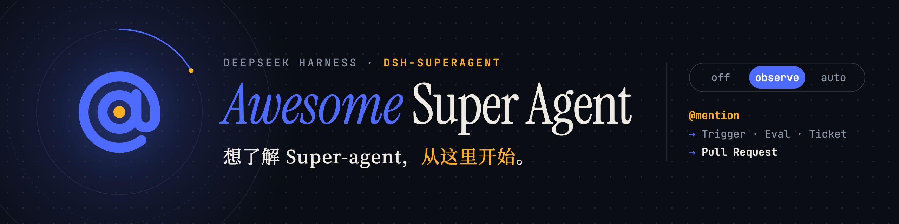

# Awesome Super Agent 

> DeepSeek Harness 上的 Super-agent 链接。这是研究原型，不是 DeepSeek 的正式产品。
>
> *English:* links for the dsh-superagent research prototype. Not a DeepSeek product. Notes are in Chinese.

它盯着一个 GitHub 仓库，也可以再接飞书。只做名单里的人交办的事，做完回到原来的讨论里，通常是开一个 Pull Request。没被点到就尽量不说话。

文章里写的，有一部分仓库里还没有。有人 @ 它，默认仍会去做；没 @ 的只记下来，不真做。改已经发出的 Issue 正文，或在正文里补一个 @，它收不到，要另发一条评论。

📘 官方 · 🟢 原型里有 · ⚪ 只在设计文章里 · 📝 社区解读 · 🛠️ 自己动手装 · 🔌 周边插件。核对日期：2026-11-05。不写星数。

## Contents

- [官方](#官方)
- [设计](#设计)
- [文档](#文档)
- [部署](#部署)
- [解读](#解读)
- [衍生](#衍生)
- [生态](#生态)
- [讨论](#讨论)

## 官方

### 原型

- [deepseek-ai/dsh-superagent-prototype](https://github.com/deepseek-ai/dsh-superagent-prototype) - 🟢 官方仓库。2026-11-03 换过一次提交，文件和旧的 `6337fc8` 相同。下面写到 `6337fc8` 的，是各分支切出去时的那一笔。MIT.
- [它是什么](https://github.com/deepseek-ai/dsh-superagent-prototype/blob/main/README.md) - 📘 官方自己的说明：这是什么，不是什么.
- [LICENSE](https://github.com/deepseek-ai/dsh-superagent-prototype/blob/main/LICENSE) - 📘 MIT，Copyright (c) 2026 DeepSeek Harness Team.

### Harness

原型跑在它上面。产品页不介绍 Super-agent。

- [DeepSeek Harness](https://www.deepseek.com/en/harness/) - 📘 产品页。全球公开预览，Cordis 上「万物皆插件」.
- [deepseek-ai/deepseek-harness](https://github.com/deepseek-ai/deepseek-harness) - 📘 Harness 本体，MIT。外部贡献走 Discussions 和带 `dsh-plugin` topic 的插件，不接受外部 PR。见 [CONTRIBUTING.md](https://github.com/deepseek-ai/deepseek-harness/blob/master/CONTRIBUTING.md) / [中文](https://github.com/deepseek-ai/deepseek-harness/blob/master/CONTRIBUTING.zh.md).
- [Harness 文档](https://deepseek-harness.github.io/deepseek-harness/) - 📘 文档站。[Quickstart](https://deepseek-harness.github.io/deepseek-harness/en/guide/quickstart)、[插件市场](https://deepseek-harness.github.io/deepseek-harness/en/guide/plugin-market).
- [`@deepseek-ai/dsh`](https://www.npmjs.com/package/@deepseek-ai/dsh) - 📘 命令行。2026-11-05 13:21 UTC 起，npm 的 `latest` 和 `next` 都指向 `0.2.2-rc.1`（这个版本 2026-11-04 09:20 UTC 就发出了，这次只是把 `latest` 从 `0.2.1-rc.5` 挪过来）。原型 `package.json` 的 `engines.dsh` 仍是 `^0.2.1-alpha.2`，它接受 `0.2.1-rc.5`，不接受 `0.2.2-rc.1`。装哪个版本，仍以安装文档和仓库 `package.json` 为准.

## 设计

文章和仓库在 2026-10-31 一起公开。deepseek.com 和 arXiv 上没有这篇正文。仓库 README 用了英文标题 *Exploring Super-agent Design: Towards a More Autonomous Agent System*，但没有英文链接。

- [Super-agent 设计探索：迈向更自主的 Agent 系统](https://mp.weixin.qq.com/s/zoS7GlReWPhfCjENGxXCdg) - ⚪ 中文原文。一个角色只负责分派，另一个角色单独改代码。文末写明原型只做了其中一条路。署名 Yujia Qiao，DeepSeek Harness team.
- [知乎转载副本](https://blog.eimoon.com/p/deepseek-super-agent-design/) - 📝 微信打不开时的全文副本，保留了「这不是现有功能说明」的声明.
- [英文机器翻译](https://threadnavigator.com/thread/2116857257245987236/) - 📝 第三方标注为 @DeepSeekHarness 帖子的机器翻译。不是官方英译。原帖 [x.com/DeepSeekHarness/status/2116857257245987236](https://x.com/DeepSeekHarness/status/2116857257245987236).

文章里有、代码里没有：巡检、云端加本机守护进程、自己带模型、做到一半能停。代码里有的是分派和改代码这两个角色，以及「接一件事、做完、交回去」。命令跑满 5 秒就转后台，不是文章里的云端守护进程。文中的耗时是用计时器代替写代码测的，不能当成真实仓库上的效率。

## 文档

从上往下读。后面的文档会用到前面的词。

- [何时行动、何时开口](https://github.com/deepseek-ai/dsh-superagent-prototype/blob/main/docs/000-philosophy.md) - 📘 什么时候做事，什么时候说话。操作的人要管好名单，并为它说出的话负责.
- [名词表](https://github.com/deepseek-ai/dsh-superagent-prototype/blob/main/docs/001-domain.md) - 📘 这些词是什么意思，中英对照.
- [谁能派活](https://github.com/deepseek-ai/dsh-superagent-prototype/blob/main/docs/002-authorization.md) - 📘 谁能让它开工，能做到哪一步。点名的请求，默认仍会做.
- [一件事怎么做完](https://github.com/deepseek-ai/dsh-superagent-prototype/blob/main/docs/003-execution.md) - 📘 一件事单独做、单独交。自动合并只写在提示词里.
- [侧栏](https://github.com/deepseek-ai/dsh-superagent-prototype/blob/main/docs/005-panel.md) - 📘 现在要不要我插手、系统是否正常、这一件事的经过.
- [代码在哪](https://github.com/deepseek-ai/dsh-superagent-prototype/blob/main/docs/007-architecture.md) - 📘 上面这些概念分别在哪些源文件里.
- [怎么加一种来源](https://github.com/deepseek-ai/dsh-superagent-prototype/blob/main/docs/008-cookbook.md) - 📘 用一个虚构例子，演示怎么再接一种消息来源.

### 提示词

提示词在 [`prompts/`](https://github.com/deepseek-ai/dsh-superagent-prototype/tree/main/prompts)。团队通常改这三份：

- [提示词怎么拼](https://github.com/deepseek-ai/dsh-superagent-prototype/blob/main/docs/004-prompts.md) - 📘 它实际读到什么。团队通常改下面三份.

- [`team/communication.md`](https://github.com/deepseek-ai/dsh-superagent-prototype/blob/main/prompts/team/communication.md) - 🟢 何时开口.
- [`team/scope.md`](https://github.com/deepseek-ai/dsh-superagent-prototype/blob/main/prompts/team/scope.md) - 🟢 何时做到可评审的 PR，何时停成草稿.
- [`team/delivery.md`](https://github.com/deepseek-ai/dsh-superagent-prototype/blob/main/prompts/team/delivery.md) - 🟢 提交署名和自动合并.

### 技能

- [`dsh-superagent-github`](https://github.com/deepseek-ai/dsh-superagent-prototype/blob/main/skills/dsh-superagent-github/SKILL.md) - 🟢 用 `gh` 读 Issue、PR、评审和 CI.
- [`dsh-superagent-feishu`](https://github.com/deepseek-ai/dsh-superagent-prototype/blob/main/skills/dsh-superagent-feishu/SKILL.md) - 🟢 用机器人身份读飞书消息和文档.

## 部署

只支持 Mac 和 Linux。Windows 看「衍生」。Node 24 上查状态、停止的问题看「讨论」。

要用一个专门的 GitHub 账号。GitHub App 不行，因为收件读的是这个人的通知。跑起来的进程权限很大。第一次启动若退出码是 3，是在等你填配置。四种退出码见安装文档。

- [怎么安装](https://github.com/deepseek-ai/dsh-superagent-prototype/blob/main/docs/006-deployment.md) - 📘 账号、安装、启动、排错。密钥不要贴进对话.
- [交给编程助手的安装步骤](https://github.com/deepseek-ai/dsh-superagent-prototype/blob/main/SETUP.md) - 🛠️ 让它先看环境、再提问、再写出计划，最后写入配置.
- [`examples/profile.cordis.patch.yml`](https://github.com/deepseek-ai/dsh-superagent-prototype/blob/main/examples/profile.cordis.patch.yml) - 🛠️ 单独的 `superagent` profile 示例，面板示例在 `127.0.0.1:3082`。不要装进日常 web profile；已有 profile 时不要重跑 `dsh superagent --from-default-profile`.
- [larksuite/cli](https://github.com/larksuite/cli) - 🛠️ 飞书可选，文档用 1.0.90 测过。[飞书 CLI 文档](https://open.feishu.cn/document/mcp_open_tools/feishu-cli-let-ai-actually-do-your-work-in-feishu).

## 解读

官方文档优先。下面这些用来对照「文章写了什么、仓库做了什么」。

### 文章和代码

- [dsh-superagent 深挖报告](https://www.bytenote.net/article/dsh-superagent-deep-dive-report) - 📝 把实验条件、默认 `observe`、以及「隔离是 Session 加目录，不是沙箱」写清楚了.
- [本机管理接口与批次授权](https://www.ctfiot.com/314686.html) - 📝 对照 `6337fc8` 的社区审计，不是上游公告。本机管理接口用部署文档里的请求头辨认面板，保存 GitHub 来源时会运行配置里的 CLI。同一次评估里，门禁没通过的触发仍写在 `triggerIds` 上，Mandate 记的是这批里最强的发送者。作者的 PoC 仓库尚未公开。这个接口只监听本机.
- [合成实验反算：云端那半还只在文章里](https://halfatoken.com/insights/deepseek-super-agent/) - 📝 对设计长文里的同一组实验做反算，并在树里没有找到 Watchdog、边缘守护进程或 BYOM。反算是作者自己的，不是 DeepSeek 的结论.
- [Ticket、Mandate、Executor](https://www.harelasaf.com/articles/deepseek-dsh-superagent-prototype-ticket-mandate-executor-design) - 📝 只读了设计理念、领域模型、权限、执行和架构这几篇。订阅线程上的跟进不授予新权力；Worker 持有那条消息时，主会话只能停止这项工作。作者没有跑代码，也没有读设计长文.
- [MarkTechPost](https://www.marktechpost.com/2026/11/01/deepseek-dsh-superagent-router-worker-coding-agent/) - 📝 英文新闻稿，正确地把 p95 标成合成工具模拟。它把异步 ReAct 和未实现的想法放在一起，读的时候用上面的 ⚪ / 🟢 对照.
- [Super-agent 设计课](https://github.com/aicoder2048/learn-super-agent) - 📝 九课的中文互动课，按官方文档从设计理念到架构的顺序拆原型。明确请求在 `off` / `observe` / `auto` 里都有效；订阅跟进不授予新权限。对照表把文章里的机制标成已实现、部分或文档未提及：没有名为 Watchdog 的 Session，部署文档里的每小时检查是运营者自己 profile 上的定时任务。SA07 写明实验把编码换成计时工具，测的是调度。SA08 的安装只指向 SETUP.md，并写明独立目录不是沙箱。模拟演示标明是作者的简化。MIT，作者写明与 DeepSeek 无关，原文和原图不进仓库。2026-11-06 05:31 UTC 仓库改名为 `learn-super-agent`，README 的标题和克隆地址跟着改，课的正文没改。2026-11-07 00:17 UTC 的 `6653f7acf6ee` 把课页接到现行互动课件模板：`SA.*` 换成 `CL.*`，配置放进 `course-config.js`，辅导引用来源放进 `tools/sources.json`。学习者多了可拖宽的辅导面板、回答里的 Mermaid、记笔记页，以及文章或原型文档偏离快照时的横幅。笔记、勘误和来源快照不进 git.
- [Way2SA](https://github.com/NavigatorXia/way2sa) - 📝 2026-11-05 00:40 UTC 创建的八课静态课，01:33 UTC 的尖端 `c11985eb5379`。从领域模型到扩展指南各一课，页内有模块图、状态机和事件日志。原型是只读 submodule，钉在 `6337fc8`；README 写明后来的 `8c32a9d` 和它是同一棵树，所以钉的不是最新提交，文件仍然对得上。L02 把「`off` 什么都不接」写成误解：explicit 请求在每种接受模式都有效，`off` 只挡 inferred。作者写明这是个人阅读课，不交付一个智能体。打开 `index.html` 不用服务器。12:21 UTC 的 `86da5fa6b878` 在 L02 补了 Policy.gate 之前的 SourceScope：飞书按聊天白名单决定收不收，不在名单里且 `otherChats` 不是 mentions 时，intake 记成 filtered，不进 gate；GitHub 对整个仓库 `listened: true`，只把 `observed` 交给配置，meta 对不上行时仍进 gate，并退回 `ADMISSION_DEFAULTS`，不是拒收。点名消息在 gate 的人那一支仍能查出 explicit，新消息的「不听」发生在 intake。`not_human` 有两处来源：不在 bot 名单，以及 scope 不听或没点名又不全收，原因码相同。撤掉飞书白名单后，老工单的回复也不再发到那个群。12:23 UTC 的 `6ccf5dddce74` 在课表外加了三篇对照（飞书一条消息的生命周期、Engine/Runtime 端口、Parts），断言写到钉住的 submodule 文件和行号，没有登记进 `assets/curriculum.js`，`tools/*` 不检查它们。12:29 UTC 的尖端 `ac072c103f06` 去掉笔记里的本机绝对路径。submodule 仍是 `6337fc8`。Apache-2.0.
- [Superagent Explained](https://github.com/Algovate/superagent-explained) - 📝 2026-11-05 03:47 UTC 公开的可运行导读，`fdb1f80023f1`（04:28 UTC）。它对照的是设计长文 §2 到 §6，不是原型仓库：11 个样例加一条 0.0 端到端 trace，Node 从 24 起，默认离线、没有运行时依赖，`--live` 才读 `DEEPSEEK_API_KEY`。快过滤用关键词决定 act 或 ignore，不是原型的 `off` / `observe` / `auto`，也没有「点名请求在 observe 里仍会做」。README 写明 Watchdog 样例是规则替身，`ask` 不是模型推理；所谓并行是同一个 Node 进程里的异步交错。自然语言决策默认是 `RulePlanner`，token 按字符数除以 4 估算。包 `superagent-explained` 0.1.0，`private`，`package.json` 没有 license 字段。2026-11-08 05:27 UTC 的 `d230e0c9b8c4` 只改文档：加上索引、实体关系 `docs/ENTITY-MODEL.md` 和结构篇 `docs/SUPERAGENT-STRUCTURE.md`。README 写明这两篇是概念文档，Ticket、统一 Runner 和只追加的 session log 仍是提案；11 个样例和 trace 没有改。06:50 UTC 的尖端 `45cf9747e3b7` 在实体关系里补上 Run 和 Turn：Ticket 是做什么，Run 是这一次做，Turn 是这一轮做，ToolCall 是这一步做，Runner 是在哪做。文中写明 Run 不是 Runner。当前没有 Run 类；`worker.turns` 在 `processInput()` 结束时加一，数的是处理了多少个 input，不是模型循环了多少轮。样例和 trace 没有改。不是 DeepSeek 的仓库.
- [Super-agent local test](https://github.com/maruthiprithivi/superagent-local-test) - 📝 2026-11-06 06:11 UTC 公开的对照起点，尖端 `11edcf1a59c6`（06:14 UTC）。同一组五个小缺陷上比两种跑法：原型按设计用 Router 盯代码托管，把每条 Issue 交给 Worker；另一边是同一套 Harness 里的一个会话，提示里要求只用一个 subagent。`tasks/` 是代理看得到的 Python 小库，可见测试在起点是通过的；`hidden-tests/` 用来给 PR 打分，说明写明跑的时候不要给代理看。`issues/` 每个任务一份缺陷说明，另有 `t1-injection.md` 这种植入指令的变体。`scripts/score.sh` 把隐藏测试拷进检出的分支再跑。仓库里还没有一次跑完的分数，配套文章也还没写。MIT，作者写明与 DeepSeek 无关.
- [Super Agent Harness 架构评审](https://github.com/ai-storage-agent/superagent/blob/main/harness-architecture-review.md) - 📝 2026-11-06 10:13 UTC 的唯一提交 `67b056170a1f` 把评审和一份原型树放进 [ai-storage-agent/superagent](https://github.com/ai-storage-agent/superagent)。评审标明 Draft，基线是原型 `8c32a9d`，PPT 不在仓库里。开头写当前是一个 DSH 宿主里的 bundle：主会话和工人会话是宿主管的会话，不是独立的工人服务；建议留下工单领域模型，把依赖本机 DSH Session 的执行抽成可以远程调度的 Worker Runtime，并写明这还没实现。嵌进去的 `dsh-superagent-prototype/` 是这份基线，不是第二份实现。评审其余各节这次没有逐段对过授权文档。不是 DeepSeek 的文档.
- [dsh-superagent 可移植机制分析](https://github.com/ArtemKoval/lab/blob/main/reports/2026-11-07-issue-103-dsh-superagent-analysis.md) - 📝 2026-11-07 19:12 UTC 的 `eb2b55e7d3bf` 只加了这一份报告，没有改 ArtemKoval/lab 的代码。对照的是原型 `8c32a9d`。文首写明这是分析：确定性门禁先于模型评估，点名是 explicit，其余人类消息至多是 inferred，机器人不会更高；`off` 不接受，`observe` 只记下会接受什么，`auto` 才接受，默认是 `observe`。后面六项移植提案是给这个 lab 自己的 harness，不是给上游的补丁，文首写明每项还要另审。这次没有重跑文里提到的测试套件。2026-11-07 20:09 UTC 的 `65322037e8e3` 给报告里的 P1 补了这个 lab 自己的 openspec `add-loop-lock-check` 和 ADR 0013：`tools/process_issues` 用 `.process_issues/lock.json` 保证一次只跑一个循环，过期条件含启动 id、进程还在不在，以及拿到锁已超过 24 小时。20:55 UTC 的 `56a6b15745fe`（#125）把锁写进这个 lab 的 `tools/process_issues`，不是写进原型。`acquire` 用一次独占创建拿走 `.process_issues/lock.json`，`release` 只在持有者标签完全一致或 `--force` 时放下；`--force` 不能跟 `acquire` 一起用，用法错误退出码是 64。扫描在第一次 `gh` 之前先看锁。记录钉的是会话锚：沿父进程走到第一个 harness 进程，同一会话认得出自己的锁，崩溃的会话马上能修好，没有锚的记录当成外来主机并按年龄过期。损坏、未知版本、外来启动、进程已死、启动对不上，或超过 24 小时，都不会把运行楔死。技能先看停机文件，再看高峰窗口，然后拿锁，并在等人审规格之前放锁。作者写下整套 1519 项通过；这次没有重跑。20:59 UTC 的 `623c5dfcb484` 把这份 openspec 归档。21:27 UTC 的 `9c6d452633e6`（#128）提案 P2 `add-loop-status-schedule`。21:51 UTC 的 `10efb0cdd267`（#129）把它写进这个 lab 的 `tools/process_issues`，不是写进原型。`status` 按固定顺序看停机文件、本机 `gh` 令牌、议题列表、被挡住的议题和锁，第一行对上的决定退出码：0 在跑，1 停了或可以再起，2 组件错误，3 等着配置。普通输出在 0 时不打印，其它情况往 stderr 写一行原因；`--json` 带 `level`、`code`、`reason`、`blocked` 和 `lock`。工作根上的停机文件优先于主检出，空文件也算停，原因回退成「the halt file stands」，而且这一行不调用 `gh`。令牌缺失或探测失败是退出码 3，不把 `gh` 的原文打出来。议题列表失败是退出码 2。带 `blocked` 的议题让退出码 2 并点名号；`handover` 压过 `blocked`。锁还新鲜或是自己持有的就是在跑；过期锁是退出码 1；没有锁是 idle、退出码 1；读不了锁是退出码 2，json 里 `lock.state` 是 `unreadable`，原因不把前缀写两遍。技能的定时段先跑 `status --json`：0 以及停机文件造成的 1 安静停下，过期锁或 idle 的 1 继续，议题列表、锁或配置失败就停下并报告，被挡住的议题继续并随结果点名。继续时先跑高峰窗口，再 `acquire`，然后处理最旧的一条可做议题。定时在技能落地后用 CronCreate 登记，新加坡时间 08:00 和 20:00（`0 8,20 * * *`，`Asia/Singapore`）；cron 没有时区字段就登记 UTC 的 `0 0,12 * * *`。作者写下整套 1542 项通过，并对照过真实仓库的 status；这次没有重跑。21:52 UTC 的 `cd641281107c`（#130）把这份 openspec 归档。21:53 UTC 的 `d2ea52e02938`（#132）忽略 harness 定时留下的状态文件。22:16 UTC 的 `69dfced0b35b`（#133）只提案 P3 `add-loop-admission-gate`：扫描在看标签之前按允许作者名单拒绝外人，状态是 `refused`、动作是 `none`，不评论、不贴标签、不关闭，扫描退出码仍是 0；登录名以 `[bot]` 结尾的一律拒绝，名单里有也拒绝；作者缺失同样拒绝。名单文件缺失或形状不对是退出码 2，读在检查锁之后、第一次 `gh` 之前。22:37 UTC 的 `9921ec4c9896`（#134）把它写进这个 lab 的 `tools/process_issues`，不是写进原型。`scan` 先 `lock.examine`，锁挡住就返回；然后读模块旁边的 `authors.json`。读不了、解析不了，或不是带 `allowed_authors` 字符串列表的对象，就在 stderr 点明路径并退出码 2，这时还没有 `gh issue list`。名单随仓库提交，值是 `["ArtemKoval"]`，比较忽略大小写；空列表拒绝所有人；多余的顶层键忽略。`admitted` 拒绝空登录、不在名单里的登录，以及小写后以 `[bot]` 结尾的登录，名单里有也拒绝。被拒绝的议题状态是 `refused`、动作是 `none`，不再看标签，json 带上 `author`。`status` 的行序是停机文件、`gh` 令牌、作者配置、议题列表、被挡住的议题、锁。作者配置错误的 `level` 是 `config`、退出码 2；被拒绝的外人议题不算 blocked。令牌缺失仍是退出码 3，而且排在作者配置之前。22:38 UTC 的 `439252366e20`（#135）把这份 openspec 归档。22:56 UTC 的 `e5b32c99c8fa`（#137）提案 P4 `add-loop-write-ledger`。23:25 UTC 的 `f2d4031ec5c9`（#138）把写前账本写进同一个工具。账本是 `.process_issues/ledger.jsonl`，只追加；半行截断时下一次追加先补一个换行。`ledger write --kind K --key N` 印出 `loop-<yyyymmddhhmm>-<4 hex>`，同一种类和键已经有一条还没确认的意图时仍写入，并在 stderr 注明。种类是 `comment`、`label`、`merge`、`close`；键是议题或 PR 号，标签用 `号:标签名`。技能要求评论把标记放在固定首行 `process-issues loop` 之后，正文末尾写 `<!--process-issues:MARKER-->`。`confirm` 对未知 id 退出码 2；这个 id 最后一条已经是确认时什么都不做并退出码 0。`pending` 按文件顺序列出未确认意图，同组里较新的那条才算数，较旧的标 `superseded`。坏行跳过并写 `skipped ledger line N`，退出码仍是 0；读不了文件才是退出码 2。没有文件时 `write` 会创建，`pending` 给出空列表，`confirm` 走未知 id。用法错误仍是 64。技能要求每次循环里的 GitHub 写入之前先 `write`、退出码 0 后再 `confirm`；`resume`、`repair`、`start` 先跑 `pending`，评论按正文里的标记确认，缺了的最新标记用同一个标记重试，不新开意图。这些命令都在运行锁里。账本退出码 2 按门禁失败处理。23:26 UTC 的 `a4e00c4f8486`（#139）把 P4 这份 openspec 归档。23:39 UTC 的 `06b2ee4ca165`（#141）只提案 P5 `add-loop-communication-rules`。23:53 UTC 的 `b184ff366193`（#142）把它写进这个 lab 的 feature-pipeline 和 process-issues 技能，不是写进原型。六条沟通规则放在 feature-pipeline 的 Step 10 和 Step 11 之间。process-issues 在阶段开头加 Pick：认领评论在固定首行后面写 On it，每个议题只发一次，阶段结果出来之前不发进度评论；纯信息那条路把确认并进回答评论。作者写下整套 1578 项通过。23:56 UTC 的 `649054928881`（#143）把认领守卫的锚改成一行里放得下的片段，作者仍写下 1578 项通过。23:56 UTC 的 `8f6d1942d431`（#144）把这份 openspec 归档。00:04 UTC 的尖端 `e547b117e0f3`（#146）把分析里的 P6 安装访谈写进 project-setup 技能：先探测，一条消息只问一个问题，并带推荐答案和一句理由，答完才执行；一条计划按顺序列出安装命令；碰到密钥的步骤放在给操作者的一条消息里，并写出原命令；对话不索取密钥；探测全绿就不提问。Examine 段包在这次访谈里。作者写下 1578 项通过。11:18 UTC 的 `76768ea5fd64`（#155）当时只提案 P 饱和度的 CI 变异门 `add-saturation-ci-bar`：变异器非零退出就让 pull request 失败，并拿掉按退出码 3 收成分数的那段，文件当时只在 `openspec/changes/add-saturation-ci-bar/` 和 `openspec/eval_manifest.json`。12:44 UTC 的 `964706a87a52`（#156）把整树饱和度棘轮写进这个 lab 的 `tools/saturation_pass`，不是写进原型。12:57 UTC 的 `ea137c324055`（#157）把它做成 `.github/workflows/saturation.yml`：每周一 04:37 UTC（`37 4 * * 1`），限时 90 分钟，仓库变量 `SATURATION_PASS_ENABLED` 正好是 `false` 才停；这一轮只跑、不写 `reports/saturation/scores.json`，分数库仍要经 pull request。ADR 0014 写明按模块分数下降会让这次定时失败。13:00 UTC 的 `8dde2dfe8b0d`（#158）归档 #156，13:01 UTC 的 `dfd419373ccb`（#159）归档 #157。13:08 UTC 的 `a007411a3151`（#160）把基线写进 `reports/saturation/scores.json`（schema 1）。13:21 UTC 的 `d0ae1aae56b5`（#161）让这个 lab 的 lint 在 `.openspec.yaml` 写了 `skip_specs: true` 时，不再因为零场景拒绝；没写这个声明的空规格仍拒绝。13:25 UTC 的 `b3f96679dc36`（#162）归档 #160。这仍不是上游补丁，也没有改原型代码。这次没有重跑. 2026-11-09 15:06 UTC 的尖端 `72a5816dbf24`（[#171](https://github.com/ArtemKoval/lab/pull/171)）只提案：可选的只读规格挖掘，扫工作树、归档漂移和 Git 历史，不改原型代码。这次没有重跑. 2026-11-09 16:19 UTC 的 `e770cad9482e`（[#172](https://github.com/ArtemKoval/lab/pull/172)）把这套只读挖掘写进这个 lab 的 `spec_mining`：按名字扫工作树、按 ADDED 和 MODIFIED 扫归档漂移、用一次有界 `git log` 给每个单元排提交。16:29 UTC 的尖端 `3047f21a5439`（[#173](https://github.com/ArtemKoval/lab/pull/173)）把这份 openspec 归档。作者写下全套 1734 通过。这仍不是上游补丁，也没有改原型代码。这次没有重跑.

- [dsh-superagent-prototype 源码实证](https://github.com/wang-junjian/wang-junjian.github.io/blob/645072a1427d754f3761768eb24bf776239d7714/posts-html/2026/2026-11-08-dsh-superagent-prototype-source-research.html) - 📝 2026-11-08 15:02 UTC 的 `645072a1427d` 放在个人站点仓库里，不是 DeepSeek 的文章。对照的是原型 `8c32a9d`。文中把不可变 Mandate、版本化 Policy、确定性 Gate 和模型 Assessment 写成仓库里有的两层，并写 Watchdog、投机执行、Inline/Spill、云端拆分、长期记忆和多 Router 在树里没有。它记下本地 `pnpm install --frozen-lockfile` 成功、`pnpm typecheck` 通过、`pnpm build` 通过，以及默认 `pnpm test` 1,082 通过 / 3 失败（共 1,085），失败形态是 Vitest worker 启动超时，不是断言；那 4 个文件用 `--maxWorkers=2` 重跑 28 项通过。作者写没有再跑一遍保守并发的全量测试。实验数字仍是文档里的合成数。这次没有重跑.

### 短文

- [Piotr Sobolewski（中文）](https://sobolewski.pro/zh/blog/deepseek-superagent) / [English](https://sobolewski.pro/en/blog/deepseek-superagent) - 📝 `off` / `observe` / `auto` 的短地图，以及 `danger-full-access` 为什么需要专用系统账号.
- [DeepSeek Super Agent: Complete Guide](https://super-agent.io/deepseek-super-agent/) - 📝 独立站点，声明与官方无关。讲清了 GitHub App 不能替代智能体账号，`observe` 不是把点名请求也暂停。图是概念示意，不是一次真实部署.
- [From a GitHub Request to a Reviewable PR](https://pragmaticai.substack.com/p/deepseek-superagent-from-a-github) - 📝 两分钟：第一单只改 README 的 Quick Start，先不要合并。文中写明视频里的 diff 不是一次真实 DSH 运行的产物。配套视频：[YouTube](https://www.youtube.com/watch?v=7vYILOY6_nE).
- [掘金：源码拆解 + 本地部署](https://juejin.cn/post/7702737817416105999) - 📝 七牛的文章，把模型指到他们自己的网关。安装顺序可以作索引；@ 的写法和星数以官方文档和仓库为准.
- [DSH Superagent 中文源码剖析](https://github.com/yang0228/dsh-superagent-analysis) - 📝 把 Engine、Intake、Policy 和 Executor 钉到 `6337fc8` 的文件和行号。截图是上游组件加演示数据，作者写明没有跑过真实工单.
- [OpenFree 条目](https://openfree.tools/zh/dsh-superagent) - 📝 一屏 README 复述，不是部署指南.
- [部署笔记（中文）](https://blog.laozhang.ai/zh/posts/deepseek-super-agent-github) / [English](https://blog.laozhang.ai/en/posts/deepseek-super-agent-github) - 📝 API 经销商的博客，作者写明没有真的派完一单。退出码以部署指南里的表为准.
- [在 GitHub 评论里派活（葡萄牙语）](https://bralvim.github.io/superagente-github/) - 📝 2026-11-03 03:27 UTC 的安装短文。版本钉的是部署指南里的 `@deepseek-ai/dsh@0.2.1-rc.3`，并写明 GitHub App 不能代替用户账号，密钥留在终端。示例都是点名评论。文中没有写默认 `observe` 仍会做点名请求，没被点名的事只记成「本来会接」.
- [一台 Windows 电脑上的长期在线笔记](https://github.com/hq000204/dsh-living-home) - 📝 2026-11-03 17:22 UTC 的个人记录，同一篇也发在 [Harness discussion #12056](https://github.com/deepseek-ai/deepseek-harness/discussions/12056)。18:14 UTC 的 [#12061](https://github.com/deepseek-ai/deepseek-harness/discussions/12061) 用英文再发了一遍，写上 24 个会话、202 条事实、约 20 MB 文本，以及工作区登记簿受惊后的归档：先登记，再停掉 DSH，挪走，再打开，并留一条命令可以回来。作者在一台 Windows 电脑上用 DSH 桌面端跑了 11 天：主屋只派活，车间另开会话干重活，QQ 桥每 4 秒轮询，记忆是普通文本文件。文中写明这是同一个人换屋，Worker 不并行，也不是原型里的工单。这里的 Watchdog 是每晚六步收尾，加上每 2 分钟和每 5 分钟把桥拉起来的脚本，不是设计长文里的独立 Session。文中的 15.7 对 29.5 分钟被标成作者复现不了的文章数字。没有对照组，样本是一台机器、一个人。仓库没有 LICENSE.
- [当 Agent 指挥 Agent](https://starrysea1412.github.io/agent-orchestrator/) - 📝 2026-11-03 23:22 UTC 的中文图解，仓库是 [StarrySea1412/agent-orchestrator](https://github.com/StarrySea1412/agent-orchestrator)。作者写明只读官方原型、没有跑代码，并转述了研究原型、不是 DeepSeek 正式产品的声明。observe 一节按权限文档写成：推断候选的正面结果记成 would-accept，不建工单；explicit 请求在 `off` / `observe` / `auto` 里都有效。页内有四份对照准入表、阶段表、效果队列和提示词层级的小样。插图是图像模型生成的。仓库没有 LICENSE.
- [dsh-superagent 源码解剖](https://github.com/HY-love-sleep/dsh-superagent-anatomy) - 📝 非官方解读，全文锁在上游 `6337fc8`。作者写明结论来自读源码和文档，不是端到端运行。文章 01 写明名单里的人 @ 或私聊是 explicit 候选，explicit 只表示授权强度；`observe` 不等于自动执行，`off` 也不能当成关掉所有 explicit 请求。2026-11-04 03:06 UTC（`163194ddea`）起分成文章、考卷、术语表和破坏实验，03:11 UTC 加上提交前的链接守卫。交互流程图在 [Pages](https://hy-love-sleep.github.io/dsh-superagent-anatomy/superagent-flow/watch.html)。文档 CC-BY-4.0，脚本 MIT.
- [拒绝采用，只作只读参考](https://github.com/jliguori1312/agent-orchestrator/blob/main/docs/adr/0006-reject-dsh-superagent-keep-read-only-reference.md) - 📝 2026-11-05 15:56 UTC 合进 [jliguori1312/agent-orchestrator](https://github.com/jliguori1312/agent-orchestrator) 的 ADR-0006（`df9ae7fe1cc4`）。作者对照自己的门禁后，决定不采用、不复刻、也不包一层；领域模型和测试留作只读参考，运行时不装到那台机器上。文中写明这是 DSH bundle，不是独立编排器，GitHub App 不能当智能体账号，自动合并只写在提示里。`off` / `observe` / `auto` 只点了名字。仓库健康数字是作者自己量的。MIT.
- [tyler-jewell/dsh-plugins](https://github.com/tyler-jewell/dsh-plugins) - 📝 2026-11-05 17:35 UTC 公开的从零到面板笔记，尖端 `a402bf53fc4b`（17:47 UTC）。钉的是部署文档里的 `@deepseek-ai/dsh@0.2.1-rc.3` 和原型 `8c32a9d`。文中把接受模式留在 Observe：允许名单上的人点名会建成工单，推断只记下来、不执行。文中写明第二次 `dsh superagent --from-default-profile` 会换掉 profile 并删掉它的 `cordis.patch.yml`。1Password 凭证插件只装在人用的那个 profile，不装进 `superagent`；`dsh-proof-stamp` 只记下 Creator 会话写过一份待审的 bundle。同一篇还写了一台已经在跑的 Mac，并说新机器的步骤不要指到那台机器的卷上。MIT.

### 目录

这些是 DSH 插件目录，不是 superagent 的安装方式。

- [dsh.plus](https://dsh.plus/en/) - 📝 策展过的 DSH 插件目录，收录了这个原型的一句话简介。站内那个「装进 DSH」的插件是目录插件本身.
- [awesome-dsh-plugin](https://github.com/awesome-dsh-plugin/awesome-dsh-plugin) - 📝 DSH 插件精选，CC0。站点 [awesome-dsh-plugin.com](https://awesome-dsh-plugin.com/)。官方在 [Harness discussion #215](https://github.com/deepseek-ai/deepseek-harness/discussions/215) 指向过它.
- [billLiao/awesome-dsh-plugin](https://github.com/billLiao/awesome-dsh-plugin) - 📝 按 GitHub topic `dsh-plugin` 收来的大清单，含弱相关。浏览站：[billliao.github.io/awesome-dsh-plugin](https://billliao.github.io/awesome-dsh-plugin/)。要找 superagent，用上面那份策展清单，而不是这份主题抓取.

## 衍生

这些不是 `deepseek-ai` 名下的代码。

- [saltapp/dsh-superagent-prototype-cn](https://github.com/saltapp/dsh-superagent-prototype-cn) - 📝 社区中文文档.
- [buyou-claw/dsh-superagent-win](https://github.com/buyou-claw/dsh-superagent-win) - 🔌 Windows 移植。上游只在 POSIX 上启动；这一份把 `PATH` 和 Git 配置收到单条命令上。prepare 要用 PowerShell（`$env:DSH_SUPERAGENT_DIR`），不能用 `sh`。测试仍按 Linux 写.
- [JHOpenDev/dsh-superagent-inbox](https://github.com/JHOpenDev/dsh-superagent-inbox) - 🔌 给原型加的文件收件箱 Source：一个目录驱动它，不需要外部账号。2026-11-06 23:57 UTC 的 `cfa6c0d5c6be` 起，按包名安装不必手改 `cordis.patch.yml`。bundle 把状态目录默认放在家目录的 `.dsh/superagent-state`（Windows 用 `USERPROFILE`），`DSH_SUPERAGENT_STATE_DIR` 可以改，profile 层的 `stateDir` 优先。插件入口在 Runtime 加锁前创建这个目录，创建失败不拦住启动。收件箱 Source 仍默认关闭。2026-11-07 04:37 UTC 的 `25e078c5e9b7` 把工具包从 peerDependencies 改成 dependencies，范围仍是 `>=0.2.1-rc.1 <0.3.0-0 || >=0.2.1-0 <0.3.0-0`，并改用 `@deepseek-ai/dsh-skill`。作者写明 0.1.1 只有 2 个 dependencies、42 个 peer，新装会 e-resolve。npm 上未加 scope 的 `dsh-superagent-inbox` 在 04:38 UTC 是 0.2.0。2026-11-07 10:48 UTC 的 `2f7ce363b6b8` 把默认 `stateDir` 的 `!!js` 改成不含 `: ` 的表达式：先 `DSH_SUPERAGENT_STATE_DIR`，否则 `HOME`，再否则 `USERPROFILE`，再接 `/.dsh/superagent-state`。上一笔按平台写三元，YAML 把 `: ` 收成一层映射，没有 profile 层覆盖时 schema 报 expected string，安装失败。`package.json` 写成 0.2.1。npm 未加 scope 的包当时是 0.2.1（10:50 UTC）。11:31 UTC 的 `88d30364db7c` 把 `package.json` 写成 0.3.0，`engines.dsh` 改成 `^0.2.1-rc.3`，`@deepseek-ai/cordis` 是 `~4.1.0`，`@deepseek-ai/schemastery` 是 `~3.19.0`，其余 `@deepseek-ai` 依赖钉成 `0.2.2-rc.1`。`src/app/resources.ts` 读工人会话不再走 `sessionController.inspect`，改成按 `beforeSeq` 向后翻 `events()`，只收 `type` 为 `event` 的记录，再用 `seq` 排成从旧到新。`src/app/role-models.ts` 不在这一笔里。测试夹具改成 `installModelSelection(ctx)`，不再传入宿主引用。提交说明写 `pnpm check` 1204 项里 1203 项通过，剩下的是原有的 `environment.spec` Git 区域设置断言。这次没有重跑。npm 未加 scope 的包是 0.3.0（11:32 UTC）。11:37 UTC 的尖端 `404f1074a40d` 把版本写成 0.3.1，只改 `engines.dsh`：`^0.2.1-rc.3` 的预发布元组对不上 `0.2.2-rc.1`，在桌面端 `0.2.2-rc.1` 上安装被拒绝，于是改成 `>=0.2.1-rc.3 || >=0.2.2-0`。`@deepseek-ai` 依赖仍钉在 `0.2.2-rc.1`。npm 未加 scope 的包是 0.3.1（11:41 UTC）。14:00 UTC 的尖端 `d3a7cc7ed577` 把版本写成 0.3.2，只放宽 peer：`@deepseek-ai/cordis` 从 `~4.1.0` 改成 `~4.0.5 || ~4.1.0`，`@deepseek-ai/schemastery` 从 `~3.19.0` 改成 `>=3.18.5-alpha.1`。0.3.1 的范围和 `dsh-approval-feishu@0.2.1`（cordis `~4.0.5`、schemastery `3.18.5-alpha.1`）不相交，npm 会 ERESOLVE；放宽后两份插件能装在一起，运行时的 cordis 仍由宿主提供。`engines.dsh` 仍是 `>=0.2.1-rc.3 || >=0.2.2-0`，其余 `@deepseek-ai` 依赖仍钉在 `0.2.2-rc.1`。npm 未加 scope 的包是 0.3.2（14:03 UTC）。这次没有重跑.
- [wiva-hq/superagent-imessage](https://github.com/wiva-hq/superagent-imessage) - 🔌 实验性的 iMessage Source。本机走 Messages，Linux 走 Photon Spectrum，私聊默认关闭。有 `tests/imessage.spec.ts`，README 没有公开的端到端运行记录.
- [MYCF711/dsh-session-superagent](https://github.com/MYCF711/dsh-session-superagent) - 🔌 会话级：有变化就唤醒会话。自述 GitHub 凭证不进模型。2026-11-04 14:04 UTC 的 0.9.177（`10107549fce8`）起，同一个插件也盯 Gitee：`owner/name` 仍是 GitHub，`gitee:owner/name` 或 `https://gitee.com/owner/name` 走 REST v5。Gitee 没有 ETag。14:49 UTC 的 0.9.179（`c0da515c40a3`）起，已经有水位时，issue 和 PR 的列表都带 `since`，取上次水位再提前 30 分钟；第一次没有水位仍全量读。作者记下 `listGiteeItems` 全量 34 条、带一天 `since` 时 5 条。评论最多取前 3 条。ack 标签必须已经存在，不会自动建。私有仓库的令牌填在凭证页。14:09 UTC 的 0.9.178（`316564fab663`）按真实 API 改了编号：Gitee issue 的 `number` 是字符串（例如 `IKSQJH`），`id` 才是数字，PR 的 `number` 仍是数字。以前 `Number()` 把 issue 编号收成 0，去重键和 ack 都打在 `#0` 上。现在编号原样拼进 URL。作者写下对 `oschina/git-osc` 的一次列表，返回 10 条。0.9.179 的 `apply()` 在宿主没有 `ctx.tools.register` 时只打一条日志就返回，不拖垮插件树。作者对 npm `next` 的 `0.2.2-rc.1` 做了静态核对：CLI、`dsh-web-app`、`dsh-goal` 的 `.d.ts` 与 `0.2.1-rc.5` 逐字相同；cordis 4.1.0 的 `ctx.effect`、`ctx.on`、`ctx.get` 不变，日志级别的数字重排了，provision 形状从 `{fiber}` 变成 `{ctx,uid}`，这篇插件不碰 reflect。Node 下界仍是 `>=22.19`，新宿主要求 `>=24.9.0`。作者写明没有在真的 `0.2.2-rc.1` 上跑过。2026-11-04 18:46 UTC 的 0.9.180（`0eb70dc01ff4`）起，添加前体检真的会跑：原来 `isNew` 写成两项互否，恒为 false。Gitee 走自己的体检，不再对 `gh api repos/` 打出假的不存在。`watch_start` 和面板共用 `parseRepoSpec`，认 `gitee:owner/name`，id 带 `gitee:` 前缀；以前工具建的 Gitee 守不写 provider，每轮按 GitHub 去 404。没有 `provider` 不是 `gitee` 的守时，`/state` 不再跑 `gh` 健康检查，跳过原因是「没有 GitHub 守」，不再报成未登录；没写 provider 的旧守仍会探测。18:54 UTC 的 0.9.181（`1d96ac3d76a5`）让 `watch_trace` 接受字符串编号，`IKSQJH` 不再被 `Number()` 收成 NaN。19:12 UTC 的 0.9.182（`04c1d7ebe619`）起，Gitee 的 HTML 404、JSON 401 和 429 按它自己的措辞分类，不放宽成裸 404，以免抢走 GitHub 的分支。Gitee 没有 `state_reason`，重新打开用上一轮 closed、这一轮 open 自己补上，只在 Gitee 上写。ack 404 直接提示先去建标签。19:16 UTC 的 `cfb1f60655c5` 只改派单表。19:40 UTC 的 0.9.183（`3b0a48e8be89`）给会改文件再还原的回归用例加了可重入目录锁。19:49 UTC 的 0.9.184（`78b501a3f224`）起，Gitee 先查再自动建 ack 标签；半角冒号不在允许集里，默认从「主理鱼:已处理」改成「主理鱼-已处理」，非法名字在发请求前拦住。19:53 UTC 的 0.9.185（`8333a953bf1f`）让面板看得到「重新打开」：`lastReopened` 改到 `markGiteeReopened` 之后再写，否则这一轮已经判完；`POLL_RESULT_FIELDS` 补上 `lastReopened` 和 `lastStates`，漏掉时 `/state` 一直是 null，⚠ 不会出现，GitHub 也一样。推断仍只写在 Gitee 上，不覆盖 GitHub 自己的 `state_reason`。19:56 UTC 的 0.9.186（`5885bf6680dd`）改了空态配色，并去掉「分钟前前」的叠字。20:15 UTC 的 0.9.187（`4884061d1232`）读取时把 0.9.184 之前存下的半角冒号标签名换成连字符，换完仍非法就用默认名；`doctor` 不再写 Gitee 不会自动建标签。20:25 UTC 的 `71cda0c38ca7` 只改派单表。20:32 UTC 的 0.9.188（`5fe140baa6b7`）起，`watch_ack` 的 JSON 也带 `labelNote`，说明标签是新建的还是本来就有的。`ensureGiteeLabel` 改成每页 100 条、最多 5 页（500 个）；以前走默认每页 20 条，标签多了会把已经存在判成不存在，再 POST 一次。作者在更新说明里写下：100 个标签的仓库在第 2 页命中，请求 2 次，结果是 `already-exists`。`lastReopened` 不再一直留着：这一页的条目里已经没有上次记下的编号就清成 null；编号还在这一页上就留着，哪怕它已经不是 reopened。0.9.183 的回归目录锁释放时比对 `owner.json` 里的 pid，只删自己的锁。21:24 UTC 的 0.9.192（`6ae5b35b2b2b`）把空态里「默认 60 秒；先设 300 秒」改成「新手先填 300 秒，默认 60 秒适合盯得紧的仓库」，并让「全部恢复」按已暂停的守计数，不再点了没反应。0.9.189 到 0.9.191 和 0.9.193 是预览 `aria-*` 的 `true`、浅色对比度门禁和豁免，不改 Gitee 守望。21:29 UTC 的代码在 `59d264939f69`。21:33 UTC 的 `dc2b61242ba4` 只改派单表。21:38 UTC 的 0.9.194（`3790b5a1cd42`）把对比度先不修的理由写进对照表。21:41 UTC 的 0.9.195（`477b99d05e3b`）给 `POLL_RESULT_FIELDS` 补上漏掉的 13 个轮询字段：`etag`、`needsReauth`、`lastErrorAt`、`deferReason`、`silentWakes`、`prevWakeAt`、`dailyWakes`、`absorbedLog`、`filterCounts`、`repoAccess`、`sessionMissingSince`、`minIntervalSec`、`lastCleanupAt`。`mergePollResult` 只许 `seen` 和 `lastPoll` 前进。写盘失败记进 `writeError`。坏的 `wakeTimes` 当空数组，不再让 `/state` 500。21:52 UTC 的 0.9.196（`2325ab387d60`）把错峰的一次性定时器登记进 `bootTimers`，暂停或拆掉时清掉。`enabled` 为 `false`、`0`、`"false"`、`"0"`、`"no"` 或 `"off"` 都算暂停，缺省仍启用。`partitionItems` 收到非数组当空。21:58 UTC 的 0.9.197（`ccec527c7bef`）把 Gitee 的 `merged` 和 `rejected` 收成 `closed`，合并掉的 PR 不再每轮当成新动态。最后一条评论按每页 100、最多 5 页取末条；Gitee 不认 `direction=desc`。`comments` 原样透传，没有该字段时不写成 0。22:03 UTC 的 0.9.198（`961e4276e58b`）先看正文：带 `rate limit` 或 `too many` 才算限流，403 不再一律当成凭证失效。`nogh` 只认 `ENOENT`、`gh: command not found` 和 Windows 的 command not recognized，普通 404 不再提示去装 gh。列表不是数组时不再抛。22:11 UTC 的 0.9.199（`d49bfb544856`）在列标签失败时回报 `list-failed`，不再盲发 POST。Gitee 仓库对象没有 `permissions` 时 `push` 记成 null，面板只在 `=== false` 时提示只读。`listGiteeItems` 满一页就回 `truncated: true`，这一轮不推进水位。22:27 UTC 的 0.9.200（`3d9ce0dff7f4`）在 `wake()` 出口调用 `redact()`：唤醒消息是必进模型上下文的那条。补上 GitLab、AWS、Slack、Stripe、Google、JWT、数据库 URL、裸 Bearer、截断 PEM、PGP、查询参数，以及前面 20 字内出现 gitee 或令牌上下文的 32 位串。讨论里的 `ghp_` 前缀、40 位 sha、md5 和 issue 链接保留。`watch_doctor` 的 `lastError` 也脱敏。issue 标题压平换行，把 `【】` 换成 `[]`，截到 200 字。22:35 UTC 的 0.9.201（`dd70e77ee818`）用 `truncateUtf8` 把 64KB 截断退回 UTF-8 起始字节，避免半个汉字让 `decodeBody` 整段按 GBK 重解。Gitee 令牌提示只认 `Access token does not exist`、`登录失效` 和 `无权限访问该资源`。没有 `HTTP` 前缀的 `429 Too Many Requests` 用中性限流提示。带 `HTTP 429` 的那条仍写 Gitee 未带令牌时额度更低。普通 `HTTP 401` 仍提示 `gh auth login`。推断仍只写在 Gitee 上。22:41 UTC 的 0.9.202（`26d02e808ecf`）给面板 `load()` 加了序号：轮询、刷新、重试和回读并发时，只有最后一次请求能改界面，更早的成功或失败都作废。暂停、恢复、删除和立刻轮询失败时显示「操作失败」，不再空 catch。22:48 UTC 的 0.9.203（`f66cbda7a3b5`）行内保存只提交改过的字段，`repo` 和 `sessionId` 仍带上；同一字段两人同时改仍是后写赢。23:11 UTC 的 0.9.204（`e0947952e3f2`）起，作者的门禁抢不到锁用退出码 3，preflight 把它记成跳过，不算通过；快照和盘上不一致时不覆盖，除非设 `SUPERAGENT_GATE_FORCE_RECOVER=1`。23:21 UTC 的 0.9.205（`fb60dd20d2cc`）让整轮 preflight 持一把锁，子进程要带上和 `owner.json` 里相同的一次性 token 才能重入；`verify-gates` 开工先把可能改写的文件落到 `.gate-recover-verify/`，内容对不上快照就不还原。23:28 UTC 的 0.9.206（`95a99e5158ec`）给写路由加了来源检查：带了 `Origin` 或 `Referer` 就必须是 `127.0.0.1`、`localhost` 或 `::1`，否则 403；两者都不带的 curl 仍放行，也不要求 `Content-Type`。请求体边读边算，超过 64KB 立刻销毁并回 413。`applyWatcherAction` 只认自有属性的字符串 id，`__proto__` 当未知守望。`parseRepoSpec` 拒绝 owner 或 name 为 `.` 或 `..`。23:31 UTC 的 `bf3014548cf4` 只改派单表。23:35 UTC 的 0.9.207（`c98778a3cc8d`）起，新建守望在 HTTP 上也守每会话 20 条和全局 200 条，超出回 429；`sessionId` 超过 200 回 400；Gitee 令牌必须是 32 位十六进制，否则 400 且不入库；强制刷新更新检查 60 秒内只打一次 npm。23:55 UTC 的 0.9.208（`1e452a0161b4`）把额度推迟的 `deferReason` 固定成 `quota`：以前拼成 `quota09:30Z`，面板按原因筛选永远是空的，时间只留在给人读的那句里。00:00 UTC 的 0.9.209（`b4b0fe93d711`）把唤醒结算抽成 `planWakeSettlement`：只有真正发出去才推进水位和 ETag；失败保留水位，下一轮重试同一批，并记进 history；会话忙不退避，其它失败才 `bumpFailure`。00:08 UTC 的 0.9.210（`a88b808df9e6`）把批量展示的缺省条数统一成创建时的 5，不再用 3；没有 ICU 的环境跳过 GBK 用例。00:21 UTC 的 `cfa3fe286678` 是 0.9.211，知识库里 8 篇「还没做」改成已落地，并禁止文档用「第 N 项」指 preflight。00:36 UTC 的 0.9.212（`43bf1c9c55c7`）起，Gitee 的 `issue_state` 和 `state` 一起看：`resolved` 收成 closed。以前只看 `state` 时，「已解决」的 issue 每轮都算新动态。面板上一件事还没跑完再点按钮，会提示稍等，不再静默丢掉。00:43 UTC 的 0.9.213（`cc2b39d91629`）在批量操作失败时也回读，已经成功的不再停在旧画面上。00:52 UTC 的 0.9.214（`e6928c06592e`）把两处写死的「每小时最多唤醒次数 / 单次最多条数」占位符改成读 `defaults`。00:57 UTC 的 0.9.215（`79db359b7a76`）只把间隔和离线判定抽成可断言的纯函数：`'0'` 和 `'false'` 不算离线。01:07 UTC 的 0.9.216（`7ef3f2ef4097`）修 0.9.203 的保存回归：控件名和字段名对不上时，改标签、只看已指派或优先级会提示已保存，实际一个字节都没发；现在有显式映射。筛选胶囊的关闭不再调用未定义的 `setDeferFilter`。只改 token 不再把已绑定的 gh 账号目录清成空串，要解绑得另按按钮。「看建议规则」按钮会渲染。01:14 UTC 的 0.9.217（`8a04a7e35e5e`）起，「全部暂停」只动这一屏筛出来的守，不再动全部；复制命令成功或失败都有提示；单条暂停和恢复也有 toast。01:27 UTC 的 `46ae16f2da67` 是 0.9.218，只修作者自己的审计脚本假阴性：空术语表能假通过、版本路径不认 `docs/`、序号扫描漏根目录、打包清单漏 CHANGELOG。01:34 UTC 的 0.9.219（`cb954daa5dbf`）再修三条：空输出当成通过、skip 换行写法、对号和版本写在同一行。01:41 UTC 的 0.9.220（`0420c50e2039`）：`gh.ok` 为 `null`（零守或纯 Gitee，这一轮不探测）时，面板不再要求去跑 `gh auth login`；`goal` 是对象时，输入框不再变成 `[object Object]`，那种保存也不再假装成功；`Section` 的 `subtitle` 会渲染；`/state` 的 `defaults` 带上 `batchLimit`。01:46 UTC 的 0.9.221（`85b97f334e4d`）：守望行在 `intervalSec` 缺失、为 0 或不是数字时用 60，不再印出「每 undefineds」。01:55 UTC 的 0.9.222（`47a1e419f2ee`）再修三条审计假阴性：README 的单测数字只看第一处、语法检查写死 6 个文件、临时目录只认一种拼法。02:08 UTC 的 0.9.223（`f26dba7f63e0`）：preflight 失败时打出用例名；没有浏览器时对比度记成 skip，不再记成 PASS；tag 推送失败就非零退出；`prepublishOnly` 跑 `preflight --fast`。02:26 UTC 的 0.9.224（`71c22a5595c0`）改掉作者照着文档会失败的五处：安装命令改成 `dsh plugin --profile desktop add`；诊断按钮改到「版本与更新」；`verify-live` 的默认端口从 64349 改成 65466；门禁写成 40 项、单测 369；README 里叠出来的 `\r\r\r\r\n` 行尾收成普通换行。02:32 UTC 的 0.9.225（`dae804d8d15a`）按代码改文档：状态文件是 `~/.dsh/state/session-superagent/watchers.json`，`lib/index.js` 用 `homedir()`，不读 `DSH_HOME`；gh 失效的原文还包括可以在面板填 token；网络抖动的原文写明这一轮没连上、已按退避重试、不需要手动处理；升级按当初安装的来源走，npm 包不是 `github:` 规格；设置左栏是来源、凭证、版本与更新、分诊信号、会话 goal，术语表是弹层；pnpm 只写在开发流程里。02:36 UTC 的 `d9a42560ab24` 只标记派单表，那一笔不改唤醒。02:51 UTC 的 0.9.226 和 02:58 UTC 的 0.9.227 只让测试写不到真实状态目录。03:06 UTC 的 0.9.228（`d0480b2cdbfa`）起，状态目录、密钥、`watchers.json` 和 `trigger.json` 改成每次现读：设了 `DSH_SUPERAGENT_STATE` 就用它，否则仍是 `homedir()` 下的 `~/.dsh/state/session-superagent`，不读 `DSH_HOME`；改这个环境变量不用重新 import，旧目录里的文件不搬走。03:12 UTC 的 0.9.229（`7d20f8759ac4`）合并多条唤醒时，先抽出第一份还在的「接下来」，再从各条正文拿掉，末尾只附一次；相同的完成标准仍只留第一份。以前相同的完成标准块一直切到文末，只剩一条还带着「接下来」时，这段指令会被丢掉。优先级开着时，批量那句写成「按优先级取前 N 条（重开的排最前）」，不再说「按最近更新」。03:18 UTC 的 0.9.230（`f4a4f4cef00b`）把一条标题行按码点限制在 120：编号和状态的前缀以及 ` — @谁` 先占位，标题至少留 20，放不下就省略号；第二行同样截到 120。03:25 UTC 的 0.9.231（`178fde4ff9d0`）把「接下来」收成一句：先读仓库 AGENTS.md 定「修 / 回 / 待定」；没有测试结果不算完成；做完一条就写回 GitHub 或 Gitee，并调用 `watch_ack` 打上已处理标签，不要扩大范围。Gitee 仍写明走网页或 API，不要跑 `gh`。03:29 UTC 的 `01f563d80029` 只标记派单表。03:32 UTC 的 0.9.232（`e9c8a1a84205`）不改唤醒正文：作者在 `formatWatchText` 的注释里写下，建议删掉每条都出现的「未认领」，试过之后决定保留，因为模型靠它区分无人认领和已经派给别人，默认不加权不等于这个字段没用。03:35 UTC 的 `cf5d7c0ed145` 只标记派单表，并加了一份工具说明书审计，不改 `formatWatchText`。03:42 UTC 起，0.9.233 到 0.9.238 改工具结果。`format: json` 的失败返回 `{schemaVersion:1, ok:false, error}`，别的格式仍是 `[error: …]`。一条会话同时在跑的守仍最多 20 条：`watch_stop` 只把 `enabled` 写成 false，计数用 `enabled !== false`，已停的不再占名额；全局上限仍是 200。`watch_stop` 先按原仓库名找，找不到再试加上或去掉 `gitee:`。`activeHours` 必须是 `HH:MM-HH:MM`，时 00–23、分 00–59；空着仍表示没设时段。`9-23` 这种写错的格式以前会静默当成全天，现在创建时拒绝。唤醒失败的 `error` 加上 `wake: ` 前缀，用来和轮询失败分开。0.9.240（`ad6def6f1f0a`，04:30 UTC）和 0.9.241（尖端 `afc7eb3e30c9`，04:36 UTC）只在代码注释里加上知识库反向引用，并改文档里的过期数字，不改唤醒正文。04:57 UTC 的 0.9.244（`4bf31120afa8`）给 `lastReported` 加了时间窗和条数上限，作者记下 30 天从 14MB 收到约 4KB，`watch_stop` 清掉 `bootTimers`。0.9.245 给 `titleCache` 和 `.corrupt-*` 加上限。0.9.247 起，一个坏状态值不再让 `/state` 和 `/diagnose` 整个失败。05:24 UTC 的 0.9.248（`8e237bb4d1fe`）修了设置页左栏点了不换内容。05:40 UTC 的 0.9.249（`29c78e140c95`）把 `props.key` 收进 `audit-react-semantics` 门禁，并加一条知识库，不改唤醒正文。版本 0.9.249。06:14 UTC 的 0.9.252 想加 `filters.allowAuthors`：空数组仍是谁都算，大小写不敏感，可以带 `@`，挡下时原因写成 `作者不在名单`。06:26 UTC 的 0.9.254（`ce44d90d0d6d`）写明 0.9.252 的 `mergeFilters` 没有这个键，工具和面板都把它丢成空数组，功能等于没有；这次才写进状态文件，并补了读状态文件的用例。同一条 20 条上限，面板把已暂停的守也算进去，工具只数在跑的，于是 20 条全停后面板回 429、工具还能建；这次 HTTP 与工具对齐，报错里说明怎么办。Gitee 的字符串编号（例如 `IKSQJH`）现在也能生成追溯。0.9.253 的 `watch_ack` 可以带 `note`，只留最近 20 条，没记过不编，下次唤醒原样带回。作者记下 `npm test` 394/394。06:41 UTC 的 0.9.255（`f56470b0e55b`）起，上一轮提过、还开着、又没有 ack 的条目可以再提：默认最多 2 次，冷却 10 分钟，关掉的不再提，这一页没有的先留着。唤醒正文写「上一轮提过，还没回执」。`POLL_RESULT_FIELDS` 补上 `acked` 和 `pending`，否则写盘会丢掉。这不是原型的 Ticket。06:52 UTC 的 0.9.256（`7f91f463a633`）加三个数：叫醒过的里面后来 ack 的比例、从条目最后更新到叫醒的中位数、连续没回音的 `silentWakes`。history 记下这一批最老的更新时间。总览多一格有动作率。`wakeQuality()` 不写每次都变的时间戳，否则 `/state` 的 ETag 不会命中。作者记下 399/399。07:15 UTC 的 0.9.257（`4b6a9359861b`）让面板的 `/watch` 也走 `validateActiveHours()`，`9-23` 回 400，不再静默当成全天。`watch_start` 恢复暂停的守时，回执必须写明这次已恢复；`resume: false` 只改配置、保持暂停。作者记下 401/401。07:44 UTC 的 0.9.258（`049c0ede161a`）让新建时就能填作者白名单（去掉 `@`）、每小时唤醒上限、隔离区保留天数和个数；保存后这些限额还在。编辑补上排除标签和指派，`filters` 整块提交，改一项不清掉另外几项。`/watch` 的间隔先取整再夹到 30–3600 秒，和工具一样。`watch_status` 回传 11 个可写字段的副本，重复调用不破坏 ETag。作者记下 408/408。08:10 UTC 的 0.9.259（`9e006c1c3aa6`）让 `watch_stop` 在 `delete: true` 时先停计时器再删状态并写墓碑，默认仍只暂停；只有显式的 `watch_start` 能按这个 id 揭掉墓碑，普通旧快照写不回去。`watch_start` 的 `priority` 只覆盖传入的布尔键。doctor 按这次挂载的成功数和失败数报比例，旧状态没有路由数就写未知，不再写死 `/6`。`/state` 回传真实 `ackLabel`，列表面板显示作者白名单和回执标签，编辑器可以改已处理标签。作者记下 420/420。版本 0.9.259. 08:43 UTC 的 0.9.260（`ecf9d5107754`，npm 08:48 UTC）起，`watch_start` 新建时和 HTTP 一样跑 `precheckRepo`：仓库不存在、只读或归档只警告，不拦住创建，并把 `repoAccess` 写进状态；编辑已有的守不再打这次网络。文本回执追加 `WARN`，JSON 只在确有警告时带 `warnings`。`isolated` 开着又没给目录时，工具和 HTTP 都写成 `process.cwd()`。追溯文本改走同一份 `formatTraceText`。作者记下 423/423。09:22 UTC 的 0.9.261（`2a25489be915`，npm 09:27 UTC）让 `watch_ack` 在 `comment: true` 时把同一条 note 评回原条目，默认仍只打标签。缺 note 会在任何外部写之前拒绝。GitHub 走 `issues/<编号>/comments`；Gitee 用 `kind`，`pull` 才评到 PR，否则评到 issue。标签先打，评论失败单独标 `phase: 'comment'`，并写明标签已经打上。同一会话忙时，合并窗口结束的那条唤醒进内存 FIFO，回调仍是 `ok: false`，不推进水位；空闲后按顺序 `followup`，成功才结算。相同 `queueKey` 不重复入队。队列跟着这次插件实例，热重载不接管旧回调，重启靠没推进的水位重建。作者记下 429/429。09:49 UTC 的 0.9.262（`d81b75e17b53`，npm 09:53 UTC）给 `watchers.json` 加上 `schemaVersion`：没有版本号的旧文件补成 1，原有字段都留着，缺的 `watchers` 补成对象；大于 1 或不是非负整数就拒绝，`readState` 改读 `.bak` 并在迁移成功后写回主文件，`writeState` 总是写成 1。唤醒正文改由 `buildWakeSections` 按固定 id 拼段，`header`、`facts`、`next` 始终在，其余段没有内容就省略；`formatWatchText` 只把这些段接起来。标题里的换行收进同一行，`【】` 换成 `[]`；goal 里的换行也收进它自己那一行，伪造的「完成标准」或「接下来」不会另起一段。作者用 wake-samples 的 SHA-256 对上重构前的正文，空列表仍留着原来的空行。根目录 `SETUP.md` 是安装剧本：收齐答案前只做只读探测，一次只问一个短问题，问完仓库、会话、过滤、隔离和 goal 后给出完整计划，明确确认才安装；密钥不进聊天，仍装进当前 profile，不另建 profile，也不用 tmux。Gitee 的默认回执标签写成「主理鱼-已处理」。`lib/` 里的 js 没进 npm `files` 时测试失败。作者记下 442/442。10:07 UTC 的 0.9.263（`99acd39b42bd`，npm 10:16 UTC）让 `/trace` 在原来的 `text` 之外带上 `traces`，没有痕迹时是空数组。判定页点「追溯」后，时间线直接出现在这一页：首次看到、上次上报、被过滤及原因、被冷却期吸收、唤醒成功或失败；没有结构化结果时仍显示原文。不新开一级页。作者记下 445/445。10:49 UTC 的 0.9.264（`d912985cb6f3`，npm 10:56 UTC）只改面板，不改唤醒正文。搜索、加号、时钟、关闭、设置和箭头改用官方 16×16 图标。追溯的每个时间戳是一条 `li.dt-event`，运行时事件改成 `ol.dt-timeline`。删除改成两段确认，不再叠浏览器自己的确认框。设置按钮直接打开凭证、诊断或更新，不再只切到设置页。检查更新失败显示「检查失败」，不再写成「已是最新」；诊断复制失败不再写成「已复制」。作者记下 448/448。11:30 UTC 的 0.9.265（`a2abf054952b`，npm 11:34 UTC）把主面板和卫星环的确认收成同一块 Modal：取消、Escape 或点背板都不发请求；成功才关上，随后刷新失败不会把已经删掉说成失败。判定日志按官方 DecisionLine 排，一天一节，状态、仓库、编号、原因和时间分开，日期标题不再和事件混成同一种 `li`；追溯和运行时事件仍是 `ol.dt-timeline`。作者记下 459/459，并写明真实浏览器里的 Tab、Escape 和焦点归还还没有肉眼走过。版本当时是 0.9.265，11:34 UTC 之后 npm 上也是 0.9.265。12:59 UTC 的 0.9.266（`567c869949bb`，npm 13:10 UTC）让新增和编辑共用 `WatcherForm`：高级限额放进默认收起的 Disclosure，保存仍走 `/watch`，只提交改过的字段，不改 API。另加 `ui-host-primitives.js`，Toast 必须用 `item.id`，缺原语就报错、不自造一套；作者写明这一层还没接到现有调用上，浏览器焦点、计时和滚动关闭仍没有肉眼走过。唤醒正文没改。作者记下 486/486。13:50 UTC 的 0.9.267（`c4be34eeb656`，尖端 `de2c64b4c4d2`，npm 13:57 UTC）修掉展开后点不进输入框：官方 `.dt-open::after` 是整行透明点击层，点 input 实际打在标题按钮上并把表单收起。表单加上相对定位和 `z-index:1`，外壳改成官方 DraftEditor 的 `form.dt-card`。作者用 Chromium 记下修复前 `elementFromPoint` 是 `button.dt-open`，修复后是数字输入框。主面板在 `client.js` 的 `factory` 里探测 `@deepseek-ai/dsh-client-ui-primitives`，`Modal`、`Toast` 和警告图标都在才改用这套；缺了就留着原来的实现，插件照常加载。卫星环的确认仍用本地 Modal。这不是把 0.9.266 的 `ui-host-primitives.js` 接到现有调用上。唤醒正文没改。作者记下 500/500。真实 WebView 里连续打字、输入法和保存后刷新还没有肉眼走过。版本当时是 0.9.267。14:39 UTC 的 0.9.268（`b150bf103577`，npm 14:43 UTC）把 InfoTip 换成宿主 Tooltip，文字、图标和警告还是原来的，位置在上面、进 portal、点击打开、间距 8。只有缺 Tooltip 时才退回 InfoTip，不把已经接上的 Modal 和 Toast 一起降级。卫星环改走 `ui-orbit-popover.js`，用宿主的锚点、点外面关闭和 MenuSurface，portal 到 body，`role=dialog`；不传 center，也不说自己会自动翻面。缺这些原语时仍用手算的位置。删除确认改成先关掉卫星环，再用单独的确认框，取消或做完把焦点送回圆环，不再让浮层压住确认框。作者记下 524/524。14:43 UTC 的 `e09c7f902549` 只补这份集成说明。15:09 UTC 的 0.9.269（`bf71cd8fa4f0`，npm 15:13 UTC）在滚动关掉 Tooltip 时，只有焦点本来就在触发器上才用 `preventScroll` 放回去，焦点在别处不抢。`ui-host-primitives.js` 和主面板里的 Tooltip 用同一套焦点规则；这仍不是把 0.9.266 那一层换成唯一实现。卫星环按钮去掉写死的颜色，改用官方 `dt-btn dt-btn-ghost`，最左位置、标记和开关不变，有原语和回退共用这颗按钮。唤醒正文没改。作者记下 535/535。16:04 UTC 的 0.9.270（`47916b0ae4ac`，16:07 UTC 的尖端 `b586a637cf59` 只改定稿报告，npm 16:13 UTC）让独立的 `ui-host-primitives.js` 在宿主没有 `React.cloneElement` 时直接抛出「Tooltip 需要宿主 React.cloneElement 以合并 trigger ref」，不再在渲染深处抛 `is not a function`。主面板自己的 forwardRef 回退不走这道检查。作者写下真实 Chromium 先碰到测试桩没盖住的三处：第一帧还是 hidden 时聚焦失败，Orbit 的 cleanup 盖掉 Modal 的 autofocus，点外面被强制送回圆环。修复后，浮层可见才聚焦，每次打开只聚焦一次；点外面和确认不抢焦点；Escape 回到圆环；确认框关掉之后才显式把焦点送回圆环。确认关闭不经过 `OrbitPopover.close`，原因记在 ref 上。作者用 Chromium 156.0.8078.74 记下 Tooltip、卫星环和 Modal 的焦点与事件 27/27，`npm test` 544/544。这仍不是 DSH 自己的 WebView：宿主 slot、读屏和守望请求还没有走过。唤醒正文没改。16:51 UTC 的 0.9.271（`9a839b3a45ae`，17:16 UTC 的尖端 `6ede3eaacb29` 只改测试，npm 17:05 UTC）让「版本与更新」在 `hasUpdate` 时多一颗「安装更新」。确认框点头之后才 `POST /session-superagent/update`，进行中再点会得到 409。请求体只许一个可选的严格 semver `version`，不接受 `latest`、范围或命令参数。`guardWrite` 通过之后，argv 固定是 `dsh plugin --profile <profile> add dsh-session-superagent@<version>`，`spawn` 不用 shell。profile 只从 `DSH_PROFILE`、`DSH_PROFILE_NAME` 或 `DSH_ACTIVE_PROFILE` 读。响应把 `installedVersion`、`runningVersion` 和 `needsReload` 分开，退出码 0 不表示正在跑的代码已经换成新版本，也不自动重启。复制命令还在。作者记下更新路由 19/19、更新 UI 5/5、窄屏回归 2/2；真实 Chromium 156.0.8078.74 上 Toast、Modal、响应式和双主题一共 39/39，`npm test` 570/570。固定 368px 在 320 和 360 宽的视口里会溢出，现在先收到视口宽度减 16 像素。真实 DSH WebView 的会话 slot、读屏、touch 和守望请求仍没有走过。17:31 UTC 的 0.9.272（`16ec0260e61e`，npm 17:37 UTC）补上本机 asar 里的官方入口 `app.asar/dsh/node_modules/@deepseek-ai/dsh/lib/bin.js`。0.9.271 的候选只有 PATH 和 `resources/runtime/cli/bin`，真实 Electron 上 `resolveDshCommand({})` 会得到 `cli_not_found`。现在也从 `resourcesPath`、可执行文件旁边的 `resources`，以及 `DSH_PROFILE_DIR` 和 `DSH_HOME` 推出的桌面安装目录里找这份 `bin.js`，来源记成 `DSH installation CLI JS`，仍用安装目录里的 Electron 执行，`spawn` 不用 shell。作者在一台 Windows 桌面安装上解析出 profile `desktop`，并对这份 `bin.js --help` 跑通；没有执行 `plugin add`，没有安装，也没有重启。更新路由 20/20，`npm test` 571/571。版本 0.9.272.2026-11-07 12:30 UTC 的 0.10.5 把门禁抽成 `@mycf711/dsh-gate@0.1.0`：四层配置、确定性规则、命令行，以及默认关闭的语义复审。12:52 UTC 合进 main 的 `ff6b43b013b5`（代码在 `d578d8636c1f`，npm 12:55 UTC 的 0.10.6）在设置页加上「门禁」：默认层只读，另有「我的」和「项目」。规则卡用中文，正则收在「高级」里，可以启用或覆盖、保存、预览、优化提示词，并列出模型。`POST /gates` 仍不能停用默认层规则，只能在当前层覆盖。作者记下 824/824、preflight 41/41、ui-audit 100。09:04 UTC 合进 main 的 `e68da40322cf` 是 0.10.7（npm 09:10 UTC）。`addGiteeLabel` 的请求体从 `{ labels: [...] }` 改成裸字符串数组。作者写下，Gitee 项目看板式仓库上对象体回 `400`，正文是 `Problems parsing JSON`，`watch_ack` 停在打标签，水位不往前；同一令牌改完是 201。维护者记下 `npm test` 827/827。10:50 UTC 合进 main 的 `a78c5014b461` 是 0.10.8（发布提交 `a71bec677bd7`，npm 10:46 UTC）。门禁子包 `@mycf711/dsh-gate` 写成 0.1.1：缺省 `enabled` 为 true，写成 false 会真停，更后一层的完整规则可以再打开。发送前 CLI 硬门禁失败就不请求模型。设置页开关显示四层合并后的结果；没改过的 semantic 原样写回；这一层有 `extends` 就拒绝保存并给出配置路径；更后一层停用时开关不可用，并标出来源层。`sync-profile` 对门禁子包按文件算指纹，`--check` 漂移就退出 1，`--repair` 整目录覆盖。以前只改 `lib/` 或 `gates/default.json`、版本没升时，profile 会假绿。Gitee ack 仍是 0.10.7 的裸数组。作者记下根 `npm test` 873/873、gate 133/133、UI 11/11、真实 Chromium 47/47，preflight 40 通过、2 跳过（要真机宿主的 smoke，以及打 tag 后的维护一致性）。`--repair` 只对齐 profile 磁盘副本，已经加载的模块要重载。12:22 UTC 合进 main 的 `2cad1a60f1c9` 是 0.10.9（发布提交 `04d8a1ef7046`，npm 12:26 UTC）。门禁子包 `@mycf711/dsh-gate` 写成 0.1.2（npm 12:25 UTC）。`writeGateConfig` 整层重写时不再悄悄丢掉 `extends`：入参是 true、`default`、路径、内联对象或非法形状就抛 `extends_not_preservable`，点名配置绝对路径；盘上已经有共享 `extends` 时，哪怕入参写 false 也拒绝，文件字节不变，不产生 `.bak` 或 `.tmp`。`false` 和 `'none'` 原样写回，入参没写就留盘上的值。写盘顺序是 version、name、extends、rules、semantic。用户层 `semantic: false` 时，开关、底部「当前关闭」和预览三处都是关；打开开关会清掉这个字面量 false，保存才能真的写掉它，以前能点但保存无效。字符串、对象、true 或非法的 `extends` 拒绝保存，并点名形态和配置路径；`false` 和 `'none'` 放行，而且只在本层原本写了它们时原样带回。有草稿时切作用域会先确认，取消留着草稿；有草稿时切仓库不重读，页面写明仓库已换、面板还是原来的。preflight 只在门禁子包漂移时多显示这一段；陈旧不再把这份漂移计成「陈旧 1」。`TARGETS` 补上 `bin/check.mjs`、`assets/icon-180.png` 和 `assets/icon-app.png`，以前 `--check` 会把这三处漏同步报成全零。作者记下根 `npm test` 890/890、gate 143/143、preflight 42 项里 41 通过、1 跳过，UI 11/11，真实 Chromium 47/47。验收报告写明源码只读，没有重启 DSH。2026-11-08 14:49 UTC 的 npm `dsh-session-superagent@0.10.10` 和 14:46 UTC 的 `@mycf711/dsh-gate@0.1.3` 一起发出。Git 尖端 `54f9052c3153`（14:53 UTC）是门禁 v4 的文档回填，发布提交是 `f293eb9c299e`。写锁、守护锁和释放不能拿走别人的新锁，Windows 上 rename 会重试；`writeGateConfig` 多了 `gate_lock_timeout` 和 `gate_lock_lost`。面板补了 load 竞态和跨仓库草稿污染。作者记下根 `npm test` 934/934、gate 166/166、真实 Chromium 47/47，另有门禁专项 Chromium 54/54。2026-11-08 16:20 UTC 的 npm `dsh-session-superagent@0.10.11` 和 16:19 UTC 的 `@mycf711/dsh-gate@0.1.4` 一起发出。发布提交是 `b607149f471e`（16:14 UTC），文档回填的尖端是 `7846678683df`（16:24 UTC）。门禁子包清掉接管和释放留下的锁残余；旧版没有 token 的锁按原文逐字节比对，内容读不出来就 fail closed，不搬走也不删除。`pruneLockArtifacts` 留下最新 3 份，mtime 不满 60 秒的也不回收。设置页的模型列表跟着面板仓库走，迟到的跨仓库响应丢掉，不把选中的模型写到另一个仓库。`sync-profile` 在 TARGETS 缺源时，任何写盘之前就退出 2 并点名；`lib/` 里相对 import 解析失败仍是写盘之后才发现。作者记下根 `npm test` 952/952、gate 172/172、真实 Chromium 47/47、门禁专项 Chromium 54/54。这次没有重跑. 2026-11-09 02:28 UTC 的尖端 `ec36ddec9259` 合进 [#31](https://github.com/MYCF711/dsh-session-superagent/pull/31)。`v0.10.12` 和 `gate-v0.1.5` 都指向这一笔。npm 上 `dsh-session-superagent@0.10.12` 在 02:33 UTC，`@mycf711/dsh-gate@0.1.5` 在 02:35 UTC。v6 起 `pruneLockArtifacts` 的 60 秒改看文件名里的搬走时间：`takeOverStale` 用同一个 `movedAt` 命名 `.stale-<ts>-*` 和 `.release-<ts>-*`，并 `utimes` 刷 mtime；名字里的时间戳优先，取不到才退回 mtime，没有时间戳的旧格式仍和 v5 一样。大小写跟着文件系统，Windows 默认不区分；`.bak`、前缀相似的名字和守护锁残留不回收。仍留下最新 3 份。`sync-profile` 在任何写盘之前同时判定 TARGETS 缺源、整个 `lib/` 缺失、门禁子包目录缺失和相对 import 缺失：`--check` 和 `--repair` 都退出 2，一份都不写。整个 `lib/` 缺失不再抛 `ENOENT`。退出码是 0 干净、1 profile 漂移、2 仓库侧问题；仓库侧问题不再建议跑 `--repair`。`client.js` 这一版没有改。正式 Chromium 从 47 条收到 64 条。CHANGELOG 写下根 `npm test` 968/968、gate 180/180、Chromium 64/64，并写明没有重载真实 DSH。这次没有重跑. 2026-11-09 03:13 UTC 的尖端 `9df0fe23fb5f` 只改交接文档：preflight 42 项改写成 41 PASS / 1 SKIP（`smoke:observe` 要真机宿主），不再把缺 tag 和 profile `--repair` 记成发布前的 2 条 FAIL。`client.js` 没改。这次没有重跑.
- [vicfei/dsh-super-agent](https://github.com/vicfei/dsh-super-agent) - 🔌 独立重实现，给 Claude Code、Codex、opencode 用，不跑在 DSH 上。默认 `observe` 只打印 WOULD-ACCEPT。0.5.0 起，工人干净退出且有新提交时会推 `dsh/ticket-` 加编号的分支并开 PR，链接写进报告；推送或开 PR 失败只记在报告里，不把工单改回未完成。0.6.0（2026-11-03 02:30 UTC）起可以自动合并，默认关。打开后只合并自己的 `dsh/ticket-` 加编号的 PR：名单里要有一次批准落在当前 head 上，改动行数默认不超过 200，名单里的 `CHANGES_REQUESTED` 会否决；名单外的评审和机器人不算，草稿、冲突或合并状态还没算出来也不会并，条件不够就只记下原因。0.6.1（2026-11-03 09:46 UTC，npm 09:47 UTC）起，恢复工单时如果目录里的 HEAD 已经是这张工单的分支，就继续用这份 worktree，不再跑 prepare；`git worktree add` 会拒绝分支已经在这个路径检出，0.6 的实际使用里因此续跑失败。README 写明单人打开自动合并时要用 GitHub App：个人令牌开出的 PR 作者是操作者本人，GitHub 不允许批准自己的 PR，名单上的批准就凑不齐；团队成员仍可以互相批准。合并条件仍是名单里的批准落在当前 head 上。0.7.0（2026-11-03 13:07 UTC，npm 13:10 UTC）起，同一条线程上，开启者自己后来被接受的消息，如果这张工单还开着，就记成后续上下文，不再另开一张；别人的消息不会并进来。工人要等这张工单还没派过，或上一轮干净退出，下一轮领取时才看得到：原请求后面按顺序接上后续，每条正文截到 2000 字，合起来截到 12000 字；0.9.1 起不再做这个硬裁剪。已经结束、授权还在的工单被同一个人恢复时，恢复那条消息也写进上下文。自动合并另有 `policy.merge.requireCi`，默认关；打开后 head 上必须有 CI 且全部成功，查不到、没有检查、有失败或还在跑，都先不合并。0.8.0（2026-11-03 16:07 UTC）起，`watch` 增加飞书、Slack 和个人微信；0.8.1（2026-11-03 16:22 UTC，npm 16:23 UTC）再加 Telegram。四条都进同一张准入表的 `im_dm` / `im_group`：名单里没被点名的记成 inferred，名单外 ignore；默认 `observe` 仍只把 inferred 印成 WOULD-ACCEPT，点名请求会做。私聊算点名。飞书要 `FEISHU_APP_ID` 和 `FEISHU_APP_SECRET`，长连接订阅 `im.message.receive_v1`，不设公网回调；不填 `FEISHU_BOT_OPEN_ID` 时群消息不算点名。Slack 要 `SLACK_BOT_TOKEN` 和 `SLACK_APP_TOKEN`，走 Socket Mode，不用公网地址，自己的用户 id 用 `auth.test` 查，频道里的 @ 能认。微信走 iLink Bot Protocol（`ilinkai.weixin.qq.com`），`wechat-login` 给出二维码，凭证、游标和回复路由写进同一份引擎库；群正文不能稳定认出 @，所以群消息不算点名；回复原样带回 `context_token`；媒体先写成 `[type]`；会话码 -14 会清状态并提示重新登录。2026-11-03 16:58 到 17:33 UTC 的四次微信修正已经收进 0.9.0。0.9.0（2026-11-03 18:01 UTC，npm 18:05 UTC）默认仍不打开沙箱，也不打开 Watchdog。沙箱打开后，Linux 用 bwrap、macOS 用 sandbox-exec：根只读，可写只有这张工单的 worktree，网络默认关掉，`allowNetwork` 才开；子进程环境只留 `PATH`、`HOME`、`LANG`、`LC_ALL`、`TZ`、`TERM`、`TMPDIR`、`SHELL` 和 `DSH_` 前缀，再加上 `passEnv`。不在这份名单里的变量进不去，所以 `GITHUB_TOKEN` 不会进工人；`DSH_` 开头的仍会原样传进去。`passEnv` 里名字带 token、secret、key、password 或 credential 的会被拒绝。缺 bwrap 或 sandbox-exec 就拒绝启动，不会退回没有沙箱的跑法；Windows 没有这道存在性检查，执行器仍去找 bwrap。Watchdog 打开后，跑过 30 分钟的 Assignment 只发一条签到，等人超过 24 小时只发一条提醒，同一条 effect key 不重复，也不自动关闭工单，也不杀进程；超时仍由执行器的进程组杀掉。策略里的 `consultLlm` 要调用方传入 progress 才会在看到进展时跳过签到，`watch` 这一轮没有传。一轮收集里，同一条线程的推断只问一次 Slow Path，后面的推断复用这次结论；点名请求不调用评估模型。0.9.1（2026-11-03 18:36 UTC，npm 18:41 UTC）起不再把后续硬裁到每条 2000 字、合计 12000 字：原请求始终留在正文里；后续还能放进正文的额度是 8000 字减去原请求的长度，放不下的整段原文进 spill 表，正文只留 300 字预览和 `.dsh/spill/<id>.md`，Worker 开工前先把这些文件写进 worktree。1.0.0（2026-11-03 18:43 UTC，npm 18:49 UTC）起，`policy.speculation` 默认关。打开后，observe 里本来只记成 WOULD-ACCEPT 的推断候选可以开一张投机工单，在 worktree 里做，不推送、不开 PR、不发回复；同时最多 1 张，多出来的仍只留影子记录。要人执行 `tickets promote` 或按面板上的 promote 之后，watch 的 promote 扫描才去取基线、推 `dsh/ticket-` 加编号、开 PR 并贴报告；同一条交付记录不重复做，没有这次 promote 不会送出去。`get_bot_qrcode` 的 `qrcode_img_content` 是 `https://liteapp.weixin.qq.com/q/…` 这种网址，不是图片；`wechat-login` 在终端印出可扫的二维码，并另存一张 PNG，登录等待最多 3 分钟。`getupdates` 成功时没有 `ret` 或 `errcode`，这两项只在失败时出现；以前要求 `ret===0`，会丢掉已经送到的消息，也不保存游标。现在没有状态就算成功，明确的非 0 `ret` 或任何 `errcode` 仍是失败。`sendmessage` 也一样：回复已经进了微信，出站箱却因为 `ret` 不是 0 记成失败并重试。一对一消息的 `group_id` 是空字符串，以前被收成 `im_group`；现在按这个字段是否非空来分，空字符串仍是私聊，仍算点名。群消息仍不算点名。Telegram 用 `TELEGRAM_BOT_TOKEN`，`getMe` 认出用户名，群里的 @ 可以辨认，`getUpdates` 的 offset 记在引擎库，长轮询每轮自己中断，避免挡住这一轮 watch。回复回到原来的聊天，工单仍走原来的执行循环。1.0.1（2026-11-03 18:56 UTC，npm 18:59 UTC）起，微信回复按大约 1800 字分段，优先在空段、换行和空格处切开，切点早于一半就整段硬切，按顺序用同一个 `context_token` 发出。登录轮询记下 `ilink_user_id`，没有就用 `user_id`，放进 `wechat_binder`，并在终端提示可以把这个身份加进允许名单；它不自己改名单。正在输入这次没有做。1.1.0（2026-11-04 00:54 UTC，发布提交 `446c697d0a` 在 00:56 UTC，npm 00:57 UTC）起，`policy.approval` 默认关。打开之后，允许名单里、不是机器人的 `im_dm` 每来一条新消息，就把这个登录名的运维线程改成这条私聊，后一次覆盖前一次；登记发生在决定之前，跟这条消息接不接无关。等人的工单和已经做完、还没交付的投机工单，优先发到开启者自己的运维线程，没有就发到第一份登记过的运维线程。同一条线程只留最新一笔未完成的请求，旧的标成被取代；60 分钟没答就过期，什么都不做。整段正文去掉空白后必须正好是 `1`、`2` 或 `3`：`1` 对等人的工单重新排队，对投机工单走原来的 promote；`2` 先要在 5 分钟内再回一次 `2` 才停掉工单；`3` 只回详情。群消息、名单外的人、夹着别的字，都仍是普通消息。数字在准入之后、建工单之前拦下；审批关着时这些数字照旧进门。每次做成或没做成都回一条收据。GitHub 上的合并批准仍留在 GitHub，这层不能改 Policy，也不能凭空开工单。面板多了一段待审批。提交说明里测试从 196 增到 204，这次没有重跑。2026-11-05 05:49 UTC 的 `fd6578b8aab3` 加上计时来源，`package.json` 仍是 1.1.0，npm 仍是 1.1.0。例程是操作者写的五段 cron，非法定义让整份配置拒绝载入。时区按条设置：夏令时缺口当天不触发，时钟回拨取较早的一次。重启后每个例程在一轮里补一次，最多回看 7 天，一轮最多 32 次，一条抛错不挡住这一轮。计时触发是未列入名单的发送者在点名，例程必须在已载入的策略里，范围的未列入点名格必须是 inferred，强度封顶也是 inferred，所以 off、observe、auto 和慢路径仍按原规则；时钟不新建范围，也不提高信任。所在线程还有未结束工单就并进上下文，不恢复已结束的工单。CLI 是 `dsh routines list`、`validate` 和 `fire`。06:07 UTC 的 `22ae3de3866f` 加 `dsh init` 和 `dsh doctor`。向导找到 `bwrap` 时沙箱默认打开，回答 `n` 才关，找不到就关；模板在包装器存在时改成打开，macOS 这条探测用 `sandbox-exec`，向导那段仍只查 `bwrap`。doctor 默认离线，打开了沙箱却没有包装器算失败。06:16 UTC 的 `01c953250b03` 把 `examples/executor.json` 的 `sandbox.enabled` 写成 true，网络仍关；已经写在磁盘上的配置不会因此改掉。工人可以写工单目录里的 `.dsh/approval-request.md`。文件在，这一轮就不算完成，不管退出码。批准数字 `1` 只把请求正文注进下一次领取的上下文，不是能力令牌。npm 包是 `@vicfei/dsh-super-agent`。2026-11-05 13:30 UTC 的 `9a61446da5db` 给每条微信 `sendmessage` 带上新的 `client_id`（`randomUUID()`）和 `message_state: 2`。作者写下同一轮里第一条回复能进微信，后面的仍被接口收下并返回不同的 `message_id`，出站箱却当成已经发出，因为没有新的 `client_id` 时服务端把它们当成重复并丢掉。长回复的每一段也各用一个 `client_id`。`package.json` 仍是 1.1.0，npm 仍是 1.1.0。2026-11-05 13:54 UTC 的 `101ab846c89a` 起，promote 扫到已经晋升、工人干净退出、但 worktree 相对基线没有新提交时，用 `promote-empty:` 加工单号记一次，之后不再每轮重复写「没有可交付」。14:20 UTC 的 `7f61fd996041` 只在首页加了一张已经写过的微信审批对话图。`package.json` 当时仍是 1.1.0，npm 当时仍是 1.1.0。14:33 UTC 的 `d17e51365de1` 把 `package.json` 写成 1.2.0，npm 在 14:37 UTC 也是 1.2.0。这一笔只改版本号和路线图，计时来源、`dsh init`、`dsh doctor` 和向导里沙箱默认打开仍是上面已经写下的行为。15:29 UTC 的 `6456f7ccf088` 在本机面板加了只读的例程区和 Watchdog 健康行。例程写出排期、下次触发、是否逾期和 `reportTo`，下次触发用引擎计时器的位置，和 `dsh routines list` 同一份；例程没开或关掉就写明时钟是关的。健康行是阶段计数、最久卡住的时长和效果积压；没有异常就不占地方。动手仍是私聊里的数字、GitHub，以及面板上原来的三个按钮。只听本机，没有新的运行时依赖。17:46 UTC 的 `8a2ffbc0429e` 把 doctor 嵌进本机面板：守护进程把执行器配置、仓库和数据库路径交给面板，`/api/state` 带上完整的 doctor 报告（检查项、警告或失败、退出码），页面按绿、黄、红显示。面板不探测网络（`probeNetwork` 仍是 false），探测结果在服务端缓存 60 秒，避免 3 秒轮询反复拉起子进程。没有宿主上下文时，这一节写明还没接上。18:04 UTC 的尖端 `c483488a4f53` 把评估的 `max_tokens` 从 8 提到 512：作者写下 deepseek-v4-flash 在 8 的预算里把推理链用完，`finish_reason` 是 length、正文是空的，于是每次评估都按失败收成负面，接口却返回 200。判定仍只看正文。2026-11-06 00:51 UTC 的 `0936fd63dd43` 起，审批扫视用效果表里 `kind` 为 `reply`、键为 `approval-req:` 加工单号的一行判断已经问过：每张工单只入队一次，重试仍归出站箱。同时有多张待问工单时，后一次 `openApprovalRequest` 仍会按线程盖掉前一条请求行，但下一轮不再把被盖掉的工单当成从未渲染。作者写下当天有 4 张工单每 15 秒重入队。终态失败的询问也不再渲染。数字回复仍是最新一条胜出。测试覆盖两张工单和一次终态失败。这次没有重跑。2026-11-06 13:13 UTC 的 `2264b4887840` 把 `package.json` 写成 1.2.1，npm 在 13:15 UTC 也是 1.2.1。这一笔只改版本号，评估预算和每张工单只问一次仍是上面已经写下的行为。13:30 UTC 的尖端 `f35193be6d75` 在微信来源的轮询里加静默打字心跳：默认每 45 分钟（`typingEveryMs`，设成 0 就关）。到点先把 `positions.typingAt` 写成现在，成功、失败或没有 `wechat_binder` 都推进这个节流。有 binder 时走 `ilink/bot/getconfig`，`ret` 为 0 且带回 `typing_ticket` 才 `sendtyping` 先 status 1、等 300 毫秒、再 status 2。异常吞掉，不打断轮询。作者写下当天 08:00 的摘要因发送侧会话过期返回 `ret=-2`，这次心跳在真机上 `ret` 为 0。这次没有再发 npm。这次没有重跑. 13:35 UTC 的 `6f9b176b24c3`（13:37 那次记下的尖端还是 `f35193be6d75`）把静默打字心跳挪到长轮询之前。作者在提交说明里写，空闲时长轮询被握住大约 35 秒，这里 8 秒就中止，冷会话到不了原先放心跳的成功分支。中止时返回已经写上 `typingAt` 的 next，节流留得住。测试把轮询挂住，仍断言打出两次 `sendtyping`，并且没有 Trigger。18:04 UTC 的 `312cdbcb5cbf` 给 `wechat-login` 加了 `--web`。用法文案写的是 v1.3，`package.json` 仍是 1.2.1，npm 仍是 13:15 UTC 的 1.2.1，这次没有再发。端口读 `WECHAT_LOGIN_PORT`，默认 8899，只听 `127.0.0.1`。页面先给按钮，点了才取二维码；大约 110 秒没确认就自己再取。手机确认后，凭证和 binder 写进引擎库，和终端登录同一条存储，然后关掉这个本机服务。没有新增运行时依赖。19:55 UTC 的尖端 `5b33a716fe13` 不再把 loopback 当成 CSRF 豁免：面板 POST `/api/mode`、`/api/stop` 和 `/api/promote` 在 Origin 不是本机这个端口时返回 403，Content-Type 不是 `application/json` 时返回 415。同一笔把 `/api/promote` 补进外层 POST 路由；作者写这个按钮从 v1.0 起一直 404。`package.json` 仍是 1.2.1，npm 仍是 13:15 UTC 的 1.2.1，这次没有再发。这次没有重跑。2026-11-07 04:28 UTC 的尖端 `68b0d11348ab`（#98）：同一条线程上已经结束、而且 `revoked_reason` 为空的工单，还要 `stopped_by` 也是空，才走进原来的恢复。`stopped_by` 有值就跳过这段。提交说明写，人停过的工单不再被后来的弱意图消息恢复，那些消息另开一张。`package.json` 仍是 1.2.1，npm 仍是 2026-11-06 13:15 UTC 的 1.2.1，这次没有再发。2026-11-07 05:43 UTC 的尖端 `035b2104eecf`（#99）：例行任务补跑改成这条任务自己的节拍，最多 24 个错过的槽。cron 用小时和分钟的格子估算节拍。每天一次仍大约盖住 7 天，第一个错过的槽照旧重放；每小时最多补一天；每分钟最多补 24 分钟。`package.json` 仍是 1.2.1，npm 仍是 2026-11-06 13:15 UTC 的 1.2.1，这次没有再发。这次没有重跑.2026-11-07 06:52 UTC 的 `d4170c4a5ad8`（#100）：运维线程里正文只有一个 `?` 或全角 `？` 时回一张状态卡，写出接受模式、待人决定还是排练、工单阶段、outbox 和下一次例行触发；夹在句子里的问号和别人的问号仍当聊天，不进命令层。07:00 UTC 的 `ae391215dd2a`（#101）加 `dsh stats`，只读闸门决定、工单计数、工单到完成的中位时间、批准周转和每条例行任务实际触发的次数，`--since` 收窗口。07:02 UTC 的尖端 `17fd38b9bf82`（#102）把这些时长写成秒、分或小时。当时 `package.json` 仍是 1.2.1，npm 仍是 2026-11-06 13:15 UTC 的 1.2.1，那次没有再发。2026-11-07 08:47 UTC 的 `39e5bfc042bc`（#103）给本机面板加了只读审计：`GET /api/audit/trigger` 按 id 交回整段 Trigger 正文和最近一条决定，不截到 160 字；`GET /api/audit/ticket` 交回每次 Assignment 的退出码、输出最后 400 字、并进来的跟进，以及批准请求的创建、确认、解决和被取代；`GET /api/audit/approvals` 最多列 100 条批准历史。决策行、待人决定和排练卡片可以点开；按钮停掉冒泡，查看不会顺手 promote。08:51 UTC 的尖端 `fbcd4296fd32`（#104）把 `package.json` 写成 1.3.0，npm 在 08:53 UTC 发出 1.3.0。这次没有重跑. 2026-11-09 10:09 UTC 的 `32eb44dc6fca`（[#111](https://github.com/vicfei/dsh-super-agent/pull/111)）在 Git 上加上两层记忆的持久层。`package.json` 仍是 1.3.0，npm 仍是 2026-11-07 08:53 UTC 的 1.3.0，这次没有再发。`policy.memory` 默认关。打开、而且评估走 llm 时，工单完成后从报告抽出最多 3 条、每条最多 160 字的事实，记在引擎库，不写进目标仓库。只有 `auto` 在抽出时接受；其他接受模式只记成候选，不注入。接受的按仓库保留最近 32 条，每次派工带上最近 8 条，写进 `DSH_PROMPT.md` 的 Project memory，并写明这是以前工单的工作笔记，不是人的指示，和仓库矛盾时以仓库为准。抽出失败只记日志，不把已经完成的工单改成失败。没接评估模型时这一层不起作用。`memoryView` 给出候选、已接受和已拒绝的计数，以及最近的行。这次没有重跑 2026-11-09 19:12 UTC 的 `83fb14b72fa3`（[#115](https://github.com/vicfei/dsh-super-agent/pull/115)）：PR 标题优先用工人报告里自己的一行摘要（`done — …`），否则用正文里第一条不是 Markdown 标题的行，并去掉强调符号。不再把 issue 正文开头的 `##` 截进标题。19:23 UTC 的 `a1bdea7a012f`（[#116](https://github.com/vicfei/dsh-super-agent/pull/116)）：只画一次的批准请求，键从整张工单改成 `approval-req:` 加上工单和 Assignment。同一次失败仍只画一张；重新排队后再失败会再问一次；同一张工单上更早的 needs-person 不再挡住后来的推测性 promote。19:26 UTC 的 `b8e8f758445f`（[#117](https://github.com/vicfei/dsh-super-agent/pull/117)）只加 COOKBOOK，不改引擎。当时 `package.json` 仍是 1.3.0。19:30 UTC 的尖端 `416702ead4ae`（[#118](https://github.com/vicfei/dsh-super-agent/pull/118)）只把 `package.json` 写成 1.4.0，npm 在 19:33 UTC 发出 1.4.0。上一轮句子停在 `b8e8f758445f`，还写成 npm 是 1.3.0。记忆层、PR 标题和按 Assignment 重画批准都在这一版之前的提交里。这次没有重跑. 2026-11-10 03:24 UTC 的尖端 `c1839614b0c7`（[#125](https://github.com/vicfei/dsh-super-agent/pull/125)）把 `package.json` 写成 1.5.0，npm 在 03:27 UTC 发出 1.5.0，gitHead 是这一笔。同一版里：每次引擎状态迁移写进哈希链账本，用法加上 `events tail` 和 `verify`；`/api/events` 提供这条流，截断的尾部靠 head anchor 接上。面板用没有依赖的 SVG 画拓扑：已武装的来源、准入门（带 would-accept 计数）、按阶段的工单、工人、发件箱。工人提示改成按影响面停下，不按花了多少力气。人读的回复可以用 `DSH_LOCALE=zh`。这次没有重跑.
- [LofiSu/deepseek-super-agent](https://github.com/LofiSu/deepseek-super-agent) - 🔌 独立重实现，自带薄 Harness 和 `ds-agent`。Router / Worker、Trigger 和 Watchdog 不跑在 DSH 上，作者写明不是 DeepSeek 产品.
- [cjy851096/nano-dsh-superagent](https://github.com/cjy851096/nano-dsh-superagent) - 🔌 约 3400 行的独立骨架，用来对照设计长文里原型没有的 Watchdog、异步 `start()` / `stop()` 和 Inline & Spill。不跑在 DSH 上；文中的批处理压测是作者自己的.
- [HulnotHutu/dsh-superagent-qq](https://github.com/HulnotHutu/dsh-superagent-qq) - 🔌 上游树上的 QQ 群来源。配置过的群里，经 OneBot v11 进来的消息变成 Trigger，回复回到群里。代码在 `src/sources/qq.ts`，说明在 `docs/009-qq-source.md`，本地小工具是 `napq`。作者写明与腾讯无关，用第三方客户端连接 QQ 可能违反用户协议.
- [Check-mj/dsh-superagent-windows](https://github.com/Check-mj/dsh-superagent-windows) - 🔌 Windows 适配，基线 `6337fc8`，差量在 `WINDOWS-DELTA.md`。另有设计长文里的 Watchdog：独立 Session，默认定时 30 分钟看工单是否停滞，设为 0 则关闭（`src/app/watchdog.ts`）。Router 分片默认关；打开后同一条 Thread 固定进同一个 Router，空分片到第一次投递才创建（`src/app/shards.ts`）。桌面壳不引用上游源码。2026-11-06 07:50 UTC 的 `eec088cba85f` 在 08:02 UTC 合进尖端 `fd4b769ecad8`。25 个 `@deepseek-ai/dsh-*` peer 从 `^0.2.1-alpha.2` 改成 `>=0.2.2-rc.1 <0.2.3-0`，cordis 改成 `~4.1.0`。会话历史改读 `page()`，不再调用 `SessionController.inspect()`。新的 `dsh-subprocess` 直接 spawn 程序；测试夹具里的 `cmd`、`env`、`echo` 和 `sleep` 改成 `cmd.exe` 和 `node -e`，生产路径本来就传 `cmd.exe`。`WINDOWS-DELTA.md` 第 10 节写明没有改第 3 节的 Windows 补丁。随后的 `ef87494b9eee` 删掉第 10 节里一条未核实的说法。这次没有重跑测试.
- [kulebbb/dsh-superagent](https://github.com/kulebbb/dsh-superagent) - 🔌 个人桌面插件，钉在 DSH `0.2.1-rc.5`。侧边栏目前只显示骨架；领域核心和「只有我」的 Policy 已有测试，作者写明还没接到插件入口。2026-11-10 04:35 UTC 的 `e0326c2a58b3` 去掉 `private`，提交 `lib/`，从 Git 安装不再构建；MIT，版权人是 Liang。04:51 UTC 的尖端 `4781fc6c4948` 把包名改成 `@kulebbb/dsh-superagent` 0.0.1，因为无作用域的 `dsh-superagent` 被 npm 判成和 `dsh-super-agent` 太像。profile 行的 id 和插件显示名没改。`engines.dsh` 仍是 `^0.2.1-rc.5`。README 写明还没有发到 npm，阶段 1 的领域核心仍没有接到入口。这次没有重跑.
- [shibaeff/dsh-superagent-prototype](https://github.com/shibaeff/dsh-superagent-prototype) - 🔌 上游 MIT 分支，给 ChatGPT 订阅加了一条脚本化的 Codex 登录。`codex-install` 默认装 `@jcy2387/dsh-codex-provider`，作者在 DSH `0.2.1-rc.3` 上核对过能列出模型，没有打过模型调用。`codex-install --codex-package dsh-codex-auth@0.3.4-rc.2` 复用本机 Codex CLI 的 `auth.json`，该插件只接受 `0.2.1-rc.1` 和 `rc.2`；作者在 `rc.2` 上记了一次 headless 回答，面板里没有再登录。说明在 `docs/009-codex-auth.md`.
- [mycguo/tebra-superagent](https://github.com/mycguo/tebra-superagent) - 🔌 仓库已从 `mycguo/dsh-superagent-prototype` 改名。署名 Tebra 的分支，README 写明供内部评估，不是 DeepSeek 的仓库。一个 `superagent` profile 同时盯多个 GitHub 仓库，`scripts/prepare-github-ticket` 按仓库分缓存。本机面板可以加 Google 登录（`docs/009-google-login.md`），不更换模型供应商。可选的 PostgreSQL 写在 `docs/011-postgresql.md`：默认仍是 SQLite，要在 profile 的 `dsh-superagent` 项里显式选 `postgres`，只设环境变量不会切换；连不上就拒绝启动，不会退回 SQLite。同一 schema 用会话顾问锁，避免两个运行时同时派工。从 SQLite 导入默认只做只读检查，会话文件和 Git 工作区仍在原来的磁盘上. 2026-11-04 07:17 UTC（`47f8b56fa512`）起，`scripts/setup-jira-mcp.mjs` 可以给已有 profile 加上只读 Jira MCP：连 Atlassian 固定的 HTTPS，要求 issue、评论、历史和 JQL 工具，发现变更类工具就拒绝，再对所选项目做一次有界 JQL 探测；失败不改 profile。令牌不写进配置，Authorization 是启动时读环境变量的 `!!js`。07:54 UTC（`c09fc60ae26c`）起，同一 profile 里可以用另一个连接名并存第二份账号。默认名 `jira` 仍是 `mcp-jira`；别的名字必须显式给 `--token-env`，1 到 32 位字母、数字、下划线或连字符，撞上别的插件的条目 id 会拒绝。站点和项目只用于这次探测，不是运行时的项目白名单。这条命令不启动、也不重启应用. 2026-11-04 09:08 UTC 合进 main（`0becb3111b60`）：只读 REST 插件 `jira-kareo` 和 Jira 命令来源 `dsh-superagent-jira` 都默认关闭。REST 只做 GET，令牌和先前那份 MCP 安装脚本分开。命令来源把新评论收成 Trigger：去掉开头空白后，第一行必须是 `/superagent` 再加一个词；引号、代码块或列表里的命令不算，带 `dsh-superagent:` 的回复也不算。允许名单里的 Atlassian accountId 在 `off` / `observe` / `auto` 里都算点名；普通讨论不开工单。一个 Jira 项目只映射到一个已经在盯的 GitHub 仓库，没盯上的仓库报来源错误，不退回部署里的默认仓库。令牌只放在环境变量里，设置页写变量名。文档写默认 60 秒轮询，第一次只记下边界，不回放旧评论。回复用令牌主人的身份，不改状态、指派人或描述。仓库里没有记一次真实的 Jira 往返. 2026-11-05 05:17 UTC 合进 main（`f80583665551`，代码 `2f4fad833122`）：启动只核对 GitHub CLI 身份，已保存的仓库名不再逐个探测读和推送权限，所以这个 CLI 读不到的仓库不会让整个部署或别的来源停在启动。改来源设置里的仓库或 CLI 时仍做这次检查。轮询、prepare 和真正的读写仍要那次操作自己的凭据，启动也不会自动换一个账号.
- [alasong/ssa1101](https://github.com/alasong/ssa1101) - 🔌 独立的轻编排（目录名 `dsh-superagent-lite`）。`scripts/server.ts` 默认对每个 assignment spawn `dsh --json`，`SA_WORKER=fake` 才用假会话。README 仍写 SessionFactory 是桩，Cordis bundle 只打挂载日志，准入记账还在外部的 kaa.
- [waixv-superagent/dsh-superagent-prototype](https://github.com/waixv-superagent/dsh-superagent-prototype) - 🔌 上游分支。只读 TAPD 来源默认关闭、不回写；任务中心按租约把工单放进共享工作区，租约不是沙箱。飞书可以另选一个话题群：接下工单后在该群开一个话题，后续回复和卡片转到话题里，并在原来的会话留一条指向话题的回复；这个群必须收全部消息，因为话题里的回复不带 @，留空则仍回到原来的聊天。服务外面还可以每分钟跑一次 `scripts/feishu-status.mjs`：它读本机 `3082` 的总览，用机器人的 `lark-cli` 发送并原地更新一张卡片，再尝试置顶；总览读不到就换成红色的掉线卡，脚本不改工单、也不写插件配置。飞书只允许更新 14 天内发出的卡片，脚本在第 13 天换发一张新的。工单新建的飞书文档用请求者自己的身份创建和修改，不先用机器人建好再转让；没有点名的身份时会问请求者，而不是退回机器人。P1 方案卡在 `src/app/plan.ts`，可以带上 Worker 自己的问题、2 到 4 个选项和可选的说明；同一句回答若对上多张在等的方案，会保持含糊并追问是哪张工单。`docs/012` 的阶段表把这张方案卡写成已有，但「P1 未过门不许写代码」仍标成待实现。2026-11-03 06:33 UTC 起，p4 的 P1 通道预检去掉了：target 在接受时就定死，Worker 不再停下来报告通道不符；工单其实属于别处时走 redispatch，还在等人的方案会留着，新的 Assignment 要先回答那份方案再改代码。`maxWorkers` 按交付环境分开计数，工单记下的 target（或后端回退到的那个）各有自己的名额，不同仓库和 depot 不再互相占槽；共用的工作区按物理目录各自计数。恢复的 Assignment 开场会带上工单、阶段和上一份报告。更早的提交把交付改成可切换的 Perforce shelve / Swarm，包装会拒绝 `p4 submit`。2026-11-03 02:22 UTC 起，接工单按这份安装配好的 target 决定通道，不让人在 Git 和 p4 里挑：不写 target 时，GitHub 来源落到被盯的仓库，TAPD 来源落到 depot，其余来源仍用 `settings.executor.backend`；写了安装没配的 target 会被拒绝，回复里列出配过的名字。只有 p4 后端才跟 Swarm。2026-11-03 06:14 UTC 起，交付之后由宿主的 PipelineWatch 轮询每张已交付且还开着的 p4 工单，读评审状态、当前版本、测试和当前版本的 AI 结论，状态变了才给引擎一条观察。新的失败只唤醒 Worker 一次，并带上失败的检查和 Jenkins 错误；评审变绿就用一条消息等人；批准了就等提交；pending changelist 消失或评审已提交，工单结束。不让 Worker 自己去轮询。原样再 shelve、次数到顶或卡住计时，改成问人，而不是循环。人在本机的检查仍是并行的门，不再是启动后续的那一步。令牌留在执行器设置里，不进 Worker 的命令行。Git 后端不跟 Swarm，本机检查后就结束。06:39 UTC 起，Git 工单的 Worker 报了 ready，并且开的是这张工单自己的 PR，面板把它放进流水线门，不再放进「待你决定 / 待验收」；这道门从工单自己还开着的 PR（含链接）推出来，更早存下的报告不用迁移也会显示。工单只是跟着的来源 PR 不开这道门。已经合并的流水线在有人恢复工单时只留历史，面板不再把它当成还没入库。07:14 UTC 的尖端 `12824fdd`：Worker 可以用 `orchestrator_pipeline_rerun` 让 Swarm 重跑当前版本里失败的检查，不新开评审版本；重跑之后的 5 分钟里，旧的失败结果不算一次新的失败。评审变绿或批准改成一句短通知；流水线合并或提交不再额外补「已提交入库」。GitHub 完成通知仍由 GitHub 来源自己发那句简短的「PR 已合并」，p4 提交后工单静默结束。总览默认打开值班板；编辑器分段会写上 `?view=editor`，值班板回到不带这个参数的地址。编辑器页只报告谁占着共享编辑器、近一小时各工单的时间线，以及当前工具是否用到编辑器，页上可以展开 Worker 最近的工具和 MCP 调用；它不启动也不停止。`docs/014` 写明面板今天只会观察，租约、心跳、排队和人插队仍是设计。08:19 UTC 的尖端 `836756fc`：流水线通知写上 Swarm 和评审编号；变绿和批准仍是一行。卡住的原因只留下时间窗、结果和要做的事，不再解释为什么这次重新 shelve 没有触发重跑。09:14 UTC 的尖端 `dc6c5b9`：面板上的「去飞书回答」、工单和话题的「打开飞书原文」、话题 chip，以及过滤记录的来源链接，都优先打开具体消息。卡片用发卡时记下的链接；工单和话题先用第一条 Trigger 的 AppLink，再问飞书要话题根消息的链接，都没有才退回会话。https 的 applink 写成 `feishu://` 或 `lark://`，直接打开已安装的客户端。每 10 分钟补一轮更早只存了会话链接的卡片和话题，一轮最多查 12 次。2026-11-03 12:54 UTC 起（13:19 UTC 合进 main，尖端 `ee620c68`）：飞书里整句控制词可以切换同一份暂停。暂停是 `挂起`、`暂停处理`、`游戏模式` 或 `进入游戏模式`；恢复是 `恢复`、`恢复处理`、`继续处理`、`退出游戏模式` 或 `结束游戏模式`。前后空白、开头的 @ 和句末标点不算，句子里夹着这些词仍是普通消息。还得是人、算点名（私聊、@ 机器人，或这个话题仍算活跃），并且发送者在 Policy 允许名单里。答复回到同一条话题，这条消息不记成 Trigger。处理过的消息 id 留 7 天，这段时间里实时事件和历史补收不会再切一次。暂停本身不变：不再新开评估、派工和回复，正在跑的 Executor 回合不打断。2026-11-03 14:27 UTC 的尖端 `f7f3a27`（14:04 UTC 的面板修正已在同一条 main 上）：宿主 Watchdog 不是设计长文里的独立 Session，只处理撑过提供方三次退避的模型网关或网络失败（HTTP 408、429、5xx，或连接被拒、重置、超时）。间隔是 1、2、5、10、15 分钟，之后每 30 分钟，最多 12 次；新开的 Assignment 以 `recovered` 结束，Worker 从已有 worktree、提交和 PR 接着做。人自己重试会把这条链清零，次数用尽就等人。配额、账号、凭证、上下文过大、图片卸载，以及损坏的 Session（`SessionQueryError`、`SessionFormatError` 或恢复失败）不自动重试。暂停时整段恢复都停。主会话用同一条退避：这种失败结束的回合让它继续，会话没了就再建。飞书状态卡在恢复中写 `模型上游断连 · 自动恢复中`，主会话重建时写 `主对话掉线 · 正在重建`，次数用尽就变红并写 `自动恢复已停止`。同一条 main 上，旧报告不再一直占着卡片：Worker 已经有更新的进展，或者人把 blocked、failed 抬走之后，`currentReport` 不再用那份旧阶段、摘要和重试。2026-11-04 05:41 UTC 的尖端 `ef0ffcf00574`：工人的 `lark-cli` 垫片拒绝改机器人身份的命令（`config strict-mode`、`bind`、`default-as`、`init`、`remove`，以及 `profile` 的增删改用和 `auth login` / `logout`）。006 写明这份配置是部署里唯一的飞书入口，改成 user 之后，收消息、读历史和传文件会一起停，直到人在工人的 `PATH` 外面改回去；宿主在 strict-mode 不是 bot 时拒绝启动。用户身份的文档仍走 identities 技能点名的另一份 CLI，一次一条；没有这个人的包装时去问，不用机器人建文档，也不改机器人配置。Windows 上两份包装是分开配置目录的 `.cmd`。2026-11-04 09:05 UTC（`0a42af38118f`）起，飞书话题链接打开这个话题的最新一条，不再停在第一条 Trigger 的 AppLink；提问卡片仍用自己的消息链接。09:14 UTC（`4d68b229cb7f`）起，人的重试会撤掉上一轮问人的 Attention 和还没发出的回复，P1 方案上的问题留着。09:18 UTC（`afbc69fed4f5`）起，流水线观察记下 Swarm 的提交阶段、正在跑的检查计数和当前步骤的 URL；批准后若提交前冒烟还在跑，面板写「提交前冒烟」，不再写成等待提交。2026-11-04 14:18 UTC 合进 main（`8a97f01449f1`，代码在 `955c6893aebf`）：`docs/018` 写下 S1 到 S6。方案模板是 `fix`、`analysis`、`design`，旧方案没有 `template` 时按 `fix` 读。设计型必须 2 到 4 个选项，每个选项的 `description` 最多 160 字。`orchestrator_route` 的 accept 可以再带最多 3 个 `parts`，和主单同一个 Decision，各建一张工单；只有主单发回执，同一话题的后续消息会同时进各子单。带交付物的 ready 先核对交付还在，并且 `verification` 四行都要有：`版本与前置`、`复现步骤`、`预期与证据`、`待你判断`，整段最多 2000 字。没有交付物的分析单不要求这四块。`orchestrator_redispatch` 把工单改到已经配过的真实目标，没配过的目标会拒绝；已经在那个目标上就不再改派。`waitingOf` 从现有阶段机投影等谁，不新造状态。注意力子系统、一项目一实例，以及编辑器自动预演，文档写明还没做。2026-11-04 16:41 UTC（`2a429acaa380`，合进 `782a81dbd9b1`）起，TAPD 缺陷先在飞书会话里问优先级：P0 到 P3 的按钮、一句短回复，或 30 分钟后默认 P2。人的点名是 P1，系统自己定的是 P2，只有人能设 P0，人定的级别会留住。P2 和 P3 不再跟主线抢：要没有可跑的 P0 或 P1、工人槽空出满 10 分钟、守卫通过，P3 还要窗口和人安静，才在 `executor.idle` 下启动，同时最多一个空闲工人。17:16 UTC（`5ddfce4e097b`）起每张工单有种类：`feature`、`bug`、`self`、`inquiry`。路由 accept 可以写 `ticket_kind`；不写时 TAPD 算 bug，这份部署自己的 Git 仓库算 self，标题里的 bug 或询问词决定其余，剩下是 feature。旧工单按同样规则现读，不迁移。看板可以按 kind 过滤。17:15 UTC（`760379a98ac2`）起，飞书状态卡链接带 `lk_jump_to_browser`，在系统浏览器里打开，因为飞书内置网页弹不出面板的 Basic Auth。17:23 UTC（`d433069cc8c4`，合进尖端 `61c9ef858099`）起，正在做的工单 `executor.stall.minutes`（15）没有进展，或排队超过 `queuedMinutes`（30），在它自己的会话里说一次，最多三行；工具还在跑且不到一小时、已经结束的回合里的后台活、以及暂停中，都不算卡住。有新进展就重新计。2026-11-04 18:26 UTC 合进 main（`91830a378ecf`）。17:42 UTC（`36a10e65f905`，代码在 `2ce19e016532`）起，飞书来源写了面板地址时，机器人替一张工单发出的回复、方案、优先级和提问卡片，在 IM 字数检查之后补上指向 `?ticket=` 的工单链接。消息按 id 记下聊天和话题；粘贴的机器人或人的消息 id、话题链接、私聊消息链接或 chat id，更具体的先对回工单。17:56 UTC（`62a721210cb3`）起，`docs/021` 记下同一份虚幻编辑器的租约、队列和人的插队，调度代码在 `1182c5eeeb8d`，审查修正在 `a9da93a72d8e`。人、一张工单上的 agent，或一次宿主作业可以持有；人的认领不过期，宿主作业的租约跟着进程走。队列里人的认领先，然后是人插到最前的等待，其余先来先服务。工人用 `orchestrator_editor` 申请、心跳、释放，或把编译、重启、测试交给宿主；同一工作区里等着的编译并成一次。停掉的作业要等进程退出才放开编辑器，结果记成 cancelled，不报退出码。心跳不能把租约延长过五分钟的让出宽限。交互式编辑器只有在租约是为了打开它、并且授权之后只新出现一个时才算 agent 的；出现两个就都不算。ue-mcp 只读工程旁边的桥接文件，超过 30 秒或进程已死就记成过期，宿主不调用编辑器的游戏线程。021 写明这是配合，不是强制：绕过租约直接跑构建或编辑器，仍只被进程探测和工具名看到。`docs/018` 的 S6 仍把自动预演和编辑器租约写成后续 M1，这一笔没有改那一节。18:19 UTC（`d380e89bb7ff`）起，账单条优先显示网关账户这一小时已经结算的费用和剩余额度，读不到才退回标明是估算的会话用量。2026-11-04 18:39 UTC 合进 main（`3fc3750c9845`）。18:35 UTC（`82533c44aec0`，合进 `9f1de9dba085`）起，工人用 `orchestrator_ticket_link` 记下这张工单对另一张的 `supersedes`、`blocks` 或 `related`，理由最多 300 字；同一对同一种只留一条，自己连自己、已经结束的工单、或对不上的 id 会拒绝。`spawned` 不入库，关系图从交回记录推出来。同一份 Decision 拆开的工单，以及同一条 Thread 上按创建顺序相邻的工单，记成 `related`，不是两两全连。图最多取最新 300 张，超出的边不画。面板有时间线和点云；作者的截图是把这一支的客户端接到仍在跑的旧服务上，图数据来自只读快照，部署本身没重启。18:36 UTC（`b643cc86438f`）起，飞书状态卡在三个数字下面加一行和看板计费条同一口径的用量：近一小时的网关账单优先，读不到用标明估算的金额，都没有价格就只数 token；老服务端没有 billing 字段时这一行不出现。没有请求时写「近 1 小时没有请求」，余量低于一成加提醒。脚本仍不改工单。2026-11-04 19:46 UTC 合进 main（`ff893ee3a956`，代码 `d508d58b70f5`）起，方案卡和提问卡在手机上不再把短按钮裁成省略号：两到三个短标签、并且没有说明时仍排成一行（三个时每个不超过 4 个汉字，两个时不超过 6，英文和数字算半个字），其余每个选项单独一行、撑满宽度，说明以小字放在自己的按钮下面。「改一下」是多行输入，回车是换行，最多 8 行，换行原样交给 Worker。`prompts/work.md` 要求方案写成正式、最终的做法，非必要不加过渡方案。回调值、表单名、确认文案和文本兜底没变，已经发出的卡片还能点。19:50 UTC 合进 main（`d447d78fa999`，代码 `3d3916154ffc`）起，页面渲染抛错时在面板里显示错误，可以原地重试或回到概览，不再换成宿主的空白槽、非刷新浏览器不可恢复。面板里的每次跳转是一条浏览器历史，后退、前进、鼠标侧键和页内返回走同一条；筛选和翻页替换当前这条，不另加。地址栏不变，`?ticket=` 和 `?view=board` 仍能打开原来的页。20:00 UTC 合进 main（`f6e9da4d3a0b`，代码 `998db6129f76`）起，每张飞书卡片用同一张壳：标题只写状态和种类，聊天列表预览用 `config.summary`，工单号只出现一次，按钮在分隔线后面，灰色页脚放接下来会发生什么、截止时间和工单链接。Worker 提示词写明什么时候用纯文本、什么时候在工单话题里发一个 `.html` 文件。回调值、按钮顺序、确认文案和文本兜底没变。2026-11-05 06:14 UTC 合进 main（`d7e417986ac6`，尖端 `42ced7f9c10d`）起，已安装构建落后于这条 fork 分支时，侧栏显示「有新版本」。确认后在分离的 worktree 里构建，先暂停派工并等在跑的工人，再由 `scripts/upgrade-switch.mjs` 备份包和数据库、切换、做健康检查，失败就回滚。06:40 UTC 合进 #70（功能提交 `103414769488` 在 06:34 UTC，合并 `2142a3f74210`）。面板头的「发起工单」走 `src/sources/web.ts`：`webTrigger` 把操作者记成 `operator`，`human` 为 true，`addressed` 为 `direct`，每条请求自己一条线程。文件头写明主会话像飞书点名那样评估，回复注回提交时的主会话。提交说明写来源关掉时拒绝、不先落记录，这次没有重跑那些测试。06:56 UTC 的 `a8047e6ef859` 让工单页上就能回答工人的问题：选项一次点击，也可以写一句，走 `POST tickets/:id/answer`，和飞书问题卡是同一条进工人的路。飞书链接优先用记下的那条消息，没有就用工单话题，再没有才打开整个会话。07:36 UTC 的 `eb16346bb6ff` 在工人自己的 shell 里认 `UnrealEditor`、`UnrealEditor-Cmd` 和 `UnrealBuildTool`：没有对上的租约就记到排期上，并停掉它自己拉起来的那个编辑器。决定按调用当时的命令文本做，事后补的租约不算。人的 Rider 或 Explorer、MCP 和子会话不在这道门里。08:23 UTC 的 `5890b7cc2aae` 把等着本机检查的已交付工单分到验证：本机检查排在待回答和流水线前面，交付后等人检查的工单读成待你验证，不再先显示成待回答或流水线。08:25 UTC 的 `d020569c1e1f` 让总览排期卡点开工单：单独持有时整句都能打开，一张任务占着多张工单时每个名字各自是入口；等待或任务行里只覆盖一张工单时，整行都能打开，插到最前、移出队列和停止仍是原来的动作，一批多张工单仍是每张一个入口。08:31 UTC 的 `0dcb3062e39b` 合进这两笔。08:46 UTC 的 `e30f476caf4c` 在 08:54 UTC 合进尖端 `61e8445a8e70`：编辑器租约多了一个常驻门卫，默认每 5 秒扫一次探针，认领这次租约启动的编辑器、commandlet 和构建进程。心跳停了、工单结束或租约释放时，只停掉探针仍报同一启动时间的那个 pid；启动时间变了就当成 pid 被复用，不动。没有租约的启动仍会被停掉。`orchestrator_editor` 的 `close` 是持有者交回租约并停掉自己启动的进程的那条路。探针、ue-mcp 桥和作业日志仍只采集。10:08 UTC 的 `497492e7137e` 在 10:09 UTC 合进尖端 `4d3889ab2b34`：没有面板历史时打开的工单或线程，返回不再掉到总览，也不再把浏览器的返回送出 DSH。工单回到执行，线程回到触发，按钮写成这一级的名字。这次会先把上一级写进后面那条浏览器记录再推当前页，所以页内返回、鼠标侧键和浏览器的前进后退都在面板里走一层。刷新停在浏览器正在显示的那一条，不再重开 `?ticket=`。标签栏和关系图里的横向滑动不再被当成返回。这条 fork 的 `docs/005` 和 `docs/007` 写了这次返回。10:21 UTC 的 `bfbeeba9ef37` 在 10:29 UTC 合进尖端 `e3e771dea0b7`：`orchestrator_plan` 可以再带一份真正的 unified diff 和 `diff_base`。面板把 hunk 画成带文件索引、双侧行号、增删行和词级标记的代码，版式在行内和并排之间记住；没有 diff 仍用原来的文件列表，并写明没有。飞书卡片只留文件数、增减行、基线和前三个路径，hunk 不放进卡片，链到面板。上限是 20 万字符、6000 行、100 个文件、400 个 hunk，基线标签 200 字。工人提示要求用 `git diff -U3`、`p4 diff -du`，或只读管道比较还没写入的真文件，不要手写 diff。人批准方案之前，写文件仍被拒绝。13:26 UTC 的 `c491ca917e45` 在 13:27 UTC 合进尖端 `f4262b910b1d`：编辑器页可以重跑本机复现用例，一次一个。用例在编辑器工程旁的 `Saved/ReproTests`，没配工程就在状态目录；每个目录一份 `case.json`，清单坏了也列出来并写上问题，不从列表里消失。宿主点一下才跑，再点或到超时就停，输出和报告留下；已经有 agent 或宿主作业占着编辑器时拒绝再开。报告只从这次用例目录、经回环、在隔离来源里给出，`GET repro/log` 最多回最后 32 KB。用例不进仓库。说明在 `docs/024`。16:15 UTC 的 `fc1d6c74c656` 在 16:20 UTC 合进 `f6d9f8db70c4`：每日复盘的第二节固定是「采访人的感受」，原话要带时间，推断要标明是推断，没有这条就和别的叙述节一样显示待填写。最多发一条提问，里面三个问题，答哪个都行；过了发送时间不再等，也不追问。`TEMPLATE_VERSION` 改成 4。同一笔的 `docs/025-reproducible-verification.md` 只记复现和对照方法，采集、聚类和闲时调度仍是各自的工单。16:30 UTC 的 `5967361de53b` 在 16:32 UTC 合进 `fd512b4dc3bc`：`executor.idle.analysis` 默认开，P2 和 P3 在闲时窗口的第一次启动改跑只读分析，不再直接改代码。write、edit、方案和阶段工具被拒绝，会改工作区的 shell 也拒绝；这是命令黑名单，不是沙箱。结论是 promote、merge 或 archive，点了不存在的同类 id 会被拒。做完停在闲时池，不进待你决定，不发飞书摘要，不自动改优先级，也不交付；ready 不结束工单。关掉这项才恢复闲时直接实现。说明在 `docs/025-idle-analysis.md`。16:34 UTC 的 `9f403d689976` 在 16:37 UTC 合进尖端 `4cb8827d3f57`：看板把正在跑的机器队列和闲时池分开。闲时池只有 P2 和 P3，P3 折在「P3 暂存」下面。`POST tickets/:id/promote` 把级别写成人的 P1，并移出闲时窗口；两轮之间没有 assignment 时立刻再开一轮，第一条输入写明是人从闲时池提到注意力池。正在跑的工人不打断。还在等方案确认的单只提级，不绕过 P1 方案门。池子行在已经有分析时带上结论，请求原文仍是触发的前 160 字。`docs/019` 第 4 节仍把分析深度、stash 生命周期和早间摘要写成没做。README 开头仍是上游原文.2026-11-06 02:23 UTC 先合进 #90（`366abcc4db70`），再合进 #88，尖端 `b54f49604633`。#88 加了 `scripts/repro-ab.mjs`：同一个探针在改动前（A）和改动后（B）各跑，断言写在 `ab.json`，比的是两臂的关系（变了、没变、增、减、相等、在容差内），不是一个写死的数。未知字段直接拒绝。缺一臂、缺观测、超时或重复结果不一致判「信息不足」，退出码 3，不当通过；断言不通过是 2，用法错误是 1，通过是 0。`expect` 为空时只留证据、不做判定。`case.json` 仍是面板入口，不新增面板。`prompts/work.md` 要求能量出前后差异时把这份报告放进验证材料，而不是只写一句修好了。作者的测试这次没有重跑。同一批的 #90 是 Unreal 编辑器的 clangd 和 lldb 脚本，不改 Trigger、Mandate 或工单准入。2026-11-06 04:46 UTC 的 `603a515a25` 在 04:47 UTC 合进 `f3a2f2b76b`：闲时池只把已经离开队列、还没出报告的启动算成正在跑的工人。被 `Later` 挂起的这次 launch 不写 `idle.launchedIn`，启动前为只读分析写下的标记也会撤回；进程启动时 `dropUnstartedIdle` 清掉旧版本留下的、assignment 还在队列里却带着 idle 记录的单。一次没跑起来的记录不再挡住自己的重试和别的 `P2`/`P3`，当天的次数也不把没启动的算进去。闲时门还没放行的 `P2`/`P3` 不再算「疑似卡住」；只有门已经放行却一直没启动的单才按排队超时告警。飞书卡片的版式没改。作者用测试和构建核对，没有把这支部署到当时正在跑的宿主上。05:15 UTC 的 `43ebd23879` 在 05:17 UTC 合进尖端 `cb2d8c344d23`：闲时池不再占一列，改成看板上方的入口，点开才从右侧滑出抽屉，一行一张单，P3 默认折叠。`POST tickets/:id/promote` 只接受 `P0` 或 `P1`（不写就是 `P1`），两轮之间没有 assignment 时仍会立刻再开一轮，第一条输入写明是人从闲时池提到注意力池；正在跑的工人不打断，还在等方案、提问、本机验收或流水线的单只提级。新的 `POST tickets/:id/priority` 只写级别：落到 `P2`/`P3` 时记入闲时，落到 `P0`/`P1` 时去掉闲时记录，两种都不启动工人。拖回抽屉走 priority，不再借 promote 把工单跑起来。README 开头仍是上游原文。2026-11-06 06:05 UTC 的 `14bc86404ba7` 在 06:06 UTC 合进尖端 `ed68b30746df`：编辑页增加「编译并启动」。执行设置里的 `targets` 最多 20 条，每条是名字和命令；BuildRunner 一次只起一个宿主进程，记下日志、退出码和 `KV.build.runs`。代理或宿主任务占着共享编辑槽时拒绝，运行期间占用人的槽，进程结束交还，宿主重启留下的运行标成中断。命令自己完成编译和启动，`<project>` 换成配置的 `.uproject`。路由是 `GET build`、`POST build/run` 和 `POST build/stop`。`policy.ts` 只给编辑配置加上这些目标，不改 Trigger 准入。作者放了隔离实验室的前后记录。2026-11-06 06:31 UTC 的 `3605c4e47301` 在 06:35 UTC 合进 `92bedab38082`：一个构建目标改成 Rider 那种组合，配置（Development、DebugGame、Shipping）乘 Editor 或 Game、目标（SunGame、SunGameEditor）和平台（Win64、Mac、Linux），名字按 Rider 来写。卡片先给运行配置，默认 Development Editor SunGame；配置、目标、平台和模板收在「自定义组合」里。模板里的 `<target>`、`<configuration>`、`<platform>`、`<project>` 和 `<dir>` 按这一次填上，BuildRunner 拼成 `build && launch`，仍占共享编辑槽。旧的「名字加命令」目标按名字还能载入。06:52 UTC 的 `c682223e4e88` 在 06:53 UTC 合进尖端 `3ba7d77ebe02`：执行设置里可以填项目 `.uproject`、引擎目录，以及可选的 `UnrealEditor` 可执行文件。项目和引擎都写上时，面板按本机平台推导 UBT 命令和编辑器可执行文件；作者写下的 Windows 形式是 `Build.bat <target> <platform> <configuration> -Project=<project> -WaitMutex`。写明的编译或重启命令仍然盖过推导。缺项目或引擎时，卡片上给提示和设置链接；配了但路径不存在，就在运行前拒绝。`policy.ts` 只在编辑配置上加 `engine` 和 `editorExe`，仍不改 Trigger 准入。作者另放了组合和路径的隔离实验室记录。2026-11-06 11:52 UTC 的 `4b57576e146c` 在 11:58 UTC 合进：每条工人 Session 种上这次部署可路由的模型，Session 自己的模型仍继承。`orchestrator_report` 的 `subagent_model` 由宿主问固定的「允许 / 不允许」，只有回答正好是「允许」才写入 `execution.modelGrants`；没有这份授权时工具拒绝子代理路由。这一笔没有装 agent-team 工具。13:10 UTC 的 `3afb4eac4a2e`、`36ae27bf1167` 和 `2beca7011414` 在 13:14 UTC 合进 `3503130b25b4`。租约释放、心跳超时或工单结束时，只停它自己拉起的构建工具和 commandlet；它打开的交互编辑器继续跑并记进 `agentPids`，下一任租约复用，显式 `op=close` 仍会停。验收页写出工作区目录、交付后端和 target；p4 下还写出拥有 shelved changelist 的客户端。`deliveryEditor` 比较交付时间、这张工单自己工作区最近一次成功构建（别的工作区的构建不算）和交互编辑器的启动时间，给出已载入、需要重启、交付后还没构建、构建了但没有编辑器、或未知。工人在说缺少复现信息之前，要先查请求线程、关联缺陷和附件、工作区日志、已有用例和附近测试，并向人说明查过什么。13:18 UTC 的 `b2bda0f89e1e` 在 13:24 UTC 合进尖端 `a6d6d2ffa988`：工人可以在同一张「允许 / 不允许」卡上提议 1 到 4 名队友，每人一个不重复的角色、一行任务和一个模型路由；只有「允许」把这些路由记成带角色的 model grant，工具只放行这些路由。提示要求负责人自己分工、调度队友，并在自己的 Session 里核对，队友摘要不是证据。上游实验性 Team 包仍不安装。19:54 UTC 的 `0f3f3d682365` 在 19:55 UTC 合进 `4edc3e97de73`：工人报告若在回答人的问题，转给主会话时要带上说明，在回合结束前、工单已经结束之后也要 `orchestrator_reply`，`purpose=answer`，`trigger_id` 用报告的 `answer_to`；带着答案的 ready 报告不能判成无需操作。19:59 UTC 的 `a28cdca285e1` 在 20:02 UTC 合进尖端 `c2a8de37d1bf`：已交付、等本地验收、验证包点名了一个可运行本地用例的工单，宿主在本地 20:00–08:00、闲时判断里的队列、容量、护栏和编辑器租约都允许时自己跑一遍。默认 `executor.idle.repro.enabled` 是 true，一次一个，一晚 `perNight` 1，不占 L1/L2/L3 名额，不发消息，也不唤醒主会话。记录进 `KV.repro.runs`，`origin` 是 `night`，工单上写 `idle.repro`。重启把失联的运行标成 interrupted。`enabled` 设成 false 就回到只有人点击才跑。Trigger 准入没有改。2026-11-09 06:29 UTC 的 `2b8a2af0c5f2` 在 06:33 UTC 合进尖端 `e138019b5c58`（[#103](https://github.com/waixv-superagent/dsh-superagent-prototype/pull/103)）。切换脚本不再自己打开 `upgrade/switch.log`：拉起它的进程已经把同一个文件接到标准输出，Windows 上再打开会 `EBUSY`，切换在替换之前就退出。现在沿用拉起者的句柄。setup 在 `runSwitch` 之前死掉会记下失败状态。下一次宿主读切换写下的真实结果，不再把还在收尾的切换当成已经掉线。改的是 `scripts/upgrade-switch.mjs`、`scripts/upgrade-switch.d.mts`、`src/app/upgrade.ts` 和 `tests/upgrade.spec.ts`。这次没有重跑测试. 2026-11-09 06:58 UTC 的尖端 `a81e28d0b28c` 合进 [#105](https://github.com/waixv-superagent/dsh-superagent-prototype/pull/105)（`79b070394b98`）：账号额度用尽（`QUOTA`、`ACCOUNT_QUOTA` 或 HTTP 402）不再结束这场工作。宿主把 Session 换到仍提供同一模型的另一个供应商，并让工人或主会话继续；只换供应商，不换模型。用尽的那一家闸 30 分钟，期间新建的 Session 在同一模型的另一家上起步；一次成功请求清掉闸门。没有剩下的供应商时，工人工单失败并点名这条用尽的路由，主会话等人。同一尖端还合进 [#104](https://github.com/waixv-superagent/dsh-superagent-prototype/pull/104)，回执点名每一张开出的工单；这一笔没有逐行重读。这次没有重跑. 2026-11-09 06:57 UTC 的 `9e6f86b1139c` 在 08:17 UTC 合进 [#107](https://github.com/waixv-superagent/dsh-superagent-prototype/pull/107)：`restart` 先等工人 Session 正在回合里的 P0 工单，默认 `--p0-wait` 600 秒，超时拒绝并且不停进程；`--now` 不等；`stop` 不等。同一分钟的 `31cd22bdc2f4` 在 08:17 UTC 合进尖端 `e0c984a99205`（[#106](https://github.com/waixv-superagent/dsh-superagent-prototype/pull/106)）：已经交付或结束的工单不再从自己的线程收新消息，人的消息不再自动恢复它；主会话只有把这条消息挂到那张工单上才继续，新工作另开工单。这次没有重跑. 2026-11-10 04:29 UTC 的 `045479e4a929` 在 04:35 UTC 合进 [#108](https://github.com/waixv-superagent/dsh-superagent-prototype/pull/108)：工人报告里的 `subagent_model` 若这个人已经在本单的消息里点了这条路由，就记下那条消息当授权（`inputId`），不再发允许或不允许的卡。拒绝、点名、机器人、笔记和只作上下文的线程仍走那张卡。点击路径、工具守卫和团队名单没改。04:38 UTC 的 `7392cfebbbfd` 在 04:40 UTC 合进 [#96](https://github.com/waixv-superagent/dsh-superagent-prototype/pull/96)：`orchestrator_editor` 的 `op=capture` 经引擎 MCP 截编辑器窗口，校验 PNG 头，连同 JSON 旁路写到状态目录的 `evidence/<工单 id>/`。必须持有这张工单的编辑器租约，别人的工单和人自己的编辑器截不了。05:17 UTC 的 `7aef8e418069` 在 05:18 UTC 合进尖端 `b435369df379`（[#109](https://github.com/waixv-superagent/dsh-superagent-prototype/pull/109)）：人可以把还开着的工单退回 plan 或 implement，不能往前跳，已结束的不能退。面板上的回退以点击本身为授权；对话里由工人调用 `orchestrator_phase`，`basis` 必须是到达本单的那条人的话，bot、CI 和只作上下文的消息会被拒。退回 plan 会把当前方案放进 `planHistory` 并重新打开 P1，两份验证都作废，每次回退写入 `phaseResets`。对话里要另开工单时，工人用 `orchestrator_trigger_handback` 交回主会话评估，不自己开单。这次没有重跑.
- [Yao-MY06/more-agent](https://github.com/Yao-MY06/more-agent) - 🔌 默认分支 `feat/m0-shadow-run` 把原型引擎钉在 `6337fc8`，放进 `vendor/dsh-superagent`，`src/core` 按清单哈希未改。M0 只影子运行：Leader 用 `claude -p` 选项目，ShadowExecutor 只记账，不启动 Worker，也不发消息。不跑在 DSH 上。MIT.
- [yingpengma/cc-super-agent](https://github.com/yingpengma/cc-super-agent) - 🔌 按设计长文做的独立 Router / Worker，给 Claude Code 用，不跑在 DSH 上，也不是 `6337fc8` 的分支。Watchdog 是作者自己的 cron，每 15 分钟一次。README 里的对话是示意，不是一次真实运行.
- [xyzOvO/dsh-superagent-prototype](https://github.com/xyzOvO/dsh-superagent-prototype) - 🔌 默认分支 `fix/windows-support`。win32 上插件有六处不改就起不来：盘符绝对路径、子进程直接带环境、prepare 走 `cmd.exe`、编排会话白名单用 `pwsh`（否则 `tools.restrict` 让整个插件加载失败）、另写 `gh.cmd` 并在外来文件扫描里跳过 `*.cmd`。作者在提交说明里记了 Windows 11、Node 24 上从 Issue 到 PR 的一次往返。服务脚本仍依赖 `fcntl`，Windows 上改走面板或 HTTP API.
- [0xdrmnhttn13/dsh-superagent-prototype](https://github.com/0xdrmnhttn13/dsh-superagent-prototype) - 🔌 独立的本地调查代理，README 称为 Superagent Investigator。SQLite 里仍是 Trigger、Policy、Mandate、Ticket 和 Assignment，执行换成受限的 Pi 会话，只注册 `sa_context`、`sa_evidence`、`sa_report`。本机仅所有者可连的 Unix socket 收 UTF-8 证据。不跑 DSH，也没有 GitHub 或飞书来源。工具限制在应用层，不是操作系统沙箱。MIT.
- [jwangkun/dsh-superagent](https://github.com/jwangkun/dsh-superagent) - 🔌 上游 `6337fc8` 的社区分支，不是 DeepSeek 的仓库。同一 GitHub 账号写下的 Issue 或评论，只有正文以 `@` 加上自己的登录名开头，才算这个账号自己的点名请求，其余自己写的回复仍跳过；通知流和按仓库轮询走同一条规则。`setup` 只在自检时改 `PATH` 和 `GIT_CONFIG_*`，查完就恢复，避免放进已有 profile 后留在进程里。默认 `stateDir` 是状态目录下的 `state/dsh-superagent`。`package.json` 为 0.1.3，GitHub Release 停在 v0.1.2，npm 上没有名为 `dsh-superagent` 的包。仓库带编译好的 `lib/`。MIT.
- [mitkox/copilot-superagent](https://github.com/mitkox/copilot-superagent) - 🔌 独立的 VS Code 扩展。工单引擎来自原型，执行换成 GitHub Copilot SDK `1.0.28` 的会话，每张工单一个 Git worktree。收件是 Copilot Chat、GitHub 和 Microsoft Teams。版本 0.4.0 删掉了旧的 DSH 运行时、飞书、网页面板和启动器，并要求 Copilot Business 或 Enterprise 账号加上 Copilot CLI `1.0.105`；自定义供应商和个人套餐的推理地址会被拒绝。扩展宿主关掉后服务就停，命令仍用操作者的系统权限。作者写明不是 GitHub、Microsoft 或 DeepSeek 的产品。MIT.
- [aicodeking/dsh-superagent-gui](https://github.com/aicodeking/dsh-superagent-gui) - 🔌 本机网页，指向任意文件夹。已安装的智能体命令行在单独的 Git worktree 或普通副本里干活，目录要等 Merge 或 Apply 才写回。保留 Trigger、Mandate 和默认 `observe`：没被点名的事变成建议，等人动手。故意不带飞书、GitHub 轮询和 cordis 打包。DSH 用 `dsh --profile headless`，作者标成未实测。Node 22.12+，没有运行时依赖，版本 0.1.0。macOS 和 Linux。不是 DeepSeek 的产品。MIT.
- [MingoYung/dsh-superagent-power](https://github.com/MingoYung/dsh-superagent-power) - 🔌 DSH 输入栏里的全局开关，管已经装好的独立 superagent profile，不重写工单引擎。开关属于 `DSH_HOME` 加这个 profile，不属于某个会话。关闭先调用 `Runtime.stop()`，再 `appExit`；确认进程退出后界面才显示已关闭，有活动任务时要再确认才会中断。子进程是 `node <cli> --profile superagent --no-open`。作者在 Windows、DSH NEXT `2.0.21-next`、内嵌 `0.2.1-rc.4`、独立 CLI `0.2.1-rc.5` 上验收过，macOS 和 Linux 还没有。版本 0.1.1（2026-11-05 05:02 UTC，`be943419a78c`），`engines.dsh` 钉在 `0.2.1-rc.4`、`0.2.1-rc.5` 或 `0.2.2-rc.1`。作者原先的验收记录仍是 Windows 上的 `0.2.1-rc.5`，这次提交写的是支持范围和 CI，没有新的端到端记录。不是 DeepSeek 的插件。MIT.
- [lesterppo/dsh-superagent-rs](https://github.com/lesterppo/dsh-superagent-rs) - 🔌 原型核心的 Rust 0.1.0 移植：领域模型、Policy 门禁和 Engine，Worker 在本地目录里跑，路径逃逸会拒绝。核心仍先把回复记进 outbox。2026-11-03 11:34 UTC（`963937ab`）加上 real-life 层：`init`、`status`、`work`、`poll`，工单在 Git worktree 里做，已有同名分支会拒绝。`poll` 默认只演练，加上 `--run-workers` 才跑 Worker；开放的 issue 只有 @ 到 `gh` 当前登录名，或带 `superagent` 标签，才变成 Trigger，然后仍走原来的门禁，推断的不接。默认不推送；`--commit` 只在 ready 且 diff 非空时提交那条 worktree 分支，`--create-pr` 必须叠在 `--commit` 上，仓库里没有合并开关。`--post-replies` 才把收尾或等人的 outbox 贴成 issue 评论。Worker 多了 `memory_save`、`memory_search`、连续相同调用上限和凭据参数拒绝。作者用 scripted 模型在临时仓库上提交过一次，原文件没动；对自己仓库的只读 `poll --once` 没有匹配的 issue，也没有发评论。仍然没有飞书、面板和 DSH Session。不在 `auto` 时，推断接受记成 would-accept 再忽略。可以接 Muse Spark 或 DeepSeek 的聊天接口；作者写明 Muse 还没有密钥，缺密钥就退出，不假装调用成功。不跑在 DSH 上。MIT.
- [RichardoMrMu/mini-super-agent](https://github.com/RichardoMrMu/mini-super-agent) - 🔌 教学用的事件引擎，对照设计长文和 `6337fc8`，没有复制上游文件。同一份 fixture 分四步看会话阻塞、Router / Worker、线程直通和 SQLite 崩溃恢复。模型是确定性 mock，不接 GitHub，也不跑在 DSH 上。Node 从 22.5 起、不到 23。作者写明不是生产框架。MIT.
- [ForkbombEu/superagent](https://github.com/ForkbombEu/superagent) - 🔌 非官方的 Coolify Compose 包，仓库没有 LICENSE。镜像是 Node 24，克隆原型 `main`，全局安装 `@deepseek-ai/dsh@0.2.1-rc.3`。管理接口仍只听 `127.0.0.1:3082`，旁边的 Caddy 把 Host 改回这个地址。2026-11-04 16:54 UTC（`d9cfbb92b7ab`）起不再做 HTTP Basic Auth。内层 Caddy 对 `/orchestrator/api/*` 用 `forward_auth` 问 DSH 的 `GET /`，有效会话 cookie 才是 200，否则把 401 交回浏览器。cookie 由启动令牌 URL 签发，`HttpOnly`、`SameSite=Strict`；README 写有效 30 天，重启还在。`Sec-Fetch-Site` 为 `cross-site` 或 `same-site` 时回 403，因为反代会去掉 `Origin`，原型自己的跨站检查因此不生效。同一 Docker 网络里直接访问 `superagent:3083` 仍能绕过这道 cookie，README 写明要和不受信任的容器隔开。16:55 UTC（`9df16a9c3ae5`）起，入口后台脚本等 DSH 起来，再经回环管理接口按环境变量写入 GitHub 仓库、允许名单、执行器模型和 prepare 命令；没有变化的块不写。工单目录根仍留空，也就是状态目录下的 `work`。17:34 UTC 的 `aece22d6975e` 改读 Coolify 不带端口后缀的 `SERVICE_URL_DASHBOARD` 和 `SERVICE_FQDN_DASHBOARD`。带 `_8080` 的名字并没有被注入，构建会在 `:?` 上失败。Host 对不上时 DSH 的 `/api` 回 403，面板因为 Host 被改写仍能开。2026-11-04 18:53 UTC 的尖端 `d808958e1ad7` 在交付提示里要求：DeepSeek 工人开出 PR 之后，用官方包 `@deepseek-ai/dsh-subagent-claude-code` 的 `subagent_claude_code` 只读审这一次 head；审查通过、head 仍是审过的那次提交、并且要求的检查过了，才用智能体账号的 `gh pr merge --squash --match-head-commit`。失败的审查最多三次，然后停在未合并。不用 `--admin`，也不开 auto-merge。入口没有 `ANTHROPIC_API_KEY` 或 `CLAUDE_CODE_OAUTH_TOKEN` 就退出 1；凭证只留在环境里，不写进磁盘。Claude 的托管策略只允许读文件和只读的 Git 命令，仓库自己的 `.claude` 不能放宽。README 写明这是写给工人的提示，不是代码强制，工人仍可能不经审查就合并；强制的部分是分支保护。README 仍写明默认 `observe` 会做名单里的点名请求。08:49 UTC 的 `bc20b7371b94` 要求把以 `VERDICT` 结尾的 Claude Code 回答原样评到 PR 上，再按结论行动；标题不合 Conventional Commits 算阻断，提交说明不算，因为 squash 只留标题。09:10 UTC 的 `78246ea24926` 要求完成的 issue 写 `Closes #<n>`，只推进的写 `Refs #<n>`。09:24 UTC 的 `5ab5d157a3d2` 让 issue 用一行 `Depends on #<a>, #<b>` 排序：依赖没有以 `stateReason COMPLETED` 关闭时，工人不改代码、不在 GitHub 发帖，只报告 `Waiting for dependencies:`，不设 `human_action`；每次 ready 后，编排者对前提已完成的等待工单调用 `orchestrator_ticket_retry`，不另发消息。`SUPERAGENT_MAX_WORKERS` 为 1 到 16 时，配置脚本把它写进执行器并发；留空则不改面板上的值。这些仍是写进 `prompts/delivery.md` 的提示，不是代码强制。09:32 UTC 的 `b311b86f77cd` 把同一套规则放进 `templates/AGENTS.md`。10:15 UTC 的尖端 `ab27365b59f1` 给审 PR 的 Claude Code 加了两个可选环境变量：`SUPERAGENT_REVIEWER_MODEL` 写成这份 provider 的固定模型，留空就用账号自己的默认；`SUPERAGENT_REVIEWER_EFFORT` 只接受 `low`、`medium`、`high`、`xhigh` 或 `max`，别的值让入口脚本退出 1，留空则不传 `CLAUDE_CODE_EFFORT_LEVEL`。README 把空的 effort 写成 Claude Code 的默认 high。凭证仍不写进磁盘。10:49 UTC 的尖端 `4d0a6b5139a5` 不再让工人调用 `subagent_claude_code`：执行器的固定工具表里没有它，DSH 也会从工人 shell 拿掉名字里带 KEY 或 TOKEN 的变量。镜像另外装了 `@anthropic-ai/claude-code@2.1.318` 和 `/usr/local/bin/claude-review`，`claude-code.patch.yml` 删了。入口把凭证、模型和 effort 写进 tmpfs 上 0600 的 `/run/superagent-secrets/claude-review.json`，再从环境里 unset。`claude-review <owner/repo> <PR号> <40位 sha>` 先核对这个 sha 既是 PR 的 head，也是工单目录的 HEAD，再用 `claude -p` 跑固定提示，超时 1800 秒；传给 Claude 的环境去掉 `GH_TOKEN` 和 `GITHUB_TOKEN`。回答末两行必须正好是 `VERDICT: PASS` 或 `FAIL`，以及 `REVIEWED_SHA:` 加上这个 sha，才把评论发到 PR；对不上就退出 2，不发评论。发出去之后，0 是通过，1 是不通过，评论发不出去是 3。交付提示要求工人把这次调用当后台任务，退出码不是 0 或 1 就再跑一次，还不是就停住；失败的审查仍最多三次。12:55 UTC 的 `c62eaa9beed0` 起，Claude 改在一份随后删掉的临时检出里跑，装依赖和跑测试不改工人的目录。13:14 UTC 的 `56815cf70f8b` 拿掉镜像里写死的 Bun 1.3.1，改成核对过 SHA-256 的 mise v2026.11.2：prepare 在新工单目录、审查在那份临时检出里各跑一次 `mise install`，用仓库 `mise.toml` 钉的版本；shim 排在 `PATH` 前面，没钉版本的仓库仍用镜像自带的 node 去跑 dsh。`MISE_TRUSTED_CONFIG_PATHS` 只信工单目录、仓库检出和 `/tmp/claude-review`。managed settings 仍拒绝 Edit、Write、网页工具、`git commit`、`git push`、`gh api`，以及会写的 `gh pr` 和 `gh issue`。它另外放行查看命令，`npm`、`npx`、`node`、`pnpm`、`bun`、`make` 和 `pytest` 的安装、测试和构建，只读的 `gh pr view`、`diff`、`checks`、`list`，`gh issue view`、`issue list`，`gh run view`、`run list`，以及 `mise install`、`ls`、`run`、`exec`。提示要求按仓库文档把能跑的检查跑完，失败算阻断，没跑到的要写明没跑。README 写明跑测试就是用智能体账号的凭据跑 PR 里的代码：`gh` 的限制挡的是 Claude 自己去写，挡不住它执行的代码。工人仍要自己去跑这条命令，编排器没有在合并前检查退出码。不要把 3082 直接公布出去。2026-11-05 16:04 UTC 的尖端 `f4fab55e7fc1` 不再靠合并之后的 ready 报告去叫醒依赖工单。作者写下 #28 的工人在 `gh pr merge` 之后工单已经结束，ready 发不出去，#29 就一直等着。入口在 DSH 旁边启动 `superagent-dependencies`，每 60 秒查一次本机 `127.0.0.1:3082` 的 `tickets?state=person`：动作是 blocked、还能 retry、摘要第一行是 `Waiting for dependencies: #a #b` 时，用 `gh-agent issue view` 看这些 issue。全部是 `CLOSED` 且 `stateReason COMPLETED` 才 `POST tickets/<id>/retry`，和面板上的 Retry 同一条，每张最多 3 次；再报等待就留下，并打 `superagent-dependencies:` 日志。有一条以 not planned 关闭就只记日志，不重试。请求头仍是 `x-orchestrator-request: 1`。交付提示删掉合并后的 ready，也删掉编排者在每次 ready 之后调用 `orchestrator_ticket_retry` 的职责。工人仍要写出那一行摘要。09:24 UTC 那句「每次 ready 后由编排者重试」从这一笔起不再是当前提示. 2026-11-06 09:25 UTC 的尖端 `d86d845c3fc2` 改审查，不改依赖重试。`claude-review` 把这份 PR 已经存下的审查塞进提示：每轮一份摘要，最近一轮连同修复计划全文；没有存档就让 Claude 用只读的 `gh pr view --comments` 去看。Claude 先核对先前的阻断项。之后新的阻断只许是上一轮之后引入的问题、失败的测试或检查，或者真能触发的安全、丢数据或正确性缺陷；同一类问题要一个结构性修法。回答分成 Summary、Review 和 Fix plan。PR 上只贴 Summary，标题带 PASS 或 FAIL；全文写进 `~/.local/state/claude-review/<owner>/<repo>/pr-<n>/`。工人要读这个文件，按 Fix plan 的顺序做，包括它点名的测试和必须通过的命令；只有核实某一步对这段代码是错的才能跳过，并在报告里写下原因。退出码仍是 0、1、2、3。问 Claude 的任务仍来自镜像里的固定文件。这次没有重跑.
- [miyako-sa/dsh-superagent-telegram](https://github.com/miyako-sa/dsh-superagent-telegram) - 🔌 非官方的 Telegram Source 插件。长轮询把私聊、列出的群和频道里的文本和媒体收成 Trigger，经宿主的 Policy 开工单，回复回到原来的聊天和话题。官方仓库没有这个来源，也不导出 Source 类型，所以插件自带要用的那一份，只往宿主的 `orchestrator` 上注册 `telegram`；没有这项服务时保持空转。消息正文仍留文件 id 占位；照片、文档、视频和语音会下载到按令牌分开的目录（Bot API 单文件 20 MB，可关掉），路径记成 Thread 上的 `telegram-files`。回复若带 `attachments`，先发文字，再最多 10 个文件当文档发出（上传 50 MB）。出站文件要宿主有 `orchestrator_send_file`，上游 `6337fc8` 没有。令牌只从环境变量读。`docs/UPSTREAM.md` 把对照机器写成宿主 `0.2.1-rc.3`、DSH `0.2.1-rc.3`、Node 24，上游提交记的是 `6337fc8`。版本 0.1.0。MIT，作者写明与 DeepSeek 无关.
- [hi-unc1e/dsh-superagent-prototype](https://github.com/hi-unc1e/dsh-superagent-prototype) - 🔌 上游 `6337fc8` 的分支，多了一个默认关闭的本机来源 `parallel-chat`。同一条聊天流里的消息各自理解，再交给已有的工单执行器；面板在 `src/client/chat.tsx`。接收开关默认关。README 开头仍是上游原文.
- [kohakushigure/dsh-superagent-lab](https://github.com/kohakushigure/dsh-superagent-lab) - 🔌 独立研究仓库。`local-superagent/` 用 Node 24 内置模块做 Router、Worker、两级过滤、SQLite 和 Watchdog，零 npm 依赖，不跑在 DSH 上。来源有本机 HTTP、CLI，以及 `scripts/hosting/github-poll.mjs` 对 issue 和 PR 评论的轮询。不设密钥时走 mock；`docs/08` 写明那一轮自检的产出是模板，真实网关当时还没接上。`docs/09` 第 5 轮记下 2026-11-03 00:21 UTC 的 [issue #1](https://github.com/kohakushigure/dsh-superagent-lab/issues/1)：点名评论被收成工单，作者写明用了 `deepseek-v4-pro`，结果写进 `agent-out/`，但把停止参数和构建脚本写错。Worker 提示因此禁止编造命令、路径和脚本名。指出命令写错的那条说明仍是作者在 00:24 UTC 自己补的。`239ac26`（2026-11-03 01:56 UTC）起，项目规则 `channel=github` 且 thread 是 `owner/repo#N` 时，Router 用 `gh issue comment` 把报告贴回去，Worker 仍没有出站通道；01:55 UTC 的评论是这条通道发的连通性探测，登录名仍是作者。`574288a`（2026-11-03 03:06 UTC）起，`deliverOnce` 同时接受 `github` 和 `github-pr`，`c587cdf`（03:36 UTC）仍是这样。`github-pr` 且报告或规则里有分支时，Router 用 `gh pr create` 开草稿 PR（调用没把 `draft` 设成 false，所以带 `--draft`），成功后再贴一条 issue 评论，写上 PR 链接、分支、改动、实跑和 NOT RUN；没有分支则仍只贴评论。只有配置里的 `channel.dryRun` 才做 dry-run，合并不在这条路径里。Worker 仍没有出站通道。`docs/15` 记下这条通道自动开出的草稿 [PR #47](https://github.com/kohakushigure/llm-patent-batch-generator/pull/47)，以及随后修 issue #35 的草稿 [PR #48](https://github.com/kohakushigure/llm-patent-batch-generator/pull/48)。README 写明原生 Windows 跑不了官方原型：`stateDir` 拒绝盘符，服务脚本依赖 `fcntl` 和 tmux。2026-11-04 15:09 UTC（`8a46514bfc28`）起，这份实验的本机 loop 不挂在 DSH 进程上：计划任务 `local-superagent-keepalive` 每 10 分钟跑一次 `start-all.ps1`，`dsh-with-loop.cmd` 在拉起 DSH 之前再踢一脚；父进程是 cmd，关掉 DSH 不会停掉 loop。15:05 UTC（`6b8f851122dd`）起同一次启动也拉起专利项目的 `3091`。作者写下计划任务结果是 0、进程数停在 2。没写进 `PROJECTS` 的线程不接管。2026-11-06 03:16 UTC（`eea1ec968b37`）起，`docs/18` 记下作者已经卸掉每 10 分钟的计划任务 `local-superagent-keepalive`，因为那个任务会弹出 cmd 窗口。仓库里的 `install-autostart.ps1` 没有跟着改：它仍注册登录时的 `local-superagent`，动作仍是 `powershell.exe -WindowStyle Hidden`，不是 VBS。新加的 `scripts/hosting/run-hidden.vbs` 把启动脚本写死成作者机器上的 `G:\Agent-workspace\dsh-superagent\scripts\hosting\start-all.ps1`。`spawn.ps1` 改成 `cmd /c start "" /b node`，cmd 马上退出，node 继续跑。文档写明卸掉这道 10 分钟保活之后，进程意外退出不会被计划任务再拉起，只剩 loop 里的 `watchdog-ext` 会重启 loop 自己。作者记下 `LastTaskResult=0`、任务状态 Ready、进程数仍是 2。这次没有重跑。MIT，作者写明不是 DeepSeek 的仓库.
- [miyako-sa/dsh-superagent](https://github.com/miyako-sa/dsh-superagent) - 🔌 非官方维护分支，默认分支 `telegram-source`，比上游 `6337fc8` 超前 8 个提交。Telegram Source 已拆到单独的插件。Worker 用 `orchestrator_send_file` 在结果里附最多 10 个文件，单文件 50 MB，缺文件、目录和相对路径会被拒绝；工单即将结束时要把文件放进 `orchestrator_report` 的 `files`，否则工具已经卸掉。给人看的附言是同一次调用的 `files_text`；不写就只发一行文件名，内部 `summary` 不会发给人。不支持文件的来源会忽略该字段。点名请求的卡片多了一句：不算仓库工作的私聊不要忽略，用 `orchestrator_reply` 短答。`scripts/dsh-superagent` 能认出 Node 24 服务进程的 MainThread。README 开头仍是上游原文。不是 DeepSeek 的仓库.
- [NattoCB/dsh-plugin-superagent](https://github.com/NattoCB/dsh-plugin-superagent) - 🔌 DSH 上的项目控制台，不是原型的分支。项目、Ticket、Assignment 和 DSH Session 分开存；输入必须点名项目，不用模型猜归属，也没有 Watchdog。本机 `3081`，只听 loopback，做完要人点验收。作者在 `docs/verification.md` 里写明用 DSH `0.2.0-rc.2` 跑过一次真实 Worker，截图是虚构项目。版本 0.1.1，peer 钉在 `@deepseek-ai/dsh-llm@0.2.0-rc.2`。和原型的工单模型不同，不要混装当替代品。MIT，不是 DeepSeek 的插件.
- [two-workspaces/dsh-superagent](https://github.com/two-workspaces/dsh-superagent) - 🔌 非官方的 Railway 模板，仓库没有 LICENSE。镜像是 Node 22，钉住原型 `6337fc8` 和 `@deepseek-ai/dsh@0.2.1-rc.3`。管理接口仍只听 `127.0.0.1:3082`；Caddy 做 HTTP Basic Auth，把 Host 改回这个地址并去掉 Origin，`/healthz` 不带密码。构建时把客户端的 `isLoopback` 判断改成恒真，公网域名才能保存模型密钥，边界是这层密码。配置不改接受模式，所以默认仍是 `observe`：README 写明主动接手默认关，允许名单里的点名评论大约一分钟内会出现工单。容器里以 root 跑命令。不要把 3082 直接公布出去.
- [lyra-planet/claude-superagent](https://github.com/lyra-planet/claude-superagent) - 🔌 独立重实现，给 Claude Code 用，不跑在 DSH 上。作者写明领域核心拷自 `6337fc8`，跟进规则多了 `owns`，会话换成 Claude Agent SDK `0.3.310`；Router 没有 shell。Worker 的 Bash 可以进沙箱，写入只限工单目录和草稿，状态库、Worker 的 Git 配置和 shim 不再可写。`PreToolUse` 拦住合并自己的 PR，也拦住 REST merge、`gh` 删除和从家目录起的 Grep 或 Glob。作者在测试仓库上用收窄后的沙箱跑通了一次从请求到 PR。另有终端来源。面板仍在 `127.0.0.1:3082`。包版本 `0.0.0`。README 在 2026-11-02 16:19 UTC 去掉了页首的非官方声明；文末和 `NOTICE.md` 仍写明代码来自原型。MIT，不是 DeepSeek 或 Anthropic 的产品.
- [zhangcun1995521/superagent-mini](https://github.com/zhangcun1995521/superagent-mini) - 🔌 按设计长文做的常驻代理，中文说明写明是净室实现，写的时候不看原型，对照记在 `docs/COMPARE.md`。不做成 DSH bundle：Router 和 Worker 都是 `dsh headless --session-id` 拉起的会话，Router 没有执行工具，模型要吐出一段 JSON（`dispatch` / `ignore` / `reply_only`），每张任务一个 Worker 会话。README 里的常驻入口是飞书。耗时表是作者自己的合成负载，并写明不要引用设计长文的数字。仓库没有 LICENSE。默认分支 `master`，版本 0.1.0。`engines.node` 写 `>=22`，README 说直接跑 TypeScript 要 Node 24。不是 DeepSeek 的仓库.
- [PHLens/dsh-superagent-prototype](https://github.com/PHLens/dsh-superagent-prototype) - 🔌 上游 `6337fc8` 的分支，默认分支是 `dev`，比上游超前 10 个提交。项目工作台会留下对话；工单聚合按版本保存不可变方案和确认。作者在前一笔说明里写，同一版的确认是幂等的，并用 DSH `0.2.1-rc.5` 对过模型和浏览器；已确认的方案会交给本机 Worker，产物不可变，报告按版本验收，取消会真正停掉 Session。那份说明写过 1325 项测试通过。`3539813`（2026-11-03 00:39 UTC）把暂停、停止、观察、检查点和按版本的 Attention 回答存下来（schema 16），恢复点带 WAL；未知的出站回执留下对账，不自动重发。作者写明旧套件里要求立刻从 stop 变成 ended、且仍按 schema 15 的断言还会失败。`89326b3`（2026-11-03 07:47 UTC）只发布核对过的恢复点：要带上应用自己的材料和本机 Session 身份，捕获窗口对不上就不发布；还原进一份不启动的副本，没确认的资源引用只留清单，不能据此去读文件。还没回答的 Question 不能把工作收成完成。冷启动并且已经对账过的执行，恢复时只把存下的回答当作唯一的续跑输入。备份页可以配置、看状态、手动做点和隔离还原。作者写下一次隔离的 DSH `0.2.1-rc.5` 验收；生产切换仍记在 T11，还没做。2026-11-03 18:58 UTC 的尖端 `2495905c88`：一份已经确认的目标可以拆成多张内部 Assignment，登记过的依赖不用协调者逐条批准才前进。协调者模型不可用时，新的判断挂起，Worker、产物登记、独立复核和别的项目继续。当前图修订留在原来的授权里，并且不可变；暂停、停止和恢复盖住它拥有的全部执行；物理结果还没对上的占着名额，直到对账。作者写下这次隔离验收用的是 DSH `0.2.1-rc.5`，115 个文件、1575 项测试通过：两个原生 Worker 同时在跑，实际的文件 Worker 没有 shell；同一项目的协调者模型失败时，两项调查做完，综合和复核仍会启动。2026-11-04 19:49 UTC 的尖端 `268e7218b35a` 把 T7 合进默认分支（schema 18）：已经确认的 Assignment 带有限的项目材料、已确认的知识、按角色和阶段钉住的技能，以及可对账的代码校验回执。材料有稳定 id、当时的授权、精确内容版本和有上限的分页；过期页、文件变了、符号链接、权限、体积、别的项目和撤销都失败关闭。提议中的修改和已确认的知识分开记，新的协调者或 Worker 上下文只带已确认的那一版。技能在每次读正文前按角色、阶段、项目、仍有效的材料、工具和执行租约再授权一次。Worker 跑在服务端自己的隔离目录里，对过的那次检查没通过就不能结束。GitHub 的身份、游标和跟进的 PR 号仍限定在这份项目材料的命名空间里。作者写下 DSH `0.2.1-rc.5` 上 130 个文件、1669 项测试通过，生产检出没有切换。远程 Web 和飞书交付这次没有做。2026-11-04 21:03 UTC 的尖端 `e352e52633b5` 把 T8 合进默认分支（schema 19）。本地帮忙是一条审计边：从一个还活着的受管 Worker Attempt 到一个可选的本机子 Session，不另开工单，也不再做一套任务状态机。`project_delegation` 按父 Attempt 和 operation 唯一，子 Session id 也唯一。记录在本机副作用之前提交，处理回执在终态结果之后提交。模糊、缺失或非本机的启动留在 `reconcile`，不会自动再启动。父会话可以在子会话还在跑时继续，但 `ready` 报告停在 `delegation-pending`，直到每个必需的终态结果都有一次幂等的处理回执。重启留着这道门，不从空闲推断结果。子模型调用记在父项目的模型预算上；未登记的受管 Worker 后代拿不到应用工具。`startNative` 默认仍不提供，要等真宿主证明本机 spawn、授权和技能继承、暂停和停止的传递、结果交付和重启对账。正式协助和复核仍走同一 Task 里的普通 Assignment。README 开头仍是上游原文，没有写明这是社区分支。MIT，不是 DeepSeek 的仓库.
- [Aily-DSH/dsh-superagent-manager](https://github.com/Aily-DSH/dsh-superagent-manager) - 🔌 DSH 插件，在同一个客户端里管多个原型项目。上游一个实例只盯一个仓库，所以每个项目单独起一个 `dsh web`，端口、stateDir 和 profile 都分开，再代理进 `<id>.localhost` 的标签页。管理 API 在 `/api/dsh-superagent-manager`，只接受回环地址。进程控制用 `taskkill` 和 `netstat`，作者写明目前是 Windows。`engines.dsh` 为 `>=0.2.1-rc.2`。不设 `SUPERAGENT_MANAGER_OPERATOR` 时，新建实例写入的操作者是 `SolaNoKan`。版本 0.3.1（2026-11-03 04:27 UTC）：实例没在跑时，面板里的 HTML 文档请求不再回裸 503 或 502，而是一页「没在运行」，让人到设置里点启动；其它静态资源不额外做这次探测。2026-11-04 16:35 UTC 的 0.3.5（`3ff05d5955eb`）一次收进 0.3.2 到 0.3.5。0.3.2 起，健康探针失败不再当成已停止：先看 TCP 和 PID，再用命令行核对是不是这个实例，对不上就拒绝终止；`/remove` 在停止没确认时回 409，不删文件、不注销，用户自己的项目目录不删。0.3.3 不再用 `Sec-Fetch-Site` 把桌面壳 `dsh-app://` 嵌进来的面板判死，改由回环 Host 和受信 Origin 挡住跨源请求。0.3.4 把 iframe 挂在 React 外面，离开面板不卸载，只有点刷新才重载当前实例。0.3.5 的 `sync-sessions` 只把目录桶里没登记的顶层会话补进工作区，跳过 `origin=subagent` 和带 `parentSession` 的；打开面板会自动跑一次，60 秒节流。克隆目录的标题如果还是自动生成的项目名，改成项目名加「（实例克隆）」；人手改过的标题，以及不在管理器 stateDir 里的目录，不动。2026-11-05 04:36 UTC 的 0.3.6（功能在 `10aa866f4020`，尖端 `c3987f3fccf4` 只补自用测试版说明）：实例 profile 文件里记下的 bundle，比宿主锚点 profile 现在会装上的少时，面板加一条琥珀色提示，点名最多 4 个还没加载的名字，并写明停用再启用即可同步，会话不丢。实例清单比宿主多时不提示；比较抛错就不显示。MIT，不是 `deepseek-ai` 的插件. 2026-11-09 11:40 UTC 的 0.3.7（`8aa3adb78266`）：实例的 `cordis.patch.yml` 给 `session-persistence-jsonl` 写上 `root: <stateDir>/sessions`，不再和宿主共用 `~/.dsh/sessions`，后打开的进程不会再因为同一把会话锁看到 `error.sessionInUse`。第一次启动按克隆目录和 stateDir 的桶名，把宿主 `sessions/` 里已经有的桶复制进来，之后各写各的。只有 `DSH_SUPERAGENT_SHARED_SESSIONS=1` 才回到共享目录。已经在跑的实例要停用再启用才换目录。12:10 UTC 的 0.3.8（`18321050fc4c`）：对话镜像同时读实例自己的 `<stateDir>/sessions` 和宿主目录，按会话 id 去重，隔离目录优先。面板工具栏的「对话」是只读时间线，2 秒刷新，不打开也不锁定实例里的会话。这次没有重跑. 12:58 UTC 的 0.3.9（`fbfea9c0815a`）：设置页可以从已管理的项目里选一个设为客户端项目。客户端 Super Agent 的仓库写在 `~/.dsh/state/superagent/orchestrator.sqlite` 的设置快照里，不是本插件的登记表。切换前把 `orchestrator.sqlite*` 备份成 `orchestrator.sqlite.bak-<时间>`，再写入新的 `settings-version:<n>`，并更新 `settings-revision` 和对应的 block revision；仓库缺失时先 clone 到 `$DSH_HOME/state/superagent/repos/<repo>`。「恢复到旧设置」把任一历史版本写成新版本，旧快照保留。要重启一次客户端才生效；原来的对话仍可在面板的「对话」里只读查看。这次没有重跑.
- [cheng200606/dsh-superagent](https://github.com/cheng200606/dsh-superagent) - 🔌 非官方分支，比上游 `6337fc8` 超前 16 个提交。`local/` 里有替代 tmux 服务脚本的 Windows 进程守护，以及可重放的宿主补丁。根目录的 `src/` 已不是未改的上游：本地目录来源把文件夹里的文件当成请求，答案写在旁边的 `.reply.md`；回环上的 `POST /orchestrator/webhook` 要带 `x-webhook-request: 1`，共享令牌可选，不设则只信回环，结果没有回程；执行页可以新建工单，走内置的 `manual` 来源，算操作者自己的点名请求。每次 schema 迁移前用 `VACUUM INTO` 留备份，失败时库文件保持原样。配置脚本把 prepare 的 fetch 指到 `ghfast.top` 的只读镜像，不是 006 里的取代码方式。README 开头仍写根目录是未改的上游。`engines.dsh` 仍是 `^0.2.1-alpha.2`。MIT，不是 DeepSeek 的仓库.
- [alnyx-dev/dsh-superagent-windows](https://github.com/alnyx-dev/dsh-superagent-windows) - 🔌 非官方的 Windows 移植，相对 `6337fc8` 改了平台路径、命令查找和部署文档，并换掉服务脚本。`scripts/dsh-superagent.mjs` 在 Windows、Linux 和 macOS 上管同一个 profile，不调用 tmux 或 `fcntl`；Windows 上 `stop` 靠 `NODE_OPTIONS` 里的钩子在进程内发 SIGINT，因为不能向另一个进程投递。编排会话的工具白名单在 Windows 上写 `pwsh`，其它平台写 `bash`；若仍写死 `bash`，`tools.restrict()` 会因为 profile 没注册这个工具，编排会话每次恢复都失败。文档写 Windows 10/11 不需要 WSL、Git Bash、Python 或 tmux，自带 PowerShell 5.1 即可；命令查找先找 `.exe`，再找 npm 的 `.ps1`，因为进程接口不能直接启动 `.cmd`。没有公开的端到端运行记录。`package.json` 的 author 仍是 DeepSeek Harness Team，README 仍用上游第一人称，`engines.dsh` 仍是 `^0.2.1-alpha.2`。MIT.
- [ChrisCindy/dsh-superagent-prototype](https://github.com/ChrisCindy/dsh-superagent-prototype) - 🔌 上游 `6337fc8` 的社区分支，比上游超前 12 个提交（尖端 `56078b483021`，2026-11-05 19:16 UTC），不是 DeepSeek 的仓库。早先两笔仍在：飞书健康检查在 ready 之后保留错误；Policy、接受模式、prepare 命令和可写根只能在面板上保存，主会话预设只读，Worker 只能写工单目录、临时区和配置过的可写根，`setup` 会拒绝把状态目录、`$DSH_HOME` 或 profile 放进可写根。合并走宿主上的 `orchestrator_merge_request`，Worker 的 `gh` 拒绝 merge。`docs/009` 写明这层只拦住写，不拦住读，同一个系统用户仍能读到凭证；`sandbox: full` 会关掉文件限制。推断候选每个来源每小时默认最多 20 条（`eval.maxInferredPerHour`），点名请求不限。Assignment 预算默认 300 轮、120 分钟，token 不设上限，用尽就 `blocked` 并问要不要继续。人可以把未结束的工单暂扣（面板、`POST tickets/<id>/hold`，或明确要求暂停），暂扣期间不投递、不新开 Assignment。GitHub 来源可以按仓库各开一个实例，setup 要求它们登录同一个智能体账号，同一个仓库不能登记两次；工单上的仓库是它来自的那个来源。一条 Trigger 关联的 Thread 只给 Eval 当上下文，最多五个，不负责派工。Mandate 可以带宿主检查的 `paths` 和 `actions`（`comment`、`push`、`open_pr`、`merge`）；点名请求不带这些限制。`paths` 在 `ready` 时核对 PR 里的文件，超出就改记 `blocked`。`push` 宿主并不拦截 `git push`；`open_pr` 不把开出的 PR 绑到工单，但 `gh pr create` 本身仍会开出来。`engines.dsh` 仍是 `^0.2.1-alpha.2`。2026-11-03 05:56 UTC 起，匹配到的规则或来源可以给新工单指定 Executor，否则仍是 DshExecutor；注册表里没有这个名字时，Assignment 记成失败，提示换一个再试。ADR 0001 已接受：第 1 步是把整个 profile 放到专用系统用户下，这一步不改代码，Worker、主会话和宿主仍是同一个用户，所以 Worker 还是能读到该用户的模型密钥和库。用 SSH 把工具放到第二个用户上还没有接进运行时。日程来源默认关闭。一条条目有 id、说明、15 分钟到 30 天的间隔，和一条 GitHub 搜索；`{now-48h}` 这种占位符可以用。搜索经这份来源对应仓库的 `gh` 跑，自动加上 `repo:`，查询里自己写了 `repo:`、`org:`、`user:` 或 `owner:` 就拒绝。每一条命中在该 Issue 或 PR 的 Thread 上变成 `human: false` 的 Trigger；正在被未结束工单处理的 Thread 跳过。同一周期存在来源自己的 KV 里，这个周期内重启不再搜。它没有允许名单，能变成候选的条目写在 bots 名单里，所以门只把它当推断候选，并计入那条 GitHub 来源的每小时上限。2026-11-05 14:04 UTC 的 `511c512f170b` 起，一条人的消息对每张碰到它的工单只留一个所有权状态：`delivered`、`read`、`taken`、`handedBack`、`released` 或 `context`。状态只在 `OWNER_TRANSITIONS` 里变。交回会撤销接手。只有这张工单自己接到、而且没有交回，才算接手。14:13 UTC 的 `a6204ecfc88d` 起，登录后的 `GET metrics` 从事件表读一个窗口：按强度分的决定、评估从开始到投递再到决定的延迟、工单怎么结束、人暂扣或停下的、以及用尽预算的。总览在有数据时显示最近一天评估时间的中位数。保留默认 90 天、至少 15 天，长于两周的轮询窗口；每天修剪一次，先把要删的行写进状态目录下的 JSONL，再删。过了窗口的 Thread 上新来的消息会新建 Thread。19:04 UTC 的 `512ed83f5a60` 加上默认关闭的钉钉来源：宿主进程自己维持 Stream 连接，带健康检查和退避；一分钟内没有确认，钉钉会再投递，存下来的 Trigger id 把第二次收成重复。机器人群和私聊变成 Trigger。Thread 先按引用归并；点名的消息再并入同一会话、同一发送者在 `threadMinutes`（默认 30 分钟，0 关掉）内的上一条，否则新开 `<conversationId>:<msgId>`。每个 Thread 留最近 100 条记录，因为机器人列不出群历史。回复走 OpenAPI，以机器人身份。凭证读 0600 文件，或配置点名的 SECRET 环境变量。setup 会先检查、取 token 并打开网关，来源才跑。这不是 Shuai-S 的钉钉插件。说明在 ADR 0009。19:16 UTC 的 `56078b483021` 加上默认关闭的 codehost 来源：原型没有客户端的代码宿主只走操作者自己的适配器命令，契约在 `docs/010`。`describe`、`whoami`、`repository`、`events` 必填，其余操作可选，缺了 setup 会警告。Thread 键是 `codehost:<n>`（Issue）和 `codehost:!<n>`（PR）。指派和评审请求直接点名。评论带幂等标记，重试前会先查。PR 像 GitHub 一样绑到工单，CI 变成 Trigger。合并仍先由宿主核对，再由单独的 merge 适配器合并已经核对过的 head。适配器同时是克隆 URL 的 Git credential helper。GitHub 关掉、codehost 开着时，setup 不再解析 GitHub 账号。有端到端测试对着假适配器。ADR 是 0010。README 开头仍是上游原文，第一段仍写一个 GitHub 仓库。MIT.
- [Hewlbern/superOpenAgent](https://github.com/Hewlbern/superOpenAgent) - 🔌 按设计长文做的独立 TypeScript harness，不跑在 DSH 上，作者写明与 DeepSeek 无关。Router 没有 shell，Worker 隔离执行，另有 Watchdog、异步 `start()` / `stop()`、文件状态和本机环境接口。0.2.0（`474e282`，2026-11-03 00:52 UTC）加上关键词长期记忆、执行时注入并打码的 `{{secret:NAME}}`、进程内签名的实例间总线，以及按 Thread 或频道分片的 Router。语义记忆、网络上的实例消息、分片再平衡，以及 Slack、GitHub、邮件适配器仍未做。快速开始仍是本机终端频道。README 引用的 12.4 / 15.7 分钟是设计长文里的合成实验，不是这个仓库的测量。Node 从 20 起，包名 `super-open-agent`。MIT.
- [Meaple-SFKY/Super-Agent-Plugin](https://github.com/Meaple-SFKY/Super-Agent-Plugin) - 🔌 非官方的 DSH bundle，包名 `@meaple-sfky/dsh-super-agent`，版本 0.1.0，`engines.dsh` 钉在 `^0.2.1-rc.5`，`package.json` 标了 `private`。Router 预设不装 shell，Worker 的前台命令 5 秒转后台；行 id 加 `sa-` 前缀，避免和上游 bundle 撞车。委托出去的会话（Worker 和它再开的 subagent）在创建时写成 `danger-full-access`，审批策略是 `never`；作者写明一个 Worker 写到了工作区外的 `$DSH_HOME`。仓库、状态目录和 GitHub 身份先读 `sa-super-agent` 这一行，环境变量只作回退。不写时状态目录仍是 `$DSH_HOME/super-agent`（没设 `DSH_HOME` 则是家目录下的 `.dsh/super-agent`），同一个 home 里的多个 profile 仍会共用；默认仓库是 `Meaple-SFKY/Super-Agent-demo`。不另设名单时，可以发请求、但不能充当智能体账号的登录名默认是 `Meaple-SFKY`。准入后的 GitHub 事件先进入常驻 Router 的收件箱，要它调用 `sa-dispatch` 才派 Worker，或调用 `sa-ignore` 放下；没有这两次调用就保持 pending，不用在面板上再点一次。Worker 做完后，给人的回复必须带 `OUTCOME: SUCCESS`、`PARTIAL` 或 `FAILED`，否则重新排队，不会把这轮结束写成做成了。面板用带鉴权的 `GET`/`POST /api/super-agent/settings` 读写同一行（仓库、状态目录、克隆路径、wrapper、登录名和名单），写入走宿主的 config editor；`GET /api/super-agent/readiness` 是安装后的就绪清单。宿主没有带鉴权的 fetch 时，这些路由不挂。每张工单优先从配置的本地克隆执行 `git worktree add -B agent/<ticket>`，不访问网络，也不改那份克隆自己的工作区；没有克隆时才做深度 50 的浅克隆。Worker 的 `PATH` 前面放一个 `gh` 垫片，指向配置的智能体 wrapper，并单独写一份 `GIT_CONFIG_GLOBAL`；没配 wrapper 时，任务里会写明不能推送。作者在提交说明里记了两次真实往返：较早一次到机器人开的 PR #5，重复回调只派一次；22:09 UTC 这一次由 Router 写回复，机器人开了 PR #7，回复里写了 PARTIAL。`delivered` 记下所属 `router_session_id`；新的常驻 Router 就绪时，把不属于自己的行退回 pending，另有超过 3 分钟仍未决策就重投的兜底。同一事件连续两次没有 `sa-dispatch` 或 `sa-ignore`，就换掉这个 Router 会话。常驻 Router 创建失败时，队列里的事件会被标成 done，并直接派 Worker。定时巡查走配置 schema，不写时默认开启，间隔和卡住阈值都是 15 分钟，不调用模型：超过阈值的 Worker 会被中断，卡住的投递会重排队；一切正常时只写一行审计。只有真有异常才懒创建一个 `sa-watchdog` 会话，预设里没有 shell、没有文件工具、也没有 `sa-dispatch`。审查会话若只回 `WATCHDOG: OK` 或空白，不会盖掉控制回路已经写好的人话摘要。Worker 还在跑时到来的追加评论可以带着 `[thread-update]` 进那个会话；这一轮没逐条覆盖的条数会写进 Router 的最终回复。作者在 22:39 UTC 的 README 里记下随后的真机：PR #8 的回复是 SUCCESS，卡住的事件没有新评论就被重投并开了 PR #9，PR #10 带上了运行期间的追加评论。2026-11-03 16:29 UTC（`26284c76`）起多了 Telegram 来源，默认关，名单默认空。令牌只从文件读（配置 `botTokenFile`，或 `SA_TELEGRAM_TOKEN_FILE`），日志里打码。`getUpdates` 长轮询，可选 HTTP 代理。私聊必须是 `operators` 里的人；群还得在 `allowedChats` 里，并且算点名（@ 机器人、text_mention，或回复机器人）。其他人只留 `unlisted_actor`，不开工单。别的机器人、被编辑的消息，以及没有 caption 的纯媒体，都不建单。游标在这条 update 处理完才前进；去重键是 `sha256` 的 `telegram`、chat id 和 message id。回复指回该工单最新一条来信，超过 4096 字再分段。这个来源把工单的仓库留空：派工发现没有仓库就不克隆，Worker 在状态目录的 `workers/ticket-` 下做，任务里写了仓库才自己去克隆。幂等、Router、Worker 和定时巡查仍是原来那一套。同一笔提交加了 `src/repo.ts`，能解析 GitHub、gitlab.com 和自建 GitLab 的地址；2026-11-03 17:33 UTC 的尖端 `5890636e` 起，派工改走 CodeHost。GitLab 的克隆地址来自 RepoRef 的 `baseUrl`，不假定 gitlab.com；配过的本地克隆只有确实是这个仓库才用。没有 `glab` 就报 `GLAB_MISSING`，任务里写明不能推送、也不能开 MR，不把没交付说成做成了。有 `glab` 时用 `glab mr create` 开评审。带检出的工单如果报了 `OUTCOME: SUCCESS`，会核对远端有没有这条分支；没有就降成 UNVERIFIED，`delivery_state` 记成 `none`，回复写明只有本地提交，面板也不把它画成绿色。`deliveryRecovery` 默认开，只做一次有界的后续：推送并开评审，原来的回复等这次做完，避免同一条线程里出现两份相反的报告。分支名写在派工行上（迁移 v11），准备、核对和恢复读同一个名字。这一笔之前，准备建的是 `agent/` 加上触发那张工单，核对和恢复却去找 `agent/` 加派工 id，远端永远对不上，每张报了成功的工单都被降级，并多跑一轮恢复。v11 之前留下的行仍按旧名字回退。没写主机的 `owner/name` 用 `defaultCodeHost`，kind 取 GitHub 或 GitLab，并带上 `baseUrl`。Telegram 来源没改。2026-11-03 18:31 UTC（`d0b92e39`）起，`turn/start` 不再清掉已经收下的唤醒标记。宿主在 `turn/start` 之前就把认领的用户消息写进缓冲；原先这里把缓冲清掉，`finishRouterTurn` 看不到标记，就当成 Router 没看见这条消息，重新排队而不是计一次未决策，回收因此不会发生，行一直停在 delivered，重启也只是再绕一圈。投递已经在 `pumpRouter` 里清缓冲。回归测试断言消息落在 `turn/start` 之前时，两次空转仍会计数并回收。2026-11-03 18:41 UTC（`33392eea`）起，远端已经有分支、而且确认没有评审时，也做一次恢复，只开 PR 或 MR：不改文件、不 amend、也不再推送。核对结果不确定时不算缺口。18:42 UTC 的 `f4c5f864` 只改 README：表里补上 D6、D7、D8。D7 就是上面那个 `turn/start` 标记，D8 就是这次只开评审的恢复。D6 写的是新线程的第一条事件会被首轮全局通知游标跳过，这次提交没有改那条路径。description 仍写 skeleton。2026-11-04 17:02 UTC（`120fd744c81e`）起，Telegram 聊天和仓库改成多对多登记（迁移 v4）。`getUpdates` 同时订 `my_chat_member`，机器人进群就登记，不必先有人发言；没有列出机器人全部聊天的 API。新聊天默认关闭，设置里打开之前不能开工单、不能回复、不能写绑定。就绪按通道算：Telegram 要至少一个已打开且绑了仓库的聊天，不再要求一个全局仓库。17:29 UTC（`4d895082b893`）起，回复用 HTML：先转义，再套模型 Markdown 的粗体、斜体、行内代码、围栏、标题和链接，Telegram 拒绝就退回纯文本。后到的一条消息不再当成上一问的答案，也不会因此默认仓库并开工。同一条消息再送一次保持沉默。默认仓库只在真正超时，或对方明确让它自己选之后才用。已经有工单的待处理请求清掉，不再派第二次。干净工作区且没有远端分支记成 noop，不算交付失败。17:33 UTC 的尖端 `0189f841e019`：工单结束时归档 Worker 会话，Router 回收时归档上一份，巡查后归档审查会话；归档只拿掉侧栏，不删日志。登记表缺失或拒绝只警告，不挡住工单结束。2026-11-04 18:32 UTC（`03ee71f74f0d`）。17:49 UTC（`f03ccdde4abf`，缓存根在 `6154b82a2796`）起，每个 host/owner/name 在 `reposRoot` 里只完整克隆一次，工单从这份缓存建 worktree；一条路径锁串行化克隆和 fetch，凭据用 Worker 的环境。自建实例和 gitlab.com 即使 owner/name 相同也不共用目录。缓存失败才退回以前的浅克隆，不挡住工单。18:11 UTC（`109e105943db`）起，机器人 left 或 kicked 的聊天标成 gone：没有绑定就删掉，还有绑定就留下，但不能启用、也不能派工。标题相同不算同一个聊天。18:17 UTC（`3a08867b048f`）起，`repoKey` 是唯一身份，整段地址折成小写，展示仍用原来的拼写。18:24 UTC（`78d916a011c5`）起，没有 outcome、也没有 PR 的恢复不再记成 SUCCESS。授权收成每条消息一次调用。删缓存时，带 `..` 的路径不能逃出 `reposRoot`。18:32 UTC 起，运行时以 notice 里的 `repoRef` 为准，只有旧行才退回解析，并且每次警告。`recovery_of` 唯一，一张工单不能同时开两次恢复。worktree 在工单结束且会话归档之后保留一天再收回。面板在数据库忙时等待和另外两个域一样的 5000 毫秒。2026-11-04 19:29 UTC 的尖端 `074f8f1309dc` 只重编了拆文件之后的 `lib/`。18:43 UTC（`62f57d7b71aa`）起，工单还在跑时，线程上的后续评论经 `subagents.sendMessage` 直接送给这个 Worker，没有这条通道就退回 `followup`，不经过 Router。正文标明这是追加，不要重来、不要重做已经完成的部分、不要再开一个 PR。结束了的工单只留在附件上，不报错。18:50 UTC（`01fe79a45bb6`）起，去重键只用 Trigger 的 `eventKey`；没有这把钥匙就拒绝投递，仍留下附件，不再用工单 id 去猜。同一把钥匙再来一次记成重复。18:48 UTC（`5cad30e00813`）起配置里有主动发现，默认关。只有 `proactive.enabled` 为 true、并且 GitHub 端口真有 `findProactiveCandidates` 时，Telegram 来源才挂上扫描器。打开之后只提议：闲置默认 14 天的 Issue 或 PR，以及仓库搜索里的 TODO 或 FIXME。不建工单、不开 PR。已启用、没被移出、绑了仓库、也没有待答问题的聊天，本地每天默认最多一条摘要，默认 22 点到 8 点不发，两次扫描至少隔 24 小时，一条消息里最多 5 条发现，同一条发现不重复说。一个仓库扫失败就跳过。18:54 UTC（`d5de139e4f85`）起面板有近 24 小时和近 7 天的度量，未能证实率放在前面：Worker 说成功、远端却没有分支或 PR。19:04 UTC（`568772026610`）起缓存页列出每份克隆的大小、最后使用和按 `repoKey` 对上的聊天；清理要再确认一次，路径必须在缓存根里，不碰远端仓库和已经打开的 PR，也不自动删。`package.json` 仍是 0.1.0。仓库没有 LICENSE，不是 `deepseek-ai` 的插件.
- [leolegends/carbon-superagent](https://github.com/leolegends/carbon-superagent) - 🔌 独立的本机面板，不跑在 DSH 上。README 写明灵感来自原型少占注意力的原则，执行换成本机已经登录的 Claude Code 或 Codex，默认执行器是 Claude。Claude 被禁止 `git commit`、`git push`、`git reset --hard` 和 `rm -rf`，提交由面板自己做。每张任务在 `.carbon-data/worktrees/` 里开一份临时 Git worktree，分支是 `agent/` 加任务键和工单 id 的前 6 位。提交齐了就删掉这份 worktree，分支留下；还有未提交的改动就留着。干活时不改当前检出。做完后，卡片可以把改动开成指向所选分支的 PR、合并进一个本地分支，或把 diff 应用到项目目录里当未提交改动。合并进当前检出时工作区必须干净，冲突会中止并且什么都不改；应用到目录前先 `git apply --check`，对不上就不写。接受模式默认 `observe`，自动推送默认关；推送打开时 `observe` 开的是 draft PR。Node 从 22.13 起，包 `carbon-superagent`，版本 0.2.0。MIT，作者写明与 DeepSeek、Anthropic、OpenAI 无关. 2026-11-06 18:27 UTC 的 `59f6e999d91e`（18:29 UTC 合进 main，尖端 `9ad31fa74576`）加了默认关闭的 `useClaudeMemory`。打开后，仓库绝对路径里每个非字母数字都换成 `-`，先读 `CLAUDE_CONFIG_DIR`，没设就读 `~/.claude`，取 `projects/<slug>/memory` 下的 Markdown。`MEMORY.md` 排在前面，其余按文件名。符号链接跳过，只读普通文件。单文件超过 50000 字符就截断，最多 300 个文件。提示词里按 24000 字符的预算内联，并写明和任务或上面的规则冲突时以后者为准，不要改这些文件；预算外的文件列在工作区 `.carbon/claude-memory/`。准备 worktree 时把 `.carbon/` 写进 `info/exclude`，提交不会带上这份拷贝。设置注释写，这份记忆属于跑 Carbon 的机器用户，每个门户账号都会拿到同一个人的，所以默认关。没有这个目录，或目录里没有 Markdown，就当没有。包仍是 0.2.0。接受模式没改。2026-11-06 22:29 UTC 的 `307206f98b36`（22:32 UTC 合进尖端 `410adc1936ae`）让工人用 `carbon join`、`join-token` 和 `leave` 加入集群。面板同时只留一张 `cjt_` 令牌，库里只存 sha256，明文只在创建或轮换时出现一次；工人换成自己的 `cwk_` 凭证，这张加入令牌不能领任务。环境变量自动加入时，管理员已经移除的节点以退出码 3 停下，重启不会再加回来。同一尖端里 `b403a5779e18` 给新任务加了默认关闭的 `multiAgent`，而且只在执行器是 Claude 时把这段写进提示词：可以用 Agent 工具把互不重叠的部分交给子代理，同时最多 4 个；子代理不写 CARBON 标记，整合、跑测试和最终总结仍由主代理做。面板最多记下 40 条，后台子代理要等整次运行结束。Claude 的允许名单加上了 `Agent` 和 `Task`，子代理自己的工具调用仍走同一份名单。远程工人协议多了 `subagent_start`、`subagent_progress`、`subagent_end`，工具事件可以带 `agentId`。2026-11-06 23:00 UTC 的 `8586207fe7ba`（23:01 UTC 合进 #8 `52b26ec38dde`）加了默认关闭的分布式任务。创建时可以勾选「Dividir entre os computadores do cluster」，不限执行器；勾上之后主任务的 runtime 收成 local，在面板这台机器上规划和汇合。提示词要求写出 2 到 4 段，代码最多收下 4 段。标记是 `CARBON_SUBTASK:` 加标题、逗号分开的文件或 glob、以及 brief；同名标题丢掉。只有 `distributed` 为真、自己不是分片、而且还没拆过的任务才认这个标记，分片不能再拆。代理报出各段并停下后，Carbon 在主任务的 worktree 里 `git add -A`，再提交 `chore: base para as partes de <任务键> (Carbon)`，然后按段建子任务。子任务的键是父任务键再加一段序号。池里有在线工人就派到池里，否则在本机一个一个跑。主任务记成 `waiting`，这次等待不发人的通知。分片留在自己的分支上，不替它开 PR。每个分片都已 `done` 或 `failed`，或者已经找不到时，每 3 秒跑一次的汇合（重启后也会再看）把主任务排回队首。汇合对每个分片 `merge --no-ff`：干净合并、没有改动、冲突、合并失败各记一笔。冲突把 diff 放进提示词，超过 12000 字符就截断，让代理自己套；合并失败则由代理做这一段。汇合后的交付对着基线收集完整 diff，仍按原来的自动推送开关决定开不开那一个 PR。23:07 UTC 的 `7c405ff0dbe8`（合进 #10）把本机分片在面板上标成「neste computador」。23:08 到 23:12 UTC 的 #11、#12、#13 只改站点标题。尖端 `a820f8626f08`（23:12 UTC）。2026-11-06 23:32 UTC 的 `960afe6a6fef`（23:49 UTC 的 `b1b69150c3e4` 在分支上把 IP 加入和集群加入收成同一条命令，00:19 UTC 合进尖端 `54a8ee08610e`）让 `carbon join` 同时接受 URL 和 `ip[:端口]`。没写协议就是 https，默认端口 3418。`CARBON_WORKER_LISTEN` 不在回环上时，启动用 openssl 生成自签证书，放在数据目录 `worker-tls`（目录 0700，密钥 0600），下次启动继续用。工人在握手之后核对证书的 SHA-256，对不上就在令牌送出之前断开；第一次接触可以确认（TOFU）。指纹存在节点凭证旁的 `node-state.panelFingerprint`，重启再用。没有公网 URL 时，加入命令带上这台电脑的 IP 和 `--fingerprint`。面板里单独的「直接」入口（当场发 `cwk_`）去掉了，加入令牌覆盖这一路。监听器开始接受 Bearer `cjt_`。包仍是 0.2.0。这次没有重跑测试.
- [billbill2012/dsh-superagent-redmine](https://github.com/billbill2012/dsh-superagent-redmine) - 🔌 非官方的 Redmine Source 插件，不 fork 原型，经宿主的 `orchestrator` 注册 `redmine`。轮询一个项目的 issue 和评论，收成 Trigger；工单仍在 dsh-superagent 已经配好的 GitHub 仓库里做。点名默认整词 `@dsh`，不区分大小写；指派给专用账号也算明确请求。附件会下载，作者写明在 Eval 时给模型看。回写只加评论：`writeBack=notes` 时带隐藏 marker，重试不重复发；`off` 则不写。作者写明不改状态、指派人和自定义字段。原型自己的 setup 没完成时，这个来源保持暂停。一个插件实例对应一个 Redmine 项目。`engines.dsh` 为 `^0.2.1-rc.3`，Node 为 `^22.19` 或 `>=24`。作者写明在 Redmine 6.1 上跑通过，2.3 只按兼容性实现。版本 0.1.0，`private`，未上 npm。MIT，不是 DeepSeek 的插件.
- [yinhaox/dsh-game-studio](https://github.com/yinhaox/dsh-game-studio) - 🔌 非官方的 Godot 4 工作室包，运行时仍是外部的原型，不是 DeepSeek 的仓库。`packages/studio` 用 cordis 插入三张主动来源卡（证据缺失、CI、工程检查）和四个守卫（项目事实、路径规则、写入、文档）。证据来源只产生推断候选，不构成点名请求；人仍在 GitHub issue 里点名，类型写成 `Type: design|story|bug|review`。`guard-writes` 只看 `write` 和 `edit`，拒绝工单目录以外、`.godot/`、`.import`、`export_presets.cfg` 和 `.git/`，不拦 shell。模板是按 Godot 4.7 验过的工程。兼容文件把原型钉在 `6337fc8`，另附 `patches/superagent-windows.patch`（盘符 `stateDir`，Router 白名单去掉 profile 里没有的 `bash`，通知轮询每次回看 10 分钟，避免慢的一轮把提及漏掉）；README 的安装步骤没有打上这份补丁。插件 peer 钉在 `@deepseek-ai/dsh-agent` 等 `0.2.2-alpha.2`。一个部署一个游戏仓库。2026-11-03 04:49 UTC 的 `docs/sokoban-case-study.md` 把第一个完整产物记成另一个 profile（`superagent-sokoban`，端口 3083）里的 3D 推箱子，2026-11-03 05:42 UTC 改成 45 次提交、15 个合并的 PR、911 次无头检查，并记下已发布的 0.1.0。游戏仓库 [yinhaox/sokoban-3d](https://github.com/yinhaox/sokoban-3d) 这次能打开，[v0.1.0](https://github.com/yinhaox/sokoban-3d/releases/tag/v0.1.0) 带 Windows、Linux 和 Web 三个压缩包。同一篇仍写明进程重启时新建的 Issue 仍可能被游标跳过，10 分钟回看只是减轻。2026-11-03 17:25 UTC（`7845e21c`）起，Windows 上工人垫片写成 `gh.cmd` 和 `lark-cli.cmd`，下次启动删掉没有扩展名的旧文件，因为 PowerShell 不能直接跑名为 `gh` 的 POSIX 脚本。生成的 `studio.yaml` 仍写 `godot`，这台机器的绝对路径放在跑 superagent 那个进程的 `STUDIO_GODOT` 里，不写进会提交的文件；只在当前终端里 export 的话，来源检查和工人 shell 仍会报引擎缺失。CI 候选会写上失败的 job 和 step；维护类工单可以改 `.github/` 工作流。证据日志里的命令印成 `godot ...`，路径相对工程根。2026-11-03 18:36 UTC（`f8a8d596`）起，`studio.py check` 在 Godot `--import` 退出码为 0、但输出里有 `Parse Error`、`Failed to load script` 或 `SCRIPT ERROR:` 时也失败，最多把 10 行打到 stderr；要解析的脚本除了工作区 diff，还尝试 `origin/main...HEAD` 和 `HEAD~1`，因为工人先提交再检查时工作区 diff 是空的。2026-11-03 19:48 UTC（`6f74f0e9`）的 `docs/coil-probe-report.md` 写第二款私有游戏 Coil 3D 走了推断加 `auto`、提问后恢复、三个主动来源、几类工单、面板暂停和 PR 评论唤醒；游戏仓库打不开，这些结论是作者自己的。2026-11-04 01:05 UTC（`946d77585e`）同一篇写 Coil 3D 的 v0.1.0 已打标签，并带上 Windows、Linux 和 Web 三个压缩包，48 次提交、14 个合并的 PR、540 次无头检查；仓库和 [v0.1.0](https://github.com/yinhaox/coil-3d/releases/tag/v0.1.0) 这次仍是 404。2026-11-04 12:11 UTC（`a96181fe6450`）起，`patches/superagent-windows.patch` 在绑定的 PR 已经合并时，用 `gh issue close --reason completed` 关掉发起这张工单的 Issue，评论是 `Merged in #` 加 PR 号；Issue 已经不是 open 就不动，PR 只是关闭、没有合并也不关。关掉失败被吞掉，不挡住后面的工单结束。`docs/004-deployment.md` 写明构建前要 `git apply` 这份补丁；README 自己的安装步骤仍没有这条命令。12:28 UTC（`09307a12ed5c`）的范围提示要求动笔前先数验收条件和预计会碰到的目录：超过 5 条验收、3 个目录或 300 行 diff，或者要两种工种，就不要实现，发一条拆成 2 到 5 张工单的进度并停下。`docs/006-granularity.md` 把默认粒度写成 fine，13:14 UTC（`07a2ef8be67b`）起，同一篇改成计量过的表：粗粒度界面壳 126 步、输入 510911 token，页脚细工单 43 步、输入 87351 token。文中写细工单大约是粗工单步数和输入的三分之一，量到的最长一步是 4.5 分钟，所以还没有步超时；Issue 若写成封闭文件列表、改动却要多一个文件，那次提问比写代码更久，因此要求写目录，而不是封闭文件列表。2026-11-04 13:30 UTC（`01b5804ca4ec`）的排障表写：setup 还在 starting 时保存工作室来源设置会返回 `404 Source not found`，要等 `/state` 的 `runtime` 和 `github` 都是 ready。14:30 UTC（`89e3e2dcbab1`）再加一行：到 `github.com:443` 的 fetch 或 push 超时、但 `gh api` 正常时，操作端用 `ssh://git@ssh.github.com:443/...` 做同步，工人的 prepare 改从本地 bare mirror fetch；分支和 PR 仍由工人用 gh 推送，身份不混用。`scripts/studio-metrics.py` 读编排库和工人会话日志，报每张工单的墙钟、步数、工具调用和 token；会话日志要 Python 3.14 的 zstd。2026-11-04 18:02 UTC（`a2c7f7d780bf`）的 `docs/008-bastion-complex-project.md` 记第三款私有游戏 Bastion 3D，第四个 profile `superagent-bastion`，端口 3085，三个工人槽：53 次提交、21 个合并的 PR、150 次无头检查，作者写并行工单没有合并冲突。200 个敌人、5 座塔的 10 秒窗口采了 3053 帧，平均 328.8 FPS，p95 帧时间 5.46 毫秒。逻辑工单大约 10 到 15 分钟，集成工单 20 到 45 分钟。游戏仓库 [yinhaox/bastion-3d](https://github.com/yinhaox/bastion-3d) 和 [v0.1.0](https://github.com/yinhaox/bastion-3d/releases/tag/v0.1.0) 这次仍是 404。文中写注意力问题在 Issue 回复送达后仍开着，当时的办法是停掉工单、关掉 Issue、把批准的拆分另开一张；面板上的送达信号还没做。这些是工作室提示词和补丁，不是上游原型。2026-11-05 05:46 UTC 的 `41c565962965` 让故事可以加音频素材。06:06 UTC 的 `6dacadda0592` 给模板加了质量批评角色和 FFmpeg 抽帧，玩法复查读的是帧，不是静图。06:16 UTC 的 `8706eacb63f4` 不再把二进制视频当文本扫。08:09 UTC 的 `2b89e834a92d` 另附 `patches/superagent-ratelimit.patch`：已订阅、又没有活工单的线程，轮询期限从 14 天改成 48 小时；这一轮剩余调用低于 300 就跳过按线程和按工单 PR 的读取，通知轮询仍做，并在健康详情里写上暂停。08:24 UTC 的 `0cd7aea4350c` 把 `rateRemaining` 放进同一份补丁。这份补丁也把通知游标写成本轮开始时间再回看 10 分钟。README 的安装步骤仍没有打上它。2026-11-05 13:27 UTC 的 `0099f3ff9ba7` 记下第四款私有游戏 Lanternfall，profile `superagent-lanternfall`，端口 3086：96 次提交、30 个合并的 PR、208 次无头检查，5 轮批评从 needs one more pass 收到 ship-ready。3 对 3 的自动对战 20 局里赢 60%，完整流程 10 局里赢 40%，没有卡住。作者写全程没有人试玩、也没有人合并，唯一的人输入是最初的简报和素材库。游戏仓库 [yinhaox/lanternfall](https://github.com/yinhaox/lanternfall) 和 [v0.1.0](https://github.com/yinhaox/lanternfall/releases/tag/v0.1.0) 这次仍是 404。注意力仍不可靠：三次工人在等一个已经贴出的回答，办法仍是停掉工单再重开。15:31 UTC 的 `6896377b50e9` 让证据日志不再带绝对路径：测试行写成 `project: .`；截图和短片的输出必须在工程里面，外面的路径直接退出 2，避免 Godot 自己的输出把绝对路径写进日志。这一笔不改 superagent 补丁。版本 0.1.0，`private`。MIT.
- [AIR-DUSTER1/dsh-superagent-review](https://github.com/AIR-DUSTER1/dsh-superagent-review) - 🔌 独立发行版，不是 `6337fc8` 上的提交链（首笔没有父提交），也不是 DeepSeek 的仓库。`review` 模式下评估通过只生成 Proposal，不建 Ticket、worktree 或 PR；批准后的 ApprovalGrant 绑需求哈希、范围哈希、排期和过期时间，`Engine.executeProposal` 校验通过才建 Ticket，同一个 `execution_id` 不重复派 Worker。审批控制台是 [Gatehouse](https://github.com/AIR-DUSTER1/dsh-gatehouse)，两边走 HMAC；控制台不跑 Git，仓库没有 LICENSE，首笔提交在 2026-11-02 10:33 UTC。2026-11-03 00:58 和 01:14 UTC 的两笔只改文档；06:11 UTC 起批准可以不写评论，06:14 UTC 的 Gatehouse 同样放行，写了评论仍限 2000 字。06:49 UTC（`b071df6`）起，review 模式先把浅显说明和一句固定交接发回原来的会话：已经记录并移交开发，人工审批和排期完成前不会执行修复；批准后再通知开发开始时间，并写明那是开始时间、不是完成时间，时区是北京时间。2026-11-03 07:54 UTC（`5fb7b2e`）起，还没消耗的活动 Grant 可以改期或撤回。改期要求新的开始时间在未来，而且过期时间晚于开始时间，然后更新这份 Grant 并再次通知发起人。撤回把 Grant 标成 revoked，提案回到待复核，这份授权不能再执行。同一个幂等键再来一次只回放，不重复改；同一个键配了不同内容会拒绝。批准前的副作用写明为不运行命令、不改文件、不清理订阅。点名请求在 review 模式下也先走评估。包名仍是 `dsh-superagent`，0.1.0，`private`，`engines.dsh` 为 `^0.2.1-alpha.2`。作者写明 Windows 上依赖 POSIX 的上游测试可能失败。2026-11-03 09:28 UTC（`7d1b565`）起，GitHub Thread 记下读取它的仓库。设置改到另一个仓库后，旧仓库里已订阅的 Issue、PR，以及跟着它们的工单，不再用新仓库的编号去读，也不把由此而来的 404 记成轮询失败；旧仓库还没重试的通知一并丢掉。正在看的仓库，包括那里的 404 重试，仍按原来的方式轮询。改设置之前留下的 Thread，靠 Issue 或 PR 的 URL 认出原来的仓库。2026-11-03 09:54 UTC（`af2fb75`）起，新的飞书 Trigger 记下这条消息是不是已经在话题里：在话题里才加 `--reply-in-thread`，会话顶层的消息不加。地址里没有这个标记的旧回复仍先按话题发；飞书返回 2200 时，用同一个幂等键去掉话题标志再发一次，不另起一条。失败的回复只作为待发出的问题出现一次，总览不再把它重复记成运行时错误。2026-11-04 05:58 UTC（`ad094cbbb46a`）起，飞书历史补收对一次请求做 4 次指数退避，第一次间隔 1 秒。整轮都是瞬时网络失败时，健康状态写成 starting，连续 3 轮才报 `history` 错误；别的错误马上报。停掉事件子进程时，已经退出的不再发 SIGTERM。2026-11-05 04:17 UTC（`71b8d4ae3b72`）起，打开 Runtime 碰到 `ELOCKED` 按 1 秒重试，默认等到状态锁 30 秒的过期阈值；别的初始化错误，例如不认识的数据库版本，不重试。管理路由在探测外部账号之前注册，`apply` 不再等 `runtime.ready`，账号检查还在跑时插件保持挂载。08:18 UTC 的 `43f55b2d63ff` 把这把状态锁改到构造 Runtime 之前拿：重试只包住锁，失败的尝试不会留下已注册的 `orchestrator`。来源上下文里的命令和部署信息改成用时再读，避免插件在部署配置完成前就去解析。LICENSE 版权行仍写 DeepSeek Harness Team。MIT.
- [lishuoipad/codex-superagent](https://github.com/lishuoipad/codex-superagent) - 🔌 给 Codex 用的社区技能，不跑在 DSH 上，作者写明与 DeepSeek、OpenAI 无关。Router 分派完整任务，后续回到该任务的 Worker；SQLite 记下绑定和投递意图。离线演示和 unittest 不调用模型。原生多聊天要宿主能建聊天并发消息，作者写明只装上技能并不会开工，角色分离靠说明和本地路由，不是全客户端沙箱。对照的是原型 `6337fc8` 的执行和架构文档。Python 3.10 起，只用标准库。MIT.
- [zhangzihaoDT/dsh-superagent-mashang-service](https://github.com/zhangzihaoDT/dsh-superagent-mashang-service) - 🔌 上游 `6337fc8` 的独立仓库，2026-11-03 02:55 UTC 加上用户级 LaunchAgent `local.dsh.superagent` 和 macOS 菜单栏控制器。退出菜单栏不会停掉 launchd。路径写进 LaunchAgent，换检出目录不会跟着改。2026-11-03 05:41 UTC 起可以把 `prepare-workspace` 配成 `executor.prepare`：业务检出必须干净，准备过程不写那份检出；按 profile 声明把共享数据复制进 `agent/` 加工单名的新 worktree，优先 APFS clone，并改成 `0444` 只读。数据要有截止时间，超过 profile 的新鲜度上限就失败。缺文件、脏检出、分支已存在或工单目录非空都会失败并点名路径。准备花了多久写进记录。Harness 核心不写业务仓库路径。包名仍是 `dsh-superagent`，0.1.0，`private`，`engines.dsh` 仍是 `^0.2.1-alpha.2`。README 开头已是 Mashang 的职责边界，不再是上游原文。2026-11-05 06:29 UTC 的 `096356f7f85f` 给工人加 `business_job`。来源允许名单上的人可以直接启动 `data-refresh-daily`；仍要过作业允许名单、明确工单和生产根目录检查。服务作业保留锁、超时、`run_id`、结构化日志和数据状态核对。高风险作业留了要批准的扩展点。提交说明写了授权、拒绝和状态测试，没有写下一次生产跑。2026-11-06 00:53 UTC 的 `2dd71e5b5ae1` 起，工人回答明确问题必须同时交 `reply_to_trigger_id` 和 `reply_text`，只交一边会拒绝。`reply_text` 仍受 `IM_WORDS`（100）限制，执行笔记留在 `summary`。这份正文按原问题的 trigger 记在工单的 `answerTexts` 里。主会话用 `orchestrator_reply`、`purpose=answer` 时必须原样发送它，对不上就拒绝，错误码 `answerTextMismatch`，正文是 `Use the worker report reply_text verbatim for this human trigger.`。带 `answer_to` 和 `reply_text` 的 `worker_report` 让主会话原样转发这一条，不再把报告改写成新通知。01:05 UTC 的 `63bfc49427d4` 在菜单栏应用里加了「业务运行控制」窗口，和 DSH 服务健康无关。它在本机跑 `scripts/business_runtime.py`，不调用 mashang-hub，也不开 Agent 会话。调度器只对已有的 `make sales-scheduler` 做查看、启动、停止和重启，每日时间仍读业务配置（当前写的是 08:50），不另起一个调度器。日报流水线是 `make -j1 data-pipeline`，全量更新是 `make -j1 allupdate`。目标在固定允许名单里，不能任意执行 shell。关窗口或退出控制器不停掉已经启动的监督进程；手工流水线可以取消子进程组，已经写下的数据不回滚。超时 30 分钟。记录放在检出里的 `.artifacts/business-runtime`；监督进程不见了就标成 UNKNOWN，并挡住下一次操作，直到人看过结果并明确清掉。这一笔不安装 LaunchAgent，也不改生产排期。界面写「执行结束」，不写「日报发布成功」。作者记下 `tests/business_runtime_test.py` 和 `--test-business`，这次没有重跑。2026-11-09 00:12 UTC 的 `189f9c63d2d3` 加上 `scripts/scheduler_service.py`：launchd 标签是 `local.mashang.scheduler.` 加业务根 SHA-256 的前 12 位，plist 写在 `~/Library/LaunchAgents`。`scheduler-settings.json` 的 `serviceRoot` 对不上这份业务目录就拒绝，错误是「调度配置属于其他业务目录」。计划行多了 `nextAt`。上面那笔菜单栏窗口仍不安装 LaunchAgent；这一笔是调度服务自己的 plist。05:54 UTC 的 `e12865df3263` 把生产作业扩出去，05:58 UTC 的尖端 `0a4a3cdc2379` 再删掉专门的 `run_ls8_mix`。尖端上的作业是 `data-refresh-daily`、`data-refresh-config-attribute` 和 `data-refresh-lock-attribution`，数据集是 `order_data`、`assign_data`、`config_attribute` 和 `lock_attribution`。工人提示改成：授权的刷新只用 `business_job`；直接刷新走 `run`；又要分析就加载技能 `refresh-and-analyze`，先 `refresh_snapshot`，再只查它的 `snapshot_path`。不在工单目录或业务仓库里跑更新命令、提交或开 PR。这次没有重跑。LICENSE 版权行仍写 DeepSeek Harness Team。MIT，不是 DeepSeek 的仓库.
- [cjcj5438/omp-superagent-prototype](https://github.com/cjcj5438/omp-superagent-prototype) - 🔌 按原型的来源、Trigger、Policy、Eval 和 Ticket 主循环重写，执行换成 `omp --mode rpc` 子进程，不跑在 DSH 上。一个守护进程只盯一个 GitHub 仓库，飞书可选。默认 `observe`：推断且不是 `auto` 时记成 would-accept 再忽略；评估要接受，还得每条启用的规则都有一份判断，并且至少一条匹配。允许名单为空时，第一条消息是 `not_a_member`。包 `omp-superagent`，0.1.0，`private`。LICENSE 版权行仍写 DeepSeek Harness Team。MIT.
- [ucsdzehualiu/mini_super_agent](https://github.com/ucsdzehualiu/mini_super_agent) - 🔌 用 AgentScope 做的本机复刻，不跑在 DSH 上，也不是已列出的 `RichardoMrMu/mini-super-agent`。Router 常驻只出任务单，Worker 做完就丢；订阅命中正在办的任务会直接投递，不调 Router。Watchdog 只标记和注入提示，不取消任务。没有 GitHub 或飞书来源。工具是 ALLOW 桩，直接在本机跑。控制台在 `127.0.0.1:8080`。README 写约 4000 行 Python、96 个测试。MIT，作者 ucsdzehualiu.
- [huajixiaobai/admit](https://github.com/huajixiaobai/admit) - 🔌 独立的 Python 准入闸，不跑在 DSH 上，也不建工单。作者写明思路来自原型的四象限和 `off` / `observe` / `auto`，并写明没有拷上游代码。和 002 不同：`observe` 和 `off` 都不执行，点名请求在 `observe` 里只记成「本会执行」。只有 `auto`、发起人在允许名单里、而且这次是明确点名，并且每条规则都通过，`accepted` 才为真；没点名的推断在 `auto` 里也不会执行。规则抛异常、任何一条失败，或一条规则都没配，都不会放行。Python 3.9 起，只用标准库。README 写了 `pip install admit`，PyPI 上没有这个包（这次核对是 404），把 `admit/` 目录复制走即可。版本 0.1.0，作者标成 Alpha。MIT.
- [huangyj-dev/dsh-superagent-prototype](https://github.com/huangyj-dev/dsh-superagent-prototype) - 🔌 上游 `6337fc8` 的社区分支，比上游超前 11 个提交（`ace5acb`，2026-11-03 07:22 UTC），不是 DeepSeek 的仓库。GitLab 来源可以和 GitHub 同时开，gitlab.com 或自建都可以，API 根默认 `https://gitlab.com/api/v4`。令牌放在文件里，请求用 `PRIVATE-TOKEN`，不写进配置。一条来源可以写多条：精确的 `group/project`、`group/*`（只含直接子项目）、`group/**`（含子组）或整个 group。展开走 group API，缓存 5 分钟，按项目去重。线程带上项目，不同项目里相同的 Issue 号不会并成一条。工单的 `DSH_SUPERAGENT_GITLAB_REPOSITORY` 是发起它的项目，另一个代码主机的仓库变量为空，同一条 prepare 仍能分支。写明的精确项目在 setup 时要能读、能推；只被模式或 group 匹配到、令牌却不能读或不能推的项目会跳过，不让整个来源停掉。面板按行保存这些项目和模式，添加按钮插入的空行可以留下，保存后再加的行仍能改。GitHub 和 GitLab 各自解析账号，关掉的来源不解析。轮询 Issue 和合并请求的评论，默认 30 秒。明确请求是允许名单里的账号在评论里 @ 智能体的用户名。07:22 UTC 起，Issue 或合并请求的描述里点名智能体用户名也会开工单，Trigger id 按项目、类型和 iid 固定，之后改描述不会再开一张；描述的作者是智能体自己则跳过。评论仍走原来的笔记。回复改用 `repository` 指向项目，不再塞进只有一项的列表；在这之前 `send()` 指到空项目，每条回复都变成 gone。系统评论、智能体自己的评论，以及正文里带 `<!-- dsh-superagent:` 的宿主回复会跳过。06:36 UTC 起，GitHub 卡片可以另填智能体用户名（`botUsername`，默认空）：留空仍用 CLI 登录的账号；填了别的名字后，只有这个名字的评论算智能体自己的而跳过，@ 也认这个名字，再打开「接收仓库里的评论」就可以用同一个账号自测。默认不收没点名的评论；打开「接收全部评论」后才交给 Policy。新评论不一定会推动 Issue 的 `updated_at`，所以还会重读工单正在跟的讨论。回复写回同一条讨论，已经有同一个 marker 就不再发。Worker 环境给出 API 根、令牌文件、项目、类型和 iid。技能让 Worker 推 `agent/` 加短名的分支，并用 API 开合并请求，示例里的目标分支写死 `main`。服务脚本把进程名以 `node` 开头的也当成服务进程，用来认出线程名里的主进程；上游只认正好叫 `node` 或 `dsh` 的名字。`engines.dsh` 仍是 `^0.2.1-alpha.2`。README 首段已写成 GitHub 或 GitLab。author 和 LICENSE 版权行仍写 DeepSeek Harness Team。MIT.
- [Linjiangxian0203/dsh-IM-superbridge](https://github.com/Linjiangxian0203/dsh-IM-superbridge) - 🔌 单独的 DSH bundle，把 QQ 接进一套通用 IM 来源，不是已列出的 `HulnotHutu/dsh-superagent-qq`（那一份写在原型树的 `src/sources/qq.ts`）。NapCat 用 OneBot v11 反向 WebSocket 连到本机 `127.0.0.1:6700`。插件 `inject` 的是 `superagentIm`，没有这项服务就会把自己卸掉。公开的上游 `6337fc8` 没有 `src/sources/im.ts`；作者自己的原型仓库停在 2026-11-01，公开分支只有 `main` 和 `fix/github-source-intake`，里面也没有这份契约。文本、@、引用和断线补收在适配器里。图片、语音、文件和合并转发只留占位，不下载。仓库里的端到端用的是假 NapCat，README 写明真实 QQ 要用户自己的环境。回复要等原型 setup 完成才会发出。版本 0.1.0。Node 为 `^22.19.0 || >=24`，没有 `engines.dsh`。MIT，版权行是贡献者，不是 DeepSeek 的插件.
- [aniveny163/dsh-superagent-prototype](https://github.com/aniveny163/dsh-superagent-prototype) - 🔌 上游 `6337fc8` 的社区分支，比上游超前 2 个提交（`1ab0fa1`，2026-11-03 05:27 UTC），不是 DeepSeek 的仓库。服务脚本多了 `tickets`：只读本机管理接口的工单列表，不拿控制锁。接口没应答是退出码 1。`action` 为 `failed` 或 `blocked`、note 标了错误，或者 `review` 但没有 PR 也没有回复，是退出码 4；还在做的，以及已经带 PR 或回复的 `review`，不算异常，退出码 0。能重试的记 `needs: retry`，否则记 `needs: inspect`。脚本只打印，不自己重试。这不是设计长文里的 Watchdog 会话。`ops/watchdog-prompt.txt` 是 006 那种放在操作者自己 profile 上的定时巡检：先看 `status`，再看 `tickets`，一切正常就不开口；`needs: retry` 时由这次巡检去 POST 本机的 retry。作者记下 2026-11-03 的一次漏报：13 个部件都是 ready，一张飞书工单却因模型超时停在 `failed`。这份 prompt 仍写着一台机器的绝对路径和一位操作者的名字，`ops/README.md` 让人换成自己的检出目录。进程名在 `node` 和 `dsh` 之外还认 `DeepSeek Harness`、`DeepSeek` 和 `Electron`，命令行仍要对上这个 profile。官方 006 的四档退出码没有 `tickets` 的 4。`package.json` 没改，author 仍是 DeepSeek Harness Team，`engines.dsh` 仍是 `^0.2.1-alpha.2`，README 开头仍是上游原文。MIT.
- [feel-think/dsh-superagent-prototype](https://github.com/feel-think/dsh-superagent-prototype) - 🔌 上游没有父提交的 `8c32a9d` 上多了 19 个提交（尖端 `3ab041812fbe`，2026-11-05 07:00 UTC），不是 `6337fc8` 的子提交，也不是 DeepSeek 的仓库。这一笔撤回主会话直接作答：交回或工单结束后，主会话也不能把答案发出去；交回的候选只能接受、改挂或忽略。`answer` 仍要 Worker 的报告写过这条消息的 `reply_to_trigger_id`。原先列出的 `e6f16afc` 不在这条历史上。多了默认关闭的本机来源 `spool`（插件 `dsh-superagent/spool-watch`，要在 profile 里把 `dsh-superagent-spool` 的 `disabled` 改成 false）。本机程序把一份写完的 JSON 改名放进收件目录，来源收成 Trigger；读过的文件进 `.done`，不合法的进 `.bad`，读不了的留在原地并计失败。轮询默认 5 秒。发送者身份写在配置里，程序不能在 JSON 里把自己写成一个人。`addressed` 默认 true；替人转达的消息设成 false 时，按没点名的准入处理。非人的后续请求仍会进入评估。回复可以只写 JSON 目录（默认）、只发到配置的飞书会话，或两处都发；飞书没有原消息可回复，所以每条都是新消息，用消息 id 做幂等。确认回执始终写进 JSON 目录。改回复去向只影响之后的请求。2026-11-03 11:12 UTC 起，原先只在侧支上的飞书回环进入默认分支：回复走飞书或两者时，用 `lark-cli` 的 `im +messages-send` 发一条新消息，幂等键是消息 id。2026-11-05 07:00 UTC 的尖端起，这条路不再调用 `checkedImText`：超过 100 词的结果以前会被拦住然后无限重试，现在按原文发送。这一笔只改了 spool；提交说明写飞书来源自己的回复仍走 `checkedImText`。发出后若运行时有 `engine.followForContext`，把工单订到飞书线程，id 是 `chat_id:message_id`。工单已结束或不认识这张工单就跳过订阅，其它订阅失败会让这一次发送重试。`docs/009` 仍写没有 `engine` 时回复会发出、只是订不上，以及 `both` 时超过 100 词会在写 JSON 之前失败；字数这句已经和代码不一致，这次没有改那篇文档。确认回执仍只写目录。说明在 `docs/009-spool-source.md`。12:21 UTC 起，部署配置可以写 `mcpToolAllowlist`：主会话和 Worker 在自带工具之外，还能调用点名的 MCP 工具，以 `__` 结尾的项是前缀；默认空，改完要重启才读到新名单。宿主上多了只读的 `stateDir`，给插件放本实例自己的文件。2026-11-04 10:58 UTC 合进 main 的 `5d24acf68c6d`（比 `8c32a9d` 超前 18）在 `plugins/goal` 加了独立插件 `dsh-superagent-goal`：侧栏「定时 Goal」按本机 cron 的分钟，把请求写进已经列过的 spool 收件目录，自己不跑模型，也不改 spool 来源。每条 goal 的线程固定是 `goal-` 加 id，会话名都是 `goal`，发送者 id 是 `goal`，`addressed` 为 true。调度器每 5 秒看一次；总开关或这一条关着、spool 没开、或这个发送者不是 person，就不写文件。错过的那一分钟不补。共用提示词和单条提示词各最多 10000 字，拼起来超过 20000 字就拒绝写，最多 100 条。首启从 `defaults/common.md` 带入的默认提示词把失败也说成 ready，并点了一个叫 Nick 的人；人可以改 `<stateDir>/goal/common.md`。面板路由要 `x-goal-request: 1`，并且是回环主机。MIT.
- [wydddddcool/dsh-personal-agent](https://github.com/wydddddcool/dsh-personal-agent) - 🔌 上游 `6337fc8` 的社区分支，比上游超前 11 个提交（`1da1e8d`，2026-11-03 08:35 UTC），不是 DeepSeek 的仓库。主会话可以用 `orchestrator_request` 自己开工单，后面仍走 Issue 那条路径，个人部署不必先有 GitHub Issue 或飞书。这个 `local` 来源默认关，要等操作者把主会话的固定身份 `main-session` 写进 Policy 名单才接。问过人、超过 24 小时还没答的工单不再算在等人：面板不再把它报成等待回答，工单被放到一边；它的 Thread 上再来一条消息会像原来一样恢复。没有记下提问时间的旧问题不会在这次加载时被放到一边。2026-11-03 08:04 UTC 起，Router 预设把自动压缩阈值设成上下文窗口的五分之一（`thresholdRatio: 0.2`），Worker 仍用宿主默认值；人也可以输入 `/compact` 当场压缩。作者记下一次部署在大约 54.5 万 token 时已经变慢，可是要到模型窗口将近才自动压缩，所以那次一直没有自己压过。2026-11-03 08:35 UTC 起，主动发给人的消息先过一道测试：人读完会不会据此做决定、确认、改方向，或用上这个结果。只让人多知道一件事就不发；准备好了也没人会用的结果留在内部，回答了也不会改变什么的问题不去问。这道测试只限制何时开口，不限制开口之后说什么。README 仍从上游原文起笔，第二段补了这个本机来源。MIT.
- [hhaa12321/dsh-superagent-prototype](https://github.com/hhaa12321/dsh-superagent-prototype) - 🔌 上游 `6337fc8` 的社区分支，比上游超前 30 个提交（`35df51b`，2026-11-03 06:16 UTC），不是 DeepSeek 的仓库。Worker 步数预算按交付类型分开，可以在执行设置里改，默认分析是软 30、硬 50，改动是软 120、硬 180，每档都在 1 到 1000 之间，而且硬上限高于软上限。工单在一个 epoch 开始时把当时的限额快照下来，改设置不影响正在跑的 epoch。明确重试才用当时的设置开下一个 epoch，并清零已用步数，但保留会话序号水位，重试前计过的步不会再计。没有墙钟，长构建或测试不占步。到软上限只引导一次，工具守卫拒绝 `orchestrator_report` 以外的调用。到硬上限把报告记成 `blocked` 并停掉 Worker，同一次只发一条说明：这不是做好的结果，明确重试才会换一份新预算。重启不丢计数，也不把同一步计两次。MIT.
- [uppifyagency/deepseek-super-agent-harness](https://github.com/uppifyagency/deepseek-super-agent-harness) - 🔌 非官方的独立实现，不跑在 DSH 上，作者写明与 DeepSeek 无关。服务层用 TypeScript 从原型移植了 GitHub 来源、过滤、事件日志、outbox 和注意力列表；Worker 交给 Atomic 0.9.63 起，方法用 pstack。一台 Mac、一个人，Node `>=26.13`。代码过滤器只放行允许名单里的人写出的整词 `/harness`；已经有工单的线程上，人的后续评论不再经过 Router。机器人自己的评论不放行。Router 是不带工具的 Claude Code 会话，只有 harness 的五个 MCP 工具。Worker 在自己的 worktree 里提交，守卫拦住阶段内的 `git push`，作者写明这不是安全边界；只有发布步骤用机器人账号推送并开 PR。Harness 不合并，也不部署。Watchdog 是作者自己的 launchd，每 120 秒一次。推测开工默认关。作者把一次私人测试仓库上从 issue 8 到 PR 9 的记录放在仓库里。版本 0.1.0，`private`。NOTICE 的版权是 Vlad Vrinceanu，移植部分仍保留 DeepSeek Harness Team 的 MIT 版权。MIT.
- [ketchupz1999/super-super-harness](https://github.com/ketchupz1999/super-super-harness) - 🔌 独立的本机助手，不跑在 DSH 上。README 写明灵感来自设计长文和原型，执行换成已经登录的 Claude Code，路线图里的 DeepSeek Harness 还没做。一个 Router 对多个 Worker，Worker 各在自己的分支上，彼此不直接说话；依赖由代码接上，上游做完就启动下游。事件进一条规则：丢掉、记下、发给人，或叫醒 Router。状态在 SQLite，重启接着做。终端、网页和 CLI 进同一个 Router。定时任务可以只提醒，或叫醒 Router 去干活。作者写明 Worker 在这台机器上有完整权限。macOS，Python 3.11 起。2026-11-03 06:04 UTC 的第一笔公开提交。2026-11-04 16:37 UTC（`df78e640b50d`）起可以接 GitHub 通知。`sources.github` 不写 permission 时默认 `observe`，于是这个来源的每条通知都记成观察：回合里除了系统消息以外全都是观察时，只许只读工具和 `observe_note`，不能动手，也不能回复。点名请求如果只从通知进来，同样不执行。同一回合里还有人的消息时，这一回合不再算纯观察。默认每小时最多记下 12 条，间隔 120 秒。网页可以把图片交给 Router，Router 只在被要求时才转给 Worker。MIT，作者写明与 DeepSeek 无关.
- [drscrewdriver/dsh-superagent-governance](https://github.com/drscrewdriver/dsh-superagent-governance) - 🔌 非官方的 DSH 预设，不是原型的分支，也装不进那个会整份换掉 profile 的 superagent。v0.0.2（2026-11-03 07:17 UTC，`7f26135`）从宿主当前的 standard 预设复制出 `yu-governance`；已有同名、且没有标记文件的预设只警告、不覆盖。鱼总管用 `yu_dispatch`、`yu_touch`、`yu_list_active`、`yu_poll_inbox`、`yu_close_task`、`yu_patrol_now` 在进程内账本上登记任务，重启就丢。鱼阁老是宿主的 `setInterval`，默认 300 秒扫一次，静默 900 秒记成卡住并放进内存收件箱，不调用模型，也不会把报告推进会话（作者写明那是 v0.0.3）。面板的 `apply()` 仍是空操作。`engines.dsh` 写明接受 `0.2.1-rc.1` 到 `rc.5` 这五个版本。仓库描述仍写着占位。MIT，版权行是 drscrewdriver，作者写明与 DeepSeek 无关.
- [Charley188/codex-superagent-harness](https://github.com/Charley188/codex-superagent-harness) - 🔌 本机网页工作台，执行换成已经登录的 Codex CLI，不跑在 DSH 上。领域源码钉在原型 `6337fc8`，面板布局钉在 Harness `ce7073d`。Router 分任务，Worker 在各自的隔离工作区里并行，产物不自动盖掉原项目；对不上回执的异常退出记成待核对，不假定成功，也不自动再跑。作者自己的 Watchdog 观察进展并提出纠偏。页面上的暂停只暂停编排，普通聊天还在。Worker 时限默认 20 分钟，可改成 1 到 120 分钟，新回合和重试用保存的值；并发可配 1 到 16，作者的真实模型验收覆盖 4 路。侧栏可以移除和恢复工作区，普通会话和 Worker 会话可以归档。GitHub、飞书和完整规则模式还没接上。2026-11-03 11:19 UTC（`ff86b469`）起，已登记、而且根目录没有变成符号链接的项目可以按需只读当前文件：排除 `.git`、以点开头的名字，以及文件名里带 `.env`、`credential`、`secret` 或 `private_key` 的；docx、pptx 和 xlsx 从压缩包里取文本。一次读到的内容不代替以后再读。编辑仍在独立副本里改代码和跑本地测试，不自动覆盖原项目。适配核对的是 Codex `0.166.0-alpha.5.1`，Windows 10/11，Node 22.19+ 或 24+，Python 3.12+。2026-11-03 07:54 UTC 首次公开。12:12 UTC（`d09060e5`）起，输入框可以为这一条会话另选模型、推理强度和速度，下一回合生效，不改桌面默认。MIT，作者写明不是 OpenAI 或 DeepSeek 的产品.
- [yuzhiyang1/dsh-superagent-java](https://github.com/yuzhiyang1/dsh-superagent-java) - 🔌 用 Java 21 重写的学习向实现，对齐上游 `6337fc8`，不跑在 DSH 上，也不用 Spring。常驻服务走 SQLite、Outbox 和只听 loopback 的面板，默认 `127.0.0.1:8080`。模型是 OpenAI 兼容的 Chat Completions，密钥只从环境变量来。默认 `observe`：推断先记决定，允许名单里的明确请求和推断不是同一条。来源回写，以及执行器的写文件、shell、网络、子任务和发布，默认都关。shell 开了就以服务的系统账户跑，不是沙箱。2026-11-03 08:11 UTC（`8bbb5bac`）起，准备命令还在跑时如果暂停，准备可以做完，新的模型回合和输入投递要等恢复，已经开始的回合不停；恢复后沿用准备好的目录，不把准备命令再跑一遍。准备失败的报告留下退出码，以及截短、去掉常见凭据样式之后的输出，上限 4096 字符；作者写明这是尽力脱敏，准备脚本仍不应打印凭据。验收表把浏览器测试和真实账号分开，本地测试不能代替真实部署。JDK 21，Maven 3.9+，包版本 `1.0.0-SNAPSHOT`。MIT，不是 DeepSeek 的产品.
- [mengzhongjie/dsh-superagent-local](https://github.com/mengzhongjie/dsh-superagent-local) - 🔌 非官方的本地操作者仓库，不是 DeepSeek 的仓库，GitHub 也不把它记成 fork。README 前两段仍是上游声明，后面写明它服务坐在机器前的人，而不是盯一个 GitHub 仓库。`src/sources/dsh.ts` 只把主会话里 `source.kind` 为 `user` 的消息收成 Trigger，编排器自己注入的消息不会再绕回来；回复回到同一条主会话。每个侧栏工作区按需有自己的主会话，记在 `KV.runtime.masters`。没有配远程仓库时解析出空仓库，GitHub 来源报暂停，不去轮询。图片和文件放在 Trigger 的 `meta.attachments` 里，Worker 拿到附件库路径后再读。主会话自己不改文件。2026-11-03 09:01 UTC（`84aea93`）起，从仓库安装会跑 `prepare`，用 tsdown 构建没有入库的 `lib/`。2026-11-04 05:59 UTC（`f5a43de90873`）起，面板一级改成概览、评估、执行、设置。触发列表页删掉，线程详情放到评估页下面，旧书签折回评估。设置里的日志把 Trigger、Decision、Ticket 和还没发出的回复按时间合在一起，可以筛完跳回记录。评估页筛选默认是全部。包名仍是 `dsh-superagent`，0.2.2，`private`，`engines.dsh` 为 `^0.2.1-alpha.2`。author 仍写 DeepSeek Harness Team，并注明由 mengzhongjie 维护。MIT。11:12 UTC 的 `fe5929a5b138` 把版本写成 0.2.2。插件自己的 `worker-` 和 `orchestrator-` 会话改用挂在 head 上的静态样式表收起，展开工作区时下面那组不再先弹一下；标题是 `superagent` 的伪工作区行仍靠观察者。这次没有重跑.
- [DylanMing/dsh-superagent-prototype](https://github.com/DylanMing/dsh-superagent-prototype) - 🔌 上游 `6337fc8` 的社区分支，比上游超前 9 个提交（尖端 `47292af3`，2026-11-03 12:35 UTC；上一笔代码仍是 `7669a0cd`），其中一笔是把 main 同步到没有共同祖先的 `8c32a9d`。不是 DeepSeek 的仓库。Source 收成可注册的 `SourceKind`。开发指南写明面板来源默认开、Gitea 和 GitLab 默认关。人在管理面板里写的消息收成 Trigger，回复记成 outbox 回执，身份固定是 `local`；出站 webhook 可选，入站 `/orchestrator/hook` 要有共享密钥，留空则关。Gitea 和 GitLab 的 webhook 在 `/orchestrator/git/gitea` 和 `/orchestrator/git/gitlab`，密钥留空则入口关闭；没有 API token 时入站仍收，回复丢掉。点名是正文里 @ 配置的智能体名字。CodeHost 只有 GitHub 和 local：local 用 `git worktree add --detach` 开工单目录，交付说明要求不要调用 `gh`、不要开 PR、不要等 CI；有可推的远端就用 `git` 推分支并报告名字，否则提交留在本地。指南记下一次本机 smoke：面板消息走到工单结束，Worker 在 worktree 里做了只读检查。Gitea 和 GitLab 只完成代码，没接真实实例，也不会替它们开合并请求；`find` 仍是空的。服务脚本把进程名 `MainThread` 和 `node`、`dsh` 一样当成服务进程。2026-11-03 12:35 UTC（`47292af3`）只发文档：编号文档和两份指南各有简体中文对照。README 开头不再是上游原文，改成这份分支自己的说明。行为仍是 11:25 UTC 那一笔代码。包名仍是 `dsh-superagent`，0.1.0，`private`，`engines.dsh` 为 `^0.2.1-alpha.2`。author 仍写 DeepSeek Harness Team。MIT.
- [samanhappy/dsh-superagent](https://github.com/samanhappy/dsh-superagent) - 🔌 非官方分支，比上游 `6337fc8` 超前 23 个提交（尖端 `cc933f5580a4`，2026-11-06 14:32 UTC）。README 写明 DeepSeek 不维护这份仓库；新增部分的版权是 samanhappy，上游仍是 DeepSeek Harness Team 的 MIT。除了 GitHub 和可选飞书，还可以听 GitLab（`glab`，按实例和项目轮询 issue、合并请求和评论）、PingCode（本地技能和用户令牌，回复写成工作项评论）、企业微信智能机器人（每个机器人一条长连接，别人用同一机器人连上就报错并停）和微信（iLink，面板扫码，长轮询私聊）。没配好的来源只暂停自己。微信走的不是稳定公开 API，作者写明与腾讯无关，并建议用专用测试号。2026-11-03 11:02 UTC 起，`git` shim 只在标了 `DSH_SUPERAGENT_WORKER` 的执行器会话里带上部署自己的 `GIT_CONFIG_GLOBAL` 和 `GIT_CONFIG_NOSYSTEM`；这个标记以外的 shell 拿回操作者自己的 Git 配置。2026-11-04 10:52 UTC 的 `454a5dd41c00` 能读企业微信图片做评估。06:02 UTC 的尖端把明确请求上的图片交给候选卡和工人 Assignment，读不出来的略过，并写了企业微信链接会过期。07:25 UTC 的 `4a66e058ccff` 把 IM 字数检查从 Outbox 挪到来源 Channel 的 `check`：飞书、企业微信和微信仍调用 `checkedImText`。回复在入队前就被拒绝；已经入队、通道永远不会接受的，记成 `messageInvalid`，不再无限重试。确认回执仍在决定时校验。2026-11-06 03:49 UTC 的 `cb8191a5be3e` 把聊天线程订阅限制在还活着的工单上：工单结束，或另一张工单认领同一线程时，丢掉订阅；面板退订可以带 `ticket_id`。执行器会话不进工作区列表。04:05 UTC 的 `d91e6a6aab5e` 让不是从 Pull Request 或合并请求开工的工单检出配置里的基线分支，写进 `DSH_SUPERAGENT_WORK_REF`，不再用远端默认分支。04:10 UTC 的 `880faf465bcf` 只从同一个来源成组取仓库角色，GitLab 工单不再继承 GitHub 的基线分支。14:32 UTC 的尖端 `cc933f5580a4` 把包名改成 `@samanhappy/dsh-superagent`，版本 0.1.0，`engines.dsh` 是 `^0.2.1-alpha.2 || ^0.2.2-rc.1`。README 写的安装是 `dsh plugin --profile superagent add @samanhappy/dsh-superagent`。2026-11-06 14:36 UTC 起，npm 上有 `@samanhappy/dsh-superagent@0.1.0`。未加 scope 的 `dsh-superagent` 仍是 404。MIT.
- [JACKWang19559/dsh-superagent-windows](https://github.com/JACKWang19559/dsh-superagent-windows) - 🔌 上游 `6337fc8` 的 Windows 社区分支，比上游超前 7 个提交，不是 DeepSeek 的 Windows 产品。版本 `0.1.0-windows.6` 的尖端是 `f241022a67`（2026-11-04 02:43 UTC）。仓库和明确启动改到「Superagent · 按需启动」这条对话里：写出 `owner/repo` 或带 `/tree/` 分支的 GitHub 链接，并明确要求启动之后，才检查账号、连接 GitHub、跑编排。侧栏改成最近 30 次启动的记录（仓库、分支、时间和会话 id）和一个打开新对话的按钮；打开或新建对话本身不发消息、不启动、也不改权限。历史只读，不扫工单库，也不探 GitHub。冷启动把没写完的记录标成中断，然后仍是待机。更早版本的启动不会被补写成历史。一次只跑一个仓库加一个分支。选择预设、重开会话或看侧栏只读本地状态。控制台里的聊天不会自动变成工单。停止之后取消轮询和工作 Agent，回到待机；关掉面板不会停。Harness 或插件冷启动后总是待机，记得上次的仓库也要再明确启动。写明但不存在的分支直接报错，不退回默认分支。工单目录从所选分支克隆，分支名放在 `DSH_SUPERAGENT_GITHUB_BASE_BRANCH`，不写进脚本文本。来源 CLI 只要原生 `.exe` 或 `.com`。飞书来源仍默认关。README 写明 Desktop `0.2.1-rc.5` 换了本地安装目录之后要完整退出再开，只关窗口清不掉客户端缓存。12:55 UTC 的 windows.5 把管理接口前缀改成不带结尾斜杠的 `/orchestrator/api`。先前带斜杠时，`/orchestrator/api/state` 对不上路由，面板说没有响应，启动器却显示仓库在跑；客户端和预设仍是 windows.4，不用迁移状态。2026-11-04 02:43 UTC 的 windows.6 在已经启动的工作区会话里加一页只读总览，排在 Trajectory 后面。`GET /orchestrator/project?sessionId=` 读仓库、分支、存下的工单数、最近工单和保留的启动记录；初次打开和刷新都不启动工作。停着的数据用隔离的 SQLite 快照读，避免共享内存记账改到源库。新的 Superagent 对话动作不发消息、不改草稿、也不改权限。远端对不上或 detached HEAD 不借用别的项目。`engines.dsh` 仍是 `^0.2.1-alpha.2`。MIT.
- [yuxfeng275/dsh-superagent-prototype](https://github.com/yuxfeng275/dsh-superagent-prototype) - 🔌 上游 `8c32a9d` 的社区分支，比这个没有父提交的尖端超前 33 个提交（尖端 `a5208be92850`，2026-11-04 14:25 UTC），不是 `6337fc8` 的子提交，也不是 DeepSeek 的仓库。每个实例和副本有稳定身份。Source 事件在 Engine 处理前写入 `event_log`，确认落在 Engine 自己的事务里；崩溃留下的未确认事件下次启动重放，Engine 已经存过的 Trigger 不会再开一张工单。实例租约的 TTL 是 10 秒，每 3 秒续一次，epoch 只升不降。拿不到租约的副本不记事件、不接工单，健康状态记成错误；续约看单调时钟，本机墙钟往前跳也不能把数据库已经不肯认的租约延长。schema 13，比 10 更旧的库会拒绝打开。2026-11-03 14:45 UTC（`bd089f89`，14:59 UTC 合进 main）起，租约丢了之后这份副本先围栏再停：Store 拒绝事务写入，读还可以，面板和诊断仍可用；效果队列不再开新的效果；Outbox 发现已经围栏就不再发送，回执留着等接任的副本，避免同一条消息发两次。围栏是进程状态，schema 仍是 13。2026-11-04 00:46 UTC 合进 main 的代码在 `c364d42ca9`：出站回复先在效果账本写下 `intent`，平台收下之后记成 `sent`。重试如果看到已经是 `sent`，就只补回执、不再发一次，所以平台已经收下、回执还没落库的崩溃不会把同一条消息发出去两次。平台自己的幂等（GitHub 评论 marker、飞书的 key）盖住记成 `sent` 之前的那段窗口。撤回的消息记成 failed，不留一笔还开着的 intent。账本只由 Outbox 写。schema 升到 14，只加这张表。2026-11-04 05:50 UTC 的对账在 08:17 UTC 合进 main（`24501e7ea54d`）：启动之后、开始投递之前，账本已经是 `sent` 而回执还挂着的，Outbox 结清回执、确认账本并取消排队的回复，下一次启动不再重发，也不干等来源回来；投递看到 `confirmed` 就当成已经发出。08:24 UTC（`a2935de4172f`，08:25 UTC 合进 main）起，渠道把平台自己的消息 id 写进 `external_id`：GitHub 是用 marker 找到的已有评论，或刚发出的那条；飞书是 `message_id`。渠道没有给出 id 时这一列留空，仍靠平台自己的幂等。这两笔没有改迁移，当时 schema 仍是 14。2026-11-04 09:10 UTC（`fba8677e1576`，09:29 UTC 合进 main）起，多了默认关闭的企业微信和钉钉来源。企业微信是自建应用的 HTTPS 回调，默认只听 `127.0.0.1:8091/wecom`，签名用恒定时间比较，解密后还要核对 corp id；应用只收发给它的消息，所以都记成 `direct`。钉钉走 Stream，不要公网地址：群消息记成 `mention`，一对一记成 `direct`。当时凭据是绝对路径的 JSON 文件，不进设置库，也不进 Worker 环境。文本才会开工单，企业微信的语音识别也收；图片、文件、卡片和事件只确认、不建 Trigger。两条都没有对话历史给评估读。回复走应用或机器人 API，不走会过期的 sessionWebhook；钉钉记下的 `processQueryKey` 是发送编号，不是消息 id。没有凭据时来源暂停，不让整个应用失败。`docs/009` 写明测试不联系这两个平台，仓库里没有真实联调。09:15 UTC 的恢复测试只加断言，没有改产品行为。2026-11-04 10:40 UTC 合进 main 的 `9a5e7d27f666` 起，企业微信和钉钉的凭据改在面板里填写，写进本机设置库；密码框的设置历史只记下改过，不记下原值。字段可以先留空，来源把缺的字段写进暂停原因，填全并保存之后才开始听回调或连接。不再读绝对路径的 JSON 文件。10:52 UTC 的 `3e5ca4c69395` 让健康项 `ledger` 写出 intent、sent、confirmed、failed 的笔数，以及这个进程启动后因为账本已经是 sent 或 confirmed 而没有再发的次数。11:01 UTC 的尖端把 schema 升到 15，只加环境登记和边缘任务队列表，打开库时由 Store 建。执行设置里的 Worker environment 留空，工单工人仍在这台机器；写成已登记的环境 id 之后，每张工单的工人回合是那个环境上的一个 task，环境离线就等它回来再试。2026-11-04 11:08 UTC 的准备步骤在 14:04 UTC 合进 main（`f5e758d94e7c`）：配了工人环境时，prepare 先在那个环境上跑成准备作业，成功之后才派工人回合；准备失败把工单记成 failed。续跑用存下的远端 session id。14:17 UTC（`6b6b013fb920`，14:25 UTC 合进 main）起，`orchestrator_route` 的 accept 可以带 `environment_id`，写进 `ticket.execution.environmentId`，优先于实例执行设置里的环境；没写仍用实例默认。不认识的 id 在 accept 时拒绝。主会话可以读已登记的环境。14:05 UTC 合进 main 的只读状态页在 `/status`，默认关，要 `status.enabled: true` 才开。页面没有暂停、停止、重试、回答或改设置。数据路由都是 GET，回环上的浏览器或配过对的设备 cookie 才能读；外壳、manifest 和图标不含数据。手机或另一台电脑还要 `status.publicUrl` 的 HTTPS 源；留空就只在这台宿主上开。配对码在宿主的 `/status/setup` 生成。说明在 `docs/010-desktop-mobile-status.md`。环境种类是 `byom`、`cloud-sandbox`、`shared-host`、`managed-runner`，只有 `online` 接新活。主机每 10 秒心跳并长轮询领任务，作业路径必须留在工作根下面。令牌用来认出主机，不是网络边界。主会话在明确的人的请求上还可以用 `orchestrator_worker` 另派一条任务，结果以后作为 `edge_task_result` 送回。README 开头仍写一个 GitHub 仓库和可选飞书。`engines.dsh` 仍是 `^0.2.1-alpha.2`。MIT.
- [rusherman/dsh-superagent-prototype](https://github.com/rusherman/dsh-superagent-prototype) - 🔌 上游 `6337fc8` 的社区分支，比上游超前 8 个提交（`aab920cf`，2026-11-03 13:36 UTC），不是 DeepSeek 的仓库。执行设置可以登记多个本机 Git 仓库，名字是 1 到 48 位、以字母开头的小写，路径必须是绝对路径；两个条目解析到同一个目录会被拒绝，只有面板能改这份名单。不填 GitHub 仓库时，GitHub 来源暂停，`DSH_SUPERAGENT_GITHUB_*` 为空，不加载 GitHub 技能，`gh` 垫片拒绝运行；Worker 在每个改过的仓库里按工单提交到分支，ready 报告写出仓库名、分支和提交，不推送、不开 PR。一张工单可以改多个本地仓库，目标不清楚就先问。GitHub 和本地同时配上时，GitHub 仍按原来的方式开 PR，本地改动留在本机。提示词里的禁止推送不是操作系统边界。README 首段写成一个 GitHub 仓库和/或多个本地仓库，前言仍是上游第一人称。MIT.
- [thanatoscosmic-ai/pi-superagent](https://github.com/thanatoscosmic-ai/pi-superagent) - 🔌 独立 CLI，把原型的领域模型放到 pi 1.5.0 的 `pi-agent-core` 上，不跑在 DSH 上。包 `pi-superagent` 0.2.0，Node 从 24 起，还没上 npm。2026-11-04 03:49 UTC（`a94afb3820`）起改为克隆后本地安装：`npm install`，把 `.env.example` 复制成被 Git 忽略的 `.env`，填写 `OPENAI_BASE_URL`、`OPENAI_MODEL` 和 `OPENAI_API_KEY`；`npm start` 读这份文件，环境里已有的变量优先。这一笔没有改 `src/policy.ts`。2026-11-04 06:23 UTC（`1b028b99bc59`）起，真实终端里 `npm start` 默认进入工单 TUI（`@earendil-works/pi-tui`）：目标目录必须是 Git 仓库，请求走真实 Policy 和 Eval，只有 accept 才建 Mandate 和 Ticket，执行在独立 worktree。`--direct` 或 `/mode coding` 才改当前目录，不建领域工单。`-p`、管道和 `--plain` 仍是纯文本 coding，不经 Trigger、Eval 和 Ticket，权限来自终端操作者。不写 `--cwd` 时，`npm start` 改的是这份仓库；直接跑 `scripts/pi-superagent.mjs` 才保持调用者的当前目录。`run` 和 `serve` 仍走领域门禁。Shell 要显式 `--allow-shell`，不是操作系统沙箱，会滤掉名字里带 KEY、TOKEN、SECRET、PASSWORD、CREDENTIAL 的环境变量。TUI 忙碌时 Ctrl+C 只打断当前执行，不撤销工单，`/stop` 才停。2026-11-04 06:53 UTC（`b6f4b63a97e6`）起，评估成 ignore 的问候和咨询交给没有工具的对话 Agent：最多 4 个 turn、30 秒，超时或失败只发通知，不编造回复，也不建工单。没通过准入的实施请求由它解释原因并追问，工具表是空的，不能改文件。界面脱敏丢掉凭据字段名，并把环境里名字带 KEY、TOKEN、SECRET、PASSWORD、CREDENTIAL 或 AUTH 的值换成「凭据已隐藏」；`threadKey` 仍留下。TUI 不自动监听 GitHub 或飞书。作者写明 `src/core` 和 `src/policy.ts` 与原型逐文件一致；抽到的门禁仍是允许名单里的点名请求在每种模式都算 explicit，推断只在 `auto` 里执行，否则记成 would-accept。面板默认只听 `127.0.0.1:8787`，要 Bearer 令牌。飞书回调不支持加密，也不做历史轮询。DSH 适配器留着做兼容构建，不是这条 coding CLI 的运行依赖。余弦工具不算记忆系统。测试用 scripted 模型。08:07 UTC 的 `cf73b5d0557a` 起，一次工具调用失败不再结束工单：读不到路径、路径被拒或 shell 非零退出都留给模型接着做，只有这一轮执行自己失败才停。脱敏不再剥掉 TUI 自己的光标协议。脚注显示上下文占用百分比。2026-11-05 14:02 UTC 的 `7df07413b4d8` 起，每次请求前把对话裁进窗口：余量是窗口的八分之一，夹在 1024 和 12288 token 之间；中文按一字一个 token 估。放不下时，更早的对话换成一句「更早的对话已省略以控制上下文占用；需要细节时重新读取相关文件」，不另写摘要。pi 会把回答长度夹到窗口剩下的位置，对话顶满时只剩一两个 token，`stopReason` 为 `length`，这一轮会像做完了一样停住，工单在等人，人却没被问。现在先再给一轮，让它接着说已经完成的部分并继续用工具，要汇报就调用 `orchestrator_report`。第二轮仍被截断，或这张工单已经不是当前 Assignment，就停成错误：窗口接近上限（`isContextOverflow`，或用量到窗口的九成）写「模型上下文窗口已接近上限」，否则写「模型输出达到长度上限」，后面都接「请拆分任务或缩小范围后重试。」脚注在还没发消息时就显示配置模型报出的窗口。包仍是 0.2.0。2026-11-06 04:29 UTC（`3305e75b64d1`）起，Esc 只中断，不再退出：一步和一步之间的快照可能显示没有正在跑的工作，以前这时按 Esc 会关掉整个会话。有未发送的文字或打开的补全菜单时，Esc 先交给编辑器。退出改成 Ctrl+C 两次、Ctrl+D 或 `/exit`。`/delete <id>`、面板按钮和管理接口 `POST /api/tickets/:id/delete` 会删掉工单：还没结束的先停，再解除线程订阅，从 Trigger 的 fanout 里拿掉它，然后删记录。和 `/stop` 不同，它拿着的消息不会回到 Eval，也不会重新排队成新工单。README 写明工作目录留在 `stateDir/work/<id>`。2026-11-06 06:51 UTC 的 `b557b94f2f1a` 给会过去的失败补上重试：默认 10 次，第一次等 10 秒，之后翻倍，单次等待不超过 60 秒；同一 Session 里接着跑，失败的那一轮留在记录里。是否会过去由 pi 的 `isRetryableAssistantError` 判定，拒绝、坏请求和配额耗尽不重试；次数用尽才把工单报成失败，并写明已重试几次。作者写下执行工单时脚注一直是 0%/128k，因为用量只统计终端对话；现在按工单记下工人的输入、输出和缓存读，context 取最近一次请求，优先显示正在跑的那张，工人空闲或结束后回到对话。包仍是 0.2.0。2026-11-06 07:46 UTC 的 `1eaad0cde508` 增加 `OPENAI_CONTEXT_WINDOW`，默认 1000000，非正数或非数字回落默认；工人默认不再有 100 轮上限，显式传入的 `maxTurns` 仍生效。08:28 UTC 的尖端 `323f4bab1cfb` 去掉 30 分钟墙钟：一轮执行只在工人调用报告、人员停止或删除工单、或 Esc 中断时结束。临时失败的退避重试不受这两笔影响。工具白名单没改。包仍是 0.2.0。这次没有重跑测试。MIT，作者写明不是 DeepSeek 或 pi 的产品.
- [Anslen/dsh-personal-agent](https://github.com/Anslen/dsh-personal-agent) - 🔌 非官方的 DSH 插件，不是原型仓库的分支，也不是已列出的 `HulnotHutu/dsh-superagent-qq` 或 `Linjiangxian0203/dsh-IM-superbridge`。`modules/superagent` 复制上游 Engine、授权、Ticket 和 Outbox；每个 QQ Bot 有自己的主控、工单、Worker、库和人设，共用一个 DSH 宿主。QQ 入站交给这份主控，避免再开一套模型会话。默认禁用，允许名单默认为空，私聊和群都要单独授权。管理接口在 `/personal-agent/<id>/api/`，沿用原型的回环同源校验。复制来的执行环境仍要求 GitHub 工作仓库和 `gh`。作者写明要 Node 24、pnpm 和官方 DSH `0.2.1-rc.5`。表情检索是附加的：完成或失败后进持久队列再叫醒主控；没有人订阅的定期补库不通知。2026-11-04 06:20 UTC（`c51aabc609bb`）起，主控可以对已经授权的人类消息直接发起表情搜索，不必先建成执行任务；搜完的事件回到原来的会话。提示要求按话题主动找表情，本地不贴切就在后台补，不挡住这一轮。2026-11-04 06:36 UTC（`9b7be13b8544`）起，还没有新的可用素材就换成别的来源继续搜，用户补库要搜到素材才算完成；取消的任务标成已投递，不再叫醒主控。完成说明要求把已入库素材的 id 传给 `sticker_search`，不要再按关键词重搜。另有 `sticker_status` 和 `sticker_cancel_search`。06:46 UTC（`6f948b9d28db`）起，同一次搜索恢复后又有完成结果时，叫醒主控的键带上 `job.updated` 或结果哈希，避免旧一轮的完成被当成已经送达。06:51 UTC 的尖端 `98dfad5843f1` 给这次恢复补了测试。2026-11-04 07:50 UTC（`3990818d81e3`）起，已经通过访问控制、还没到群 @ 门控的消息先写入本机历史，没叫醒模型的也留下；机器人自己发出的文本也记成 `self`。`qq_history` 只读当前任务或当前人类消息所在的已授权会话，模型不能另指一个群号。可按关键词、`limit`（默认 50，最多 200）和 `before` 游标翻页。保留 7 天，每个会话最多 2000 条。不在这个 Bot 允许名单里的会话读不到。2026-11-04 09:33 UTC（`421f6b2bf51a`）起，群里只有明确 @ 这个机器人才进入主控：普通群消息先归档，然后就结束，不再跑入站扩展、聚合或模型；`qqInboundForceWake` 和把 `requireMention` 设成 false 都越不过这道门。@ 别人不算。私聊仍进入主控。2026-11-04 10:29 UTC 的尖端 `19d25ed841ca`：`qq_history` 可以按起止时间、发送人 id 或昵称，以及所有人来筛。引用和还能取到的原文、附件跟历史和入站一起给模型；同一会话的索引重启后还在，引用的图片可以直接看。新入站只附上历史条数和更新时间，正文仍要查询。明确要查历史或总结当前消息时，这一轮必须重查。工具返回的是当时的快照和分页；后面的回合即使条数和更新时间没变，也不能把旧快照当成还有效。没填时间筛选时不再返回 undefined，可选引用字段先规范化，满足宿主的无损 JSON。共享表情库默认在 `stateDir/shared/stickers`，可以用 `sharedStickersDirectory` 改位置，或 `sharedStickersEnabled: false` 关掉。`sticker_search` 默认同时搜角色库和共享库，`library` 取 `personal` 或 `shared`，共享素材带 `shared:` 前缀；角色身份要求只作用于角色库。`sticker_save` 交消息 id 和附件序号，后台下载、去重、看图、打标并采纳之后才能检索和发送；默认静默，`notify: true` 才叫醒主控。`sticker_tag` 可以改已经采纳的标签。待处理和被拒绝的素材不向检索和发送开放。渠道里固定的收件确认去掉了，第一次回复由模型自己写；外部主控不再等原来的聚合。后台执行和做完再交付还在。2026-11-04 11:22 UTC 的尖端 `f728c91f0b0b`：群回复在正文前补上原请求人的 `<@id>`，id 取这条 Trigger 的发送者，不从正文里的 @ 或引用作者猜；正文里已经 @ 了这个人就不重复，私聊不加。2026-11-06 12:50 UTC 的尖端 `8d7d933ad428` 起，这个自动 @ 只加在群里的文字和 markdown 上。图片和视频直接发媒体，不再另发一条点名消息；说明里的 `<@…>` 和 `<qqbot-at-user>` 会去掉。提示把表情和其他媒体也改成直接发、不附加 @。入站 Trigger 带 `dispatch: "orchestrator"`。回复可以改指当前工单已经收下的后续 Trigger，指到别的会话会拒绝。GPL-3.0-or-later，上游代码保留 MIT，不是 DeepSeek 的插件.
- [d4vid-le/SignalRoom](https://github.com/d4vid-le/SignalRoom) - 🔌 独立的 OpenCode Router / Worker，不跑在 DSH 上。GitHub 轮询或 webhook 进来，Worker 在 worktree 里提交，Router 推分支并开草稿 PR。允许名单里的点名在 `off`、`observe`、`auto` 都算 explicit。示例策略把 `allowFollowupsWithoutMention` 开着：已经有工单的线程上，没点名的后续也按 explicit 放行。其余没点名的消息在 `observe` 里直接记成 observed 丢掉，过滤器不交给 Router，也不查规则表；这和 README 写的「会评估并记成 would accept」不是同一件事。`auto` 要示例里的 `requireMentionForNewWork` 仍为 true 时，新的没点名消息同样不放行。Watchdog 在 `src/worker/watchdog.ts`，是作者自己的停滞循环，不是设计长文里的 Session；示例里的停滞阈值是 20 分钟。只读面板在 `127.0.0.1:8788`。macOS 菜单栏应用是自签的，不公证，也不开工单。README 的仓库表和「2026-11-03 已验证」一段用的是占位仓库名，不是一次公开的指名运行。v0.1.1 给 OpenCode 加了敏感文件和把内容送出去的命令拒绝。0.2.2（2026-11-03 15:26 UTC，尖端 `01884958`）在推送前扫描 diff：命中私钥或常见令牌样式，或者改到拒绝路径，工单记成 blocked 并且不推送；`auth`、`payments`、工作流、Dockerfile、Terraform 这类路径要先批准，批准请求记下当时的 policy 版本。策略版本和工单 Mandate 对不上就停掉这张工单，理由是 policy changed。Worker 拒绝 subagent、webfetch、websearch，也拒绝 `git push`、`gh`、`curl`、`wget`、`ssh`，以及 `npm run` 的 approve、start、poll、mode、ui；带 `browser_`、`cloudflare_`、`context7_`、`gh_grep_`、`opencode_` 前缀的工具也拒绝。Router 同样拒绝 subagent、网页工具、shell 和改文件。这些是 OpenCode 权限规则，不是操作系统沙箱。示例策略的 follow-up 和 observe 丢弃没改。0.2.3（2026-11-04 07:51 UTC，`d87086e3dcd9`）把推送前拒绝的路径加上 `.p8`、`.pfx`、`.jks`、`.keystore`、`.kdbx`、`.ovpn`、`.tfstate`、`.tfvars`、`.envrc`、`.flaskenv`、`service-account*.json`、`firebase-adminsdk*.json`、`id_rsa*`、`id_ed25519*` 和 `secrets` 文件。Worker 和 Router 另外拒绝 `$HOME/Development/projects/*/secrets/*`，作者写明这包含 dblab 的密钥目录；同一组拒绝写进全局 OpenCode 配置，不只这份 superagent。README 写测试从 42 增到 44，这次没有重跑。MIT，作者写明不是 DeepSeek 的产品.
- [DylanXQH/dsh-superagent-prototype](https://github.com/DylanXQH/dsh-superagent-prototype) - 🔌 上游 `6337fc8` 的社区分支，比上游超前 2 个提交（`3568f936`，2026-11-03 15:07 UTC），不是 DeepSeek 的仓库。任务分成三种：默认的 `code-change` 克隆仓库并开 PR，`file-change` 和 `analysis` 用一份工作区目录。四层决策（分诊、计划、派工、复核）可以从 `settings.policy.strategies` 换实现。可选的 163 邮箱来源在 profile 里默认关闭，默认脚本是 `/opt/mail163/mail163.py`，凭证文件默认同目录的 `mail163.env`。Worker RPC 在进程起来后听 `127.0.0.1:3091`，主机和端口可以用 `DSH_SUPERAGENT_RPC_HOST` 和 `DSH_SUPERAGENT_RPC_PORT` 改。`notify.watchdog` 默认开，每 5 分钟看闲置的远程会话，闲置 60 分钟就把工单标成阻塞；30 分钟和 60 分钟的飞书警告要 `notify.chatId`，默认空着就不发。日报默认 09:00、时区是上海，同样要这个聊天 id。这不是设计长文里的独立 Watchdog 会话。记忆和远程 RPC 用仓库外的 `link:` 依赖 `dsh-superagent-memory` 和 `@dsh-superagent/rpc`，作者的 GitHub 上没有这两个包，只克隆这份仓库装不上。README 开头仍是上游原文，author 仍写 DeepSeek Harness Team，`engines.dsh` 仍是 `^0.2.1-alpha.2`。MIT.
- [66ai-biz/66AI-Bot](https://github.com/66ai-biz/66AI-Bot) - 🔌 桌面应用把原型放进 `superagent/`，作为 profile `66ai-bot` 的第四个 bundle 挂上，不是 DeepSeek 的仓库。0.2.14（2026-11-03 15:59 UTC，尖端 `7869c05e`）的 NOTICE 写明这份原型基本未改：`cordis.patch.yml` 多了应用经 `DSH_HOME` 提供的 stateDir 一行，TypeScript 用 tsdown 编进 `lib/`。状态在数据目录下的 `superagent`。GitHub 来源还没配时停在 setup，不开工单。面板 API 在 `/orchestrator/api/`。包版本写成 0.1.2。2026-11-03 18:11 UTC（`ca40e48c`）起，内置原型多了 `im` 来源：Telegram、Discord、飞书或钉钉渠道设成 work mode（`relay`）后，入站不再开聊天回合，而是追加到 `<DSH_HOME>/im-bridge/inbox.jsonl`。渠道允许名单不为空时，chatId 和 userId 都不在名单里就丢掉；群若要求 mention，没被点到的消息在写入桥之前也丢掉。写进桥的私聊记成 `direct`，被点名的群消息记成 `mention`，其余不带 addressed。来源默认 10 秒读这个文件，空正文不建 Trigger，回复追加到 `outbox.jsonl`，由应用的出站泵经原来的渠道适配器送回。文件超过 10 MB 会换名，只留最近 2 份；文件变短就从零重读，消息 id 稳定。没开 work mode 的渠道仍走原来的聊天。`engines.dsh` 仍是 `^0.2.1-alpha.2`，author 仍是 DeepSeek Harness Team。2026-11-04 02:57 UTC 的 `67b93a636864` 把 0.2.16 写进 main：新建项目可以另选绝对存储目录，留空仍用团队工作区；相对路径会被拒绝，路径里也不能有星号、问号、引号、尖括号或竖线。02:58 UTC 的尖端 `3e5f7f0045ab` 只加 macOS 发布工作流，没有改 `superagent/` 里的原型。应用 README 仍用 `@deepseek-ai/dsh@0.2.1-rc.4` 举例；里面的 `github:66ai-bot/66ai-bot` 这次打开是 404，代码在这个仓库。应用许可证是 Apache-2.0，原型部分仍是 MIT.
- [szmdshagent/dsh-superagent-plugins](https://github.com/szmdshagent/dsh-superagent-plugins) - 🔌 非官方的插件索引，同一个仓库发布两份 bundle，不是 DeepSeek 的仓库。`packages/dsh-superagent` 带编译好的 `lib/`，版本 0.1.0，author 仍是 DeepSeek Harness Team，`engines.dsh` 仍是 `^0.2.1-alpha.2`。`dsh-superagent-pane` 0.1.0（MIT，作者 szm，`engines.dsh` 为 `>=0.2.1-rc.3`）是侧边栏派活面板，只从主包导入 `key` 和 `Trigger`。它注册全局工具守卫：会话 id 以 `worker-` 开头时，会改外部状态的命令只放行绝对路径 `/home/szm/.local/bin/cc-worker`，主会话和别人的会话不拦；这是作者机器上的路径，换一台机器这条放行对不上。健康检查把 Assignment 仍是 running、没有任何 report、并且 20 分钟没有新投递也没有执行活动，标成僵尸，派活时改投新线程。2026-11-03 16:42 UTC 起，索引把两份 bundle 都指到 `ddd0b4e5`，面板把 `dsh-superagent` 写成可选 peer `^0.1.0`，不再只钉旧的 `34d3722d`。索引 [index.json](https://szmdshagent.github.io/dsh-superagent-plugins/index.json) 这次能打开。尖端 `364a1ed4`（2026-11-03 17:04 UTC）只改了安装说明的中英措辞.

- [chunonesoft/open-superagent](https://github.com/chunonesoft/open-superagent) - 🔌 社区维护的公开仓库，2026-11-03 17:06 UTC 创建，比上游 `6337fc8` 超前 29 个提交（尖端 `4e16b730`，17:10 UTC），不是 DeepSeek 的仓库。官方原型只有 GitHub 和飞书；这一份加上自建 GitLab 和钉钉。一次安装只能选一个代码主机，两边都填会被拒绝。GitLab 用 `glab api`，项目写成 `path_with_namespace`，推送要 Developer（access level 30）。待办读完对应讨论后标成已完成。没点名的新 Issue、合并请求、评论，以及默认分支流水线，默认都不收；流水线第一次只记现状，之后成功、失败或取消变了才收。改已有 Issue 正文或合并请求描述里的 @ 收不到，要另发一条评论。GitLab 若挂在相对路径下，改写根是 `web_url` 去掉项目之后的那段；凭证键仍只写协议和主机。Worker 的 Git 配置把 `git@主机:`、`ssh://git@主机/`，以及项目 `ssh_url_to_repo` 里的用户或端口，改写成实例根上的地址，避免用到操作者自己的 SSH 密钥。没有 GitHub 账号时，推到常见 github.com 地址会指到 `github.invalid`。不配代码主机时，飞书和钉钉仍能跑，工单用 prepare 指定的克隆，报告不能绑定 PR 或 MR，Git 用的是跑 dsh-superagent 那个系统账号的凭据。钉钉走内置 `dingtalk-bot` 的 Stream 模式，不要公网回调。群里只收得到 @ 机器人的消息，读不了群历史，停机期间的消息不会补收；私聊默认开，没列出来的群默认不收。允许名单可以按部门同步：填部门 ID（1 是整个企业），启动时和点同步时把名单换成这个部门及其全部子部门的人，身份是 staffId。包名仍是 `dsh-superagent`，0.2.0，`private`，`engines.dsh` 仍是 `^0.2.1-alpha.2`，author 仍写 DeepSeek Harness Team。README 写明与 DeepSeek 没有隶属关系。MIT.
- [reboot87/dsh-superagent-ones](https://github.com/reboot87/dsh-superagent-ones) - 🔌 上游没有父提交的 `8c32a9d` 上多了 3 个提交（尖端 `c2375771`，2026-11-03 17:02 UTC），不是 DeepSeek 的仓库。ONES 来源默认关，轮询默认 60 秒，按空间听 `mentions` 或 `all`。点名看评论里有没有字面量 `@agent`，不是可配置的机器人名字。`scripts/ones-cli.js` 自己写明是骨架：默认请求 `https://api.ones.com`，路径是示例（`/api/workspaces/...`），字段映射要按实际 OpenAPI 改；令牌用 `ONES_API_TOKEN` 的 Bearer。来源只要求 CLI 打出 `ones.ts` 要的 JSON。README 开头仍是上游原文，author 仍写 DeepSeek Harness Team，`engines.dsh` 仍是 `^0.2.1-alpha.2`。MIT.
- [lzskyline/dsh-superagent-mode](https://github.com/lzskyline/dsh-superagent-mode) - 🔌 非官方的 DSH bundle，2026-11-03 17:31 UTC 创建，唯一提交 `ae4316b1` 在 18:21 UTC。它往已经在用的 profile 里加两个预设，预设从本机的 `standard` 生成：`superagent` 读请求后决定做、问一个问题，或停在还没授权的决定上，再把活派给 subagent；`superagent-worker` 按简报改完并自查。编排器的 spawn 指定 `superagent-worker`，工人再开的 spawn 指定 `standard`。工具仍是那一版 standard 的 shell、文件、网页和 `ask-user`；工人提示词要求不要问操作者，预设里这个工具还在。没有 GitHub、飞书、工单、Trigger 或 Policy，也不改环境变量、`PATH` 和 Git 配置，没有后台进程。补丁按生成它的那一版 DSH 写死，换版本要重跑 `prepare.mjs`。包名 `dsh-superagent-mode`，0.1.1，`private`，没有 `engines.dsh`。MIT，版权行是贡献者，不是 DeepSeek 的插件.
- [AIJIUCHENG/opcsuperagent](https://github.com/AIJIUCHENG/opcsuperagent) - 🔌 设计长文的独立 Python 实现，不跑在 DSH 上，也不是 `6337fc8` 的分支。2026-11-03 19:10 UTC 创建，0.1.0 的唯一提交 `36864504` 在 19:04 UTC。总管和 Worker 都走执行器接口；来源是网页和终端，没有 GitHub 或飞书。默认 `observe`：名单里的点名请求仍会开工单，推断候选只记成「本会开工单」，不执行；`auto` 才执行推断。投机执行要规则自己标上 `speculative`，而且当时是 `auto`：后台做完，只有 `ready`、要求交付、并且没有问题才发结果，要人回答或没做成就安静丢掉。Watchdog 是进程里的巡检线程，默认开着，不是 DSH Session：默认 5 秒巡检，跑 20 分钟提醒汇报，40 分钟中断并最多重派 2 次，然后找人。Claude Code 执行器用 `claude -p`，`--permission-mode acceptEdits`；总管禁用 Bash 和改文件的工具，Worker 用完整工具。`claude -p` 不能中途送入，引擎把补充留到下一轮再用 `--resume`。`cloud` 模块把状态放在常驻进程，模型调用由本机 daemon 认领。面板截图来自 `panel-demo` 的模拟流量。README 写 68 个测试。Python 3.10 起，没有第三方依赖。MIT，不是 DeepSeek 的仓库.
- [Yiminnn/agent-ops](https://github.com/Yiminnn/agent-ops) - 🔌 给 Claude Code 用的本机插件，2026-11-03 18:50 UTC 创建，不跑在 DSH 上。README 写明分工来自原型，没有拷代码，也没有 SQLite、领域模型和网页面板。协调者会话只评估、派工、回复和评审，不写代码；每张工单一次 `claude -p`，在自己的目录里做完，用 `STATUS: ready|waiting|blocked|failed` 收尾。工人默认不带 Claude Code 的 Bash 沙箱；配置 `WORKER_SANDBOX=1` 才在每次启动时带上 `--settings`，插件自己打不开。当前目录若是主检出而不是 worktree，工人不写 Git，需要提交就以 `blocked` 结束。Watchdog 仍是 launchd 脚本，不调用 Claude。它看每轮结束时写下的 `state/heartbeat.done`（`<UTC> ok` 或 `<UTC> failed:` 加原因），不看轮询一开始就碰的 `heartbeat.last`：这一行超过 90 分钟（`AGENT_OPS_WATCHDOG_MINUTES` 可改），或最后一行是失败，才告警一次。还没有 `heartbeat.done` 时退回 `heartbeat.last`，告警里写明。没配 `AGENT_OPS_ALERT_CMD` 时把这句话追加进 `state/watchdog.alert` 并以退出码 3 结束。钩子只剩 `deny_kill`：拦 `killall`，以及不是 `-P` / `--parent` 的 `pkill`；拦不住写进脚本里的 kill，也拦不住 `pgrep | xargs kill`。合并和宽范围删除不再由钩子拦，只写在工人规则里。`merge-when-green.sh` 只合并评审过的 head，GitHub 确认之后才说 merged。需要 Claude Code 2.1.295 或更新、macOS、`python3`、`jq` 和 `gh`。2026-11-04 04:03 UTC（`daa0b539241e`）起，`session.sh launch` 必须带 `--goal DEF-n --expect`，并且 `state/commitments.md` 里有这一行，或者带 `--ops` 写明原因；`resume` 要其中一种，或 `--continue`。标记写进登记表第 12、13 列。`state/commitments.md` 或 `state/pending.md` 还没有时，`--goal` 会拒绝，`--ops` 仍可以。2026-11-04 05:41 UTC（`d832ad9f27c7`）起，已经承诺的目标只放在 Linear：团队 `LINEAR_TEAM` 里带着 `COMMITTED_LABEL`（默认 `committed`）的未完成 Issue，人加标签，协调者不加。每次 heartbeat 用 Linear MCP 读这些 Issue，再写成 `state/commitments.md`，文件头是生成时间和「不要手改」；描述里要有 `Done when`、`Next proof` 和 `Checkpoint`。`drift-check.sh` 不调模型。缓存头超过 2 小时，或没有生成头，印 `DRIFT UNKNOWN`，不当成全部正常；缺这三行印 `DRIFT INCOMPLETE`；新鲜缓存里没有这一行标签时印 `DRIFT NONE committed`，这是正常状态。已经过的检查点、没人看的承诺、ops 或还没提交的派工，以及过期未决仍会列出来。缺输入或 `gh` 查询失败仍是 `DRIFT UNKNOWN`。`drift-audit.sh` 每个工作日另开一个只读工人，直接读 Linear，最多 3 条决定；Watchdog 在 `state/drift-audit.done` 缺失、失败，或超过 30 个工作小时时告警一次。2026-11-05 01:41 UTC 把前一天留在 `yimin/retro-1104` 的改动合进默认分支（尖端 `5ca65fdc08d8`）。工人报告可以多一行 `DELIVER: <to> | <what> | <path>`。`session.sh delivers` 只看最近 7 天改过的日志；读不了就跳过，不让每轮检查因此失败。同一条用 `sha1`（`<to>|<what>`）的前 8 位当键，后写的路径盖住先写的；`state/handled.txt` 里已经有 `deliver <session> <hash8>` 就不再报。7 到 30 天的日志只报一次 `NEW DELIVER EXPIRED`；没有 `|` 的行每轮报 `NEW DELIVER MALFORMED`，直到处理。heartbeat 把每条对外承诺写进 `state/pending.md`，2026-11-06 01:10 UTC 的 `9bcae79d2a6f` 起，第三步不再按 `heartbeat-local.md` 里的 `Read channels:` 读 Slack：那份文件只留人员规则，不写频道 id。每一轮先读 `state/heartbeat-slack.ts`（没有就写成现在减去 1800 秒）。私聊和群私聊用 `slack_list_user_channels`（`types` 为 `im,mpim`，排除归档）列全，再对每个会话 `slack_read_channel`，`oldest` 用这个水位；搜索漏掉 Slack Connect 私聊和只有文件的消息。频道只搜索：操作者被 @、`is:thread with:` 操作者，以及文件里点名的每个人一条 `from:` 搜索；都带 `after` 水位、包含机器人，并跟着 `cursor` 翻完。`state/pending.md` 里链接的线程用父消息的 `thread_ts` 调 `slack_read_thread`，只处理比水位新的回复。水位只在处理过或已经记入 pending 之后前移。新鲜缓存而且是零行时，drift 只印一行 `DRIFT NONE committed`，不再每次启动都印 DISPATCH。协调者的 SessionStart 写下 `state/coordinator-plugin-rev`；活着的插件版本对不上时，每轮印 `NEW SKILL STALE`。缺这个文件时，check 自己补上一份。尖端 `9bcae79d2a6f`。仓库没有 LICENSE.
- [YansongG-HKU/dsh-superagent-windows](https://github.com/YansongG-HKU/dsh-superagent-windows) - 🔌 上游没有父提交的 `8c32a9d` 上的 Windows 社区分支，默认分支 `windows-port`，比上游超前 16 个提交（尖端 `02eab2afff5f`，2026-11-08 15:17 UTC），不是 DeepSeek 的仓库。`e06e8838`（18:49 UTC）让 win32 接受盘符和 UNC 的 `stateDir`，用 `PATHEXT` 找命令，Windows 上用 `GH_CONFIG_DIR` 指向 `<stateDir>\gh-agent`，不再写 `gh` 垫片；准备命令走 `pwsh -NoProfile -NonInteractive -Command`，主会话白名单写 `pwsh` 并丢掉 profile 里没有的工具名。令牌没有 `notifications` 范围时，GitHub 来源改读仓库事件流，并在健康状态里说明，而不是每轮都失败。飞书没有移植。`WINDOWS.md` 写明工人仍是当前 Windows 用户，垫片和 Git 配置不是安全边界；状态目录里的 `gh-agent\hosts.yml` 是明文令牌。桌面端里这些环境变量是整个进程的，插件开着时同一个进程里的其它会话也看得到。cluster 不把多个仓库塞进一个实例：`tools/cluster.mjs` 用 `~/.dsh/superagent-cluster.json` 给每个仓库单独的 profile、进程、端口、状态目录和 `gh` 配置。2026-11-03 19:46 UTC 补了中文指南。20:23 UTC 起面板有「Repositories (cluster)」页，路由是 `GET cluster`、`POST cluster/instances`，以及 `POST cluster/instances/:name/start` 和 `stop`。加仓库走 `add --repo … --provision`：建 profile、装这份 bundle、写隔离的 `gh` 配置、克隆、启动并写设置；已经在配置里的仓库改成把中断的克隆或配置再做一遍。面板拉起的进程在关掉 DSH 或桌面端之后还在，`stop` 才停；重启机器后要再 start，它不是 Windows 服务。没有源码目录里的 `tools/cluster.mjs`，或没有集群配置文件（可用 `DSH_SUPERAGENT_CLUSTER_CONFIG` 改路径），这一页不能加仓。作者在 `WINDOWS.md` 写下 Windows 11、Node 24、DSH `0.2.1-rc.5` 上对一个私有 playground 从 Issue 到 PR 的往返；同一节把核对写成 Aug 2026，和这些提交的日期对不上。2026-11-03 20:58 UTC（`79cdc5c7`）起，`src/infra/commands.ts` 里每次 `gh`、`git` 和 `lark-cli` 都带 `windowsHide`。集群工具的 `run()` 覆盖 `git`、`gh`、`node` 和 `pnpm`，`icacls` 和 `taskkill` 也带上。宿主是没有控制台的 DSH 桌面端时，来源轮询和面板上的集群操作不会再为每一次命令另开一个黑窗口。版本 0.3.1，`private`，author 仍写 DeepSeek Harness Team，`engines.dsh` 仍是 `^0.2.1-alpha.2`。相对 `79cdc5c7` 超前的 6 笔里，2026-11-06 14:40 UTC 的 `5d6564dd8973` 把版本写成 0.3.2：`engines.dsh` 改成 `>=0.2.2-rc.1`，dsh 的 peer 改成 `^0.2.2-rc.1`，`@deepseek-ai/cordis` 改成 `~4.1.0`，拿掉已经不在的 `dsh-client-ui-slots`。`SessionController.inspect()` 被上游删了，改走 `sessionController.events()`。作者写下 1188 项通过，另有 2 项只在 Windows 上恢复环境失败，未改的基线也同样失败。2026-11-08 14:00 UTC 的 `cc379a8baa25` 在创建 runtime 之前异步收回启动锁。15:17 UTC 的尖端把订阅索引改成线性追加。这次没有重跑。MIT.
- [chasey-myagi/dsh-superagent](https://github.com/chasey-myagi/dsh-superagent) - 🔌 上游没有父提交的 `8c32a9d` 上多了 19 个提交（尖端 `3992d18b3a6a`，2026-11-04 03:43 UTC），不是 DeepSeek 的仓库。`scripts/local/gh-local` 在没有 GitHub 凭据时仿真原型用到的一部分 `gh api`（用户、仓库、通知、issue 和评论），JSON 存在 `~/.superagent-local/db.json`。默认智能体是 `grokbot-agent`，操作者是 `chasey-myagi`，仓库是 `local/dsh-superagent-ws`，可用 `GH_LOCAL_AGENT`、`GH_LOCAL_OPERATOR`、`GH_LOCAL_REPO`、`GH_LOCAL_HOME` 改。智能体自己的评论不改这条 issue 的 `updated_at`。`gh auth status` 印出已用这个智能体登录，其它 `gh auth` 子命令直接失败，不提供 Git 凭据。`scripts/local/prepare.sh` 用 `flock` 按工单 target 在对应仓库开 `agent/<name>` worktree；默认工作区是 `/workspace/dsh-superagent-ws`（`DSH_SUPERAGENT_WS` 可改），target 读不到就退回 `memory-explore`。它把 `PATH`、`HOME`、以 `GIT` 开头和以 `DSH_` 开头的变量追加进 `~/.superagent-local/prepare.log`。说明在 `docs/local-dogfood.md`。设了 `DSH_SUPERAGENT_ENV_FILE` 时，`start` 在 tmux 窗格里先 `umask 077` 再 source 这个文件，然后才 `exec dsh`，不放进 tmux 的全局环境。准备失败的报告留下退出码和 stderr 末尾最多 20 行、4000 字。`start` 默认等 180 秒，可用 `--timeout` 或 `DSH_SUPERAGENT_START_TIMEOUT` 改；健康检查超时且服务进程还在时退出码是 3，并印出最新日志路径和最后 10 行，进程已经不在才是 1。工单 trace 追加写到状态目录的 `trace/tickets.jsonl`，面板用它画时间线，不另查 SQLite；模型单价是作者写死的常数，只列了 `deepseek-chat` 和 `deepseek-reasoner`，其它模型用同一组默认价。飞书那条「畸形行不中断」的测试被标成 `it.skip`，说明写这是本机时序竞态。2026-11-03 20:50 UTC（`39725137`）起，`start`、`status` 和 `stop` 认服务时，进程名是 `MainThread` 也可以，只要命令行上的程序是 `node` 或 `dsh`。Node 24 把主线程名报成 `MainThread`，以前会空等到健康检查超时，服务已经在应答却印出没有进程。2026-11-03 21:31 UTC（`f61afea0`）起，编排提示要求在 `orchestrator_route` 或 `orchestrator_eval_decide` 之前调用 `recall_facts`。trace 给每张新建工单记一条 dispatch，写明这次派工调用之前有没有回忆，指标是用过回忆的工单占比。21:45 UTC（`bcd0e691`）起，主会话和 Worker 的工具白名单在 profile 注册了这些工具时留下 `recall_facts` 和 `get_evidence`；在这之前主会话白名单没有 `recall_facts`，那条提示到不了。22:00 UTC（`07828aee`）起，主会话拿得到 `recall_facts` 时多一道门：参数 JSON 里带 `"accept"` 的 `orchestrator_route` 或 `orchestrator_eval_decide`，如果上次放行之后还没调用 `recall_facts`，第一次拒绝并提示先回忆、再原样重试；第二次直接放行，然后计数清零，所以最多挡一次，不会卡住派工。工具不在表里就不装这道门。作者写明 `DSH_MEMORY_DISABLE` 也走没注册这条路，并记下 Router 召回率从 0/4 变成随后新单 2/2。`Tickets.end` 先对每条被停掉的 Assignment 发出 `assignment.ended`，再发 `ticket.ended`，执行阶段才有完成样本。2026-11-04 03:14 UTC（`3c4f07a832a1`）起，`gh-local new` 只写目标名，不再把主仓绝对路径当成可写目标。`prepare.sh` 建好 worktree 后写入 `.superagent-worktree`，并把主仓已跟踪文件 `chmod a-w`；`.git` 仍可更新引用，未跟踪路径不锁。工人提示要求只改当前目录。作者的隔离脚本在 protect 之后写不进主仓 README，并记下工单 #19 的提交留在 worktree、主仓 status 干净。这不是操作系统沙箱。03:22 UTC 的 `13790b00b349` 只补当时的 dogfood 记录。03:38 UTC（`295d33111d30`）起，`scripts/local/stop-duplicates` 在 squash-merge 之后，按给出的 issue 号，或标题去掉停用词后 Jaccard 不低于 0.4，对上还开着的工单，再 POST 本机 `tickets/<id>/stop`；有 issue 号时用 gh-local 留一条评论。`--dry-run` 只打印，合并本身不依赖这个脚本。03:43 UTC 的尖端只把这次写进 dogfood 记录。这不是引擎里的自动去重。README 开头仍是上游原文，author 仍写 DeepSeek Harness Team，`engines.dsh` 仍是 `^0.2.1-alpha.2`。MIT.
- [hextor-ndc/superagent](https://github.com/hextor-ndc/superagent) - 🔌 独立控制面，不跑在 DSH 上。领域核心放在 `vendor/dsh`，`vendor/dsh/UPSTREAM` 钉的是原型 `6337fc8`；README 写明 `policy.ts` 只内联了一组上游命令常量，文件开头确实是这组常量。Worker 是未改过的 [t3code](https://github.com/pingdotgg/t3code) 线程，每张工单一份 worktree，只走 t3code 的 `/mcp`。GitHub 上要允许名单里的人 @ 智能体账号；控制台里操作者打的字也算请求。没点名的主动事项默认 `observe`，推断通过评估只记成 would-accept，不建工单。没有 Anthropic 凭证时 Router 退回 `rules`，只接明确请求。Watchdog 是 t3code 里另开的一条线程，用它自己的调度器定时看健康和进展，可以提醒打转的 Worker，或重试失败的运行；别的情况只在控制台告警，停掉工单仍要人来。这不是原型里的 Session。2026-11-03 23:12 UTC 合进 main（`60c7648e`）：`listProjects` 跟着 `t3_project_list` 的 `nextCursor` 翻页，一次最多 20 个项目，以前翻过第一页就报找不到；设了 `SUPERAGENT_MODEL`（`<provider instance>/<model>`）时，每次 `t3_thread_launch` 都带 `modelSelection`，工单线程和没有项目的控制台线程都走这条，因为项目没有默认模型时 t3code 会拒绝启动。2026-11-04 00:17 UTC 合进 main（`1a9fd3c715`，代码在 `5e11984229`）：启动还在飞的时候如果这张工单被停掉，`launch` 先等同一张工单上还没做完的停止。t3code 的调用已经发出、回来发现这份 Assignment 不再是 pending，就由这次启动自己打断它刚开出来的那一轮（`stopStarted`，请求 id 是 `stop-launch:` 加上 Assignment id，避免和停止任务的 `stop:` 被当成同一次应答）。打断失败会再试，`STOP_RETRIES` 是 2；同一张工单的新启动要等这次停止做完或放弃，避免打断落到新的一轮上。工单已经结束时停止带 `stop: true`；还要继续的工单（重试或重启）只打断当前轮，因为整段停掉会扣住下一份 Assignment 要发的消息。失败的一轮让 Worker 接着做，连续最多 3 次（`CONTINUATIONS`），第一次等 15 秒，之后翻倍；超过 3 次把工单报成失败等人。这次处理记在线程的 `failing` 里，进程重启从这笔记录接着做，同一次失败不重复计数。让它继续的那条消息用稳定的请求 id：第一次发送若已经落地，t3code 回放那次应答，不再开一轮。失败那一轮排着、模型还没读到的输入，会跟这句继续说明再发一次。Worker 还在跑时，最多每 15 秒看一次 t3code 的待处理请求。有批准就把注意力视图写成 `person/approve`，只有问题就写成 `person/question`，引擎阶段仍是 working 时也用这个名字。问题可以用 `superagent_answer` 回答。批准只能在 t3code 自己的界面里给，队列留下线程链接。Watchdog 自己的线程若卡在批准上，默认每 60 秒看一次，注意力队列里多一条不能手动关掉的告警，批准或拒绝之后自己消失；这和 Worker 工单上的 `person/approve` 不是同一条。规则 Router 不把工单结束时放走的后续、以及没点名的评论当成新请求。Worker 交回、判成超出这张工单的，点名与否都接。工单自己的线程上，去掉智能体的 @ 之后以 `stop` 或 `cancel` 开头、后面不再接单词的点名跟进，只停它到达的那一张还开着的工单；句子更长、提到别人，或工单正在等人回答，仍留给 Worker。没点名的推断仍忽略。GitHub 来源默认不收没点名的新 Issue、PR 和评论。`SUPERAGENT_GITHUB_OBSERVE` 可以是 `all`、`none`，或 `issues`、`pulls`、`comments` 的逗号列表。接受模式是 `off`，或者 Router 不是 claude（评估模式因此是 `off`）时，这份观察收成空列表。`SUPERAGENT_GITHUB_ADMISSION` 是只含这三行的准入表 JSON，按原型的 schema 检查。已经订阅的线程只收开始跟之后写下的消息。`npm run test:live` 和 `npm run acceptance:live` 各自起一份隔离的 `t3 serve`，不碰 `~/.t3`。2026-11-04 12:10 UTC 合进 main（`cbeb86d8d42c`，12:12 UTC 的 `ba7d4b1063bb` 是这次合并）：控制台工具 `superagent_new_project` 在 `SUPERAGENT_CATALOGUE` 指向的工作区下新建文件夹，在 `main` 上一次提交 `README.md` 和 `REPO_MAP.md`，用 `t3 project add --title=<title>` 登记，并写进 `repositories.json` 和 `REPOSITORIES.md`（先复制备份，再读，再原子写）。可以附上第一条请求。同一组参数再调一次会把做到一半的任务做完。工作区路径上的符号链接，以及指向不存在目标的符号链接，都会拒绝；目录按磁盘上的名字收录。任务 id 是随机的，同一文件夹再次开始会另开第一条请求。标题必须写成 `--title=<title>`，避免以 `-` 开头的标题被当成选项。代码默认只拒绝 `ARCHIVE/`；旁边的注释写明 `PERSONAL/`、`FAMILY/` 和 `COMMON/` 可以接活。2026-11-04 12:57 UTC 合进 main（`7a1d2d82d75c`，代码在 `4ddf8c9f5b8d`）：控制台工具 `superagent_add_project` 把状态是 `not-registered` 的已编目 Git 检出登记进 T3 Code。它跑的是 `t3 project add`，因为这份 superagent 自己的 MCP 令牌拿不到 `t3_project_create`。没设 `SUPERAGENT_CATALOGUE` 时整次调用抛错。T3 Code 已经列着的项目直接返回，不再跑 CLI。链接的 worktree 会拒绝，并点名主检出。目录不存在、没进目录、没有 Git、被拒绝，或真实路径超出工作区，都在跑 CLI 之前拒绝。这项不写 Git 仓库，也不改目录文件。同一次调用里，一项拒绝不挡住其余项。还不存在的文件夹仍走已经列出的 `superagent_new_project`。2026-11-04 19:48 UTC 合进 main（`0dc3b4279c03`，代码 `585124492104`）：`superagent_new_project_form` 在控制台线程里画一张普通 HTML 表单（MCP App，`ui://superagent/new-project`），面板队列下面是同一张。操作者从 `superagent_new_project_options` 里挑一个分组，填写仓库名、用途和可选项；创建调用已经列出的 `superagent_new_project`，参数是 `<分组>/<名字>`，走 `tools/call` 或 `POST /panel/<token>/action`，中间不经过模型。拒绝权限时显示什么都没建。控制台介绍第 5 版要求先出示这张表。分组仍排除 `ARCHIVE/`、符号链接、没进目录的检出，以及工单 worktree。包 `superagent-t3`，0.1.0，`private`，Node `>=22.19`。根目录没有 LICENSE 文件，`package.json` 写 MIT，`vendor/dsh/LICENSE` 仍是原型的 MIT。不是 DeepSeek 的仓库.
- [jiaoqsh/dsh-superagent-prototype](https://github.com/jiaoqsh/dsh-superagent-prototype) - 🔌 上游 `6337fc8` 的社区分支，比上游超前 31 个提交（尖端 `e134241616c3`，2026-11-04 06:21 UTC），不是 DeepSeek 的仓库。README 在上游声明后面加了一段：这是一份独立评估，回放台在 `bench/replay`，说明在 [research/superagent-evaluation.md](https://github.com/jiaoqsh/dsh-superagent-prototype/blob/main/research/superagent-evaluation.md)。回放台把消息灌进真实的 Engine 和 Policy，Router 可以换成模型。两处改动已经在 main 上。工单结束、Worker 还没读到的人的消息送回 Eval 时，`letGo` 先在 Disposition 里写下 `released`；`src/app/links.ts` 的候选卡片把还没留在 `fanout` 里的这些工单列出来。`prompts/dispatch.md` 写明这不是重复投递。作者用 flash 记过一轮：26 条被撤回的消息里丢了 6 条，理由都是已经投递过；换上产品实现再跑，挽回 26/26。Worker 在还有未读消息时不报告完成，这一侧还没做。同一份 `dispatch.md` 加了叫停规则：只能叫停这条消息像挂单那样明确指向的工单；「你不用管」这种没点名哪件工作的拒绝什么都不停，先问是哪一件，不能按发送者正在开的工单去猜。作者的固定剧本里，STOPS 一组的错误叫停从 9 次变成 0 次；更大的剧本里 harm 从 52 降到 16，错误叫停从 3 次变成 0 次，工单自己线程上的叫停仍是 10/10。这些数字是作者自己的 flash 运行，不是上游测量。Watchdog 没有写进产品代码。作者对照代码后写：正在跑的一轮没有时限，工具或模型一直不返回就占着槽位，面板仍显示 working。`fault-hang` 用标准答案 Router、不调模型：`maxWorkers=3`，15% 的 Worker 中途卡死，20 个种子里 11 次整个系统停摆，85 个请求从没开始，也没有人被告知，45 次卡死一次都没被发现。作者另做的 Watchdog 把卡死记成 failed 并等人重试，62/62 都被发现。间隔分布来自 Claude Code 的会话，不是 DSH Worker；15% 是假设。2026-11-04 00:23 UTC 和 00:27 UTC 只改了这份评估：业内对照标明厂商自报数字没有第三方复核，并把下一步改成以显式触发、每项任务一个会话为对照，另加一组 cron 分拣；验收负担改成要测的问题。2026-11-04 01:04 UTC 合进 main 的只是文档：`06782086`（00:37 UTC）把业内对照的正文移走，`99ac81cc`（01:02 UTC）把它定名为 `research/related-work.md`。评估文里的对照表还在，提前行动那一格仍写成「默认只观察」，没有写下 002 里点名请求在 `observe` 里仍会做。2026-11-04 06:21 UTC 合进 main 的 `e134241616c3` 把原先只在 `bench/fault-more` 上的故障注入写进默认分支，仍是标准答案 Router、不调模型，每组 20 个种子，也不是产品代码。15% 的工人一直干活、读新消息但不报告时，只看「20 分钟没有动作」的 Watchdog 一次都拦不住，和卡死一样占满槽位；再加一轮最长 120 或 60 分钟的预算，才把 62/62 记成失败，中位分别是 111 和 51 分钟。作者写明回放台里健康的一轮都在 40 分钟以内，所以这次预算没有误杀；按 Claude Code 的 1292 轮，超过 60 分钟的占 1.2%，超过 120 分钟的占 0.9%。Router 模型从第 20 分钟中断：请求一直重试时一条都不丢，只是确认变晚；每一轮直接失败时，重排 2 次、每次 120 秒，大约只能扛 6 分钟，中断 15 分钟有 80/400 没接上，丢掉的记成 `unavailable`，只在面板上，对话里没有人被告知。作者写明重试包不在原型依赖里，没有核实 DSH 实际会重试哪些错误。第 30 分钟重启时，请求、补充和确认的数量和不重启一样；Session 留下就接着做，Session 没了就重做（20 个种子合计 9.8 个 Worker·小时），被打断的工单排到队尾。`fault-hang` 里没有 Watchdog 那一行的槽位等待 p95 从 270 分钟改成 277 分钟，完成数没变。Watchdog 仍没有写进产品。包名仍是 `dsh-superagent`，0.1.0，`private`，`engines.dsh` 仍是 `^0.2.1-alpha.2`，author 仍写 DeepSeek Harness Team。MIT.
- [xepher/dsh_superagent](https://github.com/xepher/dsh_superagent) - 🔌 用 .NET 10 写的独立重实现，不跑在 DSH 上，也不是 `deepseek-ai` 的提交链。main 上已经没有早先的 `270185bb6c`。2026-11-04 01:07 UTC 的 `14dab6c99a2b` 是企微入口；同日 `f49e3276601f` 加了 Gitea 的 PR Provider，`94c5b2f7ecf8` 把 Git 忽略规则用进扫描，`365ab413463c`（08:09 UTC）接入飞书以及 GitHub/Gitea 后台来源。入口是企业微信智能机器人。群消息要先对上配置的机器人名字或别名才收；单聊算点名。允许名单里的点名是明确请求，`observe` 里也会开工单。推断候选要评估通过才记成「本可接单」，默认 `observe` 只记下、不建工单；`off` 不收推断。没有可用的代码仓库时，明确请求也不建工单。定时扫描是系统来源，发现按 commit、规则、文件和行号去重，强度是推断；仓库没开自动修复时，这类修复只记录。`auto` 并且仓库允许自动修复，才建修复工单。补丁在隔离的 Git worktree 里先 `git apply --check`，再应用，然后跑仓库自己的验证命令。GitHub 的 PR Provider 默认 dry-run：不建分支、不开 PR，可以不填令牌；关掉之后才走 Git Data API，草稿默认关。README 的启动命令把面板放在 `127.0.0.1:5180`，并写明开发环境默认管理员密码是 `admin123`；生产环境不设 `SUPERAGENT_ADMIN_PASSWORD` 就拒绝启动。README 写明允许名单为空时拒绝所有人。状态用 SQLite。仓库没有 LICENSE。作者写明这是教学实现，不是生产成品. 2026-11-08 14:52 UTC 的 `fe611ed3ab50` 修企微加密回包：默认 JSON 编码把中文写成 `\uXXXX`、把 Base64 里的 `+` 写成 `\u002B`，企微判无效并重试。现在外层和明文都走原样 UTF-8；重复回调用这一次的 nonce 重签，不重放旧信封；`response_url` 要 HTTP 成功并且 `errcode` 为 0 才算发出。作者写下现场一次回调就被接受，客户端能看到回复；提交说明写这次没有跑单元测试。这次没有重跑. 2026-11-09 16:06 UTC 的尖端 `233189e3a45f`（23:55 UTC 推到 main）改同线程追问的投递地址。回答改写到本轮实际答过、并且仍能写的最新频道；一次性地址上已经有回复或还排着消息就不用，不再固定写建单时的地址。选择器注明，执行中途新到的问题以后单独一轮回答。提交说明写，旧逻辑会把写进已经关掉的 stream 记成已送达；这一笔没有再跑测试，也没有在真实企业微信上端到端验证，并称同一份代码此前 `dotnet test` 84 项通过。这次没有重跑.
- [lunarmoon26/dsh-superagent-prototype](https://github.com/lunarmoon26/dsh-superagent-prototype) - 🔌 上游没有父提交的 `8c32a9d` 上多了 1 个提交（`027ec2364ff2`，2026-11-04 01:49 UTC），不是 DeepSeek 的仓库。工单页把工人最新报告和独立验证、运行时保证分开：验证读作 Unverified，保证读作 Unattested；ready、工单结束或 PR 已合并都不会抬高这两项。下载导出一份只含元数据的观察，身份是内容寻址；工作区、工单、工人 Session、Assignment 和 Mandate 的策略版本只留下哈希，不导出名字、路径或请求正文。同一份未改的快照身份不变，重试过的 Assignment 仍分开。这不是第二套派工，也不改 Eval。`docs/009` 写明类型检查和模拟宿主测试不能代替装进 profile 的实跑。`engines.dsh` 改成 `^0.2.1-rc.5`。author 仍写 DeepSeek Harness Team。README 开头仍是上游原文。MIT.
- [wuzhiping/superagent](https://github.com/wuzhiping/superagent) - 🔌 上游 `6337fc8` 的社区分支，比上游超前 88 个提交（尖端 `9658dc0b6b95`，2026-11-09 22:46 UTC），不是 DeepSeek 的仓库。README 在上游第一人称声明后面改成从 Kaneo 看板、自建 Gitea 和 ntfy 主题读请求。Kaneo 把进入观察列的任务收成 Trigger，`addressed` 固定是 `direct`，`human` 固定是 true；操作者是指派人、创建者或配置的回退 id。配了要求标签时，对不上就跳过。名单里的人不用再点名；名单外的人点名也不收。`bootstrap` 选 `skip` 时，第一次轮询只把已有任务记成见过，不产生请求，也不挪列；之后没被过滤的新任务，认领列非空就会挪过去。Gitea 默认主机是 `https://git.feg.cn`，仓库留空就暂停。评论或描述里 @ 配置的登录名记成 mention；通知通道的 actor 取 Issue 作者，并把 addressed 写成 mention。机器人登录名可以逗号分开。回复是带 `dsh-superagent:` 注释 marker 的评论。ntfy 默认主机是 `https://msn.feg.cn`，主题留空就暂停。发送者取标题开头的 `#name` 或 `@name`，解析不出就记成 `ntfy`，并且 `human` 仍是 true。正文或标题里 @ 智能体才算明确请求。公开 `pub_` 主题不认证，名单只是低信任约束。三条来源的 scope 都是 listened、不 observe。作者的一条安装命令默认写进 profile `web`，不是 006 里单独的 superagent profile。树里提交了 `.dsh/skills/kaneo-mcp/.key` 和 `.dsh/skills/kaneo-mcp/.cache/token.json`。上游的 GitHub 和飞书来源文件还在，这 8 个提交没有改它们。2026-11-04 02:54 UTC 的 `bd046e697ad6` 给 `stateDir` 加了默认值 `$DSH_HOME/state/superagent`（没设 `DSH_HOME` 则是 `~/.dsh/state/superagent`），不填也能挂上。标签 `v0.1.1` 指到 `10650e4f5ed8`，`package.json` 的 version 仍是 0.1.0。作者写在临时 profile 上用 DSH `0.2.1-rc.5`、Node 24.19 对过不写 stateDir 的 `dsh plugin add`。2026-11-05 05:47 UTC 的 `540a334fb57c` 起，换项目时，主题列表若是空的或只剩上一个项目的默认 `pub_<id>`，就改成所选项目的默认；人手写过的主题保留。作者在面板里把 FDEP 换到 Superagent，主题从 `pub_dgctny8...` 变成 `pub_at8x...`。06:16 UTC 的尖端改了 INSTALL.md 和 SOP：安装写成 `npx @deepseek-ai/dsh plugin --profile web add` 再加 `git+https://git.feg.cn/shawoo/superagent`，Windows 用 `npx.cmd`。同一尖端的 README 安装块仍是 `npx -y git+https://git.feg.cn/shawoo/superagent install`。仍是 profile `web`。09:08 UTC 的 `78e3bd2c3d96` 暂停面板上 PM 视图和帖子视图的权限门：换席不再询问，帖子页和设置页去掉权限条。服务端 `GET capabilities` 和 `src/app/capabilities.ts` 仍在，恢复门禁只改客户端。这不是 `off` / `observe` / `auto`。09:09 UTC 的 `11445b0ba185` 只把临时提交说明放进 `.gitignore`。13:16 UTC 的 `b94f5f79f43e` 起，设置里选中一个项目会把名称和 slug 改成这个项目自己的，不再只在空着时填；再点当前这项不覆盖人手改过的字。主题仍只在空着或还是上一个项目的默认值时才换。作者写下在跑着的面板里从 Superagent 选到 pipeline，字段变成 pipeline / PIP，没有点保存。20:57 UTC 的 `67ccde6fe9c7` 起，Gitea 卡片的 `charterPath` 默认是仓库里的 `README.md`。读取先试卡片上的路径，再试 `README.md` 和 `readme.md`；正文要能匹配 `version:` 加数字，否则不当成宪章，改读看板项目描述。网络失败时用 30 秒缓存里的上一份。发布走 contents API 的 PUT，提交说明是 `charter vN: ` 加发布者，替换时带上当前 blob 的 sha；409 或 422 就重读 sha 再试一次。Gitea 没配上，或写被拒绝，而且配了 Kaneo，才把同一份正文写进项目描述；两个载体都没有就报错。Kanban 仍是任务来源，ntfy 仍是消息来源，这两条不改。同一笔加了来源 `s3`，bundle 行是 `dsh-superagent-s3`。它不产生 Trigger，只探测桶能不能读。endpoint、bucket、access key 和 secret 留空就用存储记录 `/BDD/API/AI/dsh/storage/s3`，卡片上的值可以逐项覆盖；代码里的默认 endpoint 是 `http://oss.feg.cn`。没配好时来源是 paused。巡检默认 300 秒，最短 30 秒，最长 3600 秒。连续失败默认 3 次才报 error。region 留空时先按 `us-east-1` 签名，400 正文里点名了服务端要的 region 就换了再发一次。20:59 UTC 的 `ec00af60c727` 只补了 `docs/007-architecture.md` 的模块表和测试表。作者在 `TDD/012-charter-gitea-and-minio-source.md` 写下宪章测试 5 条、S3 测试 7 条通过，这次没有重跑。22:48 UTC 的 `bba84b193d3a` 起，工人可以用 `orchestrator_read` 的资源 `charter` 读自己这张工单所属项目的宪章：版本、载体和正文；没有 projectId 就拒绝，也不读别的项目。ntfy 换主题时，已有水位往回 600 秒，避免切换前后那条被游标跳过；入库标记仍用来去重。作者在 `TDD/013` 写下一次价值流彩排：宪章从 Gitea README 读出，ntfy 消息 9 秒内收成看板卡，19 秒开工单，2 分 41 秒交到 MinIO，4 分 40 秒卡片完成。这次没有重跑。23:29 UTC 的尖端 `2b29cca84752` 把宪章仓库和事件仓库拆开：Gitea 卡片的 `repository` 仍是要听的 issue、PR 和评论，新的 `charterRepository` 才是宪章所在的 `owner/name`，空着就不用 Gitea 当宪章、改读看板项目描述。`giteaCharter()` 只读 `charterRepository`，不回退到事件仓库；文件仍是 `charterPath`，默认 `README.md`。ntfy 卡片的 `ingestTags` 用逗号分开，留空则每条都处理；只有带上其中某个 tag 的消息才收成卡，或在看板收件关掉时收成请求。宿主自己的回复带 tag `dsh-superagent`，过滤写成 `dsh` 时不会把这些回复再收成卡。健康详情在设了过滤时写成 `tag filter` 加名单和跳过条数。作者在提交说明里写下，换上这份 bundle 之后事件仓库是 `shawoo/PDP`，宪章仓库是 `shawoo/rsi_superagent`，没 tag 的消息没有入库，带 `dsh` 的收成了卡。这次没有重跑那 21 条测试。23:55 UTC 的 `e5c01b4a25af` 收回 09:08 那次暂停的权限门，并把席位名称从 PM 视角改成 Team 视角；内部 perspective id 仍是 `pm`，已经存下的选择还有效。换到 Team 席会再查 `GET capabilities`：`canManageFlow` 为 false 时要确认，文案点名账号、角色和缺的权利，席内还有权利条；作者写下管理员账号直接进入、不弹这条。岗位视角的设置改成「我的岗位设置」，只能改自己的岗位身份，项目、主题和宪章在这里只读。归档里认识的项目，宪章 `version` 要大于 0 才许开工。评估器把这种 accept 收成 ignore，原因码 `noCharter`。主会话的 `orchestrator_route` 对每一项等待这道检查，不通过就拒绝，正文是 `Ticket was not created` 加上「The project has no published charter: publish one before work starts」。没有 projectId，或档案里没有这个项目，这道门放行。岗位页在配置过的项目没有宪章时显示红字「没有宪章不可开工」。作者写下相关测试 61 条通过，并在重装后看过席位名称，RSI 项目（宪章 v12）没有缺宪章条。这次没有重跑。00:06 UTC 的 `ad8e06eb532c` 只重印 SOP 和 STORY 幻灯片，让席位、分开的宪章仓库、ntfy 标签和这道门跟代码一致，不改运行。01:15 UTC 的 `5071ab13251b` 起，职责说明放在宪章仓库里、与宪章文件同一层的 `duties.md`：`charterPath` 是 `README.md` 时文件在仓库根，是 `docs/charter.md` 时文件在 `docs/duties.md`，不新增配置项。卡片用标签 `duty:<id>` 点名；没有这个标签就不设这道门。评估接受和主会话 `orchestrator_route` 的 accept 走同一道检查：文件里没有这个 id 记 `dutyUndefined`，承接岗位对不上记 `dutyUnsupported`，两条都收成 ignore，不建工单。承接岗位写在 `duties.md` 的「承接岗位」，空着表示任意岗位。过了闸门，简报写进派工说明并随工单固定；工人还可以用 `orchestrator_read` 的资源 `duty` 读完整规格。面板「职责说明」读取、预览并发布一次提交，路由是 `GET/POST duties`。工具和技能只写在简报里，还没有收紧执行器的工具面。作者在提交说明里写下职责测试 9 条，最后一轮相关测试 71 条通过，typecheck 干净，并在 `shawoo/rsi_superagent` 试过：`duty:doc` 开工单 `0272751b01f60ddae0cca01c1b7c9adb` 且交到 MinIO，`duty:no-such-duty` 在 01:08 UTC 记成 `dutyUndefined`、没有工单。这次没有重跑。2026-11-06 01:43 UTC 的 `334d318a9bb3` 起，上面那段 Issue/PR 收件不再启动。Gitea 卡片改成「Gitea（宪章仓库）」：只填服务器、可选账号、宪章仓库 `owner/name` 和宪章文件。宪章仓库留空就暂停，宪章退回看板里的项目描述。`apply()` 只跑宪章健康检查，每 5 分钟看仓库还能不能读，详情写明不监听 Issue 和 PR；任务和要用的仓库来自看板卡片的 `repo:` 标签。构造 Issue/PR Trigger 的函数还在文件里，没有注册进启动循环。帖子视角的来源整组禁用：没有启用开关、测试按钮和保存条，提示写明来源由 PM 在 Team 视角配置，岗位只用配好的来源干活。作者在提交说明里写下相关测试 48 条通过，并看过 Team 视图没有事件仓库字段。这次没有重跑。01:51 UTC 的 `eccd363b79c1` 只重印 SOP 和 STORY：岗位写成「履行职责」，职责闸门写进幻灯片，不改运行。`engines.dsh` 仍是 `^0.2.1-alpha.2`，author 仍写 DeepSeek Harness Team。2026-11-06 06:00 UTC 的 `8f91b0520ed5`：帖子改为填写看板登录邮箱，保存项目档案时宿主向工作区成员解析出 `kaneoUserId`；只带 id 的旧档案保持不动，邮箱对不上就拒绝保存。派工和线程匹配仍用解析后的 id。06:03 UTC 的 `4fe03366f0d2` 只加了每 10 秒打印 `git status` 的 `watch.bat`，以及 kaneo-mcp 技能文本，不改职责闸门。作者写下映射和面板设置测试通过。这次没有重跑。2026-11-06 08:09 UTC 的 `1647467ba410`：`dutyOf` 在职责文档之前先过 PM 闸门。岗位不是 `role: pm` 就跳过。宪章行 `PM 可执行职责：` 或 `pm-executes:` 写出 `*`、`all`、`any`、`全部` 或 `所有` 才放行全部职责；否则卡片的 `duty:` 必须落在列出的 id 里，没有标签也拒绝，代码是 `pmExecutionNotAllowed`，此时不建工单。这次没有重跑。10:54 UTC 的 `3385eb381239` 只加 `AIOS.md`（把叙事和现有闸门对齐，并标明未实现的内核包、模板向导和 Team 实体）和 README 里的一条链接。11:04 UTC 的 `4c5b17fb5d10` 加上 AIOS 的 HTML、PDF 和 `scripts/build-aios-deck.mjs`，不改 PM 闸门。14:01 UTC 的 `7919ef22edbb` 把 `ABC.md` 收成大约 15 分钟的就绪走查（四个设置页、大约 15 个必填项、8 项就绪检查），并加了 15 页的 `ABC.html` / `ABC.pdf`。13:04 UTC 的 `58e541ddbd9f` 只是先把这份点击路径放进仓库。仍不改职责闸门。2026-11-06 23:14 UTC 的 `8efb2ba4d285` 在每个设置页顶上加了「设置检查」。Team 视角八项：四个家（Kaneo、Gitea、ntfy、MinIO）是否就绪、项目已登记、岗位身份已映射、宪章已发布、职责说明已发布、接单模式、执行器、部署。分数写成 `{done}/{total} 已就绪`，一行可以是绿、黄或红，点一行去对应的设置页。四个家里有 error 或 setup 就是红；要全部 ready 才是绿。岗位映射要 PM 和 worker 都有 `kaneoUserId` 才是绿。宪章 `version` 大于 0 才是绿，职责条数大于 0 才是绿。接单模式只有 `auto` 是绿，`observe` 是黄。执行器要 `maxWorkers` 至少 1 且没有部署问题。刷新重新读来源、项目档案和职责；读失败就留着上一次的值，下面的设置页仍能用。设置值用本页已经读到的那份。岗位视角是只读：始终有「四个家已连接」和「我的岗位已映射」，有已安装来源时再加「来源正常（只读）」。作者写下这块部署上卡面是 6/8，黄的是岗位身份 1/2 和接单模式 observe。这次没有重跑。2026-11-07 02:34 UTC 的 `c9647e1d7514` 只让岗位 id 输入在打字时保持焦点。03:55 UTC 的尖端 `883bf3dc1312`：点「新增项目」先放两个岗位，一个角色 `pm`、名称「PM 岗位」，一个角色 `worker`、名称「Worker 岗位」，岗位 id 和看板登录邮箱仍空着，两张都能删。Team 视角按档案里的位置改和删，不再用还空着的 `postId` 对上两张新卡片。保存前先检查：还有项目没选、岗位没有自己的 id、或同一个项目里 id 重复，就在按钮旁写明原因，并且不发保存；档案一改，这句就清掉。提示写新项目默认带这两个岗位，用不上的可以删除。作者写下类型检查通过，面板项目、岗位、视角和文档一共 27 个测试通过；真面板上原来 1 个岗位，新增后是 3 个，删掉一个剩 2 个，空 id 不写入。这次没有重跑。2026-11-07 08:39 UTC 的 `0af3deb3a7f8` 让岗位身份在面板上显示看板登录邮箱，原始看板 id 只留在次要行；没有邮箱的旧档案仍显示 id。派工和线程匹配仍用解析后的 id。作者写下类型检查通过，面板岗位相关 26 个测试通过。这次没有重跑。09:34 UTC 的 `a00fc858f817` 把岗位视角的「我的职责」改成「我的任务」，只列这个岗位自己的工单；席位选择收进设置里的「我的岗位设置」，显示岗位名和看板登录邮箱。作者写下类型检查通过，面板和文档 39 个测试通过。这次没有重跑。12:14 UTC 的 `8fb382f18b74` 把职责从单文件 `duties.md` 改成宪章旁边的 `duties/<id>.md`，一文件一条。目录还不存在时仍读旧的 `duties.md`，发布时写成目录并退下旧文件。`GET duties` 带 `mode`。岗位用档案里的 `duties` 存选中的职责 id，编辑器是下拉，保存档案即可。闸门先看这份选择，岗位什么都没选才退回文件里的「承接岗位」。作者写下类型检查通过，职责 13 条、目录 4 条、面板项目和岗位 13 条通过。12:49 UTC 的 `9b11bd6e8eaa` 起，一台宿主只映射自己承担的岗位。就绪检查不再要求固定的 PM 加 worker 一对，岗位身份报已映射数比上岗位总数，有一个映射上就是绿，一个都没有才警告。12:59 UTC 的 `c2325708b30e` 让「我是哪个岗位」可以收回：再点已选的岗位，或点「取消选择」，席位清空，岗位视角回到先选岗位。作者写下类型检查通过，视角和文档 15 个测试通过。这次没有重跑。`c2325708b30e` 之后有 9 笔只加文档和幻灯片。07:35 UTC 的 `3e884c1ee0d2` 让维护页可以删 Session：列表只留还有工作目录、工作区登记或 Session 残留的已结束职责，清干净的行消失。`removeSessions` 默认关；两个选项都不勾、又没有工作区登记时记 `nothingToDo`，行还在。删除只走宿主钩子，拒绝仍在跑的 Session、找不到的位置，以及不是该 Session 自己的 `session.*.jsonl` 或 `.jsonl.zstd` 目录；数据库、配置和状态目录不动。作者写下维护、面板、文案和文档 34 项通过，并在重装后删过一条只剩 Session 的工单。08:09 UTC 的 `d3dcb8347ab3` 只把 INDEX 收成一页。08:34 UTC 的 `7b4dc1b37f6e` 只加了 PM 岗位说明。09:21 UTC 的 `ed2d933d74dd` 在 INDEX 里补了四来源、PM 加 Worker 的走查和两张设置表，并附了截图脚本，没有改派工代码。10:10 UTC 的 `f7164f6c7e65` 只同步 INDEX 的 html 和 pdf。10:47 UTC 的 `a400e471d3dc` 给被跳过的 Session 写明原因。11:58 UTC 的 `ee1cc4c62124` 改了其中「还在 `ctx.agents` 里」：宿主把已加载但空闲的 Session 也放进 `ctx.agents`，旧守卫把它们一律当成还在跑。现在 `running` 一律拒绝；`idle` 默认拒绝，原因是 `sessionIdle`（已加载、还没放开）。面板在「同时删除 Session」之后给出 `forceSessions`（强制删除空闲 Session），只删空闲的，正在跑的仍保护。路由自己的 zod `CleanRequest` 以前会悄悄丢掉 `forceSessions`，标志到不了 `clean()`；这次补上，并加了路由回归。作者在重装后强制清掉剩下的三行（场景 #47、A-I 排练 1/2），每行删掉 2 个 Session，共 6 个，维护列表清空；13 项维护测试通过。12:26 UTC 的尖端 `3f2a2e98d031` 在 Session 目录删掉之后，再删 DSH 的投影缓存 `<dsh-data>/storages/session_projcache/sessions/<session-id>.json`。那份缓存还留着工单工作目录，工作区登记已经没了，侧栏就把删掉的 Session 显示成指向缺失产物的「未分组」。路径只在产物父级是 `<dataRoot>/sessions/<hash>/<id>/...`、文件名正好是 `<id>.json` 时推导；缓存缺失或删不掉不让清理失败。作者还清掉先前强制清理留下的三份孤儿缓存，重开页面是「工作区 暂无会话」，没有「未分组」。`docs/010` 写了这三态和缓存。维护测试 14 项通过，含路由透传和缓存路径。这次没有重跑。14:45 UTC 的 `4b51a430f7dc` 起，Kaneo 在同一轮询里看每张还活着的卡片：评论、标题和描述相对快照有变化，就在原来的 `kaneo:<taskId>` Thread 上交一条 update，送给正在跑的那张工单，不新开票、不再评估。宿主自己写的评论跳过。作者写下卡片 #48 的描述被改之后，更新进了那张工单的唯一 Input。15:33 UTC 的 `68956e7ee55d` 加 `holdLabel`，默认 `blocked`。工单报 blocked 或 failed，或带着要人看的问题时，来源给卡片贴上这个标签，宿主不摘。标签还在时不把卡片上的新字送进去。人摘掉标签后，用摘之前的基线合成一条 `holdLifted` 更新，同一张工单、同一个工人 Session、同一份 Mandate 继续。作者写下彩排里工人报了 blocked 又在同一次跑完交付，所以摘标签这条没有在真板上走过。15:46 UTC 的尖端 `e157cd018662` 让来源可以停掉还开着的工单：卡片进了 `cancelColumns`（默认 `canceled,cancelled`）就以 `card_canceled` 停，读卡片得到 404 就以 `card_deleted` 停；403 或网络失败不停。作者写下卡片 #50 在工单还在做时被删掉，下一轮轮询把它停成 `card_deleted`。这次没有重跑。MIT. 2026-11-09 07:28 UTC 的 `9cab98fb58a1`：Gitea 来源自检在 404 时点名宪章仓库和服务器（不存在或账号看不见），401/403 和登录被拒也分开写，不再只回裸状态。作者在 HANDOFF 写下已保存配置实测通过，缺仓库时返回新提示，typecheck 和 gitea 24 项通过。22:46 UTC 的尖端 `9658dc0b6b95` 只在 HANDOFF 记下四条来源都通过了面板上的测试连接和保存：有未保存的修改才出现保存，只含空白的修改修剪后不写。来源行为没有改。2026-11-10 01:41 UTC 的尖端 `7933d2f5b173` 修了两处。Gitea 保存改用 `charterRepository` 校验，不再读卡片上已经没有的 `repository` 字段，缺仓库时点名宪章仓库。Kaneo 策略里可以发活的看板用户一列可以刷新工作区成员并改成选择；名单空着仍是文本，刷新不丢掉已保存的项。作者写下 Gitea 保存把 charterPath 从 84 改到 86 后仍是 ready，`POST sources/kaneo/labels` 返回 6 个成员。比 `6337fc8` 超前 89 个提交、落后 0。这次没有重跑.
- [lxhcxyjpl-dotcom/dsh-superagent-windows](https://github.com/lxhcxyjpl-dotcom/dsh-superagent-windows) - 🔌 社区 Windows 适配，不是一份上游分支，也不是 DeepSeek 的包。把 `windows/` 放进钉死的原型 `6337fc8`，Python 负责启停，不需要 tmux。补丁只接受这个包名和它对得上的源码：盘符 `stateDir`、探测改走子进程 `PATH`、路由会话用 `pwsh`、prepare 走原生 PowerShell。exFAT 把目录时间量化到 2 秒时，文件锁按这个精度比较；原子锁、30 秒过期和锁丢失检查还在。同账号自己写的 Issue 不会因为正文里的 @ 自动开工。`dispatch-issue.py` 必须带 `--approve`，并且接受模式是 observe、管理接口只在回环、`gh.exe` 的登录名和来源一致、Issue 仍开放且标题和正文的哈希没变：它写一份 30 分钟的本机批准，来源下一轮只消费一次，记成 `direct`。独立智能体账号的普通 @ 仍走原来的通知。README 写明在 Windows 11、Node 24.15.0、DSH `0.2.1-rc.3` 上做过一次从本机批准到未合并 PR 的往返，并复跑 3 项 Python 测试；没有验证合并或 CI。默认 observe 仍会做允许名单里的明确 @。尖端 `bbe17697ef`（2026-11-04 02:29 UTC）。LICENSE 版权行仍写 DeepSeek Harness Team。MIT.

- [Arcobalneo/pi-super](https://github.com/Arcobalneo/pi-super) - 🔌 Pi 扩展包，不是已列出的 `thanatoscosmic-ai/pi-superagent`，也不跑在 DSH 上。包 `pi-super` 0.3.0（2026-11-04 10:24 UTC，尖端 `41be8d4d8977`），Node 从 22.19 起。人只和当前 Pi 会话说话，这个会话是 Router：`edit`、`write`、`bash` 从主会话拿掉。`super_eval` 接单后循环自己跑，人不用再调 `super_dispatch`；循环开着时主模型看不到这个工具。编码工单按 scout、planner、worker、reviewer 走一轮，审查工单只跑 reviewer，仓库问题只跑只读 scout。工人是 `pi` 子进程，带 `--no-extensions`，没有回到人这里的通道。给人的交付是工人回执原文，主模型不再改写。reviewer 对不上授权里的验收条件就打回再改，不再是 ready 直接结束。需要人时只问一个问题，直接回答或用 `/super answer`。`--super-off` 退出 Router，`--super-plan` 只记账、不派工。2026-11-04 10:24 UTC 的 0.3.0 换掉 0.2.1 那组按句子匹配的约束：`constraints` 参数和短语检查删了，人的原话就是授权，工单留下原请求和每条后续，工人从原话推导要求；Router 不再写 `scope`，最多加一句 30 词的路由 `note`，并标明这不是要求。`ready` 必须列出 `checks` 和 `changed`，内核重跑每条检查，并核对文件存在且改过；失败就打回。`true`、`echo` 和以 `|| true` 结尾的检查会被拒绝。每个角色一条持久 session，续跑接着原来的对话。路由多了 `attach` 和 `stop`。工单可以用 `after` 依赖别的工单，依赖失败就报 `blocked`。非代码交付走 `task` 通道。`super_recall` 回看更早的工单。任何一步，包括 scout 和 planner，报 `blocked` 就停下等人。崩溃、非零退出或超过 `stepTimeoutMinutes`（默认 30，可改 0.25 到 240）的一轮，在同一 session 里重派一次；第二次失败报 `failed`，并点名 `/super run`。进程重启后，账本仍标着 running 的 Assignment 会收回再跑。入口问题只作为 Router 的回复出现一次。已经决定过的 `key` 回填，不再问第二次。CHANGELOG 的 0.3.0 标题仍写 unreleased。默认规则 `acceptInferred` 仍是 true；设成 false 时，子进程抛出的后续事件只记账，不建工单。这不是原型里 `observe` 只记 would-accept。跳数默认 8，并行默认 4。没有 GitHub、飞书、SQLite 和网页面板。`scripts/accept.mjs` 覆盖五个场景，这次没有重跑。MIT，作者写明不代表 DeepSeek.
- [cs11b137/super-agent-harness](https://github.com/cs11b137/super-agent-harness) - 🔌 给 Claude Code 用的练习模板，不跑在 DSH 上，也没有原型的 `off` / `observe` / `auto`。2026-11-04 03:17 UTC 创建，唯一提交 `215dfeab4b`。`cc-ticket` 的 `MAX_LIVE` 是 3，满了直接拒绝，不排队。派工把人的原话交给 worker，router 不改写。防护拦 `git reset --hard`、强推，以及 `gh pr merge` 和 `glab mr merge`；README 写明这只防手滑，查不到脚本里的命令。仓库没有 LICENSE.
- [OCCAgent/dsh-superagent-prototype](https://github.com/OCCAgent/dsh-superagent-prototype) - 🔌 上游 `6337fc8` 的社区分支，比上游超前 58 个提交（尖端 `911760cf2ca1`，2026-11-06 00:27 UTC），不是 DeepSeek 的仓库。2026-11-04 02:57 UTC（`472131243653`，03:30 UTC 合进 main）起，保存一份改过的评估模型时，如果主会话还跟着上一份模型，就把下一次请求切到新模型；会话里面已经另选过模型的不动。切换失败只记警告，不回滚这次保存。作者的测试断言会话对象还是原来那个。02:31 UTC 的服务脚本在启动命令里加上 `NODE_OPTIONS=--dns-result-order=ipv4first`。04:11 UTC 合进 main 的那一笔只动 learning-site，写下 11-03 23:36 UTC 的四特征快照 3/4、连续性没过。05:46 UTC 再合进 learning-site（`7340cf8b8777`）：作者的一次真实双飞书群实验里，群 B 的追加没有任务编号，Router 用语义 attach 接到群 A 的同一张工单，0 张新工单，之后这条 Thread 走订阅扇出。确定性基线仍是没有 Router 判断、也没有显式指向时，新群消息不会自动归属。这些是作者自己的小样本，不是上游测量，这一笔也不改 Router、Worker 或准入。`deploy-learning-site.yml` 在 main 的 learning-site 有变更时发布 GitHub Pages。更早的原型页和问题记录仍在。2026-11-05 01:54 UTC（`9420085cd348`）再合进一页学习阶梯，仍不改 Router、Worker 或准入。10:39 UTC 合进 main（`90fb8bac5ce4`，代码 `3de4e25262eb` 在 10:18 UTC）：人写的点名请求，评估连续超时、第三次到期记成 `unavailable` 且原因里有 `timeout` 时，在原来的会话发一条短通知。正文有汉字且没有假名就写「评估超时，本次请求没有得出结论。可以稍后重发，或在面板中重新评估。」否则用英文写评估超时、没有结论，可以稍后重发或在面板里重新评估。幂等键是 `eval-timeout` 加上这次 Decision 的 id。策略变更引起的重排队，以及评估者自己选的 `unavailable`，都不发；没有人或没有回程频道也不发。11:29 UTC 的尖端再合进学习站的系统诊断和测试说明，不改这条回执，也不是上游测量。2026-11-06 00:27 UTC 合进 main（`911760cf2ca1`，#22）：评估时限从主会话的一步认领候选卡时起算，不再从送达起算。认领看的是主会话里来源为 `dsh-superagent` 的 `user/message`，消息 id 对上 `candidatePlanned` 预先记下的 id。送达之后还没人认领的卡，排队上限是 5 分钟（`QUEUE_TIMEOUT_MS`）。没有 message id 的送达仍按策略里的 `evalTimeoutMs` 起算。还没送达的候选仍然不会过期。认领之后的期限是策略的 `evalTimeoutMs`，从认领时刻起。`docs/002` 改成同一句。回执正文没有改。作者在 `learning-site/SuperAgent评估超时-e2e联调记录.md` 写下一次真实飞书联调：代码停在分支 `393e67d`，隔离 profile `superagent-e2e-timeout`，`mode=observe`，`timeoutSeconds=30`，模型端点挂起在 `127.0.0.1:9011`，把一条真实触发重排进这个库。作者观察到认领起算、5 分钟排队上限，以及第三次到期后的 `unavailable`（`timeout`）和一条飞书回执，并写明没有改超时常量。这次没有重跑。README 开头仍是上游原文，author 仍写 DeepSeek Harness Team，`engines.dsh` 仍是 `^0.2.1-alpha.2`。MIT.
- [z-zijie/dsh-superagent-prototype](https://github.com/z-zijie/dsh-superagent-prototype) - 🔌 上游没有父提交的 `8c32a9d` 上多了 2 个提交（尖端 `ee064916c991`，2026-11-04 03:49 UTC），不是 DeepSeek 的仓库。GitCode 来源用 `gc` 轮询一个 gitcode.com 仓库。Issue 和 PR 自各自游标起的正文、评论和行内评论收成 Trigger；第一轮只记下游标，不吞历史，失败的一轮留着游标再读。回复按消息 id 只发一次，正文带 `<!-- dsh-superagent:` marker；行内评论回到那条 review discussion，目标返回 410 记成 gone。账号可以和人共用：唤醒词默认 `superagent`，只有去掉链接包装后、以 `@登录名` 加空白或标点再加这个词开头，才算点名；唤醒词留空时，正文里出现独立的 `@登录名` 就算。这个账号发出但没有这样点名的内容，以及带 marker 的回复，不接收。新 Issue、新 PR、评论和默认分支 CI 的观察开关默认关，打开后仍走原来的准入表。工单可以绑来源 PR，或智能体从这个仓库、分支最后一段等于 `DSH_SUPERAGENT_NAME` 开出的 PR；合并或关闭结束工单。已绑定 PR 的 GitCode Actions 变化会送进来，第一次只记基线；默认分支 CI 要单独打开。setup 没完成时来源暂停；没有这份配置是 `sourceOff`；配了但没有仓库或 `gc`，健康状态是 error。Worker 拿到 `gc` 垫片、gitcode.com 凭据和 `dsh-superagent-gitcode` 技能。03:49 UTC 的第二笔让服务脚本请求本机 `/orchestrator/api/state` 时不走系统代理，避免 macOS 的 urllib 把 `127.0.0.1` 送去代理后把正在跑的服务看成连不上。README 开头仍是上游原文，仍写一个 GitHub 仓库。`engines.dsh` 仍是 `^0.2.1-alpha.2`，author 仍写 DeepSeek Harness Team。MIT.
- [zeokeel/ZeoKeel-Super-Agent](https://github.com/zeokeel/ZeoKeel-Super-Agent) - 🔌 独立的 Go 单二进制，不跑在 DSH 上，MIT。`internal/engine/evaluate.go` 里，明确请求在 `off`、`observe` 和 `auto` 都会开工单；推断且没有命中规则记成 ignore；接受模式留空就是 `observe`，本来会接受的推断记成 `would_accept` 再 ignore，不建工单；`off` 同样不接推断；`auto` 才放行命中规则的推断。同一条 Trigger 接受两次只留一张工单。这次只核对了这条接受路径，没有再跑 README 里 rc.4 的提案迁移。README 仍把直接改原项目标成未完成，执行写在副本里。2026-11-04 04:13 UTC 的尖端 `5c3812b720` 提交说明是界面间隙，不是准入改动.
- [Mei0001/hootl-superagent](https://github.com/Mei0001/hootl-superagent) - 🔌 独立的人在环外的开发循环，不跑在 DSH 上，也没有拷原型代码。2026-11-04 05:47 UTC 创建，尖端 `c127ffa3ca81`（05:46 UTC）补了设计和出处。Router（`bin/superloop`）只选依赖已经通过的功能，在各自的 Git worktree 里并行开工，再把合格的合进集成分支，自己不写实现。一个功能一个 Worker 会话。评估每次新开会话，并去掉写入工具，只看 diff、测试和 `evidence/`，不采信 Worker 说的「做成了」；只有评估第一行写 `PASS`，Router 才把 `passes` 改成 true。Watchdog 只看 `AGENT_STOP`、截止时间和限制时间，不是设计长文里用模型看进展的 Session。设计笔记写明借了 Router 不干活、一任务一会话，以及把 Watchdog 放在外面；没有借 Trigger、两段过滤、IM 或 GitHub 订阅。DeepSeek Harness 只打算用通用 `command` 适配器去叫，作者写明没有在本机验证这条无人执行。Claude、Codex、pi 和 Devin 有适配器。Apache-2.0.
- [superchao5717/dsh-local-superagent](https://github.com/superchao5717/dsh-local-superagent) - 🔌 非官方的 DSH 插件，本机任务看板，不跑原型的 Source、Trigger、Thread 或 Mandate。仓库已从 ling5717/dsh-local-superagent 改名，旧地址会跳到这里。2026-11-04 11:14 UTC 的 0.4.0（尖端 `8c300ac40d4b`）：右上角一份全局设置管模型、自动审查、暂停和超时自主续办，筛选只改看哪一块。同一工作区仍可以有多个主管，队列、工作区和审查上下文分开，不再各存一份生效设置；旧的单主管账本仍按工作区建默认主管，任务和未答问题留着。schema 3 用原来的 `board.settings` 当全局配置，旧的主管设置留在 `legacySettings` 里作审计；作者写明不要用 0.3.0 直接盖回去。执行模型范围为空时继承这份统一模型，再空才用 DSH 默认。改设置不打断已经在跑的一轮。可选的超时自主续办默认关，等待 1 到 1440 分钟、默认 30；到期由这张任务的主管在原授权里决定 continue 一步或继续问人，不能伪造用户回答，也不能绕过登录、权限、安全或付款。一张任务在人回答或手动重试前最多自动续办一次。等人的任务留在进行中，顶部可以直接回答。审查 token 和持久 epoch 让旧判决盖不住人已经回答之后的新一轮；停掉的任务不会被迟到的回答或保存设置复活。同一个工作区的主管写同一块磁盘，不自动开 worktree，也没有文件锁。人在看板里写任务，Host 代码直接排队和派发，不先问模型。`maxWorkers` 默认 2，范围 1 到 4，是每位主管自己的并发上限，不是全板共用的池。每轮新建一个 worker Session，做完必须调用一次 `superagent_report`（`ready`、`needs_decision`、`blocked` 或 `failed`）。主管 Session 只审查、不改文件，结论是 `done`、`continue`、`needs_you` 或 `fail`；`continue` 最多连续 2 轮，再多就改成问人。运行超过 45 分钟会取消 worker 并问人。审查等待 4 分钟。暂停只停止派发新任务，已经在跑的不打断。账本是 `~/.dsh/state/local-superagent/board.json`，重启后运行中的任务重新排队。worker 以当前系统用户、`danger-full-access` 运行，不是沙箱。提示词要求不提交、不推送、不部署，除非任务写明。作者写明在 Windows、DSH `0.2.1-rc.5` 上验过，其它平台和全新安装还没有；作者写下离线回归 78 项，这次没有重跑。2026-11-05 02:24 UTC 的 0.5.0（尖端 `d19e9934d775`）：还没选工作区时可以选任意主管，任务落到该主管自己的工作区；先选了工作区仍只列出这里的主管，并核对任务属于它。新任务、顶部回答和详情回答可以选文件，或在输入区粘贴、拖入图片、视频和普通文件。上传中或失败不能提交，可以重试或去掉；可以只交附件。取消或折叠留着这一页的草稿，换一张题就清掉，不保证刷新之后还在。上传走宿主自己的附件服务，不另建文件库；只收宿主发的上传令牌，客户端自己带的 ref、路径、url 或 base64 整批拒绝，不留下半张任务。令牌 30 分钟有效，绑定成功就消耗，临时令牌和 Session receipt 不写进账本。一张任务累计最多 20 个、200 MiB；单个普通文件 100 MiB，图片再受原生上限和 20 MiB 里更严的那个。图片走原生视觉消息，模型不支持就转人工；视频和其它文件交给文件工具，不转码、不抽帧，也不把文件交接说成模型直接看懂视频。下载要是这张任务的主人，并且附件已经绑在任务上；图片按原生核过的类型内联，其它附件强制下载，不执行 HTML 或 SVG。附件不构成新的授权。已经绑上的附件跟着续办、retry 和 recover 交给下一轮新建的 worker，并重建原生 receipt。旧任务当成没有附件，schema 仍是 3。作者写下离线回归 104 项，并在已有的 DSH 实例上验过先选主管、图片识别、读文本、视频文件交接，以及只交附件之后的第二轮做完；不承诺所有格式、干净重装或跨 Host。当时的包是 `@local/dsh-local-superagent` 0.5.0。09:06 UTC 的 0.6.0（`08d420f70ab9`）起，任何状态的任务都可以用补充要求开一张新的排队任务：要有文字或附件，文字最多 8000 字。新任务继承主管、工作区、优先级和已有附件，自己的验收留空；祖先快照带上原任务的目标、验收、状态、报告和审查，最多 8 层，再多就拒绝。原任务不改、不停。新工人是独立 Session。普通待决策回答仍走 `answer`，不另开任务。快照不是完整聊天记录，也不跟着原任务后来的变化；同一工作区仍没有并发写隔离。作者记下 107/107 离线测试，并在 DSH `0.2.2-rc.1` 上看过界面入口；真实模型从附件到审查的闭环这次没有重跑。包仍是 `private` 的 0.6.0，Node 从 22 起。MIT，不是 DeepSeek 的插件.
- [comeonzhj/SuperAgent-General](https://github.com/comeonzhj/SuperAgent-General) - 🔌 非官方的 DSH 插件，包名 `dsh-superagent-general`，0.2.0。预览标签 `v0.2.0` 发布于 2026-11-04 08:17 UTC，唯一提交 `325c1837997a`。作者写明 `src/core` 与上游 `8c32a9d` 逐文件一致，这次没有逐文件重算。GitHub 仓库留空时 setup 不探测 `gh`，用空仓库继续；默认状态目录是 `~/.dsh/superagent-general`。飞书用应用的 `APP_ID` 和 `APP_SECRET` 走官方 SDK 长连接，探测失败只留下警告并把飞书摘掉，不让整个 setup 失败。准入仍是原型的 `off` / `observe` / `auto`，默认 `observe`：推断且不是 `auto` 时记成 would-accept 再忽略，名单里的点名仍是 explicit。门禁之前先看关键词：正文里出现负向词就丢掉；配了正向词时必须出现其中一条，所以点名请求也会被关键词丢掉。正负关键词写进策略版本。默认规则改成措辞修正和局部视觉修正。作者写明在隔离的 DSH 里验过安装、原生面板、自动更新和主会话入口；真实飞书消息要自己的应用权限，仓库里没有这次联调记录。旧任务库保留，历史任务还没迁到当前领域模型。`engines.dsh` 是 `^0.2.1-alpha.2 || ^0.2.2-alpha.3`，Node 为 `^22.19.0` 或 `>=24`，`private`。LICENSE 版权行仍写 DeepSeek Harness Team。MIT，不是 DeepSeek 的插件.
- [Arohtea/claude-superagent](https://github.com/Arohtea/claude-superagent) - 🔌 把原型的范式搬到 Claude Agent SDK 上，不跑在 DSH 上。2026-11-04 06:55 UTC 创建，唯一提交 `c5c798c0c217`。一个进程盯一个 GitHub 仓库，`gh` 每 30 秒拉一次，启动后不回放历史，游标按这一轮开始再提前 2 分钟。允许名单里的 @ 在 `off`、`observe`、`auto` 都标成 explicit，交给常驻编排者用 `orchestrator_route` 接成工单；代码不让这条走评估，模型仍可以 ignore。默认 `eval_mode` 是 observe：推断评估通过只记 would_accept，不开工单、不发言；只有 `auto` 才建推断工单。`off` 不评估没点名的讨论。允许名单不限制 `auto` 里的推断，也不限制已经订阅的线程上任何人的跟进，那些跟进在查名单之前就送给 Worker。编排者没有 shell 和文件工具。Worker 是完整的 Claude Code 会话，权限回调拒绝一组命令前缀，并限制 `Edit` / `Write` 的路径；README 写明这不是沙箱，`Bash` 仍能碰到工单目录以外。对外回复带自动化声明，超过 100 词会被拒绝。默认同时最多 2 个 Worker。没有飞书，也没有网页面板。作者写明提示词是原型的原样副本，并写明没有测试套件，五则场景是在一个真实仓库上跑的。包 `claude-superagent` 0.1.0，Python 3.11 起，依赖 `claude-agent-sdk>=0.2.178`。MIT，版权是 Arohtea，不是 DeepSeek 的产品.
- [nichar3232/dsh-superagent](https://github.com/nichar3232/dsh-superagent) - 🔌 上游没有父提交的 `8c32a9d` 上多了 5 个提交（尖端 `eef4b42797c9`，2026-11-04 07:29 UTC），不是 DeepSeek 的仓库。多了 `telegram` 和 `local` 两个聊天来源，都走仓库里没有的 CLI `tgq`，默认路径是 `/opt/stack/alexander-sa/bin/tgq`（`ALEXANDER_TGQ` 可改）。`listen` 默认 false，避免第二个 getUpdates 把原来那个机器人的消息抢走。私聊记成 direct。智能体自己的消息不建 Trigger。私聊不能用 ignore 收场，必须 `orchestrator_route` 的 kind `answer` 带上回复，这一下不开工单。只剩一条等待中的 telegram 或 local 私聊时，主会话如果这一轮只打出文字、没有调用工具，第一次只提醒它去路由（answer 或 accept），不把这段文字当回复发出；再写一次文字就把这条标成 ignore，并回复 `I could not route that. Send it again.`。多条同时等待则不动。开工单的那条消息不能再用来停掉这张工单。Worker 一轮结束没写报告时，没设 `DSH_SUPERAGENT_FULL_ROUTER=1` 就只追问一次。README 开头仍是上游原文。`engines.dsh` 仍是 `^0.2.1-alpha.2`，author 仍写 DeepSeek Harness Team。MIT.
- [veragao0101-cmd/butler-skill](https://github.com/veragao0101-cmd/butler-skill) - 🔌 给 Claude Code 用的技能，不跑在 DSH 上，也没有 GitHub 或聊天触发。`6eac7c53f838`（2026-11-04 15:52 UTC）。只能由人输入 `/butler` 进入，Claude 不会自己把会话切成管家：不起服务器、不跑构建，只允许看 `.claude/butler/` 和不会改仓库的 Git 查询；核对 Worker 改了哪些文件时，在那份 worktree 上跑 status，不采信 Worker 自己报的清单。写代码的子会话在 Git 仓库里用独立 worktree，同时最多 3 个。工单文件必须写绝对路径，因为 worktree 里的相对路径 `.claude/butler/` 不是管家那一份。从这次 `/butler` 到会话结束，主会话的 PreToolUse hook `scripts/guard.sh` 在越界写文件或只读白名单以外的命令时弹窗问人；带 `agent_id` 的 Worker 子会话不经过这道 hook。`--resume`、`--continue` 或重新打开不会把守卫带回来，要再输入 `/butler 继续`。`bypassPermissions` 下守卫改成直接拒绝，因为 Claude Code 2.1.318 会把 `.claude/`、`.git/` 这类受保护目录里的 ask 直接放行。`${CLAUDE_PLUGIN_ROOT}` 对不上 skill 目录时 hook 报错，守卫失效；组织设置 `strictPluginOnlyCustomization` 时，手动复制的 skill hook 不运行。作者写明在 2.1.318 上测过，守卫只用 `sh` 和 `awk`；Windows 的 Git Bash 未测。Watchdog 是管家醒来时看有没有进展，不是设计长文里的 Session。文中的 29.5 对 15.7 分钟标明是设计长文的合成实验。人不在时不跑。中文技能在 `butler/`，英文在 `en/butler/`，两份同名，装一份；插件市场是 `veragao0101-cmd/butler-skill`。09:18 UTC 的 `932cdee27384` 把台账改成验收通过且遗留转走后立刻移到 `台账-归档.md`，不再等一周。仍约束后续工作的决策留在主表；一次性批准、已经执行或被覆盖的进归档，编号只增不减。开工不读归档，要查按编号 grep。中英文技能同步。2026-11-06 06:53 UTC 的尖端 `5b16628edfd7` 把台账按主题拆开：一个主题一本 `台账.md`、一份 `台账-归档.md` 和自己的编号，管家一次只读写当前主题。`/butler <主题> <任务>` 的第一个词和已有目录同名就进入它；没说主题时，只有一个就进，有多个就列出后问，不猜。新建主题用 2 到 6 个字，先在过目消息里告诉人。项目红线和跨主题决策仍在共用的 `规则.md`。中英文技能都改了。这是技能正文，不是代码墙。MIT. 2026-11-06 09:57 UTC 的 `d38b59f30050` 要求每收到一次 Worker 汇报，这一轮结束前给用户一行状态；下一步动不了就立刻说。没有新情况时仍不发「还在做」。简报要求卡住或要等人时马上回报。09:59 UTC 的尖端 `691682a3e5e2` 在过目消息里问要不要定时巡检：预计超过半小时，或同时开多个 Worker，就建议开。用户同意后，用环境里的定时工具大约每 20 分钟唤醒一次，每次一行状态；任务结束、改派或用户说停就删掉。定时只活在当前窗口，并要告诉用户每次唤醒都耗 token。环境没有定时工具就说明开不了，仍只在 Worker 回报或用户发消息时更新。选择记进台账。中英文技能都改了。人不在时，只有同意过的定时才会再醒；没有这份同意，仍不自己跑.
- [shishuai2016/multiple-superagents](https://github.com/shishuai2016/multiple-superagents) - 🔌 Claude Code 和 Cursor 的技能包，不是 DSH bundle，也不改原型。2026-11-04 08:48 UTC（`647f180f493d`）把多实例运维和本机看板放进 `plugins/multiple-dsh-superagents`，08:54 UTC（`0b7598e9deca`）加上可选的面板深层链接安装器。一个实例只盯一个 GitHub 仓库，靠 profile、端口、`stateDir` 和智能体账号隔开；清单写在 `~/.dsh/superagent-fleet.json`。技能默认接受模式是 `observe`，不打开自动合并。`dsh <PROFILE> --from-default-profile web` 只用于新建 profile，重跑会删掉那份 `cordis.patch.yml`。看板是零依赖的 `node server.mjs`，只听 `127.0.0.1:3099`，Host 必须是 `127.0.0.1` 或 `localhost`，没有鉴权。它读各实例的 `/orchestrator/api`，并用官方脚本启停；状态不另存一份。跳到面板标签要先问过再打 `panel-deeplink.patch`，不打也能看。技能里的退出码表把 3 写成等 setup，启动注释又写成 4，以 006 的表为准。里面还有把 github.com 写进 hosts 的办法，那不是 006 的安装路径。仓库已从 `shishuai2016/SSPlugin` 改名，旧地址会跳到这里。2026-11-04 13:47 UTC 的 1.0.2（`de957a85d7d5`）：看板读不到 `public/index.html` 时返回一页说明，让人停掉旧进程再在新目录跑 `node server.mjs`，不再把缺文件回成裸 JSON。技能说明被缩短，不改启停。MIT，版权是 shishuai，不是 DeepSeek 的插件.
- [Shuai-S/dsh-superagent-relay](https://github.com/Shuai-S/dsh-superagent-relay) - 🔌 非官方的队列 Source 插件，给已经装着原型的 superagent profile 增加 `relay` 来源，不是 DeepSeek 的插件。2026-11-04 10:28 UTC 创建，尖端 `0ccbb5a30991`。生产者往 `queue.jsonl` 追加记录，默认目录是 `~/.local/state/dsh-superagent-relay`；引擎按游标行数轮询，默认 15 秒，最短 5 秒。只消费 `dir` 为 `in` 的行。`relay-cli push` 默认把 `addressed` 写成 true，记成 `mention`；`--no-addressed` 才不带点名。没写 `--actor` 时发送者 id 是 `Shuai-S`。没写进配置的会话不接收。回复追加成 `dir` 为 `out` 的行，`relay-cli replies` 读出。游标在 `receive` 之后前进；中途崩溃会把同一条再交给引擎，触发器 id 是 `relay:` 加消息 id。它 inject 原型服务 `orchestrator`，再调用 `sources.register`。仓库没有提交 `lib/`，入口却写 `lib/index.js`，README 要求先 `pnpm check` 再 `link` 安装。没有 `engines.dsh`。peer 是可选的 `@deepseek-ai/cordis` `^4.0.2`，开发依赖钉在 4.0.4。仓库没有 LICENSE 文件，`package.json` 写 MIT。这次没有装进 profile 实跑。版本 0.1.0.
- [Lencen/dsh-agent-lines](https://github.com/Lencen/dsh-agent-lines) - 🔌 非官方的 DSH 插件，作者写成 super agent 的平替，不是原型的工单、Trigger 或 Policy。2026-11-04 09:02 UTC 创建，10:32 UTC 的 `1c5189653ddc` 重写了给第一次使用的说明。一个负责人会话带多条长期成员线：每条线是一个有名字的 DSH Session，消息留在本地 SQLite。只有配置里 `createFrom` 那条线能 `line_create`；worker 侧不要开 `allowCreate`。示例里 `maxLines` 是 16，`maxReplyDepth` 是 8，`childPreset` 是 `standard`，去重窗口 5000 毫秒。0.3 写明同一个插件实例不能同时有多支团队，角色分工来自提示词，不是内置的组织架构。安装脚本按 DSH Web 的 profile 安装，不是 006 里单独的 superagent profile。`engines.dsh` 是 `>=0.2.1-rc.5 <0.3.0`，Node 为 `^22.19.0` 或 `>=24`。2026-11-04 10:51 UTC 的 0.3.1（`d7ee8875acac`）作者写明没有改运行时，schema 仍是 v6；`install.sh` 自己选 DSH Web profile。11:57 UTC 的 0.3.2（`1f4661e09714`）起，配置里既没有 `lines` 也没有旧的 `line` / `sessionId` 时走零配置：agent id 默认 `agent-lines`，先放一条 session 为空的 `manager`，`allowCreate` 和 `allowClaim` 默认打开，根会话可以用 `line_claim_manager` 绑定自己；显式写了线路时这两项仍要自己打开。数据库默认是 `DSH_HOME/agent-lines/lines.db`，没设 `DSH_HOME` 时仍是 `~/.dsh/agent-lines/lines.db`。schema 仍是 v6。12:29 UTC 的 0.3.3（`58f09c9b7a91`）只改落地页，没有运行时变化。2026-11-05 01:13 UTC 的 0.3.4（尖端 `32a035a85223`，npm 01:14 UTC）删掉「临时子任务直接用 subagent / Agent Teams」这句；作者写明一次性子任务留给 DSH 自己的做法。安装脚本默认包名改成 `dsh-agent-lines@0.3.4`。没有运行时变化，schema 仍是 v6。2026-11-05 01:51 UTC 的 0.3.5（尖端 `5f820b1da937`，01:55 UTC 把 `line_list` 的物化判断改到当前 agent 的上下文上，npm 02:09 UTC）：`bootstrapOnCreate` 默认 true。`line_create` 排队一条 onboarding，写明角色，要求不要开工、不要改文件，`noReply` 为 true；这次调用传 `bootstrap:false`，或把配置设成 false，就跳过。排队失败只打警告，线已经建好。创建返回里的 `materialized` 和 `visibleInSidebar` 写成 false，并提示侧栏要等第一回合。`line_status` 和 `line_list` 带上 `materialized`：会话投影里 `blank` 为 false 才算已经物化，读不到投影就是 null。安装脚本默认包名改成 `dsh-agent-lines@0.3.5`。schema 仍是 v6。包 `dsh-agent-lines` 0.3.5。Apache-2.0。作者写明这是实验，生产使用前要自己审代码。不是 DeepSeek 的插件. 2026-11-09 03:04 UTC 的 0.3.6（`91376fa6221c`）到 06:37 UTC 的 0.4.1（`0e980d696e1d`）补在 0.5.0 之前。0.3.6 加上 `line_retire`、`line_rebind`、`line_create` 的 replace 和 `line_rename`。schema v7 用 additive 迁移记下标题、代际和重绑。queued 和 claimed 跟着走，delivered 和 acked 不重投。积压不是空时，`migrate:none` 直接失败。作者写下测试 32/32。0.3.7（`760e5eb7002b`）加 `line_handoff`，交接快照是 JSON 或 Markdown，不调用模型。rebind 之后给新线一条 noReply 通知。作者写下测试 33/33。0.3.8（`aca3f343a8d6`）在 `line_status` 和 `line_list` 上加 activity，并写明这只是活跃度代理，不是上下文用量。作者写下测试 35/35。0.3.9（`2cc268525478`）加只读 `line_observe`，不注入提示，也不改消息状态。0.4.0（`950c92c3e075`）给 `line_send` 加上 kind（info、request、task、alert）和 ccManager。不是管理线发出的 task 停在 pending_approval，要 `line_manager_ack` 批准才投递。schema v8。0.4.1 在 rebind 或 replace 之后重新 acquire 租约。以前新 Session 没有活租约，线停在 offline，消息一直 queued，直到进程重启。这些版本的测试数字这次没有重跑. 2026-11-09 07:43 UTC 的尖端 `300d2ab73344` 是 0.5.0（npm 07:46 UTC）。这一小时的提交把包从 0.4.1 改到 0.5.0，schema 到 v9，消息可以带 `taskRef`。`line_team_board` 只给 `createFrom` 那条线，只读：读宿主的 `agentTeams` 和 `lines.db`，不改状态；服务没挂上就 `available: false`。负责人不是 `lead`、而且不在成员里，或对应线缺失、被替换（`generation` 大于 1）、离线或退役时，`staleOwner` 为 true。`lifecycle` 仍是 active 且 `status` 不是 `online` 时，收件箱记 `line_offline`。安装脚本默认包名改成 `dsh-agent-lines@0.5.0`。清单上次写到 0.3.5；这一小时只核对了从 0.4.1 到 0.5.0 的差量。这次没有重跑. 2026-11-09 11:16 UTC 的尖端 `d9e41ebbcb8b` 是 0.6.2（npm latest 11:21 UTC 也是 0.6.2，registry 没有 gitHead，这次没有拆包核对）。`line_communications` 只给 `createFrom` 那条线，只读：按线、任务、kind（`info` / `request` / `task` / `alert`）和 state 筛消息，默认 50 条、最多 200，摘要截到 300 字；不改消息状态，也不露出官方团队内部子 agent 的私聊。0.6.0 和 0.6.1 的部门看板和 `subteamPolicy` 这次没有逐行重读。这次没有重跑. 2026-11-09 12:01 UTC 的尖端 `be6f64fb228e` 是 0.6.5（npm latest 12:05 UTC 也是 0.6.5，registry 仍没有 gitHead）。0.6.3 加了只读的 `line_metrics`：任务、线和子团队的当前统计，消息的 kind、state 和按日趋势，以及每线 token 的当前值；官方任务没有时间字段，也没有每任务 token，不伪造趋势。0.6.4 加了内置 Web 看板 `dsh-agent-lines board`，默认只绑 `127.0.0.1:4090`，读 `team-board.json` 和按线的快照。0.6.5 的 `6e3b37ba6ddc` 在看板上加本地写操作：发消息、批准或拒绝 pending、handoff。库函数没给 `token` 就拒绝这些 POST；命令行没传 `--token` 会自己生成一个。没传已经存在的 `--db` 时写操作是 503。默认仍只绑回环。changelog 写明不做建队策略的硬拦截。`859e35c411e0` 在没传 `--agent` 时用库里第一条线的 `agent_id`，没有就用 `agent-lines`；没传 `--from` 时用标成 `manager` 的线，否则第一条，再否则 `manager`。页面上的即时刷新这次没有逐行重读。这次没有重跑. 2026-11-10 02:26 UTC 的尖端 `a5caad2cfeb7`，`package.json` 是 0.7.0。changelog 写 0.6.6 把看板改成只读，拿掉看板上的发消息、批准、拒绝和 handoff，也不再提供看板操作接口；0.7.0 只加委派策略文档和设计说明，没有代码行为变更。npm latest 在 01:36 UTC 仍是 0.6.6，registry 没有 gitHead，这次没有拆包核对。这次没有重跑. npm 在 02:33 UTC 发出 0.7.0（gitHead `a5caad2cfeb7`）。03:15 UTC 的 `6597ed08e91b` 把 `package.json` 写成 0.8.0。0.8.0 给消息加只追加的 `message_events`，schema 从 12 到 13；send、claim、送达、出错、ack 和重新排队都会写事件。`redeliver` 只处理 failed 或 expired，可以改投同一个 agent 的另一条线。`purge` 默认 dry-run，默认只清 failed、expired 和 acked，删除前写 purged 事件。`ackOverdue` 对 delivered 超时只上报，不自动重投。`doctor` 打出 failed、expired 和 ackOverdue。作者写下 `npm test` 含 58 项单测、11 项文档一致、9 项 bento 和 9 项业务冒烟，当时全绿。npm latest 在 03:28 UTC 是 0.8.0，registry 没有 gitHead，这次没有拆包。03:32 UTC 的尖端 `e1c479f667d1` 只改官网文案和版本徽章。这次没有重跑. 2026-11-10 03:42 UTC 的 `dea43b3bda83` 是 0.8.1：changelog 写没有功能变更、也没有 schema 变更，`files` 纳入 `scripts`，包里可以自己跑业务和门禁回测。npm latest 在 03:48 UTC 是 0.8.1，registry 没有 gitHead。尖端 `7047529c9093` 只把站点版本号改成 v0.8.1。`package.json` 在这一笔是 0.8.1。这次没有拆包，也没有重跑. 04:46 UTC 的尖端 `cf9249644199` 是 0.9.0。信封加上 `protocolVersion` `0.4`；`major` 不同就拒收（`LINE_PROTOCOL_MISMATCH`），`claim()` 不投递，写成 failed 并留下事件；`minor` 更高就忽略未知字段。消息表加 `protocol_version`，schema 从 13 到 14，旧行默认 `0.3`。显式传了 `workspace` 而 registry 不在时，`line_create` 退回 cwd，并返回 `workspaceFallback: registry-unavailable`；缺 `session.create` 报 `LINE_CAPABILITY_MISSING`。另有内存 SQLite 的 `memory` transport，快照带上 `protocolVersion`。作者写下 `npm test` 108 项、文档门禁 13 项、bento 9 项、业务冒烟 9 项。npm latest 在 04:49 UTC 是 0.9.0，registry 没有 gitHead，这次没有拆包。这次没有重跑. 05:44 UTC 的尖端 `7015b7a0e6f1` 是 0.10.0。`line_hibernate` 和 `line_wake` 都只允许 `createFrom` 那条线：休眠说明写明停掉投递、放开 lease，Session 和历史留着；唤醒说明写明重新拿到 lease、恢复投递、仍是同一条 Session，已经 `retired` 的线叫不醒。`lib/store.js` 里，发送者或目标处于 `hibernating` 都抛 `LINE_HIBERNATING`。`PRAGMA user_version` 仍是 14。`tokenSampleMs` 默认 60000。`line_metrics.tokens` 的 `basis` 写明是会话累计 `decodeTokens` 的定期采样，增量是估算，不是账单。更新记录写明 `team.yaml`、线分组和只读状态接口这一版不做，这次没有再对那份评估。npm latest 在 05:49 UTC 是 0.10.0，registry 没有 gitHead，这次没有拆包。这次没有重跑.
- [Shuai-S/dsh-superagent-mail](https://github.com/Shuai-S/dsh-superagent-mail) - 🔌 非官方的邮箱 Source 插件，给已经装着原型的 superagent profile 增加 `mail` 来源，不是 DeepSeek 的插件。2026-11-04 10:44 UTC 公开，尖端 `c3ed315ddb05`（提交时间 10:28 UTC）。每个邮箱账号是一条范围，用 IMAP 轮询，默认 60 秒，最短 15 秒。收件人 To 里有这个账号才标 `direct`，只在抄送里的不标。第一次连上或 UIDVALIDITY 变了，游标写成当时的 `exists`（邮箱里的封数，不是取到的最大 UID），这一轮不交邮件。线程按去掉 `Re`、`Fwd`、`回复`、`答复`、`转发` 前缀后的主题做 SHA-1，按邮箱分开，不看 In-Reply-To。回复走 SMTP，`In-Reply-To` 只指触发那一封。纯文本正文不截断，只有退回 HTML 才截到 8000 字。附件只计数，不下载。密码写进引擎配置，字段类型是 text。插件自己不查允许名单，交给宿主 Policy；默认名单外是 ignore，所以空名单不接，名单里的 `direct` 仍是 explicit。游标在 `~/.local/state/dsh-superagent-mail/cursors.json`。没有 `engines.dsh`，仓库没有提交 `lib/`，入口却是 `lib/index.js`。没有 LICENSE 文件，`package.json` 写 MIT。这次没有装进 profile 实跑。版本 0.1.0.
- [Shuai-S/dsh-superagent-console](https://github.com/Shuai-S/dsh-superagent-console) - 🔌 非官方的桌面端控制台插件，装进 desktop profile，不是 DeepSeek 的插件。引擎仍在单独的 superagent profile，默认 `127.0.0.1:3082`；这个插件不存引擎状态。侧栏把官方面板经同源代理挂过来，请求补上 `x-orchestrator-request`。在线安装克隆官方原型到 `~/.dsh/state/superagent-console/engine`：profile 目录已经存在就跳过会覆盖 profile 的 `--from-default-profile`，也拒绝装进名为 desktop 的 profile；已有的 `cordis.patch.yml` 只要不是空模板就不覆盖。插件页用 `dsh plugin --profile superagent add` 或 `remove` 管引擎 profile 的依赖，改完要重启。供应商同步默认只补引擎没有的 provider；带非空明文 `apiKey` 或 `apiToken` 的不复制，`apiKeyEnv` 这种变量名可以过去。10:28 UTC 的 `8fe2a91dec6d` 同步了面板客户端。16:35 UTC 的 0.1.1（`b61c1f73f997`）把 `cordis.patch.yml` 放进 npm 发布文件：`dsh.bundle.patch` 指向它，缺了文件时 npm 安装形态会 ENOENT 并回滚；link 安装读的是工作区，看不出这个问题。尖端 `217e7cecc7d1`（2026-11-04 17:26 UTC，0.1.2）让 `spawnPath` 去找应用自带的 dsh CLI，缺的项给出可复制的补齐命令。2026-11-05 07:22 UTC 的 0.1.3（`1ff2f5025672`）把安装弹窗对齐官方 plugin-manager：运行时 require `@deepseek-ai/dsh-client-ui-primitives`，构建只取类型。先做格式、已装和悬空 link 的预检，拒绝就停在拒绝屏；通过后是准备、流式日志和完成屏，失败可以换安装源或重试。没有 `engines.dsh`，开发依赖钉在 `0.2.1-alpha.2`。仓库没有 LICENSE 文件，`package.json` 写 MIT。版本 0.1.3.
- [Me106y/dsh-superagent-launcher](https://github.com/Me106y/dsh-superagent-launcher) - 🔌 非官方的桌面启动器，不是 DSH 插件，也不改工单引擎。Rust 加 egui，只要 Linux 和 macOS。2026-11-04 12:25 UTC 的尖端 `16812bcf4829`，默认分支是 `master`。它扫描 `$DSH_HOME/profiles/*/package.json`，只列出挂了 `dsh-superagent` 的 profile。启动是 `node <runtime> --profile <名字> --no-open`。打开面板时，把日志里最后一次 `token=` 放进 `http://127.0.0.1:<端口>/?token=`。停止先用 `lsof` 找这个端口上的 pid，命令行里要有 `--profile <名字>` 才 `kill -TERM`，不用 SIGKILL；`lsof` 起不来就什么都不做。添加仓库前用智能体自己的 `gh api repos/<仓库>` 看 `permissions.push`，没有 push 就不复制 profile。绑定走 `PUT /orchestrator/api/settings/source:github`，请求头是 `x-orchestrator-request: 1`。允许名单写进 policy 的 `sources.github.allowed`。新 profile 用 `cp -a` 复制一份已有 profile，改 `package.json` 的名字、`webserver` 端口和 `dsh-superagent` 的 `stateDir`；端口从 3082 扫到 3199，都被占用时仍退回 3082。给新实例写的 prepare 是一段 POSIX shell：目录里已有 `.git` 就 fetch，否则 clone。启动器自己不跑工人命令；它拉起的仍是操作者用户下的 dsh。仓库没有 LICENSE，README 写明暂未授权，使用前要先问作者。这次没有编译运行.
- [ColinStayInLife/dsh-superagent-windows](https://github.com/ColinStayInLife/dsh-superagent-windows) - 🔌 非官方的 Windows 工人环境适配，不是 Git fork，也不是 DeepSeek 的仓库。2026-11-04 12:18 UTC 公开，唯一提交 `aba89bae5a8f`（提交时间 11:08 UTC）把整棵树一次放上来。这次只核对了两处产品代码。`src/infra/paths.ts` 里，绝对路径片段盖过包根，避免 Windows 跨盘时 `path.relative` 返回绝对路径、再被 `join` 接到包根下面。`src/infra/environment.ts` 在 win32 上写 `.cmd` 垫片：调用时再读 `PATH`，用子程序去掉垫片目录，不用延迟展开；Git 凭据助手用正斜杠；路径比较不区分大小写。POSIX 垫片留在 else 里。`tests/service-script.spec.ts` 在 win32 上整文件 `it.skip`，服务脚本仍是 POSIX。提交说明写下 Windows 上 1182 项通过、0 失败、16 项跳过，`tsc --noEmit` 和 `tsdown` 通过，并写明 POSIX 路径没有在 Linux 上重跑。没有从 Issue 到 PR 的端到端记录。README 开头仍是上游原文。LICENSE 版权行和 author 仍写 DeepSeek Harness Team，`engines.dsh` 仍是 `^0.2.1-alpha.2`。MIT.

- [SilasSolivagus/dsh-superagent](https://github.com/SilasSolivagus/dsh-superagent) - 🔌 非官方的自迭代副本，不是 Git fork，也不是 DeepSeek 的仓库。2026-11-04 11:36 UTC 把原型 0.1.0 整库导入（根提交 `e4234c615fdb`），README 开头仍是上游声明。尖端 `251855b327b6`（2026-11-04 16:42 UTC）。14:34 UTC 的 `d16f81c60152` 是目录保留。13:27 UTC 的 `df1526115603` 仍是分工和文档预设那一笔。分工记在状态库的 KV `assignees:v1`，不进设置 schema，所以没有这项功能的构建读不到它，回滚也不用迁移。记录缺失或解析失败时退回默认：`enabled` 为 false，唯一 agent 是 `default-worker`，preset 是 `dsh-superagent-worker`，技能和仓库范围都是 `*`。关掉时，明确接受仍按原来的单一工人开工单，只在 `assignees-shadow:` 记下本来会选谁。打开之后，`accept` 把 `suggest()` 选出的 agent id 带上，`prepare` 写进 `ticket.execution.assignee`，`launch` 用这个 agent 的 preset 和 model 建工人 Session；花名册里已经没有这个 id，或那个 preset 建不出来，就退回内置工人，preset 失败会记一条警告。2026-11-04 14:43 UTC（`69828aa96ab5`）起，接受时还在花名册、启动前被拿掉的 agent 不再静默回退：工单多一条 note Input，写明被拿掉的 id，工人和工单页都看得到。已经建好的 Session 保持创建时的 preset。现场调用仍把 `suggest()` 的在办数量传成空表，所以挑选阶段的 `concurrency` 还是不会排除已经满员的 agent；没有 `work_type` 时直接走回退。`accept` 的 `work_type` 说明写出枚举：`copy`、`visual`、`bugfix`、`refactor`、`test`、`docs`、`infra`、`review`、`other`。2026-11-04 14:04 UTC（`8b85da8365d5`）起，真正占槽之前另有一道门：工单上的 assignee 还在花名册里时，数这个 agent 其它还开着、并且正在跑或占着启动名额的工单；数量达到它自己的 `concurrency` 就抛 `Later`，不占全局槽。没有 assignee，或花名册里已经没有这个 id，这道门不限，全局 `maxWorkers` 仍在。14:34 UTC（`d16f81c60152`）起，执行设置多了 `workspaceRetentionDays`，范围 0 到 3650，默认 0。0 表示结束工单的目录一直留着。写成正数后，启动时和之后每小时扫一次，结束时间已过这么多天才删。还开着、还没合并的 PR 不删。存下的目录必须正好是执行根加这次的工作区名，对不上的路径不碰。删不掉就留到下一轮。14:37 UTC（`caac2f1ead4f`）起，`assignees-shadow:` 只留最近 100 条，按 `at` 丢掉更早的；刚写下的那条是最新的，不会被这次清理删掉。不满 100 条不动。这些记录仍不读回派工。回退顺序是花名册里的 `default-worker`、否则第一个带 `*` 技能的、否则第一个 agent。仓库范围取设置里 GitHub 来源的 `repository`；这一项空着时，只有范围含 `*` 的 agent 会被考虑。2026-11-04 16:20 UTC（`8712e1841bbb`）起，`scopes` 的 `owner/name` 用已有的 `sameName()` 按 GitHub 忽略大小写比较；大小写不同不再把该 agent 排除出挑选。`*` 仍匹配任意仓库，仓库名本身不同仍排除。13:27 UTC 另加预设 `dsh-superagent-worker-docs`（order 89）。14:47 UTC（`c6f6c5a31ea7`）拆掉这一预设的整组 delegation（`tool-subagent` 和 `tool-subagent-control`）：子代理钉在 `agentPreset: standard`，standard 自带 shell，文档工人可以借子代理把关掉的命令找回来。`tool-bash` 和 `tool-pwsh` 仍是 `disabled: true`，不是从预设里拿掉；shell 组、`tool-jobs` 和 `tool-fs` 仍挂着。预设说明改成没有 shell、后台任务和子代理。`docs/009`（14:54 UTC，`80ffcec1ce30`）写明工人预设的 delegation 仍钉 `agentPreset: standard`，这一笔还没改。同一篇写明子代理权限不从工人 Session 继承：作者对照 `@deepseek-ai/dsh-permission-presets`，新会话按部署的 sandboxMode 取默认；本机这个值是 `danger-full-access`，所以子会话碰巧和工人一样，收窄部署沙箱后子会话会比工人更严。`engines.dsh` 仍是 `^0.2.1-alpha.2`，author 和 LICENSE 版权行仍写 DeepSeek Harness Team。16:32 UTC（`462a765236b2`）起，`attach`、`stop`、`ignore` 若带了非空 `work_type` 会被拒绝，错误是 `work_type is only read by accept; remove it`，不再悄悄丢掉；显式 null 仍不读。拒绝本身不记账，去掉这个字段可以再路由。同一分钟的 `7a2e70eaf81d`：Issue 流在 KV 里记下读过的最大编号 `highest`。自己开的 Issue 没有通知，`since` 又被别的条目的 `updated_at` 推过去之后，按更新时间的查询不会再返回它。编号大于 `highest` 的非 PR Issue 会再按创建时间读最新 20 条补进来；已经收下的按 Trigger id 去重。`251855b` 只是文档，记下同一缺陷上便宜模型和贵模型各写了什么。MIT.
- [Shuai-S/dsh-superagent-wechat](https://github.com/Shuai-S/dsh-superagent-wechat) - 🔌 非官方的微信个人号 Source 插件，给已经装着原型的 superagent profile 增加 `wechat` 来源，不是已列出的 `samanhappy/dsh-superagent` 里那份微信，也不是 DeepSeek 的插件。2026-11-04 12:59 UTC 公开，唯一提交 `a2c22eb1e112`。它 `inject` 原型服务 `orchestrator`，再 `sources.register` SourceKind `wechat`。收消息走 `ilink/bot/getupdates` 长轮询，回复走 `ilink/bot/sendmessage`，并带上入站的 `context_token`。私聊标成 `direct`；`message_type` 是机器人自己的，以及带 `group_id` 的，不建 Trigger。没有可用的 `context_token`，或距上次入站超过 `windowHours`（默认 20，可改 1 到 23），就拒绝出站，等下次入站后由 Outbox 再试。文本按 1800 字切，另有每 60 秒 20 条的出站上限。2026-11-04 13:50 UTC（`3019fd0ef3b9`）起，图片、文件和视频按消息 id 加序号做 key，正文里嵌 `[wechat-*:KEY]`。CDN 下载后按 AES-128-ECB 解密，用魔数判断类型。文件和视频先落到 `~/.dsh/wechat-attachments`，权限 0600，单件 100MiB，路径写进 Trigger；失败就降级，不挡住这条消息。语音仍用服务端转写，没有转写就留 `[wechat-voice]`。同一账号、同一用户的历史写在 `history/<accountId>/<userId>.jsonl`，只留 id、发送者、时间和文本，不写凭据，滚动 500 条。`resendOnWindowExpired` 默认关；打开后，超窗出站最多暂存 3 条，下次这个人入站带来新的 `context_token` 再逐条补发，不代替引擎 Outbox 的重试。作者写明图片注入、解密落盘和补发还没有真机。API 基址只接受 `https` 的 `weixin.qq.com` 及其子域，端口空着或 443，默认 `https://ilinkai.weixin.qq.com`。登录失效的 errcode 是 -14。游标在 `~/.local/state/dsh-superagent-wechat/cursors.json`。收消息时不查允许名单，名单交给宿主 Policy；来源准入三格都是 true。没有 `engines.dsh`，仓库没有提交 `lib/`，入口却是 `lib/index.js`。没有 LICENSE 文件，`package.json` 写 MIT。这次没有装进 profile 实跑。版本 0.1.0. 2026-11-06 08:37 UTC 的尖端 `413a91b464b9` 在引擎进程里加绑定页：`server.listen` 的 host 是 `127.0.0.1`，默认端口 26678，`bindPort` 可改，`bindPageEnabled` 可关。文件头注释写明 Host 必须是 `127.0.0.1:<port>` 或 `localhost:<port>`，`/qr/*` 要 `x-bind-token`，凭据只在内存里交付一次、不写日志。终端 `node bin/wechat-qr.mjs` 还在。登录过期仍是 errcode -14，重扫后把新 `botToken` 填回原账户行。来源准入这次没改。版本仍是 0.1.0。这次没有装进 profile 实跑.
- [Shuai-S/dsh-superagent-wecom](https://github.com/Shuai-S/dsh-superagent-wecom) - 🔌 非官方的企业微信 Source 插件，给已经装着原型的 superagent profile 增加 `wecom` 来源，不是 `yuxfeng275/dsh-superagent-prototype` 或 `samanhappy/dsh-superagent` 里那份企业微信，也不是 DeepSeek 的插件。2026-11-04 12:59 UTC 公开，唯一提交 `046a00741cb5`。它 `inject` `orchestrator` 并注册 SourceKind `wecom`。自建应用的回调要公网 URL：默认听 `0.0.0.0:3090`，按路径 `/callback/<callbackPath>` 分账号。`encodingAESKey` 必须是 43 字符，消息先验签再解密，明文模式保存不了。GET 验证把解密后的 `echostr` 原样返回。有 `MsgId` 的消息才建 Trigger，id 是 `wecom:` 加 `MsgId`；没有 `MsgId` 的事件跳过。自建应用仍是 XML 回调，文本用 `Content`，其它类型写成 `[wecom-` 加类型，这些消息仍标成 `direct`。2026-11-04 13:59 UTC（`8cea46ce5c22`）另加智能机器人：正文是 JSON，解密时 receiveid 传空串。群（`chattype=group`）只有 @ 才建 Trigger，线程是 `g:` 加 `chatid`，标成 `mention`；事件、stream、单聊和缺字段不建单。准入行的键是 `wecom-bot:` 加 `callbackPath`，三格是 false、true、false，所以群里只有 @ 能派工。图片记成 `[wecom-image:KEY]`，机器人图片是 AES 密文，解密后再看魔数。作者写下 17 项本地断言。回复用的 `response_url` 还没接。收消息时不查允许名单。自建应用那一行三格仍是 true。没有 `engines.dsh`，仓库没有提交 `lib/`，入口却是 `lib/index.js`。没有 LICENSE 文件，`package.json` 写 MIT。`scripts/probe.mjs` 不连真实企业微信。这次没有装进 profile 实跑。版本 0.1.0.
- [Shuai-S/dsh-superagent-qq](https://github.com/Shuai-S/dsh-superagent-qq) - 🔌 非官方的 QQ 官方机器人 Source 插件，给已经装着原型的 superagent profile 增加 `qq` 来源，不是已列出的 `HulnotHutu/dsh-superagent-qq`、`Linjiangxian0203/dsh-IM-superbridge` 或 `Anslen/dsh-personal-agent`，也不是 DeepSeek 的插件。2026-11-04 12:59 UTC 公开，唯一提交 `4091981c7cd2`。它 `inject` `orchestrator` 并注册 SourceKind `qq`。网关意图是 `GROUP_AND_C2C_EVENT`（`1 << 25`）。只处理 `GROUP_AT_MESSAGE_CREATE` 和 `C2C_MESSAGE_CREATE`。群消息标成 `mention`，线程是 `g:` 加 `group_openid`；单聊要有 `user_openid` 才标成 `direct`，线程是 `c:` 加这个 openid。发送者依次取 `author.member_openid`、`author.user_openid`、`user_openid`。群的准入行是：列入的群里没点名不放行，没列入的点名仍是 true；单聊三格都是 true。2026-11-04 13:51 UTC（`0e30ebaa3810`）起，附件变成 `[qq-image:KEY]`，KEY 是附件 URL 的哈希；`image()` 用 URL 重算哈希，对不上就拒绝。文件和视频落到 `~/.dsh/qq-attachments/` 加消息 id，单件 200MB。失败写进 Trigger 文本，不挡住别的附件。取附件 URL 不带头，作者写明鉴权头还没在真机上核对。WebSocket 在 READY 之后记下 `session_id`，重连用 RESUME；会话在进程内存里，重启不保留。README 写明这些字段名和被动回复窗口还没在真机上核对。收消息时不查 `allowed`。没有 `engines.dsh`，仓库没有提交 `lib/`，入口却是 `lib/index.js`。没有 LICENSE 文件，`package.json` 写 MIT。这次没有装进 profile 实跑。版本 0.1.0.

- [Laixiaomin001/dshm-local-superagent](https://github.com/Laixiaomin001/dshm-local-superagent) - 🔌 非官方的本机 DSH 插件三件套，不是原型的 Trigger、Mandate 或 Ticket。2026-11-04 18:02 UTC 创建。尖端 `53cd912a8934`（21:03 UTC）。`dshm-local-delegate` 把任务写成 `inbox/<id>.json`，宿主里的定时器默认每 10 秒认领，用 `ctx.subagents.startActivation` 起子会话，交付给父会话；工作目录默认是家目录，超时默认 30 分钟。塞回会话的正文只留 400 字，完整记录在 `done/`。父会话不在或不空闲就不塞这条回报。这个文件没有设置审批模式。`dshm-local-memory` 只注册工具，每次调用短命 `python3`，默认 15 秒后 SIGKILL，后端是标准库 SQLite FTS5。`dshm-local-jobs` 按 argv 起进程，不经 shell，到点杀掉进程组。README 写明没有权限层，能改队列目录就能改任务，也不自动重试。安装是抄进 `profiles/ondevice` 再在 home 的 `cordis.patch.yml` 里 insert，不是 006 的 superagent profile。三个包仍是 0.1.0。20:39 UTC 的 `8ddc159d2cd4` 去掉 `private`，`license` 写成 MIT，并补上仓库 LICENSE、英文 README 和一份端到端示例；示例写的是预期输出，不是一次已跑完的记录。仍没有 `engines.dsh`。21:02 UTC 的 `docs/prompt-rules.md`（`3df98b48294b`）写明只读 preset 只封 `write`、`edit`、`bash`，`python`、`terminal`、`move`、`publish`、`remove` 还在；作者把这次核对写成 DSHM `0.2.1-rc.5`（说明里的日期是 2026-11-05），派出去的子会话文件权限是 `danger-full-access`，并说只读是提示词约定，不是墙。`startActivation` 仍不传审批模式。不是 DeepSeek 的插件. 2026-11-06 10:15 UTC 的尖端 `0bcdba95902a` 把三个插件换成七个，插件名是 `xiaomin-memory`、`xiaomin-jobs`、`xiaomin-delegate`、`xiaomin-readonly-preset`、`xiaomin-ctx-guard`、`xiaomin-main-guard`、`xiaomin-sentinel`。派单仍是 `运行/派单/inbox` 里的 JSON，每 10 秒认领，`startActivation` 的 `delivery` 是 `parent`，工作目录默认 `/storage/Users/currentUser/Download`，30 分钟超时，回报正文仍截到 400 字；这次调用没有传审批模式。`main-guard` 在 `tools/pre-execute` 里拒绝顶层会话的 `write`、`edit`、`bash`、`python`、`move`、`publish` 和 `remove`；带 `parentSession`、`origin` 为 `subagent`，或 `delegationDepth` 大于 0 的放行。`$DSH_HOME/main-guard.off` 存在就整道墙关掉。这不是操作系统沙箱。记忆改成 FTS5 加百炼向量，向量不可用时退回纯 FTS，并带 `degraded_reason`。哨兵把每回合的一行追加到 `运行/待记/`。上下文守卫在 60% 时提醒一次。安装仍是抄进 `profiles/ondevice` 的 `cordis.patch.yml`，不是 006 的 superagent profile。路径按鸿蒙端侧和 `~/Documents/小敏` 写死。`examples/e2e.md` 仍是旧派单的记录。仍不是原型的 Trigger、Mandate 或 Ticket。这次没有重跑. 11:46 UTC 的 `cfbd8f47ab6e` 在 `xiaomin-memory` 上挂 `session/event`：顶层会话回合结束时，把最后一条助手正文的尾巴（最多 200 字，思考段不算）交给 `mem.py resume-auto`。子会话不写。短 id 是去掉 `session-` 前缀后的前 8 位，同一 id 原位替换，不同 id 最多留 2 行，行文以「· 自动追加（未复核）」开头。状态文件不存在就报错，不新建。`persona.py` 让开局再 `mem_get` 那一件，并写明这行没复核。11:47 UTC 的尖端 `c594e296189b` 补上 `tools/jiyi.py`，模块说明写流水是唯一真相、索引和续点可重建；提交说明写 `maintain --backup` 依赖它。这次没有重跑.
- [RechargedIdeas/organism](https://github.com/RechargedIdeas/organism) - 🔌 独立的 Python 运行时，不跑在 DSH 上，也没有拷原型代码。2026-11-04 22:41 UTC 的对照（`ce46bb4536c5`，`docs/SUPERAGENT_COMPARISON.md`）按 `8c32a9d` 的 000–008 列了一张缺口表；文首仍写这是提案，第 6 节的决定没做之前不进路线图，作者写明没有跑原型。同一分钟的 `dbb7df25c5f4` 起，`organism_sdk/work` 开始落地纯数据的 Trigger、Mandate、Ticket 和 Assignment。`gate.py` 里，名单上的人点名，在 `off`、`observe`、`auto` 都是 explicit；没点名才看准入表。`off` 把推断拒成 not-admitted。`observe` 和 `auto` 在这道门上仍都返回 inferred。`may_accept_inferred` 只在 `auto`、且命中一条已启用并毕业（`rule.auto`）的规则时返回 true；规则默认 `auto` 是 false，没毕业的规则在 `auto` 里仍停在 observe。`observe` 和 `off` 都是 false。2026-11-05 00:17 UTC 的 `7613bb26de85` 起，命中规则但没被接受的推断记成 `would_accept`（`Outcome.IGNORE`）。毕业要这条规则自己的版本下至少 20 条带人工裁决的 would-accept，同意比例至少 0.9，并且规则有能编译的 pattern（最多 200 字符）和说明；`graduate()` 只返回一份新 Policy，不改已经存下的那份。Eval 碰到收到超过 3600 秒的 Trigger，连 explicit 也记成忽略，原因是 `deadline_passed`；评估器抛错则留到下一轮，不写 Decision。不在机器人名单上的直接拒绝，名单上的机器人只能是推断。未点名的格子不能收成 explicit。22:55 UTC 的 `cb2c87323033` 用 SQLite WAL 把一轮 Trigger、来源游标和 effects 放进同一事务；effects 至少一次，退避从 5 秒到 300 秒，处理函数必须幂等。23:03 UTC 的 `841436ce0a41` 用 `.lock` 保证一个 store 只有一个写者，第二个立刻得到 `StoreInUse`，进程死掉由操作系统放开锁。23:59 UTC 的 `b5499572e115` 加上只读 GitHub 来源：`gh api` 只用 argv，读一个仓库的通知，再读对应 Issue 评论和 PR review 评论；自己的 login 不生成 Trigger，正文里的 `@login` 算点名，其余不算；某一条读失败就把游标停在它前面。读路径不写 GitHub。没有飞书，也没有 DSH Session。2026-11-05 00:43 UTC 的 `30e733412aa8` 加上回复通道：每张工单的回复按写入顺序排队，失败的那条挡住后面的；GitHub 上已经有这条回执标记就不再发，只有 HTTP 410 算线程没了。外部写入没打开时处理函数是空的，排队的回复到不了 GitHub。操作面在 `work/operator.py`，可以看状态、工单和待人处理的事，也可以暂停、恢复、停止、重试和评估。`route` 把人的消息交给还开着、且拥有这条 Thread 的那张工单，同时两张就拒绝；机器人消息不走这里。交回、释放和跟 PR 这一笔写明还没做。Policy 要 TrustStore 里的批准人签过版本才生效，作者密钥不算，空的信任库什么都不批；没结束、而且用到变过的规则或来源的工单会收到通知，接受模式变了不通知，也不取消工单。签名不对就拒绝，什么都不存。04:12 UTC 的 `9658530935d4` 加上 `ProcessExecutor`：一张工单跑一条配置好的 CLI argv，先拒绝 `sudo`、`su`、`doas`、`ssh`、`scp`、`sftp`、`nc`、`netcat` 和 `telnet`。宿主不是 Linux，或没有 rlimit、没有 namespace，就整份执行器拒绝。工人槽默认给人留 1 个，工单侧最多等 5 秒，没有空槽就记成 busy，工单回到等待。`work_executor` 是墙钟 1800 秒、RSS 4096 MB、CPU 1800 秒、256 个 fd、128 个进程，环境只放行 `ANTHROPIC_API_KEY`。网络名单写了 `api.anthropic.com`、`api.github.com` 和 `github.com`。当时那一段写明名单还没强制执行。04:34 UTC 的 `89456dd90a44` 让 `organism work drive --executor FILE` 跑一轮：每条已接受的 Decision 开一张工单，并带上当时的 Mandate。同一条 Thread 已经有未结束工单时，另一条 Decision 先压住。成功的工单标成待人看；拒绝、非零退出、超时或运行错误标成失败，等人来写。store 只在短步骤里打开，所以暂停和停止在运行中仍然生效。argv 里的 `{task}` 换成策略说明加上来源消息，消息标明是来源文本。04:58 UTC 的 `f852c87e1ec2` 起，人在已有未结束工单的 Thread 上发的消息记成下一轮的跟进，不再压住；机器人的消息仍压住。Mandate 在 Policy 变了之后不再成立的工单等人，不跑。每次运行留下结果，以及标准输出和标准错误的最后 4000 字。05:13 UTC 的 `a2069c57f123`：`stop` 记下子进程组，关库之后 SIGTERM，5 秒再 SIGKILL；停掉的运行原因是 `stopped`。2026-11-05 14:09 UTC 的尖端 `006aa3794a07` 把工作执行器那一段改成已经在 Linux 上强制：`SandboxPolicy.work_executor()` 的 `enforce_network` 是 true，子进程经 `ProcessJail` 进自己的网络命名空间，只通过 `sandbox/egress_bridge.py` 和 `sandbox/egress.py` 访问上面三个主机；命名空间做不出来就拒绝跑，所以 Windows 上这个执行器起不来。作者记下当天在 WSL 上用 curl 走过一次：名单里的主机通了，名单外的被拒绝，直连没有出去的路由。Claude CLI 自己还没跑过。同一分钟的 `46ff88f4379b` 让沙箱报告只写子进程回报已经加上的 rlimit 和 namespace，计划了却没加上的把这次运行标成 partial。`b2cc92a6bacc` 在建注册表或写入之前拒绝不认识的 `router_level` 和资源种类。2026-11-05 14:27 UTC 的 `ce1b25bfcc41` 起，部署配置里的 `work.listen` 把每个 Source 映射到 Eval 要听的行。没有这个键时仍听全部 Trigger。写了之后，名单外的一对在准入前跳过：不写决定，也不记成拒绝，所以仍是未决定，以后把那一行加进名单再评。只有 `listen:`、下面没有行，就什么都不听。14:31 UTC 的 `4eb1e18d5a08` 给每个来源的写出三档：`off`（默认）、`dry_run`、`on`。目前只认识 `github`，不认识的来源或模式在载入时拒绝。`dry_run` 把排队的回复记成 dry_run，并写下本来要发到的对话，不调用 `gh`。`organism work replies` 按配好的模式跑。14:27 UTC 的 `653fea9a4031` 只钉开发依赖，并把 nightly 改成手动，不改听哪些行、也不改回复怎么写出。14:40 UTC 的尖端 `9235027d7026` 按 SHA-256 记下每条指令正文，读回时必须还对得上。工单打开时把 Mandate 点名的规则正文摘要钉住，任务用钉住的正文，后面的 Policy 换了也不改这张正在跑的工单。规则正文变了，通知带 `default_updated`；规则被换掉或删掉不带这个标记。钉住之前开的工单仍读它自己的 Policy 版本。Apache-2.0.
- [lanshi17/dsh-booth](https://github.com/lanshi17/dsh-booth) - 🔌 非官方的终端控制台，默认分支 `master`，2026-11-04 10:27 UTC 创建，2026-11-05 03:35 UTC 的尖端 `33126f3479ca`。`superagent/` 是原型子模块，钉在 `8c32a9d`。`booth init` 构建这份检出并链进 profile `superagent`；`booth up` 在后台跑 `dsh --profile superagent --no-open`。控制台只打本机管理接口，默认 `http://127.0.0.1:3082`，请求带 `x-orchestrator-request: 1`。另带 Source 插件 `dsh-booth-local`，kind 是 `local`：控制台把指令追加进状态目录的 `booth-inbox.jsonl`，回复写回 `booth-outbox.jsonl`。每条都是 human、`addressed` 为 `direct`，`sender` 固定写成 `operator`；`booth setup` 把这个 id 写进 local 来源的允许名单，所以名单内的点名仍按原型走 explicit，Eval 仍决定这是不是一件工作。来源自己不改 `off` / `observe` / `auto`。坏掉的 JSON 行跳过。游标存在来源状态里，文件变短就从头读。保存来源设置会重启原型并清掉注册表；插件每秒看一次，kind 不在当前注册表里就重新注册并重启监听，旧注册表已经释放时健康上报不抛。接下工单之后，下一条指令带上这张工单的 thread，记在 `booth-follow.json`，控制台重启还在；`/new` 清掉。输入历史在 `booth-history.txt`。`/setup` 发现系统 `gh` 的 `api --help` 里没有 `--slurp`（2.57 之前会拒绝）时，把钉住的 `gh` 2.63.2 下载到状态目录的 `bin/gh`，核对公开的 SHA-256，再让 GitHub 来源用这份，不改系统上的 `gh`。下载只覆盖 Linux 和 macOS 的 amd64 与 arm64；装不上或装完仍不认 `--slurp` 时，GitHub 来源写成关闭。02:40 UTC 的 `312bf4f6d00a` 曾在登录或切换模型时把 `$DSH_HOME/sessions/` 里对应的会话目录挪走。`e3233697108a` 改成不再挪：`/login` 和 `/model` 调用 `write_providers_only`，overlay 登记每一个已保存的提供方，只省略 `agent-default-model`，账号成为默认，早先的会话留着原来的适配器和历史。`booth reset-sessions` 仍是手工最后手段，文档写明它会丢掉那些对话。02:54 UTC 的 `10ce8c2ce31c` 起，控制台不再在 4 分钟后把还没判断的指令当成失败丢掉：20 秒先说明还没有判断，继续看到 10 分钟（Eval 超时是 120 秒，这一轮也可能排在别的回合后面），到点再警告一次，迟到的判断仍出现在原处。`/agents` 和 `booth agents` 只打印已经有的安排：主会话 `dsh-superagent-router` 做判断，每张工单一个 `dsh-superagent-worker`；`maxWorkers` 默认 3，另留一个槽，人的消息不必等空闲工人。评估超时仍点名 Eval 并给出 `/requeue`；缺适配器时先 `/login` 把提供方加回去。03:35 UTC 的 `/eval`（`booth eval`）读写 `eval.mode`，不改规则。代码里的三句是：`off` 只有名单里的人的 explicit 请求才开工单；`observe` 把推断候选记下来，不会自己接受；`auto` 才让推断候选在人不在时也可能被接受。README 表格的列头是「自己会变成工单的是什么」，observe 那一格写成 Nothing，指的是不经人点名的部分。切到 `auto` 时控制台会再提醒一句：推断候选现在可以不开人也变成工单，仍由策略规则决定哪一条。当时版本 0.1.0。03:50 UTC 起，一行里的工单短号按字符取前 8 个，不再按字节切，避免切进汉字时 panic。03:54 UTC 起，`booth stop` 只停命令行里带这个 profile 的 `dsh` 或 `node`；pid 文件对不上就拒绝，不杀别的进程。03:56 UTC 起，回复从上次读到的偏移接着读 outbox，并记下修改时间，不再每次整份读入。08:29 UTC 起，setup 读设置碰上重启中的传输错误或 5xx，就等到截止时间再试，不把这次安装判失败。08:46 UTC 起，刚写好的 `gh` 若因为文件还开着被内核拒绝执行，只再试一次；11:36 UTC 仍是最多两次，两次都失败就报错，不会一直重试。09:44 UTC 起，服务认 `node` 后面的脚本路径：脚本不算子命令，`--patch` 后面的文件也不算，否则 `booth stop` 会拒绝自己拉起来的进程。12:22 UTC 的尖端 `2fd1b9d75ad2` 只记下对 `72cd975` 的测试证据，不改控制台行为。2026-11-06 04:16 UTC 的尖端 `30279cb995e5` 是 v0.2.0，只补了测试证据。行为在 03:04 UTC 的 `fbac51059a3d`：上一轮收口时它还不在默认分支 `master` 上。booth 不再自带 `provider.json`，不再生成 `provider.yml`，`booth up` 也不再加 `--patch`，也不再注入变量。`/provider`、顶栏和 `booth provider` 每次轮询读服务的 `GET /models`，和网页面板同一份目录。`/model` 把选中的模型写进 `~/.dsh/profiles/<name>/cordis.patch.yml` 的 `agent-default-model`。`/login` 提交 API key 时，把 `llm-pi-ai.providers.<id>` 写进这一层，值是凭据引用，密钥放在 `~/.dsh/.credentials.yaml` 的 `refs.BOOTH_<ID>_KEY`。登录会去掉 booth 自己的 `agent-default-model`，让账号按 profile 的规则成为默认。旧的 `provider.json` 在 `booth up` 时迁移一次，然后改名为 `provider.json.migrated`。这一层里有写不回去的 YAML 标签就拒绝修改。版本 0.2.0。2026-11-09 12:30 UTC 的尖端 `ad431ad5d5a8`。12:14 UTC 的 [#44](https://github.com/lanshi17/dsh-booth/pull/44)（`de95dd2c3d90`）：控制台 Source 有一条指令 `receive` 失败时，不把游标拨过这一批；下一次轮询会跳过已经按 id 存进 Trigger 的行，再试失败的那条。12:30 UTC 的 [#54](https://github.com/lanshi17/dsh-booth/pull/54) 拒绝服务端会强转的 list flag。同一小时的 #45 到 #53 这次没有逐行重读。2026-11-09 13:11 UTC 的尖端 `34e7aaac4934`。13:11 UTC 的 [#67](https://github.com/lanshi17/dsh-booth/pull/67)：静态前端在 superagent 路由注册前，对非 GET/HEAD 回空 405；现在把这个空 405 读成服务还在启动。12:45 UTC 的 [#65](https://github.com/lanshi17/dsh-booth/pull/65)：`/setup` 把目录参数里的 `~` 展开成绝对路径，管理 API 才接受 `executor.directory`。12:44 UTC 的 [#64](https://github.com/lanshi17/dsh-booth/pull/64)：`/requeue`、`/dismiss` 和 `/unsubscribe` 写进 `/help` 和命令面板。12:41 UTC 的 [#61](https://github.com/lanshi17/dsh-booth/pull/61)：替换共享的 `~/.dsh/.credentials.yaml` 时不再 truncate 后原地覆盖。12:41 UTC 的 [#60](https://github.com/lanshi17/dsh-booth/pull/60)：工单行除了 stage 还写出 action；人侧是 answer、review、blocked、failed 或 delivery，working 在排队时是 queued。#62 只改文档，#63 补离线提示里安装 gh 的命令名，#66 是 CI，这三笔没有逐行重读。这次没有重跑。2026-11-10 02:32 UTC 的尖端 `a3a75ad47c01`。01:59 UTC 的 [#68](https://github.com/lanshi17/dsh-booth/pull/68) 把共享凭证的写入先落到临时文件，不再先截断再覆盖；02:32 UTC 的 [#79](https://github.com/lanshi17/dsh-booth/pull/79) 用写锁把这次写入串起来。01:59 UTC 的 [#69](https://github.com/lanshi17/dsh-booth/pull/69) 让控制台来源在失败和收件箱被改写之后继续读。02:00 UTC 的 [#70](https://github.com/lanshi17/dsh-booth/pull/70) 把决定的结果和时间分开。同一分钟的 [#72](https://github.com/lanshi17/dsh-booth/pull/72) 解开决定页发出去的游标。02:01 UTC 的 [#75](https://github.com/lanshi17/dsh-booth/pull/75) 按 DSH 记下的路径给会话树做键。02:32 UTC 的 [#80](https://github.com/lanshi17/dsh-booth/pull/80) 在重启打断设置保存时再试一次。同一分钟的 [#81](https://github.com/lanshi17/dsh-booth/pull/81) 把 `/new` 写进命令面板和 `/help`。#71、#73、#74、#76、#77、#78 是输入框、冒烟二进制、解包、覆盖率和测试假路由，这次没有逐行重读。这次没有重跑。2026-11-10 03:37 UTC 的尖端 `60ce7b82a077`。03:20 UTC 起：[#82](https://github.com/lanshi17/dsh-booth/pull/82) 把空的已提供链接读成没有链接；[#83](https://github.com/lanshi17/dsh-booth/pull/83) 在总览错误上点名是哪一个 Source；[#84](https://github.com/lanshi17/dsh-booth/pull/84) 选择没变时保留默认模型的 reasoning effort；[#85](https://github.com/lanshi17/dsh-booth/pull/85) 在被截断的 outbox 记录之后仍开始回复；[#87](https://github.com/lanshi17/dsh-booth/pull/87) 先暂存 profile 层，不再先截断；[#88](https://github.com/lanshi17/dsh-booth/pull/88) 让 `booth send` 接着当前跟上的工单；[#89](https://github.com/lanshi17/dsh-booth/pull/89) 报告执行器实际用的工单目录；[#90](https://github.com/lanshi17/dsh-booth/pull/90) 为历史扫描建好临时目录；[#91](https://github.com/lanshi17/dsh-booth/pull/91) 读完 Thread 列表的每一页；[#93](https://github.com/lanshi17/dsh-booth/pull/93) 记下版本层，工具链为空就失败。03:27 UTC：[#96](https://github.com/lanshi17/dsh-booth/pull/96) 按 DSH 的方式解析账号凭据库；[#97](https://github.com/lanshi17/dsh-booth/pull/97) Tab 补全命令时留下已经打的参数；[#98](https://github.com/lanshi17/dsh-booth/pull/98) 完整打出的命令在面板里仍排在前面；[#99](https://github.com/lanshi17/dsh-booth/pull/99) 固定的 gh 做不了读取时写出真正的失败原因。03:37 UTC 的 [#100](https://github.com/lanshi17/dsh-booth/pull/100) 按 DSH 的方式解析 provider key 的库。#86、#92、#94、#95 是冒烟断言、测试 API、CI 凭据扫描和 `/refresh` 文档，这次没有逐行重读。这次没有重跑。GPL-3.0-only，不是 DeepSeek 的仓库. 2026-11-10 03:51 UTC 到 04:00 UTC 又合进 [#101](https://github.com/lanshi17/dsh-booth/pull/101) 到 #108。尖端 `2aab039efee0`（[#108](https://github.com/lanshi17/dsh-booth/pull/108)）在解析响应之前先把正文读完。[#107](https://github.com/lanshi17/dsh-booth/pull/107) 用写锁串起 provider key 的存储写入。[#106](https://github.com/lanshi17/dsh-booth/pull/106) 让 `/requeue` 指向服务实际存下的 trigger id。[#105](https://github.com/lanshi17/dsh-booth/pull/105) 写明钉住的 `gh` 为什么解不开。[#104](https://github.com/lanshi17/dsh-booth/pull/104) 在端口已有监听时不再启动第二个 `dsh`：连接得上就拒绝，并点名端口，避免新进程绑不上却盖掉还活着的 pid 文件。[#103](https://github.com/lanshi17/dsh-booth/pull/103) 拒绝来源自己也会拒绝的 setup 仓库。[#102](https://github.com/lanshi17/dsh-booth/pull/102) 接受任意大小写的命令词。这次没有重跑.
- [wangqiongkaka/dsh-superagent](https://github.com/wangqiongkaka/dsh-superagent) - 🔌 非官方副本，在没有父提交的 `8c32a9d` 上多了 28 个提交，尖端 `ffc140fe579c`（2026-11-08 13:49 UTC），不是 DeepSeek 的仓库。执行器 `harness` 默认仍是 `dsh`，也可以选 `codex` 或 `claude-code`。外部工人要求这个 profile 里的 Harness Provider 提供 `manageSession`；选了模型、推理档或快速模式时，还要 `managedSessionOptionsVersion` 至少为 1，否则直接报错。工人 Session 在交给外部 harness 之前仍设成 `danger-full-access`。外部上下文带上整个 `process.env`，并挂一个只听 `127.0.0.1` 的 MCP：路径里是 session id，Bearer 是进程内的随机串，带 `Origin`、任务已经结束或换了一张 Assignment 就 403，正文超过 1 MiB 就 413。还有别的仓库的 worktree 时才调用 `linkProjects`，没有这个方法就在启动时报错。多仓库来源是随 bundle 的 `git-watch`：每个仓库填 `gh` 或 `glab` 的路径，设置、工单和环境清单不写令牌。飞书群和私聊各自绑定仓库标识；没绑定的入口只能提示去配置，没有全局 GitHub 回退。同一个 GitHub 项目不能同时打开旧来源和多仓库来源。新工单先核对目录和 origin，再 fetch 默认分支，建立 `agent/<短名>` 分支和独立 worktree，不切换、合并或重置原来的工作区；网络失败不用旧代码继续。worktree 共享 Git 元数据，不是沙箱。准备命令在这些 worktree 都建好之后运行。工单结束不自动合并、删除或 prune。首次启用从当前时间起，不回放旧历史。04:18 UTC 的 `8dc8a6d5de1a` 放宽主动接单。`directionAllowed` 在 `implementation_requested` 为 true，或 `analysis_requested` 严格等于 true 时都算方向成立，另外仍要目标不是 `undetermined`，且不再需要设计决定。缺 `analysis_requested` 的旧记录当成 false。schema 不禁止两个标志同时为 true，同时为 true 时仍按要改代码通过。提示词要求只读审核或解释把前者写成 false、后者写成 true，并且不能靠多条匹配规则把只读请求升级成修改。推断工单的 mandate 不再写成单个模块内部的小改动：审核和解释只交付只读分析，没有 PR 也可以 `ready`；BUG 修复和新功能停在原请求和匹配规则已经写明的行为里。明确请求仍不受这套主动条件约束，走派工。中文提示仍把 observe 写成只记录判断。宿主 `assessmentOutcome` 仍只在 inferred 且不是 `auto` 时记 `would_accept`，这次的 diff 没有改那条路径。04:29 UTC 的 `e5d3c47b5cd1` 只改准入表列表头，让每一列同时写出在不在名单里、以及有没有点名。06:09 UTC 的尖端默认折叠来源设置里的群列表，不改准入。默认规则仍是中文的文案修复和视觉修复。README 开头仍是上游英文，前面加了一句指向 `docs/009`。08:35 UTC 的 `139ed461842a` 起，人的消息不再按话题订阅直接送给工人，也不再靠这条扇出恢复已结束的工单；每一条人工 Trigger 都先排队给 Eval。机器事件仍扇出到还开着、订了这条线程的工单。提示词要求编排者先判断：属于已有工单就 attach，新需求 accept，普通讨论 ignore，明确停止才 stop；关联到不是人停掉的已结束工单时才恢复。09:23 UTC 的 `2b8214b520e4` 给已结束且已准备目录的工单加了 `POST tickets/:id/cleanup-worktrees`：只删除干净、HEAD 已含在某个远端分支、工人会话和后台任务都空闲的 worktree，并删掉路径相同的工作区登记；不删分支。有修改或未跟踪文件，检查期间 HEAD 变了，或仓库归属对不上，就留下并返回原因。09:52 UTC 的 `a6d903bc3ddf` 把忽略文件从这道硬拒绝里分开：还有忽略文件时先返回路径和这份清单的 sha256；请求体一次带一个仓库和同一枚 64 位十六进制 token，才连这些文件一起删，token 不合格就 400。删之前看 Docker，停着的容器也算：没有 Docker 就跳过；挂载路径和这个目录互相包含，或这次检查失败，目录都留下。同一笔还让已经结束的工单在 `agent/pre-step` 拒绝对上的原会话，只供查看，后续要回到来源话题。10:01 UTC 的 `c7c3fd4f079c` 在侧栏会话行上，只有 `worker-` 后面跟着非空工单 id 的会话多一个按钮，打开这张工单的执行页并切到这块面板；面板还没挂上时也先记下这条路由。10:05 UTC 的 `f3b81e4faa80` 把删掉的 worktree 记上 `cleanedAt`，工单页写出是全部清完还是清了几份；下次准备成功会清掉这个时间。15:01 UTC 的 `9710269750b7` 在面板上加了「重建主会话」。`POST master/rebuild` 要带上当前的主会话 id，对不上就拒绝。主会话还在跑就拒绝，不排队等。空闲时先停掉已经投递、还没暂停的评估，等评估、转发和通知这三类效果排空，再开一个 `orchestrator-` 加新的随机 id。新会话只收到当前规则、最多 20 张工单卡，以及还开着的评估；旧聊天历史不复制。已经超时、要手动重新评估的那些不自动重排。旧会话和工单记录留着，执行器继续跑。重建过程中不再投递新的评估。失败发生在换 id 之前就仍用原来的主会话。15:34 UTC 的 `65a5edc3bec5` 让 Git 仓库列表和飞书群一样，一次只显示一条，用标签切换；飞书群不再默认折叠。保存时的检查和重启没变。2026-11-07 04:32 UTC 的 `3e14865c875c` 加了默认关闭的共享记忆，存在 stateDir 的 SQLite 里，和会话、worktree 分开；主会话重建、归档或清执行目录都不删这些记录。设置页或环境变量 `TYPESAFE_API_KEY` 打开后，候选正文、逐字引用和相关记忆会发到 `https://api.typesafe.ai/v1/systemone`，默认模型 `jev-latest`，自动保存门槛 `0.9`，这是模型评分不是事实准确率。主调度和执行会话多了 `orchestrator_memory_read`、`orchestrator_memory_propose`、`orchestrator_memory_forget`。项目按配置里的 Git 仓库标识，多个群绑同一仓库就共享项目知识，群偏好留在群上；执行器只能读当前工单的仓库和来源。同一仓库标识改绑别的地址不继承旧记忆。记忆不能授权，也不能覆盖人和仓库规则。密钥不出现在接口响应里。04:35 UTC 的 `7e0abaabcf2d` 只改手机端留白和滚动条。05:19 UTC 的 `7d671f4dac5e` 在飞书话题回复收到错误码 2200 时，用同一条 idempotency key 改发不带 `--reply-in-thread` 的纯文本回复；其它错误仍抛出。08:03 UTC 的 `c6778d257ab9` 和 08:14 UTC 的 `b043e89eb41b` 把评估模型收成目录下拉：换服务商会清空模型和推理强度，推理强度只列出当前模型自己的档。这只改面板，不改准入。08:24 UTC 的 `1ce2c8ccfed7` 增加永久删除。`DELETE memory/:id` 要带当前 revision，对不上就拒绝。它从存储里去掉正文、来源引用和全部历史版本，只留下这条候选的哈希和删除时的版本号，同一候选再提交不会再次保存。删除前版本又被改过就拒绝，筛选和召回也不会交回已删记录。`orchestrator_memory_forget` 和页面上的停用仍把状态写成 `deleted` 并保留历史，不是这一种删除。原始来源消息、工单、数据库备份和已经写进会话的文字都还在。13:36 UTC 的 `b9dc18182c5f` 把共享记忆交给 Hindsight：正文、抽取、检索、去重和历史不再留在本机 SQLite，也不再调用 Jev。设置里填 API 地址（默认 `http://127.0.0.1:8888`）、密钥和管理页（默认 `http://127.0.0.1:9999`），也认环境变量 `HINDSIGHT_API_KEY`。`orchestrator_memory_propose` 把来源直接交给 Hindsight，不再做本机候选评分和待确认队列。`orchestrator_memory_forget` 用读取结果里的 `document_id` 删除 Hindsight 文档。密钥仍只在服务端。记忆仍不能改用户指令、仓库规则或权限。08:24 UTC 那条按 revision 从本机删正文的路径不再是当前实现。15:29 UTC 的尖端 `6faf440d32a4` 把管理页默认地址改成 `http://127.0.0.1:9999/orchestrator/hindsight`，并在本机管理服务的 `/orchestrator/hindsight/` 上转发这份控制台。13:49 UTC 这一笔把管理页默认地址改成 `http://127.0.0.1:9999/orchestrator/hindsight/dashboard`。管理密钥和 API 密钥分开存在服务端，`view` 只给出 `consoleConfigured`，不返回密钥；密钥绑着控制台 origin，换了 origin 就清掉旧密钥。填了管理密钥以后，已经通过 DSH 认证的人打开或重载记忆页，由服务端去调 Hindsight 自己的登录接口；没配，或登录失败，仍是原生页面里手动登录。`GET /orchestrator/api/memory` 不再签发控制台 cookie。转发改走 `ctx.connection`。依赖加上 `@deepseek-ai/dsh-client-connection` `^0.2.1-alpha.2`。文档写桌面壳的「在新窗口打开」用电脑能访问的原生 `/dashboard`，并单独登录。关闭共享记忆仍可打开管理页。`engines.dsh` 仍是 `^0.2.1-alpha.2`，author 仍写 DeepSeek Harness Team，包仍是 `private` 的 0.1.0。这次没有重跑。MIT.
- [crazykeybd/nuclear-dev-kit](https://github.com/crazykeybd/nuclear-dev-kit) - 🔌 核能数值软件的七阶段门禁包，06:09 UTC 的 `9ec96bc7f7ee` 在 06:27 UTC 合进 main（尖端 `ebc2eb7ffc91`），把原先只读的 `superagent/` 收成改过的运行时。`superagent/` 和 VENDOR.md 没有了。主体目录是 `nuclear-dev-agent/`，FORK.md 写明不再是只读副本，上游基点仍是 `8c32a9d`。包名和插件 id 改成 `nuclear-dev-agent`，环境变量前缀改成 `DSH_NUCLEAR_DEV_AGENT_`。七阶段判定只调本机 `nuclearctl.py`，规则仍在 `nuclearlib.py`，包内不复制。提示词写明批准只能由人签，门禁失败即停。管理 API 增加 `GET nuclear` 和 `POST nuclear/refresh`；有 `.nuclear-dev` 工作区时工单详情带阶段快照。部署脚本是 `tools/deploy_nuclear_dev_agent.py`。更早的 `9c842e21da94` 把技能装到 `$DSH_HOME/skills`，`cordis.patch.yml` 里同 id 的 webserver、`dsh-superagent` 或 `mcp-nuclear-dev` 行原样保留。提交说明里的验证是 typecheck、build、Vitest 1214/1215（飞书事件消费那条改动前就失败）和 Python 单测，不是从 GitHub Issue 做到一个阶段结束。执行器仍是操作者系统用户的 `danger-full-access`。仓库根 `package.json` 仍写 MIT 且 `private`，根目录没有 LICENSE；`nuclear-dev-agent/LICENSE` 保留上游 MIT。07:29 UTC 的 `10d8c0039910` 在 07:38 UTC 经 #9 合进 main（尖端 `41ad59379d23`）：模板 `cordis.patch.yml` 若只剩注释和一个空 `[]`，再追加 id 会变成非法 YAML，部署以退出码 2 失败；脚本先去掉这个空 `[]`，注释留下。同一 id 的 `mcp-nuclear-dev` 覆盖行写成 `disabled: false`，不再跟着没设的 `NUCLEAR_DEV_MCP_SERVER` 关掉。作者记下本地 312 项测试。2026-11-07 05:53 UTC 的尖端 `1ee659865ac5` 合进 #13：主 Session 改称总控智能体，自己不做阶段。七个阶段智能体是 `plan`、`requirements`、`design`、`implementation`、`test`、`vv`、`release`，表在 `src/nuclear/agents.ts`。一张工单同时只做一个阶段；接单时写入 `execution.stage`，每次派工写入 `assignment.stage`。阶段以门禁为准，不以来文措辞为准；跨几个阶段的请求只为第一个还没过的阶段接一次，后面的阶段按顺序再交给下一个。工人报 `ready` 后，宿主重新读工单目录，用该阶段自己的判定；没过就把 `nuclearctl.py` 的错误原样退回，什么都不记。没指定阶段的工单仍按原来的执行文档做。执行器仍是操作者系统用户的 `danger-full-access`。不是 DeepSeek 的插件.
- [siyu1231/dsh-superagent-prototype](https://github.com/siyu1231/dsh-superagent-prototype) - 🔌 上游没有父提交的 `8c32a9d` 上多了 34 个提交（尖端 `3b009c454d19`，2026-11-05 09:02 UTC），GitHub 上是官方仓库的 fork，不是 DeepSeek 的仓库。工作目录改成 DSH 自己的 Workspace。README 写明设置页列出名称、目录、可选仓库、可选 prepare 和开关；一个仓库只能绑一个 Workspace。面板启动时和 DSH 的目录清单对齐，这里新增的目录也登记进去。工单自己的目录只在工单开着时出现在那份清单里，结束就拿掉，目录和会话日志还在。已有安装把 GitHub 来源里的那个仓库收成第一个 Workspace。README 开头改成每个工作目录是一个 Workspace，不再是上游那句只盯一个 github.com 仓库。`src/infra/platform.ts` 里，Windows 垫片是 `<name>.cmd`，因为 PowerShell 只跑 `PATHEXT` 认的扩展名；`.cmd` 和 `.bat` 经 `cmd.exe /d /c` 启动，因为 `CreateProcess` 不能直接启动它们。prepare 和工人 shell 先找 `pwsh`，找不到就用 `powershell.exe`；POSIX 仍是 `sh -c`。这次没有在 Windows 上重跑测试。03:03 UTC 的 `20317730625c` 在拿掉已结束工单的目录登记之前，把那个目录里的 Session 归档，升级时也会清掉因此没人认领的侧栏项。03:40 UTC 的 `c1b01f82ccca` 在路由 Session 的侧栏行上加一个悬停按钮，只出现在路由 Session 那一行，打开会话页：路由 Session 本身，以及每张 Assignment 已经有 `startedAt` 的工单的 `worker-<工单 id>` Session。结束的工单 `live` 为 false，打开只看记录。06:22 UTC 起把跟踪的工单放在对话右边一栏，可以在列表旁边读一张工单，并按请求打开它的 Session；已经结束的先恢复再打开。06:41 到 07:25 UTC 的八个提交给每张工单一个对话标签：从这张工单的 Session 日志读，宿主的记账不放进去，没有字就结束的回合只留这一行，折法和 Session 一样。08:31 UTC 的 `19be2d4243f2` 起，面板「新开编排会话」或 `orchestrator_new_router` 交接给后继路由：简报带上还开着的工单、还没判断的候选、最近的 Decision、Policy 版本和各来源健康，不把旧日志整份搬过去。指针跟着走，同一时间只有一个 Session 在值班。08:46 UTC 的 `682e058e7cb2` 让人在路由目录里新开的 Session 自己接过这份值班，走同一条交接。08:57 UTC 的 `ad73765956c0` 允许进程启动前就存在的会话接管，但目录必须仍是路由目录，而且 `historyView` 里还不能有 `said`；已经有回复的旧会话重开不会被收成路由。接过之后、第一回合之前套上路由预设，因为宿主拒绝在第一回合之后再选预设。09:02 UTC 的尖端只重写 README：英文导语把「没有人允许、也没有写成的规则允许就不行动」写成总则，没有再写默认 observe 里点名请求仍会做。这次没有改 `off` / `observe` / `auto` 的代码。`engines.dsh` 仍是 `^0.2.1-alpha.2`，author 仍写 DeepSeek Harness Team，包仍是 `private` 的 0.1.0。MIT. 2026-11-09 06:07 UTC 的尖端 `6a1f60b8cdb5`：绑在路由 Session 上的聊天消息收成 Trigger。`chatTrigger` 的 id 是 `im:` 加会话键、Session 和回合号，`source` 是 `im`，`human` 是 true；桥给了 `addressed` 才写 `mention` 或 `direct`。正文去掉空白后是空的就返回 undefined。作者在提交说明里写，桥说不出是哪个聊天就不记。准入没有另写一套。这次没有重跑. 2026-11-09 08:34 UTC 的 `0874cd5bd9ff` 起，dsh-im 绑上的聊天没有发送者和聊天字段。路由读桥自己的状态文件，以及根上下文上宣布的新绑定，并忽略宿主当成用户消息送来的记账，一条消息仍是一条 Trigger。08:40 UTC 的 `d22cee46e4a6` 把叫不出发送者的消息归到这场聊天。08:49 UTC 的 `fd91da723eac` 登记一个没有 scope 的 im 来源。每次启动若还没写过，就把 chat 这一行的 unlistedAddressed 设成 explicit：没在名单里、但点了名的人可以开工；之后改过的 Policy 保留。叫不出名字的记成 chat-participant。分派提示写明，聊天里的点名就是明确请求。09:05 UTC 的 `70f2cd7368bf` 只把宿主标成用户所写的消息收成聊天请求，不再把转送的卡片和通知记成请求。编排提示改为要工单号、改动、仓库和目录，以及下一步。09:17 UTC 的 `44630938bc09`：接受的请求不再落到第一份工作目录。候选卡列出启用的目录，`orchestrator_route` 用 workspace 交 id，Mandate 带上它。部署里已经没有的目录被忽略。09:21 UTC 的 `7b960ad9bcea`：只有未绑定目录的部署也能通过 setup。这种工单的工人只改文件并报告，不推送，也不开 Pull Request。09:24 UTC 的 `a098e0b6b617` 在 `<working directory>/<ticket>` 里做一次 `git init` 和基线提交。工人提交改动，并报告这次提交和 `git diff --stat`。工作目录本身没有被版本化。维护者写明，把目录当成仓库、每张工单一个 `git worktree`，还没做。09:32 UTC 的尖端 `bda9aa96bad4` 把聊天入口、不绑仓库的目录，以及还没做的事写进 README：压缩不会在工单记录里留下标记，整个部署只有一个路由 Session，没有 Agent Team，也没有在工单出现之前试跑。面板不能新建一个未绑定的工作目录。这次没有重跑.
- [Shuai-S/dsh-superagent-sources](https://github.com/Shuai-S/dsh-superagent-sources) - 🔌 非官方的清单包，2026-11-05 03:35 UTC 公开。接线在 `5642c880865e`（2026-11-04 15:34 UTC）。04:46 UTC 的尖端 `50b4080970ce` 只改 README 的说法。仓库里没有这些来源的实现：`cordis.patch.yml` 用五个 id（`dsh-superagent-sources-` 加 kind）去加载 npm 包 `dsh-superagent-dingtalk`、`dsh-superagent-mail`、`dsh-superagent-qq`、`dsh-superagent-wechat` 和 `dsh-superagent-wecom`，依赖都是 `^0.1.0`。npm 上钉钉现在是 0.1.1（2026-11-04 15:27 UTC），其余四个和本包都是 0.1.0。一次装进 superagent profile 就把五个 kind 挂上。补丁写明 SourceKind 在引擎里是单例。2026-11-05 11:03 UTC 的尖端 `ad0b6814b57d` 起，五个条目的 `disabled` 是一段 `!!js`：把 `profileContext` 收成 JSON，文本里出现该来源的包名（例如 `dsh-superagent-dingtalk`）就把清单里的这一条关掉。这是子串匹配，不是拆开的插件清单。独立安装卸掉、这段文本不再含这个包名，条目自己恢复。作者写在 dsh `0.2.1-rc.4` 上核对过只装清单、并存、以及卸掉独立包三种启动，没有重复 kind 报错。这次没有重跑。引擎若不再计算 `!!js`，条目退回一直启用，重复 kind 仍会让该条目启动失败。想整类关掉，仍在 profile 里把 `dsh-superagent-sources-<kind>` 写成 `disabled: true`。仓库 `package.json` 写成 0.1.1，npm 上这次仍是 0.1.0。没有 `engines.dsh`。作者是 Shuai-S，`package.json` 写 MIT.钉钉的点名规则在下一条。邮件、QQ、微信和企业微信仍以各自已列出的仓库为准.
- [Shuai-S/dsh-superagent-dingtalk](https://github.com/Shuai-S/dsh-superagent-dingtalk) - 🔌 非官方的钉钉 Source 插件，给已经装着原型的 superagent profile 增加 `dingtalk` 来源，不是 `chunonesoft/open-superagent` 里那份内置钉钉，也不是 DeepSeek 的插件。2026-11-04 10:25 UTC 公开，npm `0.1.1` 在当天 15:27 UTC 发出。尖端 `f055c32dac30`（2026-11-05 04:46 UTC）只改 README；连通性判断在 01:19 UTC 的 `82af26cd7f2e`。Stream 长连接收机器人消息。已经写进配置的群里，`isInAtList` 或 `atUsers` 非空才标 `mention`，否则不带 addressed；没写进配置的会话当成单聊，标 `direct`，不用先登记每一个 cid。发送者 id 是 `senderStaffId`，`human` 固定 true。空正文不建 Trigger。回复不信 `conversationType`，地址里有会话就先试群发，有 staffId 再试单聊。健康上报把收到一条入站当成连通；SDK 的 `connected` 在重连后会失真。AppSecret 写进引擎本地配置。没有 `engines.dsh`，`package.json` 写 MIT，仓库没有 LICENSE 文件。这次没有装进 profile 实跑。版本 0.1.1.

- [vHao11/dsh-superagent](https://github.com/vHao11/dsh-superagent) - 🔌 非官方的 Windows 适配，默认分支是 `windows-adapt`，2026-11-05 06:06 UTC 创建，比 `8c32a9d` 超前 39 个提交、落后 0（尖端 `898f00a00816`，2026-11-08 14:00 UTC）。不是 DeepSeek 的仓库。README 开头改成个人 Windows fork，并写 `main` 仍是未改的上游；这次只读了默认分支。`stateDir` 接受 `C:/` 和 `C:\`，命令按 `PATHEXT` 解析，编排器工具白名单在 Windows 上用 `pwsh`。服务管理是 Node 版，不用 tmux 和 fcntl。重启前会等 `stateDir` 的锁。定时来源 `schedule` 的间隔是 60 到 86400 秒的整数，`human` 为 false，没有发送人；准入说明写明没有明确请求，每一条都按准入表，三格是 false、false、true。重启用 `schedule-last:` 记住上次到期，间隔没到不重放。任务类型：显式选择写到工单的目录、模型和说明；分类器没给类型时用来源默认；两者都没有，或 id 未知，就拒绝，测试期望是 `Work cannot proceed unclassified`。提交说明还写了模型决定这一档，这次没有逐行核对。树里有 `src/executor/claude-code.ts` 和 `CLAUDE-CODE-BRIDGE-PLAN.md`，桥接这次没有逐行读。06:10 UTC 去掉 profile `package.json` 的 BOM，06:19 UTC 的尖端让另一台机器的安装用 corepack 钉住的 pnpm。作者记下 typecheck 和 build 通过，失败的 Vitest 是需要 Linux 工具的已知项，这次没有重跑。13:20 UTC 合进 #1：UME 和 BQA 两个来源默认 `disabled`。UME 只读一份绝对路径的 `tasks.json`，不读客户端库、也不发消息；`last_mine` 为 true 的会话跳过，会话 id 加 `last_time` 做 Trigger id，同一份导出不会再开一张。文档写明 UME 默认没被点名，只有把同事写进允许名单、并把「在名单里、没点名」那一格改成 Explicit，主会话才会把它当成明确请求。BQA 听回环上的 `POST /bqa/api/questions`，要请求头 `x-bqa-secret`；`autoAccept` 默认 `explicit`，这时不经过主会话就开工单，`ready` 报告的全文回传到配置的 `bqaBaseUrl`，密钥只从环境变量 `BQA_SHARED_SECRET` 读。候选可以按来源分批，没有这项配置时仍是立刻送；面板还没有这张表。这次没有重跑那次合并带上的测试。14:00 UTC 的尖端把原先留在非默认分支上的 #2、#3、#4、#5、#6 合进 `windows-adapt`。`src/executor/opencode.ts` 给每张工人 Session 起一个常驻的 `opencode acp` 进程，走 ACP v1 的 stdio NDJSON；权限和提问进 DSH 的批准卡和提问卡，只替换 `ReactLoopAgent.step`，回合边界、收件箱和 Session 仍归 DSH。文件头写要装 opencode 2.2+，或设置 `OPENCODE_BIN`。`executorProfile` 把任务类型的引擎、模型、准备命令、禁用命令，以及 Claude 和 opencode 参数快照进工单；任务类型若换了一套引擎，就不能继承执行器自己的模型。连续会话字段 `conversation`：`off` 是每条消息一场，`thread` 是每个 Thread 一场；省略时 BQA 和 `schedule` 默认 `off`，飞书、GitHub、UME 默认 `thread`。只影响新到的消息，不合并历史，也不合并已结束工单。`engines.dsh` 仍是 `^0.2.1-alpha.2`，author 仍写 DeepSeek Harness Team，包仍是 `private` 的 0.1.0。这次没有重跑这 30 个提交带上的测试。MIT.

- [leokyler/dsh-superagent-docker](https://github.com/leokyler/dsh-superagent-docker) - 🔌 非官方的容器包装，不是 DeepSeek 的仓库。2026-11-05 02:38 UTC 创建，07:40 UTC 的尖端 `48b8a93a44e1`。上游没有镜像。起初镜像是 `node:24-bookworm`，全局安装 `@deepseek-ai/dsh@0.2.1-rc.3` 和 npm 上的 `pnpm@11`（不用 corepack）。构建时浅克隆原型，`--branch` 默认 `main`，取的是构建当时的上游尖端，不是钉死某一次提交。`patches/0001-detect-the-service-process-on-node-24.patch` 让 `scripts/dsh-superagent` 把 `ps -o ucomm=` 的 `MainThread` 也当成服务进程，和 `node`、`dsh` 并列；作者写这是当前 Node 上报的线程名。这次没有核对 `node-MainThread` 那种带前缀的 ucomm。入口以 `node` 用户跑。面板仍只听 `127.0.0.1:3082`。默认 `DSH_SUPERAGENT_ACCESS=proxy` 时，socat 把容器里的 `0.0.0.0:13082` 转到这个地址，compose 再把宿主的 `127.0.0.1:3082` 映到 13082，浏览器仍用 `localhost:3082`，Host 检查才过。原生 Linux 可以 `--network host` 并设 `DSH_SUPERAGENT_ACCESS=host`，不经这层代理。`entrypoint.sh` 只在 profile 不存在时创建，并写 `cordis.patch.yml` 和 `gh-agent` 包装，再用 tmux 拉起。自愈默认开：启动宽限期之后每 60 秒看一次 `status`，退出码不是 0、2、3 时要连续两次才重启；2（部件报错）和 3（等配置）不重启。健康检查打的是带 `x-orchestrator-request` 的 `/orchestrator/api/state`，setup 还没做完也可以是健康的。README 把试用时的 `observe` 写成：主动的事记成 would-accept，不再花工人会话。它没有写点名请求在 observe 里仍会做。容器里面 Worker 和 Router 仍是 `node` 用户的 `danger-full-access`；作者把这只容器写成隔离边界，挂载只放它能读和能推的目录。06:46 UTC 起 CI 在默认分支、构建和运行时任务通过之后，把镜像推到 `ghcr.io/<owner>/dsh-superagent-docker`，标签是 `latest` 和短 sha。07:24 UTC 曾写成 GHCR 包默认私有；07:40 UTC 的尖端改口：继承开着时可见性跟着仓库，公开仓库的包是公开的。作者用一次匿名 manifest 请求核对过，这次没有重放。作者写同一上游提交在宿主机上走过触发到合并，这次没有重跑。飞书、第二账号自动合并和 GitHub Enterprise Server 不在这份包装里。2026-11-06 03:57 UTC（`31d631173647`）起，默认基础镜像换成 `mcr.microsoft.com/devcontainers/javascript-node:24-bookworm`，已带 Git、gcc/g++/make、jq、node、pnpm，以及给 `node` 用户的免密 sudo。构建把镜像自带的 pnpm 12 换成 npm 上的 `pnpm@11`，不是 11 就失败。DSH 仍是 `@deepseek-ai/dsh@0.2.1-rc.3`。04:17 UTC（`4b33b57f58e4`）起，服务起来之前可以按 `DSH_SUPERAGENT_APT_PACKAGES` 装声明的包；compose 把 `SUPERAGENT_APT_PACKAGES` 写进这个变量。包名单和镜像修订号的 SHA-256 记在 `$DSH_HOME/.apt-packages`，同一镜像重启不再访问网络，换镜像会再装。apt 最多试 3 次，仍失败只打警告，面板照常起来。`EXTRA_PACKAGES` 仍是构建时烤进去的参数。04:20 UTC 的 `e173ca6f15b0` 和 04:34 UTC 的尖端 `8e8f9950c75f` 只改 CI。这次没有重跑镜像。本仓库文件 MIT.

- [pprp/multi-superagent](https://github.com/pprp/multi-superagent) - 🔌 非官方的多项目包，包名 `dsh-multi-superagent`，2026-11-05 11:57 UTC 公开，尖端 `eeaa897262c2`（2026-11-06 11:53 UTC，README 放进说明视频和四张面板图，行为没改）。一个 DSH 进程里，每个项目一份 Runtime：单独的 orchestrator 作用域、状态目录、GitHub 仓库和可选飞书；管理接口在 `/multi-sa/p/<id>/api/`，清单是状态目录里的 `projects.json`。profile 用独立的 `multi-sa`，面板在 `127.0.0.1:3084`，状态在 `~/.dsh/state/multi-sa`。部署文档写明可以和单仓原型各用一个 profile，但不要装进同一个 profile，因为两边都会改进程级 `PATH` 和 Git。工人预设把前台命令在 5 秒后转后台，并拿掉提问、计划模式、插件市场、目标、工作流、网页抓取和再 fork 的 subagent；被派出去的 subagent 仍用宿主的 `standard`，那条要 60 秒才转后台。bundle 自己不插入 Source 行，来源挂在各个项目上。`package.json` 的 author 仍写 DeepSeek Harness Team，包是 `private` 的 0.1.0，`engines.dsh` 仍是 `^0.2.1-alpha.2`。这次没有装进 profile 实跑。MIT.
- [AirKyzzZ/hermes-superagent](https://github.com/AirKyzzZ/hermes-superagent) - 🔌 按设计长文做的 Hermes Agent 插件，不跑在 DSH 上。2026-11-05 12:03 UTC 的 `7a19847a3e62`（仓库 11:11 UTC 创建时只有许可证）。`gate()` 只看来源策略、是不是机器人、在不在允许名单、有没有点名，消息正文打不开这道门。`explicit_only` 时，名单里的人点名才是 explicit 并放行；没点名就忽略。`candidate` 时，名单里没点名的记成 inferred。这不是原型的 `off` / `observe` / `auto`。语义规则默认 `record`，改成 `act` 才按那条规则做。工具调用前，Router 只能用分派、转发、状态和少量查阅，其它工具被拒绝，理由写明它只分派、不执行；Watchdog 只有巡检和状态；Worker 不能自己分派或对外发消息。Worker 没有沙箱时，终端、进程、执行代码和读写文件会被拒绝，除非配置接受和 Router 同一个系统用户。Watchdog 是 Hermes 的定时蓝图，模板默认每 5 分钟调用一次巡检，不是设计长文里跑在 DSH 里的独立 Session。`demo/run_demo.py` 是四个写好的场景，不调用模型。README 写明 CI 对 Hermes 0.22.7 做过插件检查，还没有一次带真实模型和网关的完整运行。12:40 UTC 的 `02bd9c92acb6` 起，模型调用的分派和转发必须领走一条已经交给 Router、而且当前规则仍放行的 Trigger，窗口是 3600 秒；过期、已经用过，或规则改了不再放行，就拒绝。自动分派仍自己开工单，不走这道领取。13:26 UTC 的 `cddb206e7de1` 停工人时先发 SIGTERM，5 秒后再 SIGKILL。进程组只剩别人的进程，或 macOS 上停不掉却还有活着的成员，就报错；Watchdog 把工单结束，并记下一句工人可能还在跑。组长已经不在、组里还有人、而且超过 6 小时，就不杀。6 小时以内仍向这个进程组发信号。13:28 UTC 的 `058e9587a94b` 只加了页眉图。15:48 UTC 的 `6b1cca9de1a5` 重排 README。16:06 UTC 的 `a0c9e07fec02` 给目录条目和 CI 补上目录校验；`plugin.yaml` 的说明改成会拉起长时间运行的工人进程，Watchdog 每个回合会花掉所配 profile 的模型额度，数据库和工人目录写在配置的 home 下。`gate()`、领取窗口和停工人的信号没改。17:42 UTC 的 `785d683a9f0e` 起，工人身份不再靠环境变量。工人目录 `{home}/workers/{ticket}/{assignment}/` 里放一份权限 0600 的 `.superagent-identity.json`，记下 assignment、ticket、token 和 attempt；目录两级必须和文件里的编号一致，推出的数据库必须是这份 home 下的 `superagent.db`。插件用 `session_cwd()` 读它。角色没写、而当前目录有这份文件时，才当成 Worker；对不上就拒绝工具调用。Hermes 0.22.7 把这一回合的工具跑在 profile 的 gateway 进程里，子进程的环境变量到不了那里。README 改成：CI 在真的 Hermes 0.22.7 上用假模型跑过工人，它们会重叠、按自己的身份回报、被门禁和围栏挡住，也真的停得掉；19:06 UTC 的 `86cd7607a941` 起，CI 在真的 Hermes 0.22.7 上用假模型跑整条路径：网关消息过门，Router 分派，工人重叠、回报、被挡住并停下，Watchdog 再把结果转回去。开发依赖改走 `requirements-dev.txt`，不再装进 Hermes 环境。还没有一次带真实模型的完整运行。19:08 UTC 的 `cc18a798dea6` 把后面还跟着 `[` 的 `[` 收成 `[ `，不只有原来的 `[[`。20:14 UTC 的 `84ac11a59feb` 起，Watchdog 不再重跑已经结束、或进程已经退出却没有收尾报告的工人。`end_assignment` 只更新仍是 running 的一轮，更新不到就直接返回。工单不是 open 时，`create_assignment` 返回空，不开新一轮。进程已经不在、状态却还是 running、并且日志还有内容时，把工单改成 waiting，报告记成 blocked，问人要不要再跑；问句带上日志末尾 4000 字节里的最后 300 个字符，终端转义会去掉。没有这段日志就仍走原来的判定。20:22 UTC 的 `6698e320ee93` 起，GitHub 和其他 webhook 也能开工。来源名是 `webhook:` 加路由名。事件一律记成 addressed，所以 `explicit_only` 下，允许名单里的登录名不用在正文里再 @，也按 explicit 放行。评论里的 user 和 payload 的 sender 登录名对不上，或拿不到登录名，actor 记成空，进不了名单。`type` 为 Bot，或登录名以 `[bot]` 结尾，算机器人。默认 `via_router` 是 false：代码直接开工单，不把正文交给 Router 模型；写成 true，已放行的事件才进模型。`notify` 把这条来源的结果改送到另一个频道。线程键是来源名再加 `owner/repo#编号`。README 写明路由不设签名密钥时，能打到这条路由的人可以自称任意作者。20:30 UTC 的 `66363d2e572c` 起，不认识的配置键直接拒绝。文件改坏了就继续用上一份能解析的配置，每一轮 tick 都带上这条错误，直到修好。发送失败会让这一轮 tick 失败。22:44 UTC 的 `cd50e6abfb9c` 起，同一条不再数到 5 次就丢掉：第一次失败 30 秒后再试，之后从 60 秒按指数退避，封顶 30 分钟，没送出就留在发件箱。`superagent outbox --drop` 才把一条标成丢掉。已经因为失败被标掉、又没有 `drop_reason` 的旧行，打开库时把 `failed_at` 清掉，重新进入重试。有过失败、还没送出的消息会让这一轮 tick 记一条错误。超过 1900 字的消息拆成带编号的段。评估把事件正文截到 2000 个字符，`max_tokens` 从 800 改成 2000；坏掉的单条决定只记警告，不让整次评估失败。被忽略的 Trigger 保留 7 天。README 的测试徽章当时写成 217。20:34 UTC 的 `8567106b1b67` 起，Router 可以调用 `superagent_cancel`，Watchdog 和 Worker 不行。它要领走一条已经放行、还没使用、而且仍在 3600 秒领取窗口里的 Trigger；对话必须和这张工单相同，除非 Trigger 的来源和 actor 都和工单 Mandate 相同。领走之后先把工单结束，再停还在跑的工人，并往工单频道排队一句 `Cancelled [目标前 6 个词 · 工单 id] by ` 加上 actor，actor 空着就用来源名。工人进程停不掉时工单已经结束，工具返回这张工单已取消、工人可能还在跑。已经结束的工单再取消会被拒绝。README 写的另一条路是在 watchdog profile 上跑 `hermes -p watchdog superagent cancel <ticket>`；这条 CLI 不领 Trigger，`--by` 默认是 `an operator`。给人看的 ready、blocked 和 failed 报告，以及升级，前面都加上同一枚 `[目标前 6 个词 · 工单 id]`；报告里有 question 就用 question，否则用 summary。进度仍只留在库里。20:38 UTC 的 `e1af2b1c037b` 起，只有 Watchdog 能调用 `superagent_digest`。默认回看 24 小时，列出完成、失败或丢弃、正在 waiting、升级、还开着的张数、被忽略的事件、没送出的消息，以及 `record` 模式的规则本来会开工、但没有开工的目标；每段最多 5 条。它不把规则改成 `act`。`superagent digest --send` 和工具参数 `send` 为 true 时，才把正文排进 `[digest] channel`，下一轮 tick 送出；这个 channel 没写就报错，正文也不入队。插件另登记了一条蓝图，cron 是 `0 {hour} * * *`，hour 默认 8，提示词调用 `superagent_digest` 且 send 为 true；不启用这条蓝图就不会按点跑。20:40 UTC 的 `706685401012` 起，没有 message id 的 webhook 不再每次新造随机 Trigger id。20:42 UTC 的 `10d94e18c93e` 把这种 id 写成 `webhook:` 加来源的 user id 再加 delivery id。同一条路由上的重复投递只开一张工单；另一个路由上的同一个 delivery id 仍是另一条 Trigger。测试期望 `webhook:webhook:github:delivery-7` 和 `webhook:webhook:inbox:delivery-7` 各存一条。有 message id 时，id 仍是平台、聊天和 message id，不含路由。README 的测试徽章改成 227，这次没有重跑。22:32 UTC 的 `3ccc59753f91` 只改文档，当时 `docs/dogfood-design.md` 把轮询连接器、条目账本、对账和别的机器上的工人写成还没有。23:25 UTC 的尖端 `5e23d8e71d59` 起，账本和 `command` 连接器已经在代码里，这份对照表和路线图复选框还没改。22:59 UTC 的 `776c77f1776a` 给 tick 加了告警和心跳。锁被别人占着、而且已经超过 `[tick] deadline_seconds`（默认 600）才立刻告警；上一轮写了 started 却没有 finished，也立刻告警，文案说大概是到了截止时间被停掉。其余错误要持续 `alert_after_seconds`（默认 300）才送进 `[channels] alerts`；清掉同样久之后再送一句 Resolved。没配这个频道就只记着，不送。没有错误、而且配了 `[heartbeat] argv` 时，tick 结束才跑这条命令。23:03 UTC 的 `a072a81d9711` 加了条目账本：同一张 SQLite 里的 `items` 和 `item_events`，不删行。状态是 new、triaged、assigned、waiting、done、ignored。`hermes superagent ledger` 可以 list、show、close、ignore、snooze 和 accept。关掉或忽略必须写原因。snooze 只许 actor 是 owner。CLI 没有 assign，连接器看到条目也不会开工单。23:25 UTC 的尖端把 `[connectors.<name>]` 收进同一次 tick：类型目前只有 `command`，默认每 5 分钟跑一次 argv，读 JSON。`items` 是列表的点路径，`fields` 至少要有 id 和 title。缺 id、缺 title，或映射路径在条目上不存在，这一轮记失败，已经读到的好条目仍写入。完整快照里不再出现的条目只写 `missing_since`，不因此结束。`confirm_argv` 带 `{id}` 再查一条，只有 status 落在 closed 集合里才收成 done；查不到或查失败就保持开着。id 对不上 `[A-Za-z0-9][A-Za-z0-9._:/#@+=-]*` 就不会传给确认命令。快照从至少 5 条缩到一半或更少时不标记消失，要 `superagent ledger accept <name>` 才应用下一次。连续失败 3 次、超过间隔三倍或 1 小时没有成功、安静超时、确认失败，都变成来源警告，并立刻告警。`track = false` 的新条目被规则收成 ignored。增量来源用 `{since}`，窗口向前重叠默认 10 分钟。轮询预算是 tick 截止时间的一半。网关、webhook 和 `superagent ingest` 还在。`docs/dogfood-design.md` 仍把来源写成只有这三条，也仍把别的机器上的工人写成还没有。路线图里「条目账本加每日对账」和「真实模型的第一次完整运行」仍未勾上。23:48 UTC 的 `9fa8c3528ce8` 加了 `agents` 连接器，把每台机器上的 Claude Code 会话收进账本，不开工单。探针读 `SUPERAGENT_SESSIONS_DIR`，没设就是 `~/.superagent/sessions` 里 7 天内改过的 jsonl，每份只看末尾 64KiB、最多 40 条事件。`host` 留空就在本机跑，否则当成 ssh 那样的 argv。钩子要事先装在那台机器上，`superagent agents --hook-script` 打印脚本。`SessionEnd` 记成 ended，进程不在记成 gone，`StopFailure` 记成 limited。`Stop` 在还有后台且安静不超过 `stall_after`（默认 20 分钟）时记成 background，否则 waiting。`AskUserQuestion`、`ExitPlanMode`，以及 permission、idle、elicitation 和 `agent_needs_input` 这些通知，记成 waiting；正在忙的 `PermissionRequest` 不算。安静超过 `stall_after`，或工具超时再加 60 秒，记成 stuck。ended，或 gone 且安静超过 3600 秒，这一轮快照写成 closed。从快照里消失之后，`confirm()` 对任何 id 都返回 closed，确认轮会把这些会话收成 done。摘录会抹掉 token、密钥和长串。00:04 UTC 的 `bb18d8f29445` 加了 `github` 连接器，用 `gh api` 搜开放的 issue 和 PR。默认三条查询是 `is:open assignee:@me`、`is:open is:pr review-requested:@me` 和 `is:open mentions:@me`；每条查询都必须带 `is:open`。每页 100 条，总数超过 1000 就拒绝并要求收窄。`incomplete_results`、翻页时总数变化、或响应带 `x-github-sso`，只让这一条查询失败，其它查询仍写入，这一轮不算完整快照。确认时再读 issue 状态，closed 才收成 done。00:09 UTC 的尖端 `a7b169e88040` 在 tick 里发每日简报，但只有配了 `[channels] brief` 才发。日期按 `[brief] timezone`（默认 UTC）在 `hour`（默认 8）换日，同一天只发一次。正文开头写 Shadow mode，下面这些没有被执行。有内容才列出：来源警告和未关闭条数、在等你的（账本 waiting，或会话状态是 waiting、stuck、limited、gone）、从快照消失还没关闭的、重新打开的、上次简报之后新出现的、超过 `stale_after`（默认 3 天）还开着的、这段时间被忽略的，以及 `track = false` 的今日条目。正在跑着工单的 assigned 条目不进那份「还开着」清单。`superagent brief` 只打印，`--send` 才送进频道。14:07 UTC 的 `56089962685e` 加上 `setup` 和 `doctor`：`setup` 按本机有没有 `gh` 和 Claude Code 写一份起步 `superagent.toml`，已经有配置就不覆盖。`doctor` 没有配置文件就失败；tick 正占着锁就跳过连接器轮询并警告；tick 检查把安静超过 15 分钟记下来。14:28 UTC 的 `6a3f1a093ce1` 让 `superagent briefs <item>` 从账本写工人简报，和每日账本简报不是同一份。代码先组编号片段：条目本身、主人笔记和仓库路径算可信；只有主人自己的评论算可信，相关条目以及模型或工人写下的历史不可信；主人评论里的引文仍不可信，经应用发出的也不算。模型起草、第二轮质疑、第三轮修订，然后由代码检查：每行必须引用真实片段，引文要能在片段里找到，必须有验收标准，像密钥的串会被拒绝，地址、主机、IP、账号、shell 命令和多词代码必须出现在可信文本里。首行是 READY；有不可信片段时是 NEEDS APPROVAL；检查失败是 NOT READY，并在末尾列出结果。简报缓存到片段或写入器变了为止。`daily_limit` 默认 20，失败也计入。路线图已勾上 Worker briefs written from the ledger's context, challenged and linted。`docs/dogfood-design.md` 的 Briefs 一行仍把 context pack、challenged draft 和 lint 写在 Missing；Tracking 一行仍把条目账本写在 Missing。`First live run with a model and gateway` 仍未勾上。14:50 UTC 的 `cd8c0659645c` 用 `[[triage]]` 处理状态还是 `new` 的账本条目：`match` 里每个字段都要命中，`*` 和 `?` 是不区分大小写的通配，其余按字面；规则要么把条目记到一个 area 并把状态改成 `triaged`，要么标成 ignored 并写上原因，两者只能有一个。名字不能叫 `untracked` 或 `owned`。`[areas.<name>]` 只收一个 `channel`。没有规则就什么都不做。文档示例里 Todoist 的键从 `label` 改成 `labels`。14:59 UTC 的 `ccf83a2ea38a` 在离线 demo 里加了一个任务列表连接器：快照从 8 条收成 2 条时不把少掉的标成 gone；来源确认关闭的那条记成 closed，没有关闭确认的删除仍留在 open。16:56 UTC 的 `8d5c94eac877` 让 agents 连接器只在 `relaunch = true` 时往终端打一行 nudge，默认是关的。API 错误要等过 `retry_after`（默认 10 分钟）；限流要等 Claude Code 把自己的 auto-resume 标成 stale。打字前先确认会话没有挪走、`claude` 还活着并且在这个 tmux 窗格或 cmux 界面的前台、没有别的活会话共用这个窗格、窗格没有回滚、同步、已死或不收输入，两条横线之间的最后一行是空提示，没有对话框、vim 模式、中断或正在做的事。tmux 在同一条服务端命令里再查一次再打字；cmux 要求进程就在那个界面的前台。每个会话一次，超时也算一次。进程已经死掉的不替你重启，只留下 `claude --resume`。17:00 UTC 的 `d2bf8433f986` 用 `glab api` 读 GitLab，工作目录固定在 `/`。查询只能读 `issues`、`merge_requests` 或 `todos`，而且 `state` 必须正好是 `opened`（todo 是 `pending`）。指派的 issue、指派的合并请求，以及评审请求的 todo，在这一轮对应查询已经返回了目标，或那次查询失败时，不再单独成条；其它 todo 仍单独成条。GitLab 把 todo 列进 done 才关闭。离开全部查询的 issue 和合并请求要逐条再查，只有 `closed` 或 `merged` 才关闭；挪到别的项目就报错，不替你关掉旧条目。17:09 UTC 的 `2fdb5e4b6b9e` 只改了 pitch 和投稿文字。23:45 UTC 的 `0f852766e8af` 只改演示：升级计时前先等重启的工人。23:47 UTC 的 `0d6e68394843` 只把 README 的 pitch 拆行。23:58 UTC 的 `3f512476d4ac` 每轮用 `td task list --all --json --full` 把未完成的 Todoist 任务收进账本，提交说明写这一轮会标出新出现的。输出里还有 `nextCursor` 就不当成完整列表；列项目失败时这一轮一条都不记。完成与否看 `td task view` 的 `checked`，任务删掉或找不到记成未知。00:05 UTC 的 `10de515ca8fe` 用 `gog gmail search` 扫 Gmail，默认查询 `in:inbox`，一页 500 条。还有下一页，或条数对不上，就不把收件箱当成完整。`UNREAD` 被标成会变的标签。确认用 `gog gmail thread get`，找不到记成未知。WhatsApp 只盯配置里的聊天，经 `wacli` 读；同步失败这一轮就不记。最后一条真正说过的话如果不是自己发的才成一条，通话和投票不算说过；自己已经回过，上游记成关闭。00:13 UTC 的 `e08bc83aaad8` 给 `briefs --compare` 加盲比：把过去的任务重写成 brief，和已经跑过的并排写成一份盲表。`polling.py` 不引用它，所以它不在轮询里拦分派。README 测试徽章这次没有重跑。`plugin.yaml` 仍写会拉起长时间运行的工人进程，并写明连接器命令会把来源读进账本；另外写明只有打开 relaunch 才往停住的 Claude Code 终端打一行短 nudge；没设 role 时钩子仍不动。2026-11-08 18:49 UTC 的 `0fd934db9f95` 在没设 brief 频道时仍写下本机时区；只有写了 `[brief] hour` 却没有频道才拒绝。18:52 UTC 的 `546a3c8ee858` 只把 README 页眉改短。20:10 UTC 的尖端 `e5131453bacf` 给连接器加了 `gcal`：用 `gog calendar events` 只读列出接下来的日程，默认 3 天，1 到 30。时区取主日历；标题写成绝对日期，全天是星期和日月，有钟点再加 `HH:MM`，已经开始的写成 ongoing until。`workingLocation` 不记。某一本如果还有 `nextPageToken`，这一本就不当成完整列表；单本失败记成问题，其它本继续。`confirm` 一律是未知。和 Gmail 一样写进同一本事项账本。这次没有重跑测试。2026-11-09 11:48 UTC 的尖端 `3d8be99af11d`（[#67](https://github.com/AirKyzzZ/hermes-superagent/pull/67)）：打开数据库时，如果更旧的进程把 `user_version` 拨回去、列其实已经在，重复列名的迁移错误被忽略，版本再写成当前迁移数和库上版本里更大的一个。巡检 `check_once` 抛错不再挡住上一次评判失败的警告；读那条警告自己失败才另记。11:36 UTC 的 `6fab3047f18e` 只补了实跑说明。这次没有重跑测试。2026-11-09 13:09 UTC 的尖端 `a653574aabd5` 只改 README，让命令能直接粘贴。13:06 UTC 的 [#69](https://github.com/AirKyzzZ/hermes-superagent/pull/69)（`6dc2efa54ebd`）：简报和评判发给模型的 schema 写上 `additionalProperties: false`；简报的 quote 可以是 null，落成没有引文。作者写下这样 Anthropic 才接受。这次没有重跑测试。MIT，不是 DeepSeek 的仓库. 2026-11-09 17:16 UTC 的尖端 `6ac56fe99eef`（[#70](https://github.com/AirKyzzZ/hermes-superagent/pull/70)）只改文档：Hermes 0.23.0 上一次真实模型实跑写了工人简报，一张任务走过真实工人和 Watchdog，并用 `hermes send` 转到 Discord。这张任务从 `superagent ingest` 进来，所以还没有聊天消息到达 Router 的模型回合，漂移评判也没触发。Watchdog 的 nudge、restart 和 escalate 仍没在真实 Hermes 上跑过。CI 仍是真实 Hermes 加假模型。这次没有重跑测试.

- [back1ply/claude-superagent](https://github.com/back1ply/claude-superagent) - 🔌 把原型的工单流程做成 Claude Code 插件，不跑在 DSH 上。2026-11-05 19:53 UTC 公开，尖端 `d669914dba95`（19:53 UTC；仓库里更早的一笔 `a5a4c0b7535b` 在 19:14 UTC）。本机的 `/superagent:ask` 和 `.superagent/requests/*.md` 一律是 explicit。GitHub、GitLab（含自建）和 Bitbucket Cloud 上，允许名单里的人在正文里点到配置的 mention 才是 explicit；没点名、而且该来源有启用规则，才是 proactive。默认 `policy.mode` 是 `observe`：explicit 的 accept 仍建工单，`checkAccept` 对非 proactive 不看模式；proactive 只有 `auto` 才建工单，否则记成 `observed` 并带 `would_accept`。工人在 `.superagent/work/<name>`，分支是 `superagent/<name>`。本机交付是这条分支；forge 交付是 PR 或 MR。forge 帖子先写进 `.superagent/outbox.jsonl`，`superagent init --send on` 才真发出。每条 forge 帖子以 `This is by an automated agent, not a human.` 开头，正文最多 100 词，路由 note 最多 30 词。守卫拦住合并、关闭 issue 和批准。没有飞书，没有常驻进程（要在已经打开的 Claude Code 会话里 `/loop 5m /superagent:run`），没有自动合并，也没有网页面板。Bitbucket 只支持 Cloud，按 account id 认人。工人在 worktree 里无人值守跑命令。包 `claude-superagent` 0.1.0，`private`，Node `>=22`。这次 `node --test` 31/31。MIT，作者写明与 DeepSeek 无关。2026-11-06 08:54 UTC 的尖端 `3bc2cb3a1a58` 补上工人上限、准备命令、暂停和恢复前的复核。默认同时最多 3 个工人；`wake` 是 `person` 或 `status` 时可以多用 1 个名额，所以给人的回复不排在新工作后面。`superagent init --max-workers` 至少为 1。`superagent init --prepare` 在新工单目录里、开工人之前跑一次，不占状态锁，超时 10 分钟，失败把工单记成 ended，输出只留最后 1500 字；`--prepare none` 清掉这条命令。`superagent pause` 时轮询仍把消息送到已经订上的工单，候选卡留在账上不交给路由，`dispatch` 也不启动工人；`superagent route` 在暂停中直接拒绝；`superagent resume` 再交出暂存的候选。已经结束的工单，只有 Mandate 还成立才接同一线程的新消息：来源仍开着，explicit 的请求人仍在该来源的允许名单里，proactive 还要 `mode` 是 `auto` 且当时命中的规则都还开着，否则要重新 accept。包仍是 `claude-superagent` 0.1.0，`private`。这次没有重跑测试.
- [MotionCorr superagent](https://github.com/KingAlejandro/MotionCorr-standalone/tree/main/agents/superagent) - 🔌 给 MotionCorr-standalone 用的 GitHub 代理，跑在 T3 Code 里，不跑在 DSH 上。2026-11-05 20:15 UTC 合进默认分支 `main`（合并 `a6e95fefad0b`，功能在 `88e700455b26` 和 `5743c822211a`）。代码在 `agents/superagent/`。只有 `config.json` 里 `allowed_logins` 的登录名能开工或停下，现在是 `KingAlejandro`。Issue 或 PR 上加上 `agent:fix`、`agent:triage` 或 `agent:review` 就开一张该种类的工单；评论 `/agent` 加请求也开，这条线程已经有开着的工单就把后续交给那个工人。`/agent stop` 或拿掉标签会停掉，已经结束的也一起停，后面的消息不能再恢复。README 写明没有移植主动接手，也没有 `observe` / `auto`：没被点名的讨论不开工单。`gate()` 是确定性的。同一条线程上后来的评论会进工人的上下文；T3 已经在盯这张工单的 PR 时，这条 PR 上的新评论由 watch 叫醒，`gate` 记成 drop。人在已结束工单上的评论会恢复，机器人的不会。工人用 `delegate_task`，`isolation` 是 `worktree`。回复以隐藏标记 `<!-- motioncorr-superagent -->` 和一行 `_Automated agent message._` 开头，用这个标记跳过自己的评论。发帖身份是 `KingAlejandro`。不回放历史。20:06 UTC 的 `5743c822211a` 起，以 dropped 结束时，如果已经回过「接了」，协调者再发一句收尾；什么都没回过就保持沉默。人停掉的工单拒绝再回复。账本在 `~/.motioncorr-superagent/state.json`。没有飞书和网页面板。协调者是一条 T3 线程上的定时任务，自己去读 `prompts/coordinator.md`。这次 `python3 -m unittest agents/superagent/test_sa.py` 13 项通过。仓库许可证是 GPL-2.0；README 写明这段改编自原型的 MIT。不是 DeepSeek 的仓库.
- [hustnn/dsh-superagent-ui](https://github.com/hustnn/dsh-superagent-ui) - 🔌 给已经跑着的原型加的本机控制台，不是 DeepSeek 的仓库。2026-11-06 02:35 UTC 创建，尖端 `7b0f84fe9181`（02:38 UTC）。上一轮在 02:39 UTC 收口，这一笔比收口早大约半分钟，当时没有记下。子模块 `upstream/dsh-superagent-prototype` 钉在 `8c32a9d`。安装文档把官方仓库检出到这个子模块指针，再 `git apply` `patches/dsh-superagent/0001-status-desktop-app.patch`：macOS 桌面版的进程名是 `DeepSeek Harness`，不打这补丁时 `scripts/dsh-superagent status` 会把正在跑的服务看成已停。BFF 只听 `127.0.0.1`，默认端口 3090，上游默认 `http://127.0.0.1:3082`；打开链接带启动 token。`pnpm dev:mock` 用示例数据，不连外部服务。README 写明工人是当前系统用户的 `danger-full-access`，账号包装不是隔离。主动接单保持原型默认的观察。作者写下 macOS 上飞书加 GitHub 从请求到 PR 跑通过；只用 GitHub 的那次用了模拟的 `gh`，没有用独立的 agent 账号从 Issue 跑到 PR。Linux 没测，Windows 不支持，因为服务脚本依赖 tmux。包是 `private` 的，Node `>=24`，pnpm 10.18.3。MIT，版权是 hustnn.
- [aoncodev/claude-superagent](https://github.com/aoncodev/claude-superagent) - 🔌 Claude Code 插件，不跑在 DSH 上，也不是已经列出的 lyra-planet、Arohtea 或 back1ply 那三份。2026-11-06 03:00 UTC 公开，尖端 `9f5a8b015340`（03:08 UTC）。`/superagent:start` 先把原话冻成 Charter，等人批准再按波次跑工人；每个工人在自己的 Git worktree 里，只改这张工单拥有的路径。结果合进 `superagent/<run-id>`，不并回基线分支。从第一次批准建出集成分支，到这次运行结束或中止，钩子才挡住 Charter 里没写的 push、部署、发布和生产标记。工人或审查子代理（agent 类型是 `superagent:worker` 或 `superagent:fidelity-reviewer`，或当前目录在链接的 worktree 里）不能跑编排者命令，`superagent approve` 因此被拒绝；允许的只有 claim、brief、report、show、status、proposal 和 check-diff。钩子抛错或不在 Git 仓库里时放行；还没有 `.superagent` 目录时也不拦。`.superagent/config.json` 一旦存在，钩子把它当运行状态，Claude 不能改。没有飞书，没有 GitHub 轮询，也没有网页面板。包 `superagent` 0.1.0，`private`，作者写下用 Node 26 测过。没有 LICENSE 文件。这次没有重跑 `node --test`。不是 DeepSeek 的产品. 2026-11-10 02:51 UTC 的尖端 `737e8e94363c` 把包和插件清单写成 0.2.2，仍是 `private`。这一笔是二次评审修复，动了 health、merge、next、review、ticket 命令和编排技能。钩子何时放行、工人不能跑 `superagent approve`，这次没有逐行重读。这次没有重跑 `node --test`.
- [Nemotte/pi-superagent](https://github.com/Nemotte/pi-superagent) - 🔌 独立服务，把原型的领域模型放到 Pi SDK `1.5.0`（`@earendil-works/pi-coding-agent`）上，不跑在 DSH 上，也不是已列出的 `thanatoscosmic-ai/pi-superagent` 或 `Arcobalneo/pi-super`。仓库 2026-11-06 04:24 UTC 创建；04:38 UTC 的 `79dd265e52e9` 导入实现，05:23 UTC 的 `d61bb3e05632` 只改安装包测试夹具的路径。包 `@nemotte/pi-superagent` `0.1.0-alpha.1`，Node 从 24 起。2026-11-06 08:30 UTC 起这个包在 npm 上，08:31 UTC 起 `@nemotte/pi-superagent-extension` 也是 `0.1.0-alpha.1`。当时仓库尖端没动。一个实例管一个应用的多个 Git 仓库；GitHub 是可选来源，飞书写明延期。默认 `mode` 是 `observe`。名单里的人被点名仍是 explicit，`off` 里也收。推断走 `assess`：必须对每条启用规则给一个判断；方向没定，或没有任何规则匹配，就 ignore。`mode` 不是 `auto` 时，本来会接受的推断改记 `would_accept`，不建工单。停止要名单上的人给出 explicit。管理员在本机手动派单也是 explicit。面板默认只听 `127.0.0.1:4317`。新实例默认本机免登录，写请求要 `X-Superagent-Local: 1`。作者写明在 Linux、Node 24.14.1 上跑过测试。05:51 UTC 的 `b3cea5539a3a` 放宽本机稳定性运行并在 CI 留下失败诊断，06:01 UTC 的 `17ddd950112d` 给多仓库备份集成测试单独预算。06:19 UTC 的尖端 `5ae620d96c6f` 只改安装文档：作者记下 [CI 运行 42171893012](https://github.com/Nemotte/pi-superagent/actions/runs/42171893012)（源码 `17ddd95`）在 Linux、macOS、Windows 的六个架构组合上通过，并生成 `portable-verified`；那份安装文档当时仍写两个包未发布。准入没改。这次没有重跑那次 CI。2026-11-09 00:10 UTC 的尖端 `2b070e396dd5` 允许在派单已经暂停时，把一张工单从默认的隔离工作树改到原来的检出。`useExistingExecution` 要 `confirmed` 和当时的 `planId`；预览变了就拒绝，并要一份新的计划。GitHub 来源开着时拒绝。每个仓库都要有名字的分支。原目录用 `pi-superagent-existing.lock` 串行，别的任务占着锁就推迟。已经配过原目录的工单不能再改分支，要另开一张。00:39 UTC 的 `e0d9524f11e9` 修取消和换执行。作业取消改在子进程 `exit` 上收场，孙进程占着管道时最多再等 2 秒的 `close`，不再一直等到超时把名额占死、让 `report ready` 永久被拒。重试新的 Assignment 之前先停掉还活着的旧子进程，重复或并发的 stop 是幂等的。恢复时，Assignment 仍是 running 的工单也会重建原检出的租约，不只是还开着的工单。切换执行最多等在途效果 5 秒，租约只在切换提交之后占一次。锁路径收成 `instanceLockPath` 和 `supervisionLockPath`，避免 `state/.lock` 和 `state.lock` 指到两个文件。GitHub 的 Issue 和 PR 仍按编号识别，正文修改不算新请求；评论和评审的修改仍是新输入。00:55 UTC 的尖端 `0f0387155aa1` 备份校验按本机的 PATH 分隔符切开，Windows 盘符不再被冒号拆开。npm `latest` 仍是 `0.1.0-alpha.1`。02:33 UTC 的 `alpha` 标签是 `0.1.0-alpha.2`，gitHead 仍是 `0f0387155aa1`。这次没有重跑。LICENSE 的版权行仍写 DeepSeek Harness Team。MIT.
- [gekailin/dsh-super-chat](https://github.com/gekailin/dsh-super-chat) - 🔌 非官方的 DSH 插件，包名 `dsh-super-chat`，0.1.0，给已经装着原型的 profile 增加 `super-chat` 来源，不改原型仓库里的文件。2026-11-06 03:41 UTC 公开，`999826d4c59f`（06:26 UTC，合进 04:59 UTC 的自动打标签 `da570a8e39c9`）。本机演员 `local` 在 Super Chat 里写的消息，按这个来源的 explicit 说明直接交给原型；主题标签只是分派线索，第一条标签变成线程 `topic:<id>`，没有标签走 `general`。来源范围是 `listened: true`、`observed: false`。还没有这份来源的 Policy 时，插件写入允许 `local`、`admission` 为空对象，已有的那一份不覆盖。GitHub 的仓库和 cli 都空时，它在内存里改 `Setup.run`：跳过原型原来的检查，把仓库解析成空、清掉 GitHub 和飞书的 setup 问题并返回成功；两项里有一项就走原来的检查。没有 `orchestrator` 时退回一个通用 DSH Session，工作目录和权限预设跟 profile。自动打标签由人在通用聊天里点，只用 profile 的默认模型、不给工具，只给还没有标签的用户消息套已有主题，不新建主题，代理回复继承前一条用户消息的标签。可选的 `wechat/` 是文件传输助手桥，默认进通用聊天，正文里的 `@主题` 打标。安装示例写的是 web profile。`engines.dsh` 是 `^0.2.1-rc.5`，不接受 `0.2.2-rc.1`。还没上 npm。LICENSE 的版权行仍写 DeepSeek Harness Team。07:06 UTC 的 `4aae46d286b5` 在 07:13 UTC 合进尖端 `002a6e0d16f3`：每条消息可以改标签，`POST chat/tags` 只换这一条，缺的主题会新建，流和分派不动。自动打标签仍只填空标签、不新建主题。07:11 UTC 的 `d75eeb0823d9` 把主视图改名为全部消息，并加「无主题」过滤，只在客户端从已取回的流里留下没有标签的消息，不改接口、存储、Trigger 或分派。2026-11-06 08:11 UTC 的尖端 `4621fb143125` 合进 07:46 UTC 的 `7d0724c028e2`：已经保存微信凭据时，`apply()` 里的 `keepAlive` 每 15 秒调用一次 `ensure()`，没有凭据就不启动桥；桥进程退出后大约 1 秒再拉起。请求超时 20 秒，synccheck 超时 45 秒。`retcode` 1102 记成登录过期并结束会话；连续 3 次其他非 0 就重新 `init`。面板在桥掉线后的下一次 focus 会请求 `/wechat/start`。2026-11-06 09:22 UTC 的尖端 `24849c309b14` 合进 08:50 UTC 的 `b4fa97b9a3c9`：在原型 state 目录上建一个标题为 Superagent 的 Workspace，把编排会话附上并钉住；浏览器把 executor 工单根（设置里的目录，否则 `stateDir/work`）下的 Workspace 折进同一组，侧栏只留这一组，第一行是编排会话。Host registry 不改写，工人仍留在各自工单目录，执行环境不变。分组不在或没有可折的工单时快照不动，删掉这组就恢复一工单一组。附不上或钉不住也不中断。`/super-chat/api/workspace-group` 把分组事实给浏览器。Trigger 和分派没改。还没上 npm。这次没有重跑测试。MIT. 2026-11-06 10:12 UTC 的尖端 `6c5e7a038a93` 合进 10:05 UTC 的四笔。CHANGELOG 把它们写成：主题到上限时丢掉最旧的未使用主题，同一批里刚解析出的标签留下；坏掉的 SQLite 连同 `-wal` 和 `-shm` 隔离；`SuperagentChat.stop()` 和连接启动赛跑时卸下来源；发送和停止按顺序，打过标签的发送之后同步 `topicId`；输入法组合期间忽略 Enter；微信桥收紧来源头检查、登录和登出竞态、入站 `seen` 和 4xx 出站。包仍是 0.1.0，`engines.dsh` 仍是 `^0.2.1-rc.5`，还没上 npm。这次没有逐行重读 CHANGELOG 里的那几笔，也没有重跑测试. 2026-11-06 12:12 UTC 的尖端 `615fb781604b` 合进 11:51 UTC 的 `399a0b56c7e8`，包记成 0.2.0。`page()` 先按最新取一页，再用 `before` 往回走，返回仍是从旧到新；未打标签的条件写在 SQL 里。面板默认一页 `MESSAGE_PAGE` 50 条，单次最多 `VIEW_LIMIT` 200。`wechat/src/superchat.mjs` 的请求仍带 `limit=200`。`engines.dsh` 仍是 `^0.2.1-rc.5`，还没上 npm。这次没有重跑测试. 2026-11-09 03:54 UTC 的 `993e1107f39f` 让面板把代理回复画成 Markdown，并留一个原文开关；04:00 UTC 合进 `a89457b118e8`。04:00 UTC 的尖端 `f794b29e21ca` 只改文档：英文放前面，并写明依赖 superagent。这一小时的提交没有改 `package.json`。这次没有重跑测试. 2026-11-09 07:26 UTC 的 `dfdc2eaf4c6b` 在 07:34 UTC 合进 [#15](https://github.com/gekailin/dsh-super-chat/pull/15)：面板可以改编排和默认工人的角色模型，形状与原型的 `eval.model`、`executor.model` 相同；没有 superagent 时不能改。聊天里同时在启动新工人、并写「用某模型」或 `use … model` 时，这条消息先解析模型；未知或有歧义的名字在入库前拒绝，不猜。08:09 UTC 的 `923780b15233` 把原文开关移进代理气泡，08:12 UTC 合进尖端 `6e4d4c2073a8`（[#16](https://github.com/gekailin/dsh-super-chat/pull/16)）。这一笔没有改 `package.json`。这次没有重跑测试. 2026-11-09 08:40 UTC 的 `37427f39ece2` 去掉带真实工作区名字的旧截图。09:05 UTC 的尖端 `a83754878d1e` 把 Models 入口挪到发送按钮紧左边。这次没有重跑测试.

- [wxh6667/dsh-superagent-prototype](https://github.com/wxh6667/dsh-superagent-prototype) - 🔌 官方仓库的 fork，比 `8c32a9d` 超前 15 个提交、落后 0，不是 DeepSeek 的仓库。README 开头仍是上游第一人称，author 仍写 DeepSeek Harness Team。2026-11-06 07:49 UTC 的 `a86cc86c3f3c` 把说明改成本地 swarm：点 Superagent 打开启动器，一个目标一支 swarm，一支 master Session，每张任务一个 worker。提交说明写 schema 12。`cordis.patch.yml` 不再注册 `github-watch` 和 `feishu-watch`，`package.json` 去掉这两个导出；面板的来源状态只留 `kind === 'local'`，存着的远程配置不显示。`src/sources/github.ts` 和 `feishu.ts` 还在树上。07:50 UTC 的尖端 `589929858c38` 只归档任务笔记。`engines.dsh` 仍是 `^0.2.1-alpha.2`。这次没有重跑测试。MIT.
- [immars/dsh-superagent-prototype](https://github.com/immars/dsh-superagent-prototype) - 🔌 官方仓库的 fork，比 `8c32a9d` 超前 20 个提交、落后 0，不是 DeepSeek 的仓库。README 开头仍是上游第一人称，author 仍写 DeepSeek Harness Team。`package.json` 导出 `jira-watch` 和 `gitlab-watch`，这次没有读那两个来源的实现。2026-11-06 08:05 UTC 的 `b27e9e72e0e4` 按 `docs/012` 加周期任务：一张仍开着的 Ticket 带日程。`src/app/schedules.ts` 的时钟不是 Source，不建 Trigger、Eval、Decision 或 Mandate；每 30 秒最多为每张到期工单记一次运行，处理暂停时不记。`Engine.fireScheduled` 再校验 Mandate，并在同一条工人 Session 上推进下一次。`engines.dsh` 仍是 `^0.2.1-alpha.2`。10:35 UTC 的尖端 `89b84e97ea1e`（11:08 UTC 推到 main）让来源状态列表里，已安装且 id 不同于 kind 的实例显示「种类标题 · 标签」，没有存标签就用实例 id；id 等于 kind 的主实例仍只显示种类标题。种类缺失时标题退回实例 id。作者写下 `pnpm check`（类型检查、1284 个测试、构建）。这次没有重跑测试。MIT，版权行仍写 DeepSeek Harness Team. 2026-11-10 07:10 UTC 的尖端 `7c5dbdc8602e` 关联 PR 或 MR 时不再读分支名和目录名。工人仍用 `orchestrator_report` 交 GitHub 的 `pr_number` 或 GitLab 的 `mr_iid`，并在正文放一行隐藏 marker，形如 HTML 注释 `dsh-superagent:ticket=` 加工单 id。正文里出现多于一个不同 id 时不采用。GitHub 来源会看智能体自己开的 PR：作者和仓库要对上，head 提交还得在工单 worktree 里（`worktreeContains`）。GitLab 轮询 MR 用同一套 marker 和提交检查。提示词写明分支名和目录名不参与关联。这次没有重跑.
- [Meaple-SFKY/Super-Agent-Dsh-Plugin](https://github.com/Meaple-SFKY/Super-Agent-Dsh-Plugin) - 🔌 非官方的个人 DSH bundle，包名 `dsh-superagent-personal`，0.1.0，`private`，不是已经列出、现在打不开的 `Meaple-SFKY/Super-Agent-Plugin`，也不是 DeepSeek 的仓库。2026-11-06 08:56 UTC 的 `2c72da8bfdb4` 放进失败隔离的 guardian、Telegram 和 GitHub 来源、面板、看门狗和角色预设；09:15 UTC 的尖端 `cb8642eb2be4` 只在启动时异步预读角色提示词。默认 `mode` 是 `observe`。准入不沿用原型那张表：名单里的人要 `mention` 或 `direct` 才是 explicit，同一线程上已经有工单时的后续也是 explicit；名单里的人没点名、且线程上还没有工单，记成 `not_addressed`，不进评估。GitHub 可以登记 `botLogins`，名单里的机器人是 inferred；这份装配里 Telegram 只登记 `allowedUserIds`。inferred 在 `off` 里直接 ignore（`accept_mode_off`），到不了评估；在 `observe` 里若评估接受，改记 ignore 并带 `would_accept`，不建工单；只有 `auto` 且命中的规则都还开着才接受。explicit 的接受不看 `mode`，`off` 和 `observe` 里也会建工单。结束了的工单要恢复时，`revalidateMandate` 再对当前策略：人不在名单、inferred 的 `mode` 不再是 `auto`、或记下的规则被关掉，就不恢复。策略变更不取消正在跑的 Assignment。作者写明装在 Desktop `0.2.2-rc.1` 的 `desktop` profile，来源用假服务做过端到端。作者后来在验证记录里写下真机建库和开 PR；README 状态段仍写等待 token 后启用。README 开头仍写安装步骤随 M5 再给，仓库里已经有 `SETUP.md`。`engines.dsh` 是 `>=0.2.2-rc.1 <0.3.0`。`package.json` 和 README 写 MIT，根目录没有 LICENSE 文件。2026-11-06 10:50 UTC 起，`repositories` 写 `*` 时用令牌能访问的仓库做自动发现：`listUserRepositories` 最多 2 页、每页 100，再截到 200，大约每 10 分钟刷新；发现失败就继续用缓存，显式的 `owner/name` 仍保留。11:28 UTC 的 `437a7d9285c3` 把通配符集合里仓库级读取返回 404 或 410 的仓库移出，并把发现时间清零以便马上再刷；写在配置里的仓库只警告一次，不删除。健康详情压成一行，去掉 URL 和查询串，最长 160 字。`allowSelf` 仍默认 false；设成 true 时本人的事件可以进来，带隐藏 marker `<!-- superagent:` 的评论或 PR 正文仍不会变成 Trigger。语言默认中文，只有配成 `en` 才用英文。Worker 的 `superagent_github` 多了 `create_repository`，私有仓库是默认。11:08 UTC 的 `e49ae870e6c4`：`ready` 报告结束这张工单，结果取已记下的最新线程关闭结果，否则是 `completed`；订阅还在，之后的人消息可以按原 Mandate 恢复。同一 Assignment 上相同 kind 和 summary 只记一次，已经 ended 的 Assignment 不再接受报告。11:30 UTC 的尖端 `0ef075952c1b` 只补验证记录。作者在 `docs/verification.md` 文末写下 25 个测试文件、373 个测试；同一文件开头仍写 22 个文件、279 个测试。这次没有重跑测试. 2026-11-06 11:36 UTC 起 `package.json` 和 `API_VERSION` 记成 0.1.1。12:11 UTC 的尖端 `3f80e7ac9e70` 只动面板：权限行按宿主语言显示稳定 id 的标题，未知 id 退回接口原文；总览改成分区。这几笔的文件是 `package.json`、`src/app/api.ts`、`src/client/main.js` 和面板测试，没有准入文件。2026-11-06 12:52 UTC 的 `bd933796e29e` 给 bot 单独的 Git 身份：回环 `POST /superagent/api/setup/github/ssh-key` 还要请求头 `x-superagent-request: 1`，用 `ssh-keygen -t ed25519 -N "" -C superagent-bot` 写到 `stateDir/secrets/github-ssh/id_ed25519`（已有私钥不覆盖，响应只回公钥，私钥权限 0600），再把路径写入 `executor.gitSshKeyFile`。默认 Git 仍是 `tokenFile` 生成的 HTTPS credential helper。`create_repository` 之后按 `sources.github.collaborators`（工具参数可覆盖，默认空）逐个邀请为 `admin`，邀请失败不撤销已经建成的仓库。启动时和每次发现刷新后接受本账号待处理的仓库邀请，列表最多 2 页、每页 100；接口 404 就跳过，失败不挡住轮询。13:21 UTC 的 `6a284791cab8` 让报告里的 `files` 最多带 10 个路径，空路径丢掉，工人没写 `photo` 就当 `document`。Telegram 的 `files` 默认 true，下载默认不超过 `20 * 1024 * 1024` 字节，文件落盘给 Worker，不直接喂给模型；设成 false 时说明仍在，附件不发出。`richText` 和 `keyboards` 默认 true，按钮只有 `observeCallbacks` 开着才变成候选。路由和工人的 `model` 留空仍用 profile 默认。面板上的看门狗开关走 macOS LaunchAgent，标签默认 `com.sfky.superagent.watchdog`，启用跑 `install-launchd.sh`，关闭跑 `uninstall.sh`；找不到脚本返回 501。它和进程内 Watchdog 不是同一个。`package.json` 仍是 0.1.1。准入表没有改。这次没有重跑测试. 13:34 UTC 的 `869243d3d302` 让卸载清掉插件自己的文件：`cleanup-profile.mjs` 从 profile 补丁里删掉这一行机器配置，其它行留下，并备份到 `/tmp`；`uninstall.sh` 卸掉 LaunchAgent、链接的包入口和旧的 `~/.config`，加上 `--purge-state` 才删状态目录、密钥和 SuperAgent 会话。14:28 UTC 的 `ff8a17cbe0d3` 把 `@deepseek-ai/dsh-llm`、`@deepseek-ai/dsh-session` 和 `@deepseek-ai/dsh-tools` 都钉在 `0.2.2-rc.1` 并写进 dependencies，打包后的 tarball 从自己的 `node_modules` 解析它们。15:07 UTC 的尖端 `7b58015d072c` 在 `watchdog.mjs`、`install-launchd.sh` 和 `uninstall.sh` 三份都在安装目录里时，才返回用单引号包好的绝对路径命令，并带上 `--state-dir`；缺任何一份就不给手动命令。权限页只在有这些命令时画出它们，否则指向一键开关，不再把相对的 `scripts/` 写给已经装好的人。`package.json` 仍是 0.1.1。准入表没有改。这次没有重跑测试. 2026-11-06 15:43 UTC 的 `97b42344c4a9` 让安装向导的 GitHub 步骤可以把仓库选成 `*`。token 一次都列不出仓库时，刷新把选择收成 `*`；已经配过、名单却是空的，也会回填成 `*`。列表里多一行「全部可见仓库（*）」，空列表时可以点「监听全部可见仓库（*）」。下一步在 GitHub 状态已校验、选中 `*`、并且写了操作者时可以通过；操作者清空仍然停在这一步。面板文案写，bot 以后被邀请进的仓库会自动纳入。这次只改 `src/client/main.js` 和 `tests/client-panel.spec.ts`。`package.json` 仍是 0.1.1。准入表没有改。16:36 UTC 的 `0bbdcb7798f2` 把 `package.json` 记成 0.2.0，`private` 仍在。同一条人的消息最多恢复一张已经结束的工单：`meta.ticketId`（或 `meta.ticket`）优先；这条线程上还有未结束、而且不是只作上下文的工单时，不再恢复已结束的。人停掉的、只作上下文的，以及 Mandate 对不上当前策略的，都不恢复。`src/core/gate.ts` 不在从 `97b42344c4a9` 到尖端的差异里，名单和 `mention` / `direct` 那张准入表没有改。作者在 `docs/012-acceptance.md` 写下 32 个文件、600 个测试全绿，并写明没有做过干净 profile 的 tarball 在线安装、真实 Telegram 或 GitHub 网络、真实 launchctl。这次没有重跑。17:21 UTC 的尖端 `9d0c69568ba9` 让 Telegram 附件留下原文件名里的中文：控制字符和 `\/:*?"<>|` 换成下划线，扩展名只认末尾 1 到 10 位字母数字，主干截到 110。`排序算法性能分析报告.md` 不再被收成 `.md`. 2026-11-06 17:58 UTC 的 `626e2e6198e0` 把 `package.json` 和 `API_VERSION` 记成 0.2.1，`private` 仍在。Telegram 或 GitHub 已经配过时，向导打开就落在摘要（step 3，finish 为 done），四步都标成 done，不再回到第 0 步重问 token；「重新配置」才把 step 清回 0、finish 清成 idle。18:01 UTC 的 `c3dd85af42fb` 记成 0.2.2。摘要每一行加了「修改」，点击调用 `onEditStep`：Telegram 传 0，GitHub 和 Git 身份传 1，语言、路由模型、工人模型、mode 和工人数传 2。创建 `SetupView` 时没有传入 `onEditStep`。这两笔的文件是 `package.json`、`src/app/api.ts`、`src/client/main.js`，0.2.1 另改了面板测试。2026-11-06 19:21 UTC 的尖端 `36ceb88d1f50` 加了 schema 默认开启的 `native` 来源，给 MMAgent 的 macOS 应用用。运行时只有 `sources.native.enabled === true` 才注册，并在策略里写入允许名单 `{ id: local, name: MMAgent }`。它自己听 `127.0.0.1`，不走 DSH 的连接门。首选端口默认 47821，被占用时试 +1、+2，最后交给系统分配。状态目录的 `native.json` 权限 0600，写下端口、64 位十六进制 token、pid 和 native 版本 1.0.0，停止时删掉。请求要 `x-mmagent-token` 或 Bearer，常量时间比较；非 loopback 是 403，token 错是 401，正文超过 1MB 拒绝，每连接每秒超过 200 次是 429。`POST /tasks` 的正文要 1 到 20000 字，Trigger 的 actor 是 `local`，`addressed` 是 `direct`，线程是 `native:task:` 加新的 uuid。当时 HTTP 会校验最多 10 个已存在的普通文件绝对路径，runtime 的 `createTask` 只解构 `text` 和 `clientTaskId`，附件没有写进 Trigger，`package.json` 仍是 private 的 0.2.2。2026-11-06 19:49 UTC 的尖端 `e2cacf1c8d81` 把 `package.json` 记成 private 的 0.3.0。无效附件不再让任务失败：不是数组、相对路径、不存在或不是普通文件的项被忽略，响应带 `warnings`；超过 10 个只留前 10 个。留下的写成 `{path, name, kind, size}`，图片扩展名是 `photo`，放进 `Trigger.meta.attachments`。SSE 的 `message` 事件在顶层多了 `thread`、`ticketId` 和 `purpose`，`ticketId` 可以是 null。`src/core/gate.ts` 不在从 `9d0c69568ba9` 到尖端的差异里。还没上 npm。提交说明写 614 个测试。这次没有重跑。2026-11-07 03:18 UTC 的尖端 `8cba86ef0e3e` 把 `package.json` 写成 private 的 0.3.1。安装向导第一步要选 Telegram 和/或 MMAgent，至少一条；只选 MMAgent 就跳过 token 表。`buildConfig` 显式写 `telegram.enabled` 和 `sources.native.enabled`，来回切换才会真的生效。总览和权限列出 Telegram、GitHub 和 MMAgent 这三条入口。只装 MMAgent 时靠 `onboardingComplete` 收尾。`setup/state` 多了 `accounts.native` 和 `onboardingComplete`。MMAgent 就是原来的 native 来源，`sources.native.enabled` 缺省仍开着。`src/core/gate.ts` 不在这一笔里。提交说明写 628 个测试。这次没有重跑. 2026-11-07 04:55 UTC 的尖端 `9d4912557d08` 把 `package.json` 写成 private 的 0.4.0，Native API 记成 1.1.0。回环 `/superagent/native/v1/setup` 复用 `SetupService`，响应不回密钥。`GET /superagent/native/v1/tickets` 用 `query`、`status`、`source` 筛选，`before` 是 `<updatedAt>|<id>`，`status` 的 `attention` 指最新报告是 blocked、ready 或 failed。搜索只看最近 2000 张工单。`src/core/gate.ts` 不在这一笔里。提交说明写 638 个测试。这次没有重跑。2026-11-07 06:12 UTC 的尖端 `d165d6b7b731` 把 `package.json` 写成 private 的 0.4.1。插件 HTTP 继承加载插件的 HMR 事务，`configEditor.edit` 会以不能嵌套 HMR 事务拒绝；现在先离开这份事务再改配置，然后写 setup-complete。活保存会轮换 native 端点并重启插件。`setup/state` 多一个去掉密钥的最近配置错误。`src/core/gate.ts` 不在这一笔里。提交说明仍写 638 个测试。还没上 npm。这次没有重跑.
- [Missher12/Missher-DSH-Superagent](https://github.com/Missher12/Missher-DSH-Superagent) - 🔌 非官方的本地任务插件，不是 DeepSeek 的仓库。2026-11-06 10:06 UTC 公开，第一笔自己的提交是 `cb45cc5f68c7`（提交时间记的是 06:30 UTC）。当时包 `@missher/dsh-superagent` 是 0.2.0，`private`，还没上 npm。`engines.dsh` 是 `^0.2.1-rc.4`，author 仍写 DeepSeek Harness Team。随仓库的 `cordis.patch.yml` 把 `mode` 写成 `local`，`github-watch` 和 `feishu-watch` 都是 `disabled`。来源 `local` 的范围是 `listened: true`、`observed: false`。还没有 `policy.sources.local` 时，它把评估模式写成 `off`，`maxWorkers` 写成 1，允许名单写成 `desktop-user`，`admission` 是空对象。`create` 要求工作区是绝对路径上的真实目录。聊天派单用源会话当前的具名权限预设，面板派单用默认预设；没有预设，或预设是 `custom`，就拒绝，文案写明插件不会自行扩大权限。同一事务里先 `receive` 再 `engine.decide` 成 accept，不把候选交给主会话再路由。`superagent_task` 只许没有 `parentSession` 的主会话调用；主控会话和工单会话不能再派新任务。目录缺省是当前会话的 cwd。人停过的任务不能 `followup`，要另建。回源会话时跳过 acknowledgement。同一个 `requestId` 不能换成另一份请求。处理暂停时拒绝新建。GitHub 和飞书的实现这次没有逐行读，只看到模板里默认关掉。这次没有跑 `pnpm check`。MIT. 2026-11-06 18:36 UTC 的 `bbf77d0a981f`（18:44 UTC 推到 main，上一轮停在 18:45 时没写上）把版本改成 1.0.0，仍是 `private`，`engines.dsh` 仍是 `^0.2.1-rc.4`。标签 `v1.0.0`。`docs/local-mode.md` 写：已完成的任务可以补下一步；人手停过的不自动恢复；「重新派单」先填好草稿，由人再发送。面板是任务、工作区、设置、帮助。提示词编辑不改宿主权限，也不打开外部来源。本地模式不要求 GitHub 或飞书，不改进程级 PATH、Git 配置或账号凭据。任务记在当前 DSH 数据目录的 `superagent-local`。这一笔主要改面板，并改了 `src/sources/local.ts`。这次没有重跑测试. 2026-11-07 18:36 UTC 的 `57f5bb7312bb` 把版本从 1.2.2 改成 1.3.1，仍是 `private`，`engines.dsh` 仍是 `^0.2.1-rc.4`，author 仍写 DeepSeek Harness Team。npm 上还没有 `@missher/dsh-superagent`。标签 `v1.3.1` 在 18:42 UTC 发出。这一笔增加只读的 `GET local/workbench`：本地模式没开就 404。工作区取路径对得上的注册表项。成员是主会话，加上已经有过 `startedAt` 的工单会话。工具活动只留每个会话最近 24 条的调用 id、名字、时间和 `running` / `done` / `error`，不放参数和输出；会话变成 idle 时，仍标 running 的改成 `interrupted`。活动流按时间最多留 40 条，报告摘要截到 240 个字符。本地主控在 `ensure` 时，若注册表里的工作区标题还是目录名，就改成 `Superagent`。19:02 UTC 的尖端 `9a41730d1a45` 只把首页徽章和「当前开发源码」从 1.2.2 改成 1.3.1。1.0.0 之后、这一笔之前的 1.2.2 同步这次没有逐文件重读。工作台测试断言调用参数里的 `SECRET_EXAMPLE` 不会出现在返回的 JSON 里。2026-11-08 08:23 UTC 的尖端 `d9afadac829a` 把版本写成 1.3.2，仍是 `private`。`engines.dsh` 改成 `^0.2.1-rc.4 || 0.2.2-rc.1`，peer 同样写成这一档，所以正好 `0.2.2-rc.1` 装得上，更后面的 0.2.2 预发布不在这句里。工作区和执行器目录不再只认以 `/` 开头：Windows 上要有盘符或 UNC 共享，单独的 `\` 或 `/` 根不算绝对路径。author 仍写 DeepSeek Harness Team。首页链到标签 `v1.3.2`，08:26 UTC 发出，不是草稿。npm 上还没有 `@missher/dsh-superagent`。11:06 UTC 的尖端 `42c02db99d92` 把版本写成 1.3.3，仍是 `private`，没有新标签。主会话的工具限制不再写死 `bash`：名单是 `skill`、`bash`、`pwsh`、`read`、`read_image`、`job_output`、`job_list`、`job_kill`，只留下宿主在父作用域里已经注册的名字。禁止久等的守卫也罩住 `pwsh`，认 `Start-Sleep` 和 `sleep`。评估提示里的绕过从 bash 改成 shell。npm 上还没有这个包。这次没有重跑. 2026-11-10 03:18 UTC 的 `fbf28b8a58b8` 把版本写成 1.4.2。新任务默认在 `~/.dsh/superagent-local/work/` 下按标题建独立目录，也可以改选现有项目。面板上的补充要求先落盘再交给任务；还没读的补充要求会挡住旧一轮的 ready 报告结束任务。新建任务和会话工具栏可以指定模型，只影响这一次，不改 DSH 的全局默认。03:36 UTC 的尖端 `54440c7cbfef` 是 1.4.3：未读判断收在当前这一次 Assignment 上，更早已经结束的尝试放开它们没取走的输入。封面图那两笔不改派工。仍是 `private`，author 仍写 DeepSeek Harness Team，npm 上还没有 `@missher/dsh-superagent`。这次没有重跑. 2026-11-10 04:31 UTC 的尖端 `d8cd214cbaed` 把 `package.json` 写成 1.5.2，仍是 `private`，只把安装链接对齐到这一版。04:28 UTC 的 `f78f14e167dc` 在恢复记录之前先把会话目录注水。04:18 UTC 的布局和对话框那两笔没有当派工重读。npm 上还没有 `@missher/dsh-superagent`。这次没有重跑. 2026-11-10 07:33 UTC 的尖端 `6192931c6bf8` 把 `package.json` 写成 1.6.0，仍是 `private`，author 仍写 DeepSeek Harness Team，npm 上还没有 `@missher/dsh-superagent`。这一笔加本地团队，计划存在 `local-team:`。成员 2 到 6 人，id 不能叫 coordinator，依赖不能成环；同一个 `requestId` 不能改成另一份计划。处理暂停时不派。协调任务先做一轮规划，提示词要求这一轮不实现、不另建任务；ready 之后才按依赖派出成员。成员和协调任务共用那个真实目录，权限预设从协调触发器抄来。人停掉协调任务会停掉整个团队。约每秒推进一次。交付走 `orchestrator_report` 的 delivery：ready 时列出的路径必须是已经存在的文件，目录不行；检查命令要对上本轮已经结束的 bash 或 pwsh，出错的命令不能报成通过，对不上的放进 unverified。成员提示词写明不能自行再派任务、提交、推送或发布。这次没有重跑.
- [lezra/dsh-superagent-plus](https://github.com/lezra/dsh-superagent-plus) - 🔌 非官方包，包名 `dsh-superagent-plus`，0.1.1，`private`，不是 GitHub fork，NOTICE 写明从公开原型改来、与 DeepSeek 无隶属。2026-11-06 12:27 UTC 的 release `v0.4.3`，尖端 `a5b20b4d90d8`。树里有 `src/sources/dingtalk.ts` 和 `src/app/lark-cli.ts`；README 把主要增量写成飞书扫码、钉钉来源和 Windows 桌面。包名和上游不同，README 写可以并排安装，一次部署只用其中一个。默认状态目录是 `$DSH_HOME/state/dsh-superagent-plus`（没设 `DSH_HOME` 则在家目录 `.dsh` 下），飞书配置默认 `~/.lark-cli-dsh-superagent-plus`。`migrateLegacyDirectories` 只在目标还不存在、旧目录在、且旧目录旁没有 `.lock` 时 `rename`：状态目录要正好是默认路径、目录名是 `dsh-superagent-plus`，才把同级的 `dsh-superagent` 移过来；飞书配置把同级的 `.lark-cli-dsh-superagent` 移到默认配置目录。搬失败就留着旧目录。12:11 UTC 的 `34eaede14795` 把工人和路由预设改回 `dsh-superagent-worker` 和 `dsh-superagent-router`，因为宿主把预设 id 存在每条 Session 里。来源页在还没有任何一条 `installed` 时显示加载，不把已存来源画成未安装。`engines.dsh` 仍是 `^0.2.1-alpha.2`。2026-11-06 23:26 UTC 的 `3514de72e698` 把 `package.json` 写成 0.4.5，没有新 tag，标签仍停在 `v0.4.3`。changelog 把同一笔里的两处修复分成 0.4.4 和 0.4.5。钉钉机器人消息走 Stream 的 `CALLBACK` 帧，原先只转发 `EVENT`，消息被确认后丢掉，来源停在 ready、什么都没收到；现在 `CALLBACK` 和 `EVENT` 都交给来源。`SYSTEM` 帧把收到的 headers 和 payload 回给网关，不再只回 `topic`。重命名前创建的会话仍把工作目录记成 `state/dsh-superagent`，目录搬走之后每轮都起不来，进来的 Trigger 在评估里超时。默认状态目录、而且目录名是 `dsh-superagent-plus` 时，旧路径若不在、新路径在，就做成指向新目录的符号链接；Windows 用 junction。早先已经搬走过的安装也会补上这条链接。链接失败则那些会话还是起不来。2026-11-07 01:46 UTC 的 `867c0608e7c6` 起，钉钉链改跟飞书的工单模型。引用回复并进被引用消息记下的链；引用的是这次部署没收到过的消息（例如机器人自己的回答）就并进该会话当前链。没有引用的消息并进这个会话还没做完的链，否则按自己的消息 id 新开一条。一条会话里还有未完成的评估或还开着的工单时，后一条消息并进当前链，做完之后下一条才新开。链存在 `dingtalk-chain:`，每个会话最多记 200 条收到的消息在 `dingtalk-msg-chain:`。工单已经订阅的链上的消息直接成为工单输入，不新建工单，也不进 Eval；工单结束后，同一条链上的人的跟进会把它恢复。飞书仍按话题分组。同一笔让 `start-desktop.ps1` 在 Program Files 外面也能从正在跑的宿主可执行文件和卸载登记里找到安装。changelog 把这两段写成 0.4.6 和 0.4.7，`package.json` 当时仍是 0.4.5。03:29 UTC 的尖端 `a2d8f6defcf1` 把 `package.json` 写成 0.4.12，changelog 没有 0.4.8 到 0.4.12，标签仍停在 `v0.4.3`。面板身份块可以改名称，1 到 40 字，双击修改、回车保存，并多了运行时间线：当前运行和历史运行，最近的在上面。还没上 npm。2026-11-07 07:55 UTC 的 `d8b5e0f92d0a` 把 `package.json` 写成 0.4.14，来源卡片换成官方标识，链页节点详情可以渲染 Markdown。08:33 UTC 的 `23ed873c45ca` 把版本从 0.4.14 改成 0.1.1。changelog 在仍保留的 0.4.7 那节上面加了 0.1.1，并写编号从 0.1.1 重新开始、更早的 0.4.x 发行已去掉。仓库标签现在只有 `v0.1.1`，指到这一笔，`v0.4.3` 已经不在。08:45 UTC 的尖端 `e47f0379e5d9` 只在 README 加了界面截图。仍是 private，还没上 npm。这次没有装进 profile，也没有重跑测试。MIT.
- [TianzeLuo/dsh-super-agent](https://github.com/TianzeLuo/dsh-super-agent) - 🔌 非官方的 DSH 控制面插件，包名 `dsh-super-agent`，0.9.0，默认分支 `master`，MIT，不是 DeepSeek 的仓库。2026-10-31 创建。Router 判断并分派：同项目用 subagent，跨项目建普通 Session。它不是原型的工单模型，仓库里没有 Mandate，也没有 `off` / `observe` / `auto`。2026-11-06 13:43 UTC 的 `802f29d04322` 在 `approval/asked` 时把任务标成 `blocked-approval`，写 `approval.asked`，并向 Router 送一条 `kind` 为 `approval-request` 的 trigger。建议只是提示；送回 Router 的正文写明这一版仍把每个请求交给人，不会自动放行。watchdog 默认 `approvalTimeoutMs` 是 60000，超时后写一次 `approval.escalated`，不重复升级。`approval/decided` 清掉等待并回到 working。安装写的是 `dsh plugin --profile web add` 本地路径。`package.json` 的 `engines` 只有 Node `>=22.5`，没有 `engines.dsh`. 2026-11-08 03:23 UTC 的尖端 `bbc49876f1f4` 只补文档。03:21 UTC 的 `ab71af77180f` 起，`superagent_steer` 默认 `interrupt`：消息进宿主的 next-step，当前这轮里下一步模型调用之前能读到，正在跑的工具先结束；`interrupt: false`（HTTP 的 `mode` 为 `queue`）仍排到这轮之后。旧宿主没有 `steer()` 就退回排队。同一次只投一个队列。`dispatch` 和 `steer` 可以带本地文件：先复制到插件数据目录 `attachments/<taskId>/`，校验或复制失败就整单拒绝。绝对路径照用，相对路径相对工人项目根，不许用 `..` 逃出。目录、符号链接，以及 BMP、TIFF、HEIC、AVIF、ICO 会报错。默认最多 8 个文件、单文件 10 MiB、合计 30 MiB。工人用自己的 `read` 或 `read_image` 打开副本，不把文件写进用户仓库。03:22 UTC 的 `50acd48bba86` 把计数收进 `lib/task-counts.js`：`active` 只算 queued、starting、working、blocked-approval、blocked、resumable，`lost` 和 `interrupted` 另计，不算进行中。同一分钟的 `3b31bf76792b` 让还在 starting 的任务不因查不到会话就被判 lost，启动失败仍看 `startTimeoutMs`。working 或 blocked-approval 第一次查不到工人只记时间，下一次检查仍没有、并且过了 `watchdog.lostGraceMs`（默认 10000）才落 lost。`592149119de7` 在通知已经跳到会话之后不再弹「已定位」；认不出的会话和切换实例失败仍提示。包仍是 0.9.0。这次没有重跑.

- [zhaoli2003/superagent-max](https://github.com/zhaoli2003/superagent-max) - 🔌 非官方的本机编排，不是 GitHub fork，也不是 DeepSeek 的仓库。树上保留原型提交 `8c32a9d`。2026-11-06 19:12 UTC 的 `5ecc672ddf8b` 放进 `standalone/`，19:15 UTC 的 `40cc82cd91f2` 的提交说明写跨平台 CI 通过，没有改编排。包 `superagent-max` 0.1.0，`private`，Node `>=24 <27`。不要求安装 DSH：Claude 和自定义 Agent 仍走 ACP；Codex 从 2026-11-07 07:48 UTC 起走原生 app-server。两边都用 Agent 自己的登录，不管模型 API Key。仓库根仍留着原版 DSH bundle；作者写要在 `standalone/` 里安装并 `npm start`。页面只听 `127.0.0.1`，默认端口 4318。`src/core` 不在这两笔的差异里。飞书默认关。打开后只收允许名单里的人：私聊在 `directMessages`（默认 true）时是 `direct`，门禁记成 explicit；群默认 `mentions`，没 @、也不在已订阅话题里，就不听。`proactive` 默认 `off`，没点名的不进入评估。设成 `observe` 时，推断若被接成 accept，改记 ignore，原因是「观察模式：会接受，但不执行」。`auto` 才让推断在规则含 `configured-proactive-scope` 时可以通过；观察或自动都要求写上 `proactiveInstruction`。已订阅话题上的后续仍是 explicit。机器人自己的消息不建 Trigger。Git 模式从所选仓库 HEAD 建 detached worktree，不含未提交文件。Windows 用 Job Object 管进程树。作者在 `docs/superagent-max/VALIDATION.md` 记下 Windows x64、Node 24.21.0 上 5 个测试文件、127 项通过，并用 Codex ACP 2.5.0 跑通一次合成编排；Claude ACP 0.101.0 的 prompt 返回 Authentication required；飞书只读到机器人身份，完整往返没做。20:04 UTC 的 `77af45a7e77a` 把 Codex 和 Claude Code 收成页面上的连接：准备适配器，未登录时给官方登录入口，一次真实回复之后才显示可用。可用只表示最近一次会话和真实回复通过，改配置或超过 24 小时会提示再验，旧的握手成功不再当作可用。飞书连接后默认只收本人私聊。20:28 UTC 的尖端 `767fadacdc59` 让 Router 对问候、随便回一条、以及「有点慢」这类反馈用 `kind=respond` 一次写完回复，不派 Worker。核心决定仍记成 ignore，审计里的 disposition 是 respond，回复进 outbox。直接回复只适用于 explicit、来自人、已经点名、并且带 channel 的消息。开工确认如果需要，只写已经开始，不把答案先写进 acknowledgement 再当任务结果发第二次。页面另记消息处理状态；直接回复故意不建工单。`src/core` 不在从 `40cc82cd91f2` 到 `767fadacdc59` 的差异里。2026-11-07 06:03 UTC 的 `ae82ab5cfc4e`（06:06 UTC 的尖端 `054ea5bacafb` 只补部署记录）把独立版漏掉的 `attach` 接回来。同一用户、同一聊天里，独立根消息仍是新 Thread，不必新开 Ticket。候选提示含最近 20 个可续办任务。明确属于已有事项时走 `candidate_decide(kind=attach, ticketId, triggerId, reason)`；宿主核对当前候选、显式人类请求、配置版本、同用户同聊天和目标授权后调用 `engine.attach`。Worker 还在跑时，追加输入进下一轮；先前只收到进展的来源卡片也会收到最终答复。普通完成报告按来源话题各回一条，走原版 `answers` / `reply(answer)`，不发回最早那条消息。2026-11-07 06:40 UTC 的 `a8e6638f33d3` 让每条飞书输入各自一张卡片，并补上独立版的编排端口。06:46 UTC 的 `7ebe94bd82b1` 在任务恢复后保持每条消息自己的计时。06:50 UTC 的尖端 `4ad871ce5d24` 只补审计记录。`src/core` 不在这三笔里。2026-11-07 07:48 UTC 的尖端 `510c9c472020` 把 Codex 默认连接改成 `codex app-server --listen stdio://`，不再经过 `codex-acp`。Router 和 Worker 用同一套 JSON-RPC：`initialize` 之后是 `thread/start` 或 `thread/resume`，一轮输入是 `turn/start` 并等到对应的 `turn/completed`，停止是 `turn/interrupt`。PATH 里没有 Codex 时安装固定的 `@openai/codex@0.166.0`。已有 ACP 连接可以换成 App Server，Agent ID、名称、工作目录、并发、超时、权限策略和分派引用留下。本机登录直接复用；要登录时走 Codex 官方设备授权，宿主不读凭据文件。可用仍要一次真实的随机文本回复，程序启动或收到 `turn/start` 响应不算。保存配置不打断正在跑的进程。已有 Codex 任务在下一次启动 Worker 时换协议，工作目录和原来的执行参数留下，记录 `binding.transport_migrated`。旧的 `codex-acp@2.5.0` 把 Codex thread ID 当成 ACP session ID，所以宿主用旧 ID 调 `thread/resume`。只有错误明确说历史会话不存在时才记 `session.recovery_fallback` 并新开会话，登录、配置和进程错误不会被当成会话丢失。每次运行用这一线程的 `config.mcp_servers` 注入自己的 MCP bridge，不写全局 Codex 配置。名为 `superagent-max`、角色是 router 或 worker 的桥，角色工具写成 `approval_mode = approve`；这不作用于 shell、文件或别的 MCP。`permissions` 为 `deny` 时 sandbox 是 `read-only`、approvalPolicy 是 `never`，否则是 `workspace-write` 和 `on-request`。飞书卡片仍按输入消息分开，恢复同一个 Codex 会话不会复用上一张卡片。`src/core` 不在这一笔里。作者写本轮端到端用的是合成飞书输入，没有向真实聊天发验收消息。2026-11-07 08:35 UTC 的 `66d77b9224f7` 让每个启用的 Codex App Server 配置保持一个常驻进程，空闲也不按时间关掉。同一配置的 Router、Worker 和连接验证共用这个进程，不共用聊天：Router 每一批新建 thread，做完就 `thread/unsubscribe` 并等到 `thread/closed`；Worker 按任务记住 thread ID，追问用 `thread/resume`，每轮结束卸掉这一轮的 MCP bridge 和执行租约。启动加上 `thread_unload_delay_secs=0`，因为还加载着的 thread 不会吃进新的 MCP 配置。停一个任务只 `turn/interrupt` 并释放那个 thread，别的任务和这条连接留下。连接断开时正在跑的执行记失败，按 1 秒到 30 秒退避重连，不自动重放已经做过的动作。改启动配置或登录会等现有租约结束后再换连接。ACP 仍按轮次释放自己的进程。页面记下进程状态、托管 PID、活跃会话和重连次数；「已连接，等待任务」只表示协议在线，可用仍要一次真实回复。09:11 UTC 的 `c7dddde142d3` 只给 RPC、轮次和飞书卡片发送记耗时，不改分派。`src/core` 不在这两笔里。2026-11-07 20:08 UTC 的 `a00b2d08feaf` 把独立版的连接设置接回上游 `settingsPolicy`，文件注释写明不替换它的语义；根上的 `src/policy.ts` 只改了 `WORKER_COMMANDS` 的导入路径。`eventFilters` 默认是空数组，对不上配置时原因是「未匹配过滤配置，直接放行」。配上之后，飞书和本机来源先按原来的接收范围，再过左侧「事件过滤」：按来源和事件类型做规则过滤，也可以再叫 Agent 做语义判断，并记下预演和真实过滤记录。README 写同话题回复先过这层过滤再按订阅投递，多个有效订阅不再要 Router 挑一个接收者。被过滤或还在等语义判断的原因记在「事件过滤 → 过滤记录」；只有通过接收和内容过滤的消息才发「已收到」卡片。20:15 UTC 的尖端 `af0cdda388f3` 只补策略 CI 和部署记录。`src/core` 不在这两笔里。包仍是 private 的 `superagent-max` 0.1.0。这次没有重跑这些测试。MIT.

- [hcarsa-hub/dsh-superagent-lite](https://github.com/hcarsa-hub/dsh-superagent-lite) - 🔌 非官方的 DSH 工单捆绑包，不是原型的 Trigger、Mandate 或 `off` / `observe` / `auto`，也不是 DeepSeek 的仓库。2026-11-06 18:27 UTC 创建。上一轮只看到标题和许可证；18:34 UTC 的 `03d76f1e666b` 才是 0.1.4。内核文件头写状态机 `queued` → `running` → `ready` → `done`，任意态可以到 `blocked`；进入 `ready` 时把 outbox 写进 state，键是工单 id 加 revision，投递成功才标 `sentAt`。README 列出 31 个 `sa_*` 工具，并写安装模板默认 `autoJudge: true` 和 `judgeRotate: true`：到 `ready` 自动送给 `owners.json` 里的第一个 judge，多个 judge 时轮流；没登记 judge 就跳过，通知仍给 owner。`install.mjs` 默认只打印计划，`--apply` 才备份 patch、建 junction 并追加三条 insert。装完要手改 `cordis.patch.yml` 里的会话 id 和 `queueDir`。2026-11-06 19:22 UTC 的尖端 `cd10d795e7bd` 是 0.1.5：工单 dock 默认收起，侧栏未读角标改成绝对定位，并加了三张截图。npm 上没有 `dsh-plugin-subagent-lite`。2026-11-08 17:27 UTC 的尖端 `d7ee97a65cf0` 是 0.1.9（这一笔的说明写成 0.1.6）。包名改成 `dsh-plugin-superagent-lite`，短 id 是 `superagent-lite`。`sa_steer` 只给 owner，要 `sessionId` 和 `text`，`mode` 省略时是 `auto`：会话状态是 `running` 就 `steer` 插到下一步，否则 `followup` 起新回合。工具登记从 31 个变成 32 个。npm 上没有 `dsh-plugin-superagent-lite`，旧名也没有。2026-11-08 17:57 UTC 的尖端 `80f9095695eb` 只改 README：改了 `stateDir` 时，内核和 watcher 的 `queueDir` 必须同时写上，而且两处逐字相同，第三处是 hook 的 `HANDOFF_QUEUE`；对不上则事件读不到，工单不会自动 ready。这一笔没有改包版本。这次没有安装，也没有重跑测试。MIT. 2026-11-08 18:08 UTC 的 `815079a1daf3` 和 2026-11-09 02:15 UTC 的尖端 `08dcd3328f8e` 补上 `docs/comparison.md`，README 写明它不是官方原型的 lite 或移植。对照文先写成收口前必须 `orphan=0`、owner 不得自判；02:15 UTC 改成这两条是流程要求，工具不阻断 ready 到 done，`sa_verdict` 允许 owner，worker 不能自判仍是工具强制。32 个 `sa_*`、`sa_steer` 和安装步骤没改。对照文写明依据是官方 README，没有读原型源码。这次没有重跑.

- [louifinn/dsh-superagent-further](https://github.com/louifinn/dsh-superagent-further) - 🔌 官方仓库的 fork，比 `8c32a9d` 超前 163 个提交、落后 0，不是 DeepSeek 的仓库。README 开头改成声明这是 fork、不是 DeepSeek 的正式产品，状态表写运行要求 Harness `0.2.2-rc.1`（钉在部署文档 006）；`package.json` 的 author 仍写 DeepSeek Harness Team。0.2.0 时包名是 `dsh-superagent` 且 `private`，`engines.dsh` 仍是 `^0.2.1-alpha.2`。最先的 13 笔提交时间都记成 2026-11-06 21:28 UTC，21:30 UTC 推到 `main`。服务脚本改成不依赖 Python、tmux、`ps` 或 `wmic` 的 Node 程序；`scripts/dsh-superagent.cmd` 从 cmd 和 PowerShell 拉起。Windows 上状态目录和数据库用 `icacls` 收成只有所有者能读写。`POST /orchestrator/api/shutdown` 让没有信号的宿主也能停；停服务先打这条路由，再退回 `SIGINT` 或 `taskkill`。工人目录按平台认绝对路径。GitHub 评论正文走 `gh api --input -`，飞书回复走 `lark-cli --markdown -`，因为 Windows 命令行带不了换行。保存 GitHub 来源时不写仓库就接受，安装回到等待配置；其它账号变更仍先核对。`prompts/admission.md` 里只把 `bash` 换成 `shell`。尖端 `ed1569ab60fc` 在部署文档写明：编排器把 `worker-bin` 放进整个宿主进程的 `PATH`，并把 `GIT_CONFIG_GLOBAL` 指到智能体的 Git 配置，装进自己也在用的 profile 会让那个应用里的会话用上智能体账号。提交说明写下 Windows 上 `pnpm check` 61 个文件、1213 项通过、5 项跳过，并在新 profile 上启动、检查、停止过。这次没有重跑。2026-11-06 21:39 UTC 的 `11d2095fb629` 起，状态目录的锁拿不到就说明已经有宿主，并写上怎么停。21:55 UTC 的 `19ba15d540e0` 在编排会话的写入权被占时改写错误：点明哪个状态目录、哪一个编排会话还被另一个 DeepSeek Harness 进程拿着，要停掉那个宿主才放得开。服务脚本如果看到这个 profile 已经有进程、但编排器没有应答，就读启动之后的日志，优先用宿主自己写的「already hosted」那一行，不再把健康检查等满。新拉起的进程若报已经有人托管，就先强制停掉这次拉起的进程，再抛出同一句。`e26d0e025f0f`（22:30 UTC）只在路线图上把两条真实端到端标成 Windows 改动之后重跑过。22:03 UTC 的 `54280c98b204` 只加长了两个测试的时限。2026-11-06 22:40 UTC 的 `3d7fd717538d` 只改路线图：凭证收敛改成操作者的决定，日期写成 2026-11-07，选择继续用现在的 classic token 和飞书 secret，不改运行。22:50 UTC 的 `de300e5975b2` 让 `verify-install` 只读状态库，不写它，并用 `src/app/migration.ts` 里的 `SCHEMA_VERSION` 对照 `kv` 的 `schema`。库比这份检出新就失败，并写明要恢复升级前的备份或改用更新的检出；更旧的库写明会在宿主启动时迁移到这份版本；还没有 `orchestrator.sqlite` 不算失败。006 补了升级步骤和回滚。23:17 UTC 的 `b8eff58317ab` 把单测时限从 5 秒改成每个测试和每个 hook 30 秒，中止测试不再跟秒表赛跑，并在路线图记下 Sprint 2。23:25 UTC 的尖端 `92db86bc24d9` 在总览里，有回复还在排队时写出待发送条数、其中已失败过的条数、最久从何时开始等、以及下一次尝试。来源行在健康记录带了 `nextAt` 时显示「下次轮询」。GitHub 轮询在报 ready 时写上这一轮结束之后的 `nextAt`。这次没有重跑。2026-11-07 08:48 UTC 的 `49bc31d83473` 起，等人处理的工单写出它在等的动作；当前阶段的 `updatedAt` 满一整天后带上已等的整天数，缺时间或未来时间算 0。重试仍在同一行。09:04 UTC 的 `b15092d380d3` 给飞书加每日摘要：`digestChat` 空着就关，`digestHour` 是本地小时、默认 9。每天往这个会话发一条新消息，不是话题回复。列出等人处理的工单、各自要什么、等了几天，以及还在进行的数量；一条最多写 8 张，其余指向面板；没有待办也发，中英各一句。当天的 idempotency key 和 KV 里的日期让重启不发第二次。发送失败记在摘要自己的健康记录上，一小时内重试。09:11 UTC 的 `504ec9652be1` 只补文档和测试：正文自称明确请求、人或管理员，不改变决定。09:14 UTC 的 `ccfe0724dcae` 加 `scripts/switch-project`：一个 profile 服务一个项目；脚本先停掉正在跑的、由服务托管的项目，再启动命令行点名的那一个并打印面板地址；某个 profile 的端口未知时，什么都不改就拒绝。09:17 UTC 的 `eb6fae7847e0` 把 `package.json` 写成 0.2.0，仍是 `private`，author 仍是 DeepSeek Harness Team。标签 `v0.2.0` 指到这一笔，09:21 UTC 的 GitHub release 带上打包的 tarball；作者写下用 `dsh plugin add` 装进新 profile `release-check`。09:20 UTC 的 `c7ca005213bb` 用测试记下飞书来源已有的范围：两个已列入的会话各自的收听模式、私聊自己的一行、卡片允许 mentions 时未列入的会话走另一行；图片留在正文里的键评估能读，文件不下载。历史回补按页走，失败留下游标；限流和权限错误写在历史健康记录上。09:27 UTC 的 `528ce05508af` 在标签之后，把操作者要自己跑的平台和发行步骤写进部署文档。09:37 UTC 的 `d44dea48368c` 把 0.2.0 的面板截图放进 005。09:41 UTC 的 `59b66e36256c` 在部署文档补上：套上工人环境后，普通的 `gh` 走的是智能体账号。09:52 UTC 的 `7bc384c3f8c0` 写下可以钉住一份 Harness，把 `@deepseek-ai/dsh@0.2.2-rc.1` 装到自己的前缀，用 `DSH_SUPERAGENT_DSH` 指过去；不跑构建脚本时网页能起来，插件不加载，面板是 401，`/orchestrator/api/state` 是 404。profile 和状态库仍然共用。09:58 UTC 的 `d77e4401836f` 用 `.github/workflows/smoke.yml` 在每次推到 `main` 时于 macOS 上拉起真实宿主：建 profile、`link:` 装上、启动退出码 3、用令牌打开面板、编排 API 有应答、配置前 `verify-install` 退出码 2，然后停服务。看得见的渲染和真实账号仍由人在发行时做。`engines.dsh` 仍是 `^0.2.1-alpha.2`。这次没有重跑。2026-11-07 11:30 UTC 的 `39bb4e6b5e8e` 在执行设置里登记项目：id、名称、本机克隆的绝对路径、`owner/name` 远程仓库，以及可选的基线分支。名单属于执行设置，面板或管理 API 能改，工具发起的保存改不了。11:40 UTC 的 `7c59822875a9` 让 GitHub Trigger 带上仓库名，工单记下对上这个仓库的已登记项目。没配准备命令时，执行器在该项目的克隆里开 worktree：目录是状态目录下的 `work/<项目>/<名字>`，分支 `agent/<名字>`，起点是项目的基线分支，空着就用 `HEAD`。工人环境写上项目、工作区和这个 GitHub 仓库。11:52 UTC 的 `66ded8b970a7` 在工单行写上所属项目。12:04 UTC 的 `f7eb0f6537a0` 在总览按项目筛待处理工单，也可以只看还没有项目的；摘要和 Trigger 列表仍是全部项目。12:16 UTC 的 `64a117a5b29d` 把库从 schema 11 升到 12：启动时按来源 Trigger 的仓库补上工单的项目，Trigger 上还没有该字段就用来源自己的仓库。每日摘要在有工单带项目时按项目名分组，对不上名字就用 id，没有项目的放在最后；一张都没带项目时仍是原来的平铺列表。12:58 UTC 的 `2f15942fff36` 轮询每一个已登记项目的 GitHub 仓库。13:02 UTC 的 `7bd3b0906d77` 从工单自己的项目仓库读回报里的 PR。13:22 UTC 的 `db646e0d35e4` 让飞书候选列出已登记的执行项目，接受时可以带一个项目 id；执行器拒绝未知项目，也拒绝和 GitHub Trigger 自己的仓库对不上的项目，所以 GitHub 请求仍留在该仓库的项目里。13:25 UTC 的 `5d7d4c4f6199` 把 GitHub 读位置留在刚读到的最新一条后面 10 分钟：以前推进到最新一条再提前 5 秒，第二个仓库里稍晚被索引的第一条 Issue 会落到位置后面，之后不再出现；重叠的部分由确定性 Trigger id 收成重复。13:29 UTC 的 `239bb7dbb9b8` 在线程列表里把 GitHub 线程的仓库对上已登记项目（纯数字 id 属于这份部署自己的仓库），Trigger 页按项目筛，每个项目一枚，另有一枚给还没有项目的线程。13:33 UTC 的 `41d882c63f47` 只改路线图计数。作者写下 Windows 上 1275 项里 1270 项通过、5 项跳过。13:47 UTC 的 `f5809e97cc00` 让 IM 会话结束通知里的 PR 链接跟这条线程自己的仓库走：以前用部署仓库拼 URL，合并掉的项目 PR 会链到错误的仓库。15:15 UTC 的 `95d25ba1c0d1` 在执行设置里加 `worktreeKeepDays`（0 到 365，默认 7；0 表示一直留着）。宿主在启动时、工单结束时，以及之后每 6 小时，收回已经结束、并且结束时间早于保留期的工单 worktree 和 `agent/` 分支：只动 `<stateDir>/work` 下面的目录，还开着的工单不动；删除用 `git worktree remove --force`，失败再删目录。`scripts/clean-worktrees` 默认只预览，加上 `--apply` 才删。19:27 UTC 的 `2b36d3781324` 让 GitHub 来源卡片列出部署仓库，以及每个已登记项目里和它不同的仓库。19:30 UTC 的 `c256420438d1` 只加了 `docs/010-project-orchestrator.md`。19:55 UTC 的 `b845bd5d826f` 给每个已登记项目一个持久 Lead 会话，id 是 `lead-<项目 id>`，预设 `dsh-superagent-lead`；创建仍走原来的 `ensure`，权限预设同样写成 `danger-full-access`。Lead 只用预设自带的工具，含委托，还不注册工单应用工具。20:10 UTC 的 `9a3d4db94501` 给执行设置加 `orchestration`：`root` 或 `lead`，默认 `root`。设成 `lead` 且工单对上已登记项目时，执行器作为该项目 Lead 的子代理启动，provider 是 `spawn`，孩子预设仍是 worker；宿主没有 subagent 服务就拒绝，并写明改回 `root`。20:15 UTC 的 `ea02da61c8f0` 改用 Cordis 的 `get('subagents')` 读这个服务，直接取属性会抛。20:30 UTC 的 `d60c288fabf5` 在 `orchestrator_report` 没有 `pr_number` 时，从 summary 里认 `github.com/<工单仓库>/pull/<号>` 并同样认领；仓库用工单项目，不是部署仓库。20:40 UTC 的 `dff9736a8692` 在重试时如果宿主说子代理 `worker-<工单>` 已经存在，就 `sendMessage` 唤醒原来的孩子，不再另开一个；丢掉这次唤醒会打断那个孩子。20:45 UTC 的 `3737ccdf506e` 让已经合并的 PR 也能被认领，没合并就关掉的仍然不认。20:56 UTC 的 `6aa42ef9e7f7` 把新输入从启动它的 Lead 转给孩子，不再把 Lead 托管的孩子重开成根会话，因为根上的 `Sessions.prompt` 会被「session is owned by subagent routing」拒绝。21:06 UTC 的 `83e1c6b51a50` 让唤醒后的孩子一直留到被丢掉；重启后激活表是空的，也从这张工单的 Lead 发送。21:09 UTC 的 `be49e8255418` 在认领一份已经合并的 PR 的同一步记下关闭，点名它的报告就能把工单收成 merged，不用再等下一次轮询。21:21 UTC 的 `98557f2541da` 把这条路径写进部署文档和架构文档，并记下作者的一次实跑：Issue #9 成了工单 `aaf66561`，执行器是 `lead-project-check` 的孩子，开了 PR #10，操作者合并后工单收成 merged。这次没有重跑那一次。21:26 UTC 的 `244e0c851170` 在全局 `maxWorkers` 旁边加 `executor.projectWorkers`，默认 2，只许 1 到 16；一个项目占满自己的名额后，人的跟进仍可以再占一个。21:35 UTC 的 `70b25296ce0a` 用宿主级测试把 Lead 托管的执行器跑通：假的 subagent 服务能按保留的孩子 id 启动，工人是该项目 Lead 的孩子，预设仍是 worker。21:38 UTC 的 `533329652163` 在重启后领养这个孩子：孩子 id 已经有持久 Session 时，从它的 Lead 唤醒，不再新开一个；作者把这一段标成 P2 完成。真实宿主那次用的是来源工单，面板上还没有建工单的路由。21:46 UTC 的 `d5b456f45eb2` 在总览给每个已登记项目一行 Lead：会话 id、在不在跑、正在跑的执行器数，以及还没送达的 Lead 消息。从没启动过的 Lead 没有会话，状态是 `absent`。21:52 UTC 的 `125cca786499` 让有会话的那一行打开这个 Session，失败会通知；Lead 会话登记只读工具 `lead_status`，返回项目的本机克隆、仓库和基线分支（空基线写成仓库默认分支）、这个项目还开着的工单、最近结束的 10 张，以及等着 Lead 的消息。工人的应用工具仍然不挂到 Lead 上。21:55 UTC 的 `6bcaa9e698fe` 在 lead 模式启动时把派工记成给 Lead 的 `assignment` 消息，孩子跑起来就标成已送达，面板上的等待数和这条记录说的是同一次派工。21:57 UTC 的 `424078c08dc0` 只改文档：`orchestration` 默认仍是 `root`。改成 `lead` 和删掉根工人路径绑在 P4，两条路径都在时先不翻转。22:17 UTC 的 `2b2f4dbdd21c` 让飞书工单的环境在 Trigger 没写仓库时用该项目登记的仓库填 `DSH_SUPERAGENT_GITHUB_REPOSITORY`，不再落到部署仓库；GitHub Trigger 自己写了仓库的仍用那一个。22:19 UTC 的 `c910d34d5c90` 把 Lead 层写进名词表、执行和提示词文档。2026-11-07 22:40 UTC 的 `01084617a530` 删掉 `executor.orchestration`。`ExecutorConfigSchema` 不再有这个字段，执行器也不再读它。已登记项目的工单总是作为该项目 Lead 的子代理启动；工单没有 `project` 时仍走根 Session。已经至少登记了一个项目时，没有项目能接住的接受不会开工单：飞书这种没有仓库的请求必须点名已登记项目，GitHub 请求按仓库对上项目，对不上就拒绝。评估器把这种接受改成 `ignore`，理由指向 Execution → Projects；`orchestrator_route` 在 `decide` 之前返回 `refused`，未知项目 id 同样拒绝。宿主没有 subagent 服务时，错误改成项目工单在这里启动不了执行器，不再提示改回 `root`。一张工单对多个执行器只写在 `docs/010`，没有实现。22:48 UTC 的 `bd4fa9547307` 只改文档：提交说明写下，试过把「还没有任何项目」也拒绝并删掉无项目执行器，宿主套件因此 42 项失败，那些测试接受没有项目的工单并断言根工人 Session。文档把先改这套测试写成 P4b 的前半，入职必须有项目、启动路径才能去掉，还排在后面。23:28 UTC 的 `c2553e1a1b0c` 只在 `docs/010` 记下操作者批准的跨项目 Request。23:32 UTC 的 `897166e40309` 把 Request 写进代码：`SCHEMA_VERSION` 升到 14，升级时每张旧工单各自得到一个 Request。23:35 UTC 的 `bd3c02ade79a` 让一次接受也建 Request。23:41 UTC 的 `99869065b1d8` 允许一次接受带上多份交付，每份点名已登记的项目和它要等的更早条目。引擎写一个 Request 和 1 到 N 张工单，只有第一张带确认；要等的工单都结束后才启动，每张工单结束再派一次；全部结束时 Request 记成 done、partial 或 stopped。评估和路由工具收下这个字段，引擎定下的项目在 prepare 里保留。23:56 UTC 的 `7aa51f617e8b` 允许某一份交付点名 Trigger 仓库以外的已登记项目：prepare 信任拆开后每一份自己的项目，路由按份校验，评估要求每一份都点名已登记项目，准入提示写了怎么拆。00:15 UTC 的 `ab5a201e3bec` 让多张工单的 Request 在全部结束后只发一条 `request.ended`；`src/app/request-notices.ts` 给每个非 GitHub 渠道写一条消息，点名每张工单、它的项目和交回的 pull request。00:28 UTC 的 `05039de4f1e9` 在总览上每个未结束的 Request 一行，工单收在折叠里；每日摘要点名每个还在做的 Request，并写它有几张工单。00:31 UTC 的 `524af8cc155d` 把 `SCHEMA_VERSION` 升到 15。14 留给旧工单的 Request 当时还开着，总览会把已经做完的工作显示成还在做；15 在这个 Request 名下的工单都已结束时把它结束。结束人在任一工单是 human 时记 human，否则记 executor。结果在全部是 stopped 时记 stopped，全部是 merged、closed 或 completed 时记 done，否则记 partial。还有未结束工单的 Request 不动。00:32 UTC 的 `64b65d16c6cc` 只改路线图。作者写下套件 1308 项通过、5 项跳过，并写下一次接受在两个项目上交出两个 pull request、一个 done。00:51 UTC 的 `d47b74a0774f` 只改 `docs/010`，按顺序写下 P4b 还没做的六步：宿主测试夹具在 Runtime 打开前先放一个默认项目；`tests/runtime.spec.ts` 自己再放一个，并让没点名项目的接受走它；假的 `subagents.startActivation` 把激活提示交给预留的子会话；读根交付的断言改到 Lead 的 `sendMessage` 和子会话的交付；入职和 SETUP.md、006 才要求至少登记一个项目；然后才删掉路由、评估、`prepare` 和 `deliverInput` 里的无项目退路。同分钟的 `ecf0d4034671` 记下迁移时撞上的竞态：启动还在飞时，新消息会让 `Tickets.addInput` 再调一次 `Executor.start`，同一 Assignment 再开一次激活，子会话 id 撞上就退回唤醒发送，任务正文记两次。00:58 UTC 的 `0a0996d22f59` 让 `DshExecutor.start` 在这次启动排队或进行时把 Assignment id 放进 `launching`，再来的 `start` 直接返回，结束或失败时从集合里拿掉；等着的 Input 仍由 `assignmentStarted` 交给已经跑起来的那次。这三笔没有写下新的测试数字。2026-11-08 02:17 UTC 的 `1e92d5affc07` 做了 `d47b74a0774f` 写下的 P4b 六步。`src/app/setup.ts` 在 `executor.projects` 为空时抛 `SetupError('projectUnset')`，问题位置是 execution。评估里，没有对上已登记项目的接受改成 `ignore`，项目名单为空也不再留根路径。`src/app/tools/main.ts` 的 `route` 不再因为还没有项目就返回通过。`DshExecutor.start` 和 `deliverInput` 在工单没有项目时抛错，根 Session 的 `sessions.prompt` 删掉，输入只经该项目的 Lead 送给孩子。`tests/model-surface.spec.ts` 当时整组 `describe.skip`。`docs/010` 把状态改成 P4 完成，还留着一张工单对多个执行器，以及把 model-surface 挪到 Lead 宿主；文档写下 `pnpm check` 1301 通过、12 跳过、共 1313。05:02 UTC 的 `4edfb72ea9a0` 把这组扫回 Lead：先登记一个项目，假的子会话服务创建并给预留的孩子发消息，两处接受都写上项目名，整组不再 skip。文档把一张工单对多个执行器收成每个工单一个执行器，分析留到以后，并写下 1308 通过、5 跳过、共 1313。2026-11-08 06:02 UTC 的 `3d4ab2ad67c3` 把 README 改写成这份 fork 自己的说明。06:03 UTC 的 `d3ba106de3cf` 让 003、006、007 和 Lead-only 路径一致：入职必须先有项目，不再写引导用的根工人 Session。06:04 UTC 的 `cfb3b8fa1e9b` 改掉两句不实的说法：Lead 不启动自己的执行器，Lead 行也还不记录回报流量。06:12 UTC 的 `945fcdaef825` 删掉露出真实工作区的面板截图。06:26 UTC 的 `52c53b03c551` 加上和英文版对齐的简体中文 README。状态表仍写 1308 通过、5 跳过、共 1313。12:50 UTC 的尖端 `a96d5d8ef9c8` 只改提示词、架构文档和两份测试，没有改引擎：评估一件关于更早工作的请求之前，先用 `orchestrator_read` 读工单，按存下来的记录判断，不按可能被压缩过的当前对话。`docs/007` 写 `orchestrator_read tickets` 按新到旧列出全部工单，含已结束。提示词改成工单跟踪的线程上任何消息都交给工人，人的消息还会恢复一张人没有停掉的已结束工单；后台作业结束的那句拿掉了输出会自己到。测试只钉这些句子还在。13:55 UTC 的 `7ae580be9813` 加上跨 Session 记忆，schema 16，表在 `orchestrator.sqlite`。主 Session 和每个项目 Lead 有 `memory_write`、`memory_search`、`memory_forget`；工人没有这三件。种类是 fact、decision、preference、lesson，范围是整次安装、一个项目或一张工单。同一范围、种类和正文再写一次，返回已有那一行。提示词里的 `runtime/memory` 每次请求模型之前重算，钉住的和最近的几条合在 1200 字以内。工单或 Request 结束时不调用模型，按记录写成一条记忆。`tests/model-surface.spec.ts` 把编排器的字符预算从 59000 调到 62000，工人仍是 40500。14:04 UTC 的 `bf209ac43936` 只改路线图上的计数。面板上的记忆页仍写着未做。包仍是 `private` 的 0.2.0，`engines.dsh` 仍是 `^0.2.1-alpha.2`。15:23 UTC 的 `90deb779d69c` 把项目 Lead 的记忆收进它自己的项目：写、查、忘都不能碰到别的项目，也不能碰整次安装的记忆；写到范围外会拒绝，工单引用必须属于这个项目。15:37 UTC 的尖端 `a5a02c99b203` 只把这个决定写进 006、007 和 009：安装级范围，包括 Request 结束时存下的摘要，仍归编排器。行为相对 `90deb779d69c` 没有变。16:00 UTC 的 `9d91fa1f9934` 把记忆从系统提示词挪到运行时上下文快照：主 Session 和项目 Lead 注册 `dsh-superagent-memory`，顺序 300。快照变了，DSH 把它附在缓存历史后面的一条短用户消息里，不再整段换掉系统提示词。项目 Lead 仍然只带自己项目的记忆。`prompts/lead.md` 和 `prompts/orchestrator.md` 写明早先记住的事实从这份快照来。16:02 UTC 的 `226e01960aef` 只改路线图计数。16:10 UTC 的尖端 `e0f3f72f40dd` 只让被杀掉的测试不再看起来像成功。17:29 UTC 的尖端 `120a91393426` 给面板加了记忆页。`memory` 设置块有总开关 `enabled`、快照 `inject`、自动写入 `autoWrite`，以及钉住上限、最近条数、快照字数和自动记录保留天数。开关当时写入，数字用这一页的保存；存储每次都读这份块。总开关关掉时，写入和搜索拒绝，工单或 Request 结束也不再自动记，已存的行还在，页上仍可忘掉一条。只关 `inject` 时快照为空，搜索仍可用。`autoWrite` 关掉则结束时不记。保留只删未钉住、且 `source.ticket` 或 `source.request` 有值、又超过保留天数的行；有意写下的留到自己的到期、被忘掉或取消钉住。快照字数默认仍是 1200，页上可改，上限 4000。18:05 UTC 的 `0222028b15bc` 让记忆页能搜、能排序、能钉住：`browse` 按正文或标签里的关键词、项目（`-` 表示不属于任何项目）和排序（`newest`、`oldest`、`kind`、`project`）取行，钉住的始终在前，默认每页 20 条。18:20 UTC 的 `cdd6be01c7f4` 在 SQL 里按项目筛选并分页，换关键词、项目或排序就回到第一页。18:25 UTC 的 `c1f4e864598a` 只让 Windows 上被杀掉的飞书消费者测试最多再等 10 秒，产品行为相对上一笔没有变。19:34 UTC 的 `afa82d7d6ee6` 加了 `language` 设置块，默认 `简体中文`，自由文本，只从面板改，工具发起的改动会被拒绝，和其它块一起进修订历史。编排器、项目 Lead 和工人都注册 `dsh-superagent-language`（顺序 310），每次模型请求按当时的设置重写这段运行时上下文，保存后不用重启，也不整段换系统提示词。飞书或 GitHub 的回复跟所答那条消息的语言；PR 正文、提交说明、代码注释和文件内容仍用仓库自己的语言；结构化字段不改。不做语言检测。20:04 UTC 的 `b4f2dbee3ef5` 只在路线图记下一次实跑：默认语言设成 `English (US)` 时，操作者用中文开了 `louifinn/project-check` 的 Issue #23，编排器的确认和工人准备 PR 的回复都是中文，工人的报告摘要、PR 正文和提交说明仍是英文，工单以 `merged` 结束，随后同一块改回 `简体中文`（`context_delivery` 是 `injected`，没有重启）。21:14 UTC 的 `6755a2696f03`（21:16 UTC 合进 `745825a48a91`）把内置规则改成中文。存下来的规则若仍是没改过的旧 `copy` 和 `visual` 这一对，就换成整套默认规则：`文案纠错` 和 `视觉修正` 默认开，缺陷修复、功能实现、文档/配置/脚本、测试与 CI、重构/性能、调研与报告、审查、只读调研问答默认关。改过名字或说明的规则留着；这种情况下不补新类别，不改开关，也不把删掉的补回来。审查和只读调研可以读仓库，默认不改文件，交报告而不是 PR；规则正文写明除非另行明确授权修复。评估对这两类把所要的审查、报告或回答记成 `implementation_requested`。21:19 UTC 的 `fad391993a39`（21:22 UTC 合进 `1ceae0b0d3fd`）把库升到 schema 17。GitHub 来源不再单独存部署仓库，主仓库是「执行 → 项目」里的第一个；迁移从当前设置和每一份修订里删掉 `repository`。来源卡片不再有部署仓库字段，把第一个项目标成主仓库。没有登记项目时 `start` 以 3 退出，文案是 `No Execution project is registered.`。保存来源时没有 CLI，或还没有主仓库，仍接受，安装回到等待配置。setup 核对智能体账号能否推送到这个主仓库。主仓库的 Thread id 仍是裸编号，别的项目是 `owner/name#编号`。21:23 UTC 的 `48c51b7aa3c9`（21:24 UTC 的尖端 `1a70507efcb9`）加了首次设置向导。没有项目、也没有完成记录时，面板第一次载入就打开。步骤是欢迎、第一个项目、GitHub 账号检查、可选飞书和默认语言；每步可跳过，也能返回。关掉后可以从页眉「设置向导」再开，同一浏览器会话只自动开一次。完成或全部跳过写入 Store 的 `setup-wizard`，记下 `at` 和 `skipped`。登记一个项目也会结束首次，即使没答向导。`GET /orchestrator/api/state` 带 `wizard`，`PUT /orchestrator/api/wizard` 记下它。22:04 UTC 的 `983d2283f02d`（22:06 UTC 合进 `f45a804be4fc`）把包写成 `private` 的 0.3.0，登记身份改成 `dsh-superagent-further`：npm 包名、bundle、组件和预设 id、两个 Source 的组件名、网页客户端、技能名和目录、面板的 locale 命名空间，以及仓库里的脚本。已有安装按部署文档 006 换 profile 依赖和包行，并改写点名旧预设的 Session 头，`stateDir` 不动。状态库不用改名：Source kind、Thread 和 Ticket id、`DSH_SUPERAGENT_*`、投递和评论标记仍用 0.3.0 以前的值。`engines.dsh` 仍是 `^0.2.1-alpha.2`。22:22 UTC 的 `f04b5d781239`（22:23 UTC 的尖端 `f199b62041e3`）落地 `docs/011` 的 Part A P1，schema 仍是 17。`fieldTier` 把改动分成 A、B、C：暂停是 A；整份 policy、memory、language 是 B；来源的 `enabled` 以及 `chats`、`directMessages`、`otherChats`、`digestChat` 是 B，`pollSeconds`、`failuresBeforeError`、`observeIssues`、`observePulls`、`observeComments`、`observeCi`、`readPageSize`、`linkTimeoutMs`、`digestHour` 是 A，其余来源字段是 C。`eval.timeoutSeconds` 和 `executor.worktreeKeepDays` 是 A；`executor.directory`、`prepare`、`blockedCommands`、`projects` 是 C，执行器其余字段是 B。没分到级的字段也是 C。工具 `orchestrator_settings_save` 只能交 policy、eval、executor、pause、source，理由 1 到 280 字，并记下 Session id 当 actor；改到 B 报 `approvalRequired`，改到 C 仍是 `panelOnlyAccounts` 或 `panelOnlyEnvironment`。面板的 `PUT settings/<block>` 仍用 `panel`，不要理由。恢复和 Part B 的项目定时还只写在 011 里。术语表那两笔只对齐文档。这次没有重跑。MIT. 2026-11-09 09:09 UTC 的尖端 `2e26060aaf64`：改名迁移也改写 `storages/session_projcache`。正在跑的宿主从这份投影缓存解析 Session 的预设。只改 Session 日志时，已经装上的宿主一恢复就会报 Unknown agent preset: dsh-superagent-router。这次没有重跑. 2026-11-09 10:14 UTC 的 `b1e9d40e590f` 在 10:16 UTC 合进尖端 `4163db6b9197`，schema 从 17 升到 18。主会话可以用 `orchestrator_settings_propose` 把至少改到一处 B 级字段的设置记成提案，理由 1 到 280 字，并记下 Session id。只改 A 的让它改走 `orchestrator_settings_save`；碰到 C 仍是 `panelOnlyAccounts` 或 `panelOnlyEnvironment`；暂停不能提案。同一块上更早的未决提案标成 superseded。未决提案在读到时若已过 7 天就记成 expired。只有面板能应用或拒绝；应用走原来的面板保存，修订记下提案、actor 和理由。基线修订变了就冲突，保存失败把错误记在提案上并留着待重试。这次没有重跑. 2026-11-09 11:19 UTC 的尖端 `5e2c9c8c236c`，schema 升到 19。`migrateTo19` 不改旧记录，自动化表由 Store 先建。主会话的工具是 `automation_create`、`automation_list`、`automation_view`、`automation_edit`，没有 run 或 delete；只在人的明确请求上写，宿主有 `schedule` 服务才注册。不带 project 的任务打到主会话，可以做事；带已登记 project 的打到该项目的 Lead，并且只报告：不改仓库、设置、工单或 Policy。投递提示以 `[AUTOMATION ` 开头，运行时上下文 `dsh-superagent-further-automation` 顺序 320。最多 20 条。没登记的项目名是 400，未知 id 是 404。同一段里的 M10（从历史恢复设置块、显示未决提案）这次没有逐行重读。这次没有重跑. 2026-11-09 12:17 UTC 的尖端 `d7ddd9d8b6fb`，比 `8c32a9d` 超前 131 个提交、落后 0。11:37 UTC 的 `323a09d3a008` 把 schema 升到 20：`automation_delivery` 记下投递、错误或孤儿，每条任务留最新 50 行，`migrateTo20` 不改旧记录。面板只看最新 10 条；`GET automations` 带回 `history`，以及孤儿或记过错误的任务数 `attention`。通知只留在面板上，不发飞书、GitHub 或其他 IM。12:17 UTC 的 `d7ddd9d8b6fb` 补上运行和删除：主会话在有 `schedule` 时注册六个工具，多了 `automation_run` 和 `automation_delete`。`automation_run` 调宿主 schedule 的 run，不改动下一次日程；已有未完成的执行记成冲突。`automation_delete` 先删宿主任务，再删记录和整段投递历史。带 project 的任务仍只报告，不改仓库、设置、工单或 Policy。`docs/011` 开头仍写 optional run 故意没做，后文和工具已经把它加进 Sprint 19。这次没有重跑. 2026-11-09 13:04 UTC 的 `bc6334587ec9`，比 `8c32a9d` 超前 133 个提交、落后 0。12:36 UTC 的 `efafd15d7560` 把内置规则收成十二类：在原来十类上加上设置（更改 SuperAgent 配置）和自动化（项目 dsh 自动化任务），每一类默认启用。读设置时，仍是 0.3.0 那套十条默认、或没改过的旧 copy/visual 一对，会整份升成十二类全开；人改过的、自定义的、或删过某一类的，保持原样。13:04 UTC 的 `bc6334587ec9` 再加三类：依赖和工具链升级、评审反馈的修复、设计与架构决策（先写决定文档，实现放到后续工单）。仍是旧的一对、0.3.0 的十条、或上一版十二条、且没人改过的，整份升级；改过的不动。主会话多了 `orchestrator_label`：给 Trigger 点名的 GitHub Issue 或 pull request 加减已经存在的标签。不新建标签，不改代码，不关闭工作，也不绕过还没决定的候选；只在人明确要求标注或分拣时用。不是 GitHub 的 Trigger 不能贴。`docs/011` 开头仍写 optional run 故意没做。这次没有重跑. 2026-11-09 15:14 UTC 的尖端 `30cb3db4bb43`，比 `8c32a9d` 超前 135 个提交、落后 0。14:57 UTC 的 `ee7ba525d71f` 加上第十六类 `triage`（Issue/PR 分流），默认启用：判断类别、严重度或优先级，并给出指派建议；只有明确授权才用 `orchestrator_label` 改仓库里已经存在的标签，不新建标签，不改代码，不关闭，也不合并。没人改过的十五条会整份升成十六条全开；改过、自定义或删过某一类的保持原样。同一笔给主会话 `orchestrator_send_file`：只送已注册项目工作区里的相对路径文件，绝对路径、`..`、`.` 和重复分隔符都拒绝；飞书用 `lark-cli im +messages-send --file`，工作目录是该文件所在目录，幂等键含聊天、目录、文件名、大小和修改时间。没有 `sendFile` 的来源不能送。`docs/011` 开头仍写 optional run 故意没做。15:14 UTC 的 `30cb3db4bb43` 只改两份 README 里的分叉计数。这次没有重跑 2026-11-09 17:22 UTC 的 `4034af7b694b`（17:22 UTC 合进 `eebcab601342`）把 schema 升到 21，Store 用 `project_request` 表记下项目级请求。状态是 `pending`、`needs-info`、`accepted`、`rejected`、`awaiting-approval`、`approved`、`completed`、`withdrawn`。Lead 把 `pending` 或 `needs-info` 收成 `accepted`、`rejected` 或 `needs-info`；`accepted` 带摘要结束成 `completed`；kind 为 `architecture` 时先过 `awaiting-approval` 和 `approved`。Engine 经可选的 projectRequests 端口提供 raise、list、reply、dispose、complete。这些提交落在上一轮窗口里，上一轮句子停在 `30cb3db4bb43`。17:45 UTC 的 `390dd6648ac7`（17:47 UTC 合进 `cc550420ca40`）新增工人的 `request_create`，以及 Lead 的 `lead_requests`、`lead_request_decide`、`lead_request_reply`、`lead_request_complete`。Lead 的回复是强制的。原来的 `lead_status` 仍只读。18:03 UTC 的 `3ad24ace4d15`（18:05 UTC 合进 `46ee3be71ab2`）：根请求完成时 Engine 发出 `project-request.completed`，Runtime 给每个非 GitHub 的来源频道排队一份汇总，点名每张工单、派生请求和 Lead 的摘要。白名单里的人被点名或私聊时，决定若是 ignore、unavailable 或 stop，用决定 id 派生的稳定 id 在该频道回一条。18:27 UTC 的 `259a3c086375`（18:28 UTC 合进 `71f599d4a35a`）加上 `lead_request_approval` 和 `lead_request_approve`：人在根线程上的 Trigger 可以批准或拒绝设计，记下 `by: human`。18:51 UTC 的 `19e6e6c920c9`（18:53 UTC 合进 `ead4e3075fe5`）加来源 kind `session`。独立的 DSH 会话用全局工具 `superagent_submit` 提交，`title` 最多 200 字，`instruction` 最多 8000 字，可选已注册的 `project`；填写的 `session_id` 必须等于调用会话。子会话不能提交。本插件托管的主会话、项目 Lead 和工单工人也不能用它提交。Trigger 的 `human` 是 false，`actor.id` 留空，机器门禁不会把它当成名单上的机器人，准入表决定它是不是候选。会话 id 是频道地址。每次调用单独一条线程 `sessionId:callId`，同一个 call id 再试是重复。决定和最终结果回到这个会话。配置 schema 是空对象。scope 的行是 `workspace`，说明写明只有评估成 inferred 才成为候选，否则 ignore。宿主没有根工具服务时不注册这个工具。19:03 UTC 的 `8c95f1cb2da5`（19:05 UTC 的 `c5795f58cf04`）只补项目请求文档和套件计数。20:18 UTC 的 `54aab23d1893`：仓库流只有这一轮没有跳过条目时才保存 ETag；条件读最多信任十分钟，过了就无条件重读一次；升级后第一次启动丢掉已存的流 ETag。跳过的列表不会再被 304 一直挡住。作者写下这是项目自己仓库里的 Issue 被列出来、却没有变成 Trigger 的原因。路线图记了操作者还批准把现场 `eval.mode` 从 `observe` 改成 `auto`，那一笔没有改评估模式。20:50 UTC 的 `e30b4920c774`：GitHub 的 Issue、拉取请求、评论和 CI 用带仓库名的 Trigger id，另一个项目里号码相同的 Issue 不再在收件时被当成重复丢掉；部署仓库自己仍用已经存下的纯数字 id。21:52 UTC 的 `fc7b4a0663c9` 是 schema 22。工单在接受时写下 `deliverable`，只有 `change` 和 `answer`，没写就是 `change`，之后不改。`change` 要靠它点名或跟上的 pull request 结束：ready 报告在没有 follow、也没有 `pull_request` 时以 `changeNeedsPullRequest` 拒绝，这张报告不记下来。`answer` 读项目当时的检出，不建分支也不建 worktree，准备目录会直接拒绝；结束记成 `completed`。迁移把还没结束的工单补成 `change`；已经结束、并且 follow 的线程出现在 `meta.isPr` 的 Trigger 上，也补成 `change`；其余已经结束的补成 `answer`。只有 `change` 还要求 `worktree_name`。状态一览这一格仍写 schema 21。21:54 UTC 的 `cd4c456f638f` 只把打开数据库的注释改成：比 schema 22 更新的库会被拒绝。22:19 UTC 的 `615bdc61c5ce`：项目自动化的投递是常驻指示，不是 Source Trigger，Lead 以前只能检查和回报。`lead_request_create` 只为本项目提一张 work 请求，可以从投递标记记下 automation id，再按原有的决定处理。接受一张没有根 Trigger 的 work 请求时，`Tickets.createLead` 建普通 Request 和工单，频道为空，Mandate 的行动者是 `dsh-superagent:lead:<project>`。没有根 Trigger 的架构接受仍以 `approvalRootRequired` 拒绝。面板上这个项目的 Lead 行写出待处理数，以及其中多少来自自动化。`docs/012` 加上 D11。`docs/011` 开头仍写 optional run 故意没做。当时比 `8c32a9d` 超前 156 个提交、落后 0。套件计数写成 1484 passed / 5 skipped（1489）。23:02 UTC 的 `08dcf459c416`：主会话可以用 `orchestrator_request_create` 把一次安装级自动化交付收成一条安装级 Request。点名的自动化必须存在且是安装范围，每一条交付都要写已登记的项目；重复提起返回已经开着的那条。Mandate 记下 `basis.via` 为 `installation` 和自动化 id，复查时信任它；架构工作仍要根线程的批准。23:11 UTC 的 `c85fe685216c`：项目 Lead 用 `lead_request_escalate` 把项目外的工作升级给编排器。编排器列出这些升级，并用必填回复决定一条；接受时在一条升级 Mandate 下建一条安装级 Request。拒绝和 needs-info 不建工作。决定会作为耐久通知回到来源项目的 Lead。Lead 自己的 decide、reply 和 complete 拒绝已经升级的请求。这两笔没有重跑，套件计数仍是 1484 / 5。23:42 UTC 的 `802f9fdb990a` 和 23:52 UTC 的 `6be43c1b08fa` 只改文档，让 schema 22、交付物、升级和安装请求的写法跟上已经在 main 上的行为。23:57 UTC 的 `1e7dc4be66a2` 让只改 `docs/` 和 Markdown 的推送跳过 check 和 smoke，工作流文件本身改动仍会跑。2026-11-10 00:24 UTC 的 `20d7a272c7be` 在面板加了日志页：插件自己的宿主日志留在内存环里，最多 400 条，默认列出 120 条，可按全部、警告及以上或只看错误过滤，范围要整段相等；捕获时先格式化，宿主日志器仍收到原来的参数，不写盘。00:30 UTC 的尖端 `9a5fd6147881` 把还开着的升级，以及丢了宿主任务或上次投递失败的自动化，放进总览的只读区。升级全部列出；自动化写出总数，页面最多 5 条，更多动作打开任务页。总览不做决定。提交说明把套件写成 86 个 spec、1493 passed / 5 skipped（1498）。2026-11-10 00:38 UTC 的 `303988b10371` 给每个 Session 登记三份包内技能：分诊、发布清单和项目请求。它们从包里拼出来，自定义技能不能遮住这三份。用量可见性仍是放下的 P1：宿主暴露模型目录，但没有 token 或费用记账。00:45 UTC 的 `7a24dd37de06` 让总览经 `POST escalations/:id/decide` 做决定，和 `orchestrator_escalation_decide` 共用 `src/app/escalations.ts`。回复必填，写入 `lead_message`，再交回来源项目的 Lead。面板只能接受升级所在项目里的一张工单；单位落在别的项目时，仍走主会话的工具。提交说明把套件写成 1497 passed / 5 skipped（1502）。00:46 UTC 的 `da37ba0235c9` 只改 README 里的差异行数。比 `8c32a9d` 超前 166 个提交、落后 0。这次没有重跑.

- [Javey-Li/dsh-superagent-prototype](https://github.com/Javey-Li/dsh-superagent-prototype) - 🔌 官方仓库的 fork，比 `8c32a9d` 超前 41 个提交、落后 0，不是 DeepSeek 的仓库。README 开头仍是上游第一人称，author 仍写 DeepSeek Harness Team。包仍是 `private` 的 0.1.0，`engines.dsh` 仍是 `^0.2.1-alpha.2`。默认 T3 二进制写的是作者机器上的 `/Users/javeyli/Projects/t3code/apps/server/dist/bin.mjs`，MCP 默认 `http://127.0.0.1:3773/mcp`。2026-11-06 20:51 UTC 的 `b9852793f38a` 起，活着的工单在自己线程上收到、而且不是只作上下文的消息，不再进 Eval，直接叫醒那张工单；只有没送到任何活工单的 Trigger 才变成候选。20:41 UTC 的 `2783bfe0cb62` 起，`whoSaid` 从 `authority` 读出：`owner-original`、`owner-approved`、`none` 分别是 `founder-original`、`founder-approved-ai`、`ai-record`。`whoSaidFromAuthor` 即使登录名是主人，也只把 `author` 记成 `human`，`authority` 仍是 `none`，`whoSaid` 仍是 `ai-record`。`ai-record` 的 `normative` 算出来是 false，`Example` 也不是规范。21:31 UTC 的 `f8d885e8f019`（21:33 UTC 合进尖端 `74ed9e96a0e0`）在 T3 这一轮报 `waiting` 之后继续盯同一条线程的下一次 run，终态才交回工单。完成报告的 summary 里若有本仓库的 `https://github.com/<owner>/<repo>/pull/<编号>`，就按 GitHub 来源的 `claimPull` 绑定；绑不上的 `ready` 改成 `blocked`。summary 里没有这段链接时，不会因此拒收。20:36 UTC 的部署提交把 FretSense 的写线改到 T3。这次没有重跑测试。2026-11-06 21:50 UTC 的 `22abbfd8b957` 起，失败工单没有待回答的问题、没有投递、也没有还在跑的 Assignment，最近一份报告是 `failed` 且这份 Assignment 还没 `ended`，报告已超过 24 小时、之后也没有新输入，就用 `engine.report` 记成 `dropped`，摘要留下原报告的前 800 字。`install` 每小时查一次，`resume` 时也查。还要人看的问题、还在投递、或工人还在跑，就不归档。22:15 UTC 的 `25cb775e449e`（22:17 UTC 合进 `82ca78068258`）把三种没有向人提问的 `blocked` 也当成还没定：摘要以 `psa-report 解析失败`、`psa-report 引用的 PR 无法绑定` 或 `psa-report 不符合协议` 开头时，继续盯同一条线程，后面的报告盖掉旧状态。向人提问的 `blocked` 会结束这次 follow。22:05 UTC 合进的发布条件页只是文档。2026-11-06 23:13 UTC 的 `2d4508593663`（23:14 UTC 合进 #22 `accb0a2183e0`）在 `prompts/team/delivery.md` 要求 PR 正文先用一句白话写它给主人解决什么问题，转发时这句仍放在最前。23:27 UTC 的 `d9573aaba082`（23:29 UTC 合进尖端 `062b5a026ba4`）起，已经合并的 PR 也记到工单的 follow 上，`outcome` 是 `merged`，时间取 `merged_at`，没有就用 `closed_at`；工单已经结束也不重新打开。没合并、工单又已经结束，仍拒绝，理由还是 `Ticket ended because its PR was closed`。一张 PR 仍最多绑一张活着的工单。重新绑定一条还开着的线程会清掉 `closed`；带上 `closed` 则记下结束。2026-11-06 23:46 UTC 的 `3ad0babdeba8`（23:48 UTC 合进尖端 `60bccffbee2a`，比 `8c32a9d` 超前 30）加了默认关闭的定时 Source。它按本地时区每天一个五段 cron 发一条 Trigger，时区默认 `Asia/Tokyo`，检查间隔默认 30 秒，补跑窗口默认 6 小时；Trigger id 是角色加槽位，重启不重复跑，超出窗口记 `missed`。Source 自己不建工单，仍由 Eval 决定。接受时 Mandate 记下角色、执行档（`router`、`builder` 或 `observer`）和停止限额。示例是 02:30 的只读 FretSense 观察者：预设没有 shell、写、subagent 和网页工具，Session 上只有 `fretsense_user_sim_run`、`fretsense_user_sim_publish`、`orchestrator_read` 和 `orchestrator_report`。它跑本地 `127.0.0.1:4173` 的七条路径，前后核对 `git status`，检出被改过就中止，产物写在角色目录外。发布工具最多以角色配置的登录名开一张 Issue（示例是 `javey-agent`），正文带 `whoSaid=ai-record`，拒绝重复指纹和超过 3 条发现。停止条件是 20 分钟、1 张 Issue、3 条发现，或没有新发现。编排器面对模型的字符预算从 59000 升到 59200，worker 仍是 40500。包名仍是 `dsh-superagent` 0.1.0。这次没有重跑测试。2026-11-07 04:11 UTC 合进 #25，`eb82bb18828c`（比 `8c32a9d` 超前 32）。没有默认值的来源（Schedule 要 cron 和 role）在存下的配置过不了 schema、空对象也过不了时，`resolve` 把它显示成停用，配置留着已存的或 `{}`，不再对空对象 `parse` 抛错，列出已安装来源时不再因为没配 Schedule 而中断。`validate` 仍是 `schema.parse`，无效配置保存还是失败。`Commands` 每次执行再调用环境函数，读当时的 `setup.commandEnvironment`。`linkAgentConfigDir` 在解析出的 `configDir` 不是 `stateDir/gh-config`、且这条默认路径还不存在时，建一条目录软链；已经有文件、目录或软链（含悬空的）就不覆盖。作者写下 `pnpm check` 1269 个测试、类型检查和构建通过。这次没有重跑测试。2026-11-08 18:46 UTC 合进 #26，`69f381ebc0d5` 把中途人类要求从普通 signals 里拆开：工单输入是 trigger、不是只作上下文，而且触发者是人、不是 CI、review 或 inline，才进可选的 `requirements`，新的在前，渲染在 Recent signals 之前。预算不够先删普通 signals；已经有要求时 signals 可以删到空，再从最旧的要求删，始终留最新一条。删掉的仍能从 `ticket/<id>/inputs` 或 `trigger/<id>` 读到。`schema_version` 仍是 1。18:58 UTC 的 `926a1c1433af`（#27，比 `8c32a9d` 超前 36）是默认跳过的真实 T3 重启测试，要设 `F16_E2E=1` 才跑；测试夹具可以留住状态目录再启动。作者写下 #26 的 4 个文件、253 项测试和类型检查通过。2026-11-08 20:44 UTC 合进 #29，尖端 `4cfb7a275a3e`（比 `8c32a9d` 超前 41）。02:30 的 FretSense 夜跑先向 `origin` 要 `refs/heads/main` 的 SHA，只走 macOS `scutil` 的系统代理。这个 SHA 在独立构建根里 checkout 后 `npm ci`、`npm run build`，输出在 `builds/<sha>`，并写下逐文件 `build-manifest.json` 和带构建 SHA 与 tree hash 的 `nightly-build/v1`。复用缓存前重算清单和 tree hash；缺字段、`index.html` 或资源被换、或 SHA 路径穿越都当成未命中。打开 `127.0.0.1:4173` 之前要比对 `index.html` 和清单里每个 JS/CSS 入口，没有可核对的 JS 入口就不能对上。只替换 owner 记录同时对上构建根、源目录、脚本路径和 PID 的 preview；外来同名进程报 conflict，不杀。缺路径字段的 owner 按 untrusted，同样不杀。`run.json` 记下 `freshness.remoteSha` 和 `freshness.buildSha`，`target.commit` 是实际测到的构建 SHA。新 SHA 构建失败时 `freshness.state` 是 `failed`，`last-good.json` 不动；还有上一份好构建仍可跑，但标 `stale`，Issue 加上「未测最新」和两边 SHA。读不到 `origin/main` 是 `unknown`，不会标 `fresh`。不是 40 位十六进制的 SHA、`target.build` 和 freshness 矛盾、或七条固定路径全被跳过，这份 run 被拒绝。没有 `freshness` 的旧 run 仍可读，工具事实里不写出 `undefined`。02:15 的 preflight、`role-run/v1` 和七条路径没改。`package.json` 的 files 加上 `scripts/fretsense-nightly-build.mjs`。作者写下 tsc、Vitest 66 通过、1 跳过（1306 项通过、1 项跳过）和 tsdown。这次没有重跑。MIT.

- [fliggy-travel-ai/paseo-github-subscriptions](https://github.com/fliggy-travel-ai/dsh-superagent-prototype/blob/main/paseo-github-subscriptions/README.md) - 🔌 放在官方原型 fork 旁边的 Paseo 插件，不是 DeepSeek 的仓库，也不改原型的 `src/`。fork 比 `6337fc8` 超前 75 个提交、落后 0。2026-11-08 12:24 UTC 推到 main 的 `021ed85315a1`（提交时间 07:48 UTC，父提交含 `21ab72886370`）。相对 `21ab72886370` 超前 42 个提交、90 个文件，没有一个在原型 `src/`。详情流按仓库读 Issue、对话评论、代码评论和最近 100 条 Actions runs，带分页、五秒重叠窗口、ETag 和十四天追读上限；第一次只建基线。已跟踪的 PR 每五分钟补读详情和评审，默认分支和这些 PR 每十分钟核对 CI；额度低、429 或耗尽就降速。停用期间不轮询，重新启用按保存的游标追读。插件默认仍是影子模式：切到影子会把待发收成影子记录，切回实发不补发。`opened`、`comment`、`review_comment`、`state` 可以按仓库或具体对象匹配；`review` 必须指定 PR，按仓库选会报错。写评论的会话从 `PASEO_AGENT_ID` 在正文末尾另起一行加上 `<!-- paseo-ghsub agent=<当前会话ID> -->`，只滤掉这个会话，别的订阅者仍能收到；插件不再提供评论发布工具，没加标记的评论照常送达。令牌仍是权限 0600 的独立文件，不读守护进程的 `GH_TOKEN`，目录 0700。npm 上核对过的 Paseo 0.15.0–0.15.3 没有文档里的 subscription API，客户端用共用 store 每五秒读一次 snapshot RPC。这一版加上在线离线问答、晓晓神经语音，以及人工待办：登录、验证、权限、资金，和数据、文件、工作树、账号或环境的清理与丢弃仍留给人；代答来源写成插件，不能写成用户本人；验收和合并必须本人确认。事件格式、CI 摘要和 `readGithub` 仍复用原型纯函数，请求走插件自己的 fetch。没有复制原型的命令执行器、Web、Eval、Ticket 或 Executor。Paseo 要求 `>=0.15.0 <0.16.0`，包 `paseo-github-subscriptions` 仍是 private 的 0.1.0，`package.json` 没有 license 字段；仓库许可证仍是原型的 MIT。15:18 UTC 的尖端 `9db1fbb38dbe` 比 `021ed85315a1` 超前 23，文件都在 `paseo-github-subscriptions/` 和 `plans/`，没有改原型 `src/`。这 23 笔加上浏览器用量（AdsPower 查询、额度页图标改成 Gauge）、网页请求代答和在线状态。订阅轮询那一段没有按新尖端重读。16:22 UTC 的尖端 `847ac9915e11` 比 `9db1fbb38dbe` 超前 5，文件都在 `paseo-github-subscriptions/`，没有改原型 `src/`。浏览器扩展点审批卡片时，指纹收在根节点上并带上卡片 id，有次数上限；先等 300 毫秒，后台标签要等到可见，等完再核对卡片 id 和按钮，拒绝有退避。16:37 UTC 的 `448dec1fe780` 把初次等待改成 800 毫秒；标签重新可见时清掉已初始化的卡片并重开尝试窗，同样先等这 800 毫秒，等完仍核对路径、卡片 id 和按钮文字。16:38 UTC 的 `f66e4c1b5cea` 合进 main。这两笔只改 `paseo-github-subscriptions/browser-extension/approval.js` 和它的测试。这次没有重跑. 2026-11-10 05:48 UTC 的尖端 `711f577d6aa5` 合进 [#33](https://github.com/fliggy-travel-ai/dsh-superagent-prototype/pull/33)。相对 `f66e4c1b5cea`，多出来的文件都在 `paseo-github-subscriptions/` 和 `paseo-cloud-session/`，原型 `src/` 没有改。提交说明写语音提醒改成内置 Node 的晓晓合成，并去掉 Python 强依赖；语音卡片收成一个本机开关，弃用 `speechEnabled`；播报前再核对远端开关。GitHub 订阅的提交说明写优先选同组里没有 cancelled 的运行。这些插件文件这次没有逐行重读。这次没有重跑.
- [kkwalking/dsh-superagent-prototype](https://github.com/kkwalking/dsh-superagent-prototype) - 🔌 官方仓库的 fork，2026-11-07 02:50 UTC 创建，比 `8c32a9d` 超前 4 个提交、落后 0，`5995a367eed6`（03:26 UTC），不是 DeepSeek 的仓库。README 开头仍是上游第一人称，仍写盯一个 GitHub 仓库、也可以再接飞书；author 仍写 DeepSeek Harness Team。包仍是 `private` 的 `dsh-superagent` 0.1.0，`engines.dsh` 仍是 `^0.2.1-alpha.2`。02:53 UTC 的 `664473d83115` 把 GitHub 收成可选：没配仓库时部署合法，`github` 为空，GitHub 来源保持关闭，工作目录由操作者的 `prepare` 决定，不必是 Git 托管。同一笔加了默认关闭的 Telegram 来源和默认打开的面板对话来源。Telegram 只在配置里写 token 的环境变量名，token 放在 `~/.dsh/.env`，不进设置库；私聊默认接收、不用点名，群默认只收 @，没列出来的其他会话默认也只收 @；机器人、频道帖和转发不收；整批送进 Engine 之后才推进 `getUpdates` 的 offset。面板对话没有外部账号，发送者 id 默认 `operator`，要在准入名单里才会被接；每条都是 direct 的人类请求，回复写回对话记录，不另走传输。配了多个 workspace 时，评估要选一个短 id，目录必须是绝对路径或留空（留空落在工单根下的该 id）；没选中或不认识就用列表里的第一个。一个都没配时仍是原来的单目标。推断候选仍只在 `auto` 里接受，其它模式记 `would_accept`。`start` 会把 `HTTPS_PROXY`、`HTTP_PROXY`、`ALL_PROXY`、`NO_PROXY` 和 `NODE_USE_ENV_PROXY` 用 `tmux -e` 送进窗格，要 tmux 3.2 或更新。状态目录锁在持有者 pid 已经不在、或旧锁没有记下 pid 且超过心跳时间时才会清掉，避免进程被杀掉之后服务起来却没有编排器。03:16 UTC 的 `6596cffb7925` 让面板输入框回车换行，Cmd 或 Ctrl 加回车才发送。03:26 UTC 的 `5995a367eed6` 在记下 `blocked` 报告时，除了主会话，还往这条请求来自的人类 Trigger 的会话发一条持久 notice；没有 channel 或不是 human 就不发。面板对话的开头是「这张工单受阻，需要你处理」，别的来源是英文 “This ticket is blocked and needs you”，后面是全角冒号和摘要。相同时间和摘要会去重。仓库里有 telegram、web、workspace 和 lock 的测试。12:48 UTC 的尖端 `1a7810b7b477` 让工人 Session 只按工单目录的 `cwd` 创建，不再 `workspaceRegistry.create`；主会话仍建自己的 Workspace。`docs/003` 写执行会话是一张工单的机器，不是人工作的地方，每个工单目录一张 Workspace 会在共用 `$DSH_HOME` 的每个会话侧栏占一行。测试钉住工人没有 `workspaceId`，并且这次 `create` 没再被调用。这次没有重跑。MIT.

- [deepsleepzzz0211/dsh-superagent-windows](https://github.com/deepsleepzzz0211/dsh-superagent-windows) - 🔌 非官方的 Windows 适配，不是 DeepSeek 的仓库，也不是上游尖端 `8c32a9d`。作者与讨论 #12524 相同。提交历史里有上游 `6337fc8`。2026-11-07 06:44 UTC 的 `3a6a7fbc9271` 父提交是 `62a65da3bf33`。这一笔在 `src/infra/environment.ts` 里，win32 的 worker-gitconfig 追加 `sslBackend = schannel` 和 `schannelCheckRevoke = false`，因为 `GIT_CONFIG_NOSYSTEM=1` 会丢掉系统级 schannel，fetch 会报 `CRYPT_E_NO_REVOCATION_CHECK`。同一笔加上 `wrappers/lark-bot/larkbot.c`，给飞书 Source 一个可直接 spawn 的包装。07:30 UTC 的尖端 `5d0c271d00a6` 把包名仍写成 `dsh-superagent`，`private`，版本 `0.2.0`，`prepare` 跑 `tsdown`。`engines.dsh` 仍是 `^0.2.1-alpha.2`，npm 上的 `0.2.2-rc.1` 不满足这个范围。作者写下 Windows 11、Desktop `0.2.2-rc.1` 上，GitHub 评论和飞书群里的 @ 各走通一次。这些修复没有进上游 `8c32a9d`。这次没有重跑。MIT.

- [JaikenWong/oh-my-superagent](https://github.com/JaikenWong/oh-my-superagent) - 🔌 按设计长文和原型主路径写的研究演示，不跑在 DSH 上，也不是 DeepSeek 的仓库。2026-11-07 02:43 UTC 创建，尖端 `12a3288459b8`（08:46 UTC）只有这一笔。包 `oh-my-superagent` 0.1.0，`private`，没有 LICENSE，Node `>=24`。默认 `observe`，Router 和执行器都是 mock；`npm run demo` 用 `examples/demo.config.json`，面板只听 `127.0.0.1:7878`，GitHub、GitLab 和飞书示例都是 `dryRun`。`npm run demo:real` 才让 Router 和执行器走本机 `claude`。名单里被点名的 explicit 在 `off`、`observe` 和 `auto` 里都进门。没点名的推断在 `off` 里进不了门；在 `observe` 里要每条启用规则都评过、方向明确并且对上规则，才记成 `would_accept`，不建工单，只有 `auto` 才开工。默认 `outbound` 是 `auto`。执行器默认挡住 `gh`、`glab` 和 `lark-cli`。Watchdog 是本进程里的定时器，默认 60 秒，能重试的工单会 `retryTicket` 并通知主会话，这不是 DSH 里的 Session。作者写领域模型刻意对齐原型，Harness 常驻 Session、异步 `start()` / `stop()` 和云端循环没有做。这次没有装进 profile，也没有重跑.
- [IHUI-INF-AI/IHUI-AI](https://github.com/IHUI-INF-AI/IHUI-AI) - 🔌 不是 DeepSeek 的仓库，也不跑在 DSH 上。`packages/shared/src/super-agent` 是对照 2026-10-31 公开原型自写的控制面，默认 `acceptMode` 是 `record`。没点名、或来自机器人的触发只记账，不开工；点名的 explicit 会 `accept`。已经记账的推断只有档位是 `auto` 且规则 id 非空时，`acceptRecorded` 才开工。工单按 `ownerUserId` 分开。2026-11-07 09:50 UTC 的 `61ac4819a298` 加工人心跳租约：`workerLeaseMs` 缺省当 0，不改原来的行为；大于 0 时 `tickLeases` 把到期仍在 running 的本主体工单交还槽位并马上重新排队，不撤回授权。`report` 会续租，`renewLease` 是另一条心跳。作者写 shared 32 例和 api 5 例通过。10:12 UTC 的 `44443b7661a4` 只改计划行的 blame，10:15 UTC 的尖端 `06a974db27ab` 只重刷 README 里的生成数字，都没有改这个控制面。租约那一笔没有改对应的 README 功能行。2026-11-07 11:09 UTC 的 `b9b9181d6071` 给这块控制面加整本快照，版本是 `super-agent-snapshot-v1`。版本对不上就整份拒绝，账面不动。某个主体缺字段、工单形状不对、或工单的 `ownerUserId` 对不上这一片，也整份拒绝。通过之后先清空再灌入。快照里的 `pendingStart` 只留下有 `sessionId`、`directory`、字符串 `goal`、且 `role` 为 `worker` 的行。已经在 `triggers` 里的 id 再 `receive` 仍是 `duplicate`，不另开工单。`takenAt` 比本机时钟新时仍然灌入，结果是 `ok`，拒绝读数里写 `clock_behind`。API 泵把 JSON 写进 user preferences 的 `super_agent` 组、键 `state`；同一 `takenAt` 不重写。没设 `IHUI_SUPER_AGENT_STATE_ACCOUNT` 时状态是 `unconfigured`，不写。写入抛错把状态标成 `degraded`，内存账面留着，并记下错误。启动先 `loadSuperAgentSnapshotOnce`，再按默认 60 秒跑泵；每轮 `onCycle` 再存。默认 `acceptMode` 仍是 `record`。作者写 shared 38 例和 api 9 例通过。这次没有重跑。10:52 UTC 的 `d0028c046f54` 只改 `scripts/` 里的 guardian。11:02 UTC 的 `4602c57e1d6c` 和 11:13 UTC 的 `9241a26d3b19` 只改 `PROJECT_PLAN.md`。提交说明写 README 功能行还没补上这段持久化。11:48 UTC 的 `668e95e5e42a` 只改计划。11:52 UTC 的 `61ed8adf9008` 给已经记下来的推断积压加慢路径。判定是 `act`、`ignore` 或 `unclear`，写进快照 `recordedTriggers` 的 `decision`；对不上的条目不落注记。通道抛错时不记绿，积压留在原地。`acceptMode` 不是 `auto` 时只写注记。`auto`、判定为 `act`、且不是机器人时，调用原来的 `acceptRecorded`，规则名 `model-slow-path`，`accept` 的强度仍是 `inferred`，范围取原始请求，不把判定理由写进范围。泵要 `IHUI_SUPER_AGENT_SLOW_PATH=true` 才去调 `POST /api/super-agent/slow-path/judge`，没开就不碰这批积压；一轮最多 20 条。作者在提交说明里写下 Vitest 46 加 3 例、pytest 12 例通过。这次没有重跑。12:04 UTC 的 `d93460fc666a` 只重刷 README 里的生成数字。13:26 UTC 的 `d59b26544440` 仍只重刷 README 里的生成数字。对照 `d93460fc666a` 的 300 个文件里没有 `super-agent`。13:31 UTC 的 `8329cc7ee720` 只把 `scripts/data/dedupe-stock.json` 清成空表。13:38 UTC 的 `0bcf621eda0f` 只改 `packages/shared/src/super-agent` 的 `engine.ts` 和 `persist.ts`：快照恢复先验再灌。`takenAt` 不是数字，或缺少 `defaultPolicy`、`owners`、`policies`、`correlations`、`pendingStart` 任一格，整场拒绝，原因是 `shape`；版本不对仍是 `version_mismatch`。每个 owner 的 `slice` 要过 `ownerSliceShape`，`ticketIds`、`tickets`、`triggers`、`recordedTriggers`、`subscriptions`、`context`、`replies` 必须都是数组，否则该片记 `shape`，有拒绝就不灌。线程键拆开后空段写成空串。默认 `acceptMode` 仍是 `record`。14:27 UTC 的尖端 `d61abb30e411` 合入跨进程续跑（回执优先于历史，不确定就回 409），不改这两份文件。这次没有重跑。Apache-2.0.

- [xiaoTN/dsh-superagent-connector](https://github.com/xiaoTN/dsh-superagent-connector) - 🔌 非官方的 DSH 插件，包名 `dsh-superagent-connector`，尖端 0.4.3，不是 DeepSeek 的仓库。2026-11-07 12:47 UTC 创建，第一笔 `b47c00199c27`。装进原型 profile 的本机 Source 是 `desktop-inbox`：`human` 是 true，`addressed` 是 `direct`，actor 固定 `desktop-owner`；策略名单的 id 只能是这个值，scope 是 listened、不 observe。同一个 `requestId` 再提交记成 `duplicate`，正文不同则 409。工单仍由已经装着的原型执行。客户端把真实 `ticket.id` 同步进已经安装的 `@linxin666/dsh-client-ui-task-board` 0.4.15，不另开账本。`scripts/install-native-guard.mjs` 只接受这份发布文件（SHA-256 `477a4740655d5aa8200f7d004d079351269498273243916c8f75d60e2c724fda`），在 `startRun` 之前拒绝 `executionOwner` 为 `superagent` 的外部工单再在本机开跑；定时任务被拒时关掉该条 schedule，不抛出看板的全局定时循环。版本对不上或基线对不上就拒绝修改。备份写在 `DSH_HOME/superagent-connector-backup`。这条检查写进任务看板文件，卸下 connector 不会把它撤掉。只接受固定的本机 IPv4。`engines.dsh` 是 `>=0.2.2-rc.1 <0.3.0`。作者写下 23 个 Node 测试通过，并在 Windows 桌面 0.2.2-rc.1 加 WSL 原型上做过一次只读验收。15:19 UTC 的尖端 `ee5786075e01` 把包写成 0.3.0。实例显示名默认 `SuperAgent`，存在原型状态里的 `desktop-inbox:agent-identity:v1`，1 到 80 个 Unicode 字符，不能是凭据。改名走 `PUT /superagent-desktop-inbox/identity`，允许名单里要有 `desktop-owner`，revision 对不上就 409。改名不发聊天、不开 Trigger 或工单，也不改飞书机器人名、来源 id 或执行归属。线程里助手一侧的 `from` 用这个名字。这次没有重跑。仓库写明尚未上 npm。MIT，版权行是 xiaoTN. 2026-11-07 18:29 UTC 的 `c90067f2c14e`（18:32 UTC 推到 main）把包写成 0.4.2。`engines.dsh` 仍是 `>=0.2.2-rc.1 <0.3.0`。npm 上没有 `dsh-superagent-connector`。`install-native-guard.mjs` 和上面那份看板哈希这次没有改。`src/relay-agent.js` 写明中继是结构上的 Agent，不是 AgentLoop，也不代选模型。会话 id 是 `superagent-source-` 加对话 id 的 SHA-256，避免和调用者自选的会话 id 相撞。新准入的正文按 JavaScript 的 UTF-16 长度计，上限 12000；读回旧草稿不套这道上限。发件箱在本机回执之前同步落盘。目录必须是绝对路径、模式 `0o700`、路径上不能有符号链接。记录状态只许 `queued`、`unknown`、`accepted`、`canceled`，一个对话最多 256 条、10MB。同一文件的注释写明，不确定的请求只对账，不自动重发。`interrupt` 和 `resume` 只有 `context.execution.version === 1` 时才报真；`steer`、批准、模型选择、权限选择和 token 流都是 false。继续要求执行状态是 `paused` 且 `interruption` 是 `settled`。`integration-patches/0001-source-execution-interrupt-resume.patch` 对着原型 `8c32a9d`，说明写只升级这份 connector 得不到这组后端能力。对话路由在 `/superagent-desktop-inbox/conversations`。作者写 0.4.0 和 0.4.1 只在本地暂存。这次没有重跑，也没有打那张补丁. 2026-11-08 03:38 UTC 的尖端 `c195918ec346` 把包写成 0.4.3。测试写明 `acknowledgement` 和 `reply` 引用它们所回答的那条人话；工单级 `result` 在确认行出现之前，也可以引用这张工单开始的那条。对不上的 id 不按位置猜，这条回复不带引用。引用是按钮，标题是「在右侧查看这条消息的上下文」。点开后侧栏的 `aria-label` 是「消息上下文」，里面有当前这条和打开它的回复，输入框是「只回复这段上下文」。发送时草稿先写上被引用的原文，再走原来的 `queue` 点击。03:37 UTC 的 `8bc556ed53d3` 的提交说明把这一栏写成可拖宽度的全高分栏。作者在 `docs/release-0.4.3.md` 写下 `npm run check` 121 项通过、20 项因操作系统跳过，并写这次不需要上游补丁。这次没有重跑。npm 上仍然没有这个包.

- [Tank543jq123/dsh-superagent-general](https://github.com/Tank543jq123/dsh-superagent-general) - 🔌 非官方副本，在没有父提交的 `8c32a9d` 上多了 14 个提交，当时的尖端 `b6133516e8c2`（2026-11-08 12:23 UTC），不是 DeepSeek 的仓库。2026-11-07 13:34 UTC 创建。它把 comeonzhj/SuperAgent-General 的产品层装进自己的微信来源。作者在 README 写明 `src/core` 仍与 `8c32a9d` 一致，这次没有逐文件重算。微信 Source 默认只听账号主人的私聊（`directMessages` 默认开，`otherChats` 默认 `none`）。谁能开工仍看该来源策略名单里的微信发送者 id，连接上的 `ownerUserId` 只是名单的默认建议，不会代替名单。关键词门在点名之前：负向词命中，或配了正向词却一条都没出现，就 `admission_ignored`，点名请求也会被丢掉。过了关键词之后，名单里的点名仍是 explicit；推断且模式不是 `auto` 时记成 would-accept 再忽略。包名仍是 `dsh-superagent`，`private` 的 0.2.3，`engines.dsh` 是 `^0.2.1-alpha.2 || ^0.2.2-alpha.3`。author 写贡献者，注明 SuperAgent-General 适配来自 ZhangJia（comeonzhj），上游仍写 DeepSeek Harness Team。14:10 UTC 的 `9eae272bbc46` 只给双语首页补上开发路径链接。12:23 UTC 的尖端 `b6133516e8c2` 是 0.2.3（发布提交 `169d5ae50f0a`，派工规则在 11:48 UTC 的 `880b0e8a2623`）。`prompts/work.md` 的「派工」写明：两个及以上互不依赖的子任务，或预计超过十余步且能切成独立小块时，用一条消息同时派多个 subagent，自己继续做余下的；要拍板的选择、对外交付的最终判断、有先后依赖的串行步骤留在 Worker；委派结果是输入不是结论，要依赖的结论自己复核；几小步不必派。`prompts/worker.md` 把独立完成改成兜底，可切块的工作按这条规则派。11:48 UTC 的 `35ecc145b817` 只改注释：会话工厂写入配置的 `permissionPreset`，不是写死的 `danger-full-access`。作者记下两条 `runtime.spec.ts` 在继承了 `GIT_CONFIG_GLOBAL` 和 worker-bin `PATH` 的工人会话里失败，干净环境 91/91。`package.json` 标了 `private`。这次没有重跑。MIT. 2026-11-09 03:14 UTC 的尖端 `176cb1a9da92` 是 `private` 的 0.2.7，`engines.dsh` 没变。工人提示词末尾加上开工前派工检查：能切成两块及以上互不依赖的，必须先用一条消息派 subagent，自己只做决策、依赖、汇总和最终验证；单点小修可以直接做，报告第一行写「派工：无（理由）」或「派工：N 个（谁做什么）」。子 Agent 的 approvalPolicy 固定 never，要审批的操作不派出去。这段只加在工人会话上。另加两个来源。`cli` 把 `<stateDir>/cli-inbox` 里的 `.txt` 和 `.md` 收成 Trigger，id 是 `cli:` 加文件名，重读不会开第二张；文件没有身份，actor 用配置的 `senderId`（默认 `cli-user`），`addressed` 是 `direct`，谁能开工仍看该来源的名单。`http` 在 `/dsh-superagent/inbox` 收 POST，答复从 `/dsh-superagent/outbox` 读回；前缀不放在 `/orchestrator` 下。令牌空则全部 401，请求带 `Authorization: Bearer` 或 `x-dsh-superagent-token`。`human` 为 true，`addressed` 为 `direct`，默认发送者 `http-client`。prepare 在 Windows 上改走 `cmd /d /s /c`，不再调用不存在的 `sh -c`。环境垫片在 POSIX 上仍是 `#!/bin/sh` 且 mode 为 `0o755`，Windows 写 `.cmd` 并且不传 mode。README 写明 Windows 分支没有在真实 Windows 上跑过，不承诺可用。这次没有重跑.

- [baojingyu/dsh-superagent-channels](https://github.com/baojingyu/dsh-superagent-channels) - 🔌 独立仓库里的多渠道版，不是 DeepSeek 的仓库，也不是向上游提的 pull request fork。主分支和上游 `8c32a9d` 已经没有共同祖先，早先写的尖端 `0e0c28094af7` 不在这条历史上；14:08 UTC 那笔报告附文件现在是 `1c986f9ded17`。2026-11-08 17:18 UTC 的 `91dffec50352` 是当时的尖端。GitHub 守望仍开着；飞书、微信、GitLab、云效 Projex、钉钉和企微都插在 `cordis.patch.yml` 里，不再写 `disabled: true`。来源插件保持加载，面板才列得出 kind；没配好的报 `sourceOff` 并闲着，面板开关才决定开不开，改这份 YAML 开不了。关掉的卡片只留名字、开关和一句话，打开开关或还有未保存的编辑才露出字段。各自仍要自己的凭据才能读，并建成 `lib/*-watch.js`。一个 kind 可以有多份实例，id 是 kind 本身或 `kind-` 加 slug，设置键就是这个 id。GitLab kind 只包一层 hosting 适配器：自建实例填 `hostUrl`，中心版另填 `organizationId`，令牌走 `tokenFile`；说明写收到发给智能体的讨论后起工单，并用评论回复。企微是自建应用回调，出站声明 `idempotency: 'none'`，重试可能再发一次；这不是下面那份长连接明文。`package.json` 仍叫 `dsh-superagent`、`private`、0.1.0，描述还是上游那句只听 GitHub 的话，`engines.dsh` 仍是 `^0.2.1-alpha.2`。npm 上没有 `dsh-superagent-channels`，也没有名为 `dsh-superagent` 的包。MIT。README 写下 macOS arm64、Node 22.23.2 上 Vitest 83 个文件、1421 通过、14 跳过，以及一次真实微信侧车、gitlab.com 和几家认证失败的核对。2026-11-07 17:42 UTC 的 `38bc4e06a1eb` 把微信侧车收进 `sidecar/wxauto-bridge/`：回环 HTTP，启动脚本默认听 `127.0.0.1:8787`，Bearer 从文件读，不写进命令行。仓库不带 `wxautox4` 的许可证；没有许可证时后端报 `available:false`，不附着。侧车要同一交互桌面会话里已经登录的微信客户端。18:13 UTC 的 `49ceacc423cd` 把单次桥请求超时做成 `timeoutSeconds`，默认 30 秒，只许 5 到 300；面板刷新会话至少等 60 秒。`/rooms` 的答案缓存 120 秒，翻联系人那一半缓存 300 秒；刷新失败时交上一份列表，窗口最小化时不去做那次枚举。18:16 UTC 的 `c516fa6ee1d9` 在监听起来之后用守护线程预热会话列表。作者记下 85 个文件、1467 项里 1431 通过、36 跳过。2026-11-08 02:00 UTC 的 `dc02cabb763d` 让微信单聊可读、也可回复：事件的 `room` 是空串，面板存的是 `wxname_…`；侧车按到达时的 `chat_type` 把人的 id 或显示名映射回单聊流，还没见过消息、且最近群列表非空、名字又不在其中时，也当成单聊。`allowed` 在群上看 `room`，`room` 为空时看 `wxid`。契约写下已知限制：所有单聊共用空 `room` 这一条流，Node 按发送人分线程并按消息 id 去重。02:16 UTC 的 `18d0824ac2ae` 用 `SHELL_TOOL`：win32 取 `pwsh`，其它平台取 `bash`。主会话的 `tools.restrict` 和不再等待的守卫都用它；以前主会话无条件写 `bash`，Windows 上 DSH 没注册这个工具，限制被拒，守望插件停在 `pending (waiting for service: orchestrator)`。工人路径本来就按 profile 已注册的工具过滤。作者在这两笔都记下 85 个文件、1468 项里 1432 通过、36 跳过。05:12 UTC 的 `e9d0542b71ab`：聊天 kind 工厂以前给每个 kind 都声明 `history` 健康项，只有飞书真的报告它。默认实例按裸名认领，第二个聊天 kind（企微）注册被拒，插件起不来。现在 kind 只声明自己报告的项；后来补的回填用自己的名字，不再占用别的 kind 已经报告的项。面板把同一段 pattern 交给 HTML `pattern`，未转义的 `-` 在 `v` 标志下是语法错误，微信 wxid 的横线已经转义。选 id 时从已知名字填上面板标签，标签可以留空。05:32 UTC 的 `aea79ffdb1f9`：侧车 `/listen` 在名单没变时不再调客户端。以前面板每 5 秒推一次已配置会话，每次都 `GetAllRecentGroups()`，会打开并滚动微信的联系人窗口。没变的集合先返回；真有变化时，候选表用已经缓存的最近群列表。作者记下四次相同的 `/listen` 各 0.02 秒，并写下 `verify/listen-check.py` 第 1 到 3 节通过；第 4 节要 wxautox4 许可证，仓库故意不带。作者在这两笔仍记下 85 个文件、1468 项里 1432 通过、36 跳过。这次没有重跑，仓库也没有 Actions 记录.2026-11-08 06:07 UTC 的 `7b4e316366a6` 给面板两个开关：`voice` 和 `images` 默认开。语音转写要驱动客户端界面，每条最多 8 秒，关掉后文字是「［语音消息］」；图片关掉后只留「［图片］」占位，不下载。没点名的选项保持原值，不退回默认。私聊不需要 @。作者记下一台机器只能有一个界面自动化客户端。06:14 UTC 的 `c4350a8733d8`：`mentionBack` 默认开，只在群里、且只 @ 侧车在这个会话里见过的人；Node 按 wxid 而不是昵称，解析不了就不 @，也不把 `wxname_…` 发到群里。私聊不带 @。作者写明没有在真实群里发过。06:21 UTC 的 `ea4b4409ba52`：`keywords` 默认空。群消息正文命中关键词就被来源收下，不需要 @，这一行仍是 ambient，不升成点名；要不要开工仍由准入模型决定。`autoReplies` 默认空，命中就由轮询循环回固定文字、不经过模型，但这条消息仍交给智能体；幂等键来自消息本身。作者记下 85 个文件、1474 项里 1438 通过、36 跳过。06:30 UTC 的 `dc299b82e148` 只改说明：面板「接收的群与私聊」决定收不收，策略里「能发起工作的微信用户」决定收来的内容能不能变成工作。07:11 UTC 的 `fffc2f604659` 去掉六个来源插件上的 `disabled: true`。作者记下 85 个文件、1475 项里 1439 通过、36 跳过。07:52 UTC 的 `3a8745f71ea1` 在评估之前先回执：点名的群消息，或任何私聊，每个会话半分钟最多一条；`acknowledge` 默认开，默认文字是「收到，正在处理，请稍等。」，幂等键是 `ack:` 加实例和消息 id，重投不会再发。回执不代替把消息交进去。处理中提醒默认每 180 秒一条，最多 3 条，文案带「进度提醒 n/3」，机器人在这个会话说过话就停，满一小时也不再提。作者记下 85 个文件、1478 项里 1442 通过、36 跳过。08:14 UTC 的尖端 `29bd79ccd19a`：该听的会话上 10 分钟没有真实入站事件，侧车就摘掉再挂上并再调 `StartListening`，15 分钟内最多一次。`/health` 的 `detail` 写监听个数、最近事件距今秒数，以及「监听已自动重挂」的次数。作者用 `verify/listener-check.py` 钉住重挂、间隔和这两行 detail，9 项。10:19 UTC 的尖端 `ce9a242aedd6`：侧车序号从时钟起，不再从 0 开始；每一页带 `head`。已存游标大于 `head` 时，`pollChat` 清掉这条游标并在本轮返回 0，下一轮再从头读。否则 `seq > cursor` 会把重启后的消息整段丢掉，日志里没有错误。重复由上游按消息 id 吸收。作者记下 85 个文件、1479 项里 1443 通过、36 跳过，以及活合同 14 通过、1 跳过。11:00 UTC 的 `99007de4fcb7` 只改文档：README 补上已经落地的微信行为，macOS 那一列仍是微信改动之前的数字。11:10 UTC 的 `ef6534e53842`：侧车 `/send` 可以带可选的 `file`（`name` 和 `data`）。解码后超过 20 MiB 回 413。文件名收成基名，只留 `[A-Za-z0-9._-]`，写进私有临时目录交给 `Chat.SendFiles`，发完删掉。文字和文件可以一起发，文字在前。作者在真客户端上记下一张 2x2 PNG 以图片消息到达，回声 `text` 是「图片」。`/send` 单独放宽请求体上限；其它端点仍是 1 MiB，以前大约 0.75 MiB 以上会先被当成 `bad_request`。11:35 UTC 的尖端 `a373ce051362` 补上 ADR-008 的方案 A，模型可以发工单目录里的文件。`OutboundMessage` 带 `files`，用 base64：回复先写入 outbox，字节数组过不了那条 JSON。`answer`、`result` 和 `attention` 可以在 `ReplyRequest` 里点名。渠道用 `capabilities.files = { maxBytes }` 声明能带文件。微信把第一份放进 `/send` 的 `file`，其余各再打一次，因为端点一次只收一份。`resolveTicketFile` 顺着符号链接解析，真实路径必须留在这张工单自己的目录里；不是文件、空文件、超过 20 MiB、可执行扩展名都拒绝。`orchestrator_send_file` 先问 `Runtime.canSendFiles`：操作者的 `sendFiles` 默认关，还要渠道声明能带文件；没打开就发不出，打开了也碰不到目录外面。作者写下上一轮真客户端已经把 2x2 PNG 发成图片，这一笔是从工单走到那个端点。作者记下 86 个文件、1483 项里 1447 通过、36 跳过，tsc 退出码 0。13:48 UTC 的 `b24786503197` 删掉工人侧的 `orchestrator_send_file`：它把 `purpose` 固定成 `result`，工人在工单还没 ready 时去调，两次都是 `Ticket is not ready for delivery`。文件改挂在主 Session 的 `orchestrator_reply` 的 `files` 上，仍走 `resolveTicketFile`，`sendFiles` 默认关。13:56 UTC 的 `786a7fe5a25c` 让 `writeEnvironment` 忽略 `worker-bin` 里以点开头的目录，例如 `.idea`；不是点目录、又不是本包写的条目，仍拒绝。14:08 UTC 的 `1c986f9ded17` 让工人在 ready 报告的 `files` 里点名产出，最多 3 个，路径相对工单目录；结果回复默认附上这些路径，`orchestrator_reply` 仍可以另给一份 `files`。作者写工人后来又去调已经删掉的旧工具名，得到 `UNKNOWN_TOOL`。14:47 UTC 的 `1d12f3a0a053`：微信换了登录账号要清掉旧缓存；附着失败只留下桥，不把桥打掉。15:04 UTC 的 `1cbdc92cde98` 把桥自己的原因显示出来，不再只写 unavailable。15:25 UTC 的 `0283f535dec4` 让侧车报告客户端构建。15:35 UTC 的 `d187f1b3a2c0` 把微信 `acknowledge` 默认改成关：点名之后、评估之前先回「收到」会让随后被忽略的消息看起来像还在做。关掉时，拒绝的那条给一句为什么没接，接受的那条用接受自己的回复。15:43 UTC 的尖端 `07a365bb2881` 把拒绝通知里的理由改成门禁真正写出的 `not_a_member`，不再用作者自己起的 `senderNotMember`；`admission_ignored` 和 `no_mention` 也各给一句。作者记下 87 个文件、1487 项里 1451 通过、36 跳过，tsc 退出码 0。15:58 UTC 的 `dba0a4057201` 把拒绝通知改到每一条 ignore 的 Decision 上，门禁自己的 `ignore()` 也会发出；理由码先归一化再对照，`not_a_member` 和带空格的写法都对得上。16:19 UTC 的 `718bacba4eb6`：微信出站文件不再在 `SendFiles` 返回时删掉，客户端这时还在上传，稍大的文件会变成「发送中断」；文件留在临时目录，下次发送清掉超过 900 秒的。策略卡片在已经配置了要收的会话、但能发起工作的名单仍是空的时候给出警告。16:51 UTC 的 `09e988c0d127` 把群和人拆开：`rooms` 的标签改成只收群，私聊不需要写进这张表；人只出现在该来源策略的 `allowed`。17:18 UTC 的 `91dffec50352` 让每一轮在 `directMessages` 开着时读一次空 room 的私聊流（微信私聊是一条按发送者区分的流，不是每人一个会话）；这个开关默认开，关掉就只收群。谁能开工仍只看 `allowed`，名单空则全部拒绝。作者记下 87 个文件、1492 项里 1456 通过、36 跳过，tsc 退出码 0。2026-11-09 00:05 UTC 的 `1474483d2db4` 把微信监听从只含群，改成已配置的群加上策略名单里的人。人从群表挪走之后监听名单是空的，私聊进不了队列；现在名单上的人会自动被监听，私聊流仍是每一轮读一次。`directMessages` 关掉时不把人加进监听。00:32 UTC 的尖端 `bb4084f0829d` 在每次重新挂上监听后补读：每个被监听的会话回看最近 20 条，没见过的才入队。范围是三个会话、二十条、一分钟一次，用 `nativeId` 去重。`/health` 写出「重挂后补读 N 条」。作者记下 87 个文件、1494 项里 1458 通过、36 跳过，tsc 退出码 0。01:05 UTC 的尖端 `8860b61e5f10` 把 state 目录锁的陈旧窗口从 30 秒改成 10 秒。持有者刷新锁的时间戳；超过 10 秒没人刷新，新进程可以接手被杀掉的上一份锁。构造函数里不再等待。锁仍被占用就抛错，写明关掉另一个实例，或在没有进程时删掉 `<stateDir>.lock`。测试钉住空目录能取到、占用中立刻拒绝、60 秒没刷新的锁能被接手。`EXTENSIONS.md` 和中文副本写成 5 秒、最多等 6 秒，并且把同一行写了两遍，和 `src/app/lock.ts` 对不上。这次没有重跑. 2026-11-09 02:39 UTC 的尖端 `04bd266b1017` 让执行目录的根目录接受绝对路径：空（仍是 `<stateDir>/work`）、以 `/` 开头、以 `\\` 开头，或盘符后紧跟 `/` 或 `\`。相对路径拒绝。输入框 pattern 从只许 `/.*` 改成也允许盘符和 UNC，浏览器不再先把 `D:\...` 挡在 schema 外面。锁文档仍写成 5 秒、最多等 6 秒，并且同一行还在。这次没有重跑. 2026-11-09 04:21 UTC 的尖端 `e2cc60a1c030` 改云效 Projex：网关不再登记 `GET /listWorkitems`，实测这条和 `GET …/workitems` 都是 404，`POST …/workitems:search` 是 200。项目要放在 `spaceId`，`spaceIdentifier`、`projectId` 和 `space` 会 400。返回是带 `id`、`serialNumber`、`categoryId` 和 `status{id,displayName}` 的裸数组，不是 `identifier` 信封。分页是 `page`/`perPage`，上限 200。修改时间窗放进 `conditionGroups`，形状是数组套数组，并带 `className: dateTime`。评论的 `content` 是含 `htmlValue` 的 JSON 字符串，作者字段是 `user`。状态回写改成 `PUT /workitems/{id}` 带 `{status}`，`POST /workitems/{id}/status` 仍是 404。作者记下 90 个文件、1502 项里 1463 通过、39 跳过，tsc 退出码 0；`LIVE=1` 的只读契约 3/3。这次没有重跑. 2026-11-09 05:21 UTC 的尖端 `fd8288bfb04f` 给云效工作项补上 Policy。`workKind` 现在带 `policy`：名单是能发起工作的云效成员账号 id，也就是适配器写进 `assignee` 或 `author` 的那个值；准入三行是需求、缺陷和任务。名单空着就警告，条目都会按未列入拒绝。工作项没有 @。有 `assignee` 时 `workTrigger` 写成 `addressed: 'direct'`，名单里的人被指派，不必切到 `auto` 也算明确请求。还在待办、没有指派的仍是 ambient，最多当推断候选，要 `auto` 才做。作者记下 91 个文件、1507 项里 1468 通过、0 失败、39 跳过，tsc 退出码 0。这次没有重跑. 2026-11-09 06:37 UTC 的 `c901bd664669`：工单结束时，在它发起的那条会话里补一句「已完成：」「已合并：」或「已放弃：」，后面是工人 ready 报告的摘要。主会话已经把结果回过（工单记下已通知）、机器发起的、以及被人停下的，都不发。频道卡长度时先试摘要，再退一句短的；都放不下就静默，并发 `result.announceFailed`。作者记下 91 个文件、1510 项里 1471 通过、0 失败、39 跳过，tsc 退出码 0。07:13 UTC 的 `c29bfe0c9b63`：云效列表接口的 `description` 是空串，详情才是带 `htmlValue` 的 RICHTEXT JSON。没有正文的条目按 id 再读一次，HTML 剥成文字；这一次读失败仍交列表上的那条。作者记下 91 个文件、1513 项里 1474 通过、0 失败、39 跳过，tsc 退出码 0。07:25 UTC 的尖端 `a19b8cb6514d`：自己的评论或状态回写会改 `gmtModified`，轮询会把它当成新请求。写完回读这一条，把主机、组织、工作项和版本记进进程内账本（512 条，24 小时）；同一版本跳过，人之后改出的新版本照常触发。回读失败就不记账，最多多一次重复触发。作者记下 92 个文件、1517 项里 1478 通过、0 失败、39 跳过，tsc 退出码 0，以及只读契约 3/3。这次没有重跑. 2026-11-09 08:47 UTC 的尖端 `0e1278233833`：拒绝通知只回到对话，不写进别人的工作项。频道用 `acceptsNotice` 声明收不收这一句；只有对话打开它（微信、飞书，以及共用的 chat）。云效、GitHub Issue 和合并请求不设。引擎在排队前问 `SourceScope.acceptsNotice`，登记处在投递时再拒一次，回执记成 dropped。作者记下 93 个文件、1522 项里 1483 通过、0 失败、39 跳过，tsc 退出码 0。这次没有重跑. 2026-11-09 11:15 UTC 的尖端 `541d0ad5f607`：云效工作项不再因为指派而带 `addressed: direct`。工作项没有点名智能体的字段，所以不是明确请求；负责人（没有负责人时是创建人）只决定落在名单内还是名单外。explicit 文案改成表说了算：「忽略」不接，「允许推断」成为候选，并在「自动接单」时接。在听的类别标「接收」，不听的标「不接收」；「名单外点名」那一格不存在，画成横线。作者在提交说明里写下同一套 93 个文件、1522 项里 1483 通过、0 失败、39 跳过，tsc 退出码 0。这次没有重跑. 2026-11-09 12:11 UTC 的尖端 `3031677bad84`：钉钉、企微、微信和 GitLab 的准入表收成和飞书、GitHub 同一形状，每一行是一个接收范围，没有的格子画成横线。聊天来源按每个已配置的会话、其他会话和单聊各一行，scope 报的是这个会话自己的 id，不再共用一行 `chats`。微信按订阅的群和单聊分行，`atOnly` 决定「仅 @」还是「全部消息」。GitLab 原先 `hostingKind` 没有 Policy，什么都授权不了；现在有账号名单、评论可以算数的机器人名单，以及 Issue、合并请求、评论、CI 四段，CI 只有未点名那一格。账号名单空着时给警告。11:51 UTC 的 `776abbf274eb`：设置页算准入行时不再用严格的 `WorkConfigSchema` 解析整份配置（云效会带上 `organizationId`），算行抛错就当成没有行，免得整页设置打不开、什么都存不了。作者在 `3031677bad84` 的说明里写下 95 个文件、1531 项里 1492 通过、0 失败、39 跳过，tsc 退出码 0。这次没有重跑. 2026-11-09 13:10 UTC 的尖端 `f4b34824ad7e`：钉钉和企微并没有会话列表，12:11 UTC 那套共享聊天行让每一格都是横线，人设的值也读不到。现在按 scope 报三行：点名、未点名的群消息、单聊；`atOnly` 决定中间那格能不能配。微信补上「从群同步」，把订阅群里的人填进名单并标成来自群；来源列分开群成员和单聊用户。卡片只留常用项，其余折进 Advanced；群那一行不再另放允许开关，人只在 Policy 名单里配一次。云效准入文案去掉粗体。面向人的字符串不再带 Markdown。来源卡片先排已启用，再按英文名 A 到 Z。包名改成 `dsh-superagent-channels` 1.0.0，不再 `private`，`publishConfig.access` 是 public，面板入口同名；`packageRoot` 同时认新旧名字。npm 上这次仍没有这个包。作者在说明里写下 96 个文件、1539 项里 1500 通过、0 失败、39 跳过，tsc 退出码 0。这次没有重跑. 15:37 UTC 的 `974fc0447b25` 和 15:48 UTC 的 `ff8895a99454`：改名之后侧栏入口消失，是因为补丁仍插入 `dsh-superagent`，DSH 要沿模块往上找到 `package.json` 名字等于这个说明符。现在插入 `dsh-superagent-channels` 和 `dsh-superagent-channels/<source>-watch`；入口 id 仍是 `dsh-superagent*`，已有 profile 按 id 写的覆盖还对得上。客户端包的模块 id 从 `package.json` 取，不再写死旧名字。16:16 UTC 的 `e90fb6887a8f`：选择器给出的人在没有稳定 wxid 时是显示名，旧规则只许 `[A-Za-z0-9_-]`，这些人存不了。现在非空、最多 100 字。16:27 UTC 的尖端 `f01fbee2ff78`：设置校验用的 `AllowedSchema` 以前是 strict 的 `{id, name}`，微信名单上的 `via`（群同步或单聊）让整行存不了。现在 `via` 可选，只是标记，不参与授权。作者写下 97 个文件、1543 项里 1504 通过、0 失败，tsc 退出码 0。这次没有重跑. 2026-11-09 17:06 UTC 的 `21b5ad96df2d`：微信允许名单不再显示群或私聊列，界面和飞书一样只留用户 id 和名字。`via` 仍是内部记账，不参与授权：下次同步换掉上次同步写入的行，手加的行留下，同一个 id 上手加的赢。17:17 UTC 的尖端 `8639104526d5`：wxautox4 没有群成员表，`capabilities.members` 为 `observed` 时只返回在这个群里说过话的人，同步改成并集，只加不删；完整名册（`full`）才替换上次同步的行。`members` 为 `none` 直接拒绝。一个人都没取到就报错，不再当成同步成功。作者写下 97 个文件、1549 项里 1510 通过、0 失败，tsc 退出码 0。这次没有重跑. 2026-11-09 17:59 UTC 的尖端 `c305a1af08da` 把版本切到 1.0.1。CHANGELOG 把已经列出的微信路径写成核对过：按群接收、名单只留用户 id 和名字、观察名册只加不删、完整名册才替换、`via` 仍不参与授权。这一笔只改了 CHANGELOG、两份 README、ADR-007 和 `package.json`，没有改运行代码。npm 上这次仍没有这个包。这次没有重跑 2026-11-09 18:54 UTC 的 `9bdff77f34c3` 是 1.0.2。微信卡片多了开始、停止、重启和检查。前三个让本机计划任务去跑或结束 wxauto-bridge，命令是 `schtasks /run` 或 `/end`；任务名写在高级设置里，schema 和执行器各验一次，按钮交不出任意 shell。检查只读一次 `/health`。面板只交动作 id 和已经存下的配置。作者写下 98 个文件、1555 项里 1516 通过、39 跳过，tsc 退出码 0。19:07 UTC 的 `90d8d10f03e6` 把版本切到 1.0.3。高级设置可以填启动脚本的绝对路径。开始把它分离、无窗口拉起并 unref，DSH 退出后桥还在，仓库仍不收这个脚本。停止先用 netstat 看桥自己的端口，命令行没有点名侧车就拒绝，然后 `taskkill /T`。重启是先停再开。已经配过的计划任务仍是后备。作者写下 98 个文件、1558 项里 1519 通过、39 跳过。19:09 UTC 的尖端 `801d7626efef` 仍是 1.0.3：`.cmd` 和 `.bat` 改成 `cmd.exe /c` 加上这条路径，参数保持显式，不再把路径交给 shell 重新解析。`dd926bd1f02e` 只把这几份文件收成 LF。npm 上仍没有 `dsh-superagent-channels`。这次没有重跑.

- [FrankHeee/dsh-wecom-bridge](https://github.com/FrankHeee/dsh-wecom-bridge) - 🔌 非官方的企业微信长连接 Source，给已经装着原型的 superagent profile 增加 kind `wecom`，不是已列出的 `Shuai-S/dsh-superagent-wecom`（公网回调）或 `samanhappy/dsh-superagent` 里那份，也不是上面那份自建应用回调，更不是 DeepSeek 的插件。2026-11-07 16:12 UTC 创建，尖端 `fa87063624f5`（16:12 UTC）。`dsh-wecom-watch` 的入口是 `src/sources/wecom.ts`，inject `orchestrator` 并 `sources.register`；连的是 `wss://openws.work.weixin.qq.com`，用 BotID 和长连接 Secret 订阅，不需要公网回调，也不做 AES。仓库没有提交 `lib/`，README 要求先 `pnpm build`。私聊在 `directMessages` 开着时标 `addressed: 'direct'`，kind 的文案写明名单里的人私聊是明确请求。群消息的 Trigger 不标 `mention`：写进 `chats` 的群 `scope` 仍是 `listened: true`，但这一行 `listedUnaddressed` 是 false；`otherChats: mentions` 只让未列出的群 `inScope` 为真，不检查正文里有没有 @，`stripMention` 会删掉每一个 `@` 前缀。回复用同一条长连接按 msgid 找回 `req_id`，客户端还没有或 msgid 对不上就回 `gone`。循环在调用 `connect()` 两秒后就把健康报成 ready，不等 socket 的 open。面板把 Secret 存成 text。`cordis.patch.yml` 里标题提炼那一行加载的是包根，根上的 `apply` 只把 settings 的 `auto` 设成 false；`title-plugin.ts` 里会 `rename` 的 `apply` 不是 tsdown 入口。`engines.dsh` 是 `^0.2.1-alpha.2`，peer 钉在 `0.2.1-alpha.2`，cordis 是 `4.0.5-alpha.1`，不接受现在的 `0.2.2-rc.1`。`private`，npm 上没有 `dsh-wecom-bridge`。MIT。没有 Actions 记录。`tests/sources.test.ts` 只断言范围和私聊 `addressed`，这次没有重跑，也没有装进 profile。版本 0.1.0.

- [Missher12/Missher-DSH-Dashboard](https://github.com/Missher12/Missher-DSH-Dashboard) - 🔌 非官方的侧栏仪表盘，不是 DeepSeek 的仓库，也不改工单引擎。2026-11-07 17:25 UTC 创建，第一笔 `3361c48dc97a`（17:31 UTC）把 `@missher/dsh-dashboard` 写成 `private` 的 0.2.4，还没上 npm。没有 `engines.dsh`。README 写适配 0.2.1-rc.4，开发依赖也钉在这一档。它向本机 Web 端口的 `/orchestrator/api/tickets` 分页拉 `open` 和 `ended`，请求头只有 `x-orchestrator-request: 1`，8 秒超时；接口失败且没有旧缓存时 Superagent 标成不可用，有旧缓存则标 partial。带工单，或预设是 `dsh-superagent-worker` / `dsh-superagent-router` 的会话，算 Superagent，不进普通会话的图表和列表。四张卡片不跟项目筛选。工作中只数宿主里仍在跑的会话，所以正在等批准的也会算进工作中。需要关注是待审批、待处理、已阻塞、运行失败和状态待确认。会话不在跑时，工单阶段 `working` 且动作不是 `queued` 记成状态待确认，因此算进需要关注；`queued` 单独留下。任务完成的分子只算 `ended` 且结果是 `completed` 或 `merged`，或目标阶段已经是 complete。归档开关和时间范围同时作用在这些卡片上；正在跑、需要关注、排队，或目标仍是 active 的，更新时间超出范围也留着。汇总还没结束时四张卡不显示数字。快照 `GET /dsh-dashboard/api/snapshot` 只接受 Host 为 `127.0.0.1` 或 `localhost` 加本机端口、带头 `x-dsh-dashboard: 1`、Origin 空或同源，天数只许 1、7、30。面板可见时每 5 秒刷新。统计不发起模型请求。`tests/fold.test.ts` 写明已结束且结果是 stopped 的工单不算完成。这次没有重跑。MIT，版权是 Missher. 18:37 UTC 的 `9579f0ec57e3` 把版本改成 0.2.6。Token 卡片和排行的文案改成「已记录 Token」。缺失、负数和超出安全整数的用量仍记在 missing，界面不再为它们显示警告或星号，合计只加有效记录；`lifetimeTokens` 直接取合计，不再因为 missing 且没有 reported 变成空。点图表里的会话或点状态筛选时，只滚动仪表盘自己的 `.dd-page`，不再调用 `scrollIntoView`。18:58 UTC 的尖端 `c9f447dd0c2d` 是 0.2.7：列表的最小高度只取收起后的表格高度，展开的详情不带进下一页；分页条一直占位，只有一页时用 `visibility: hidden`。仍是 `private`，没有 `engines.dsh`，还没上 npm，README 仍写适配 0.2.1-rc.4。工单归类和「stopped 不算完成」这次没有改。这次没有重跑. 2026-11-09 03:23 UTC 的尖端 `7334aa3a7658` 是 0.2.9。完整读完后把派生统计写到宿主配置目录的 `.dsh-dashboard/cache-v1.json`：不存原始消息和工具参数，只在数据变化时经临时文件换上，读失败的扫描不覆盖上次成功的结果；没有缓存、格式坏了、版本不合或时区变了就重新汇总。重启后先显示上次结果和时间，再后台重读，不用旧宿主的会话 revision 跳过核验。图表加上 Token 构成和工具调用趋势。`fold.ts` 不在这一笔里，工单归类和「stopped 不算完成」没改。仍是 `private`，没有 `engines.dsh`，README 仍写适配 0.2.1-rc.4，还没上 npm。这次没有重跑. 2026-11-10 02:51 UTC 的 `410cd84db3be`：下一次扫描还在替换各行时，只要天数和时区没变、上一份已经就绪或有缓存，就先留着上一份的行、Superagent 摘要和失败会话。03:02 UTC 的封面和 03:03 UTC 的尖端 `500eeb72acb4` 不改这个归并。工单归类和「stopped 不算完成」不在这一笔的补丁里。仍没上 npm。这次没有重跑. 2026-11-10 04:18 UTC 的尖端 `33c768378036` 只加图解用法，不改扫描时留住上一份行的归并。仍是 `private`，还没上 npm。这次没有重跑.
- [whutlichao/superagent-plugin](https://github.com/whutlichao/superagent-plugin) - 🔌 非官方的 Orca 插件，不跑在 DSH 上，也不是 DeepSeek 的仓库。2026-11-06 13:56 UTC 创建。2026-11-07 18:37 UTC 的 `7db5e70cf418` 放进 `src/`，提交说明写「与 dsh-superagent 全量功能等价」。同一尖端的 `docs/design/orca-superagent.md` 表头仍是「设计定稿，待 to-tickets 切片实施」，上游钉在 `8c32a9d`，宿主写 Orca `>=1.4.250`。`orca-plugin.json` 的 id 是 `superagent`，版本 0.1.0，`execution` 是 `trusted-worker`。README 写一个侧栏面板、一个走 loopback HTTP 的 `src/bin/superagent.mjs`，以及 `pause` / `resume` / `restartRouter` / `checkSetup`。设计目标包括 GitHub 必选、飞书可选、Trigger、两层判定、Ticket、Mandate，以及每个工单一个 Orca worktree。等价这次没有对照 `docs/000` 到 `007` 核对，不能当成已经成立。包 `superagent-orca-plugin` 是 `private`，没有版本号字段，也不上 npm。MIT 文件的版权行仍写 DeepSeek Harness Team。2026-11-08 04:36 UTC 的 `c828d563128f` 加了仓库侧 `GLOSSARY.md` 和五份各三行的 ADR。同一分钟的尖端 `342ae0a9ff05` 把 GitHub 仓库输入收成 `owner/name`：存 `https://github.com/<owner>/<name>` 以前会原样拿去拼 `repos/https://...`，卡片停在 `repository_missing`；别的主机拒绝。保存后的 `source:<id>` 当场再读，部署检查、来源页、注册表、轮询和 PR 规则不用为了仓库地址重启；`pollSeconds` 仍要重启。保存来源报告 `restarting: false`。运行时存下的来源也驱动事实、PR 绑定和设置读取。09:49 UTC 的尖端 `e54e5ce54727` 把 `githubCommitEmail` 合进默认分支。它和别的执行器设置走同一条读取，部署检查、面板和启动环境不会各读一份。身份齐全就写进 worker 的 Git 配置；不齐全就删掉旧身份，避免启动钩子继续注入检查认为缺失的地址。等价仍然没有对照 `docs/000` 到 `007`。这次没有装进 Orca，也没有跑测试. 2026-11-09 13:16 UTC 的尖端 `d8d14bb19c0d`（[#74](https://github.com/whutlichao/superagent-plugin/pull/74)，修复在 `0102e72ab367`）：真实的 `activate()` 不再把空的 `commands` 端口注入 `bootPlugin`。注入的端口不带启动时的 `configuredPrograms()`，路径白名单一直是空的，绝对路径的包装脚本仍被拒成 `account_unreadable`；#73 只在测试没注入端口时生效。启动端口和写入时检查现在共用 `configuredPort`。作者写下通过真实 `activate()` 后保存成功，轮询会用这个脚本。等价仍然没有对照 `docs/000` 到 `007`。这次没有装进 Orca，也没有跑测试.
- [vivy-dsh/dsh-vivy-tone](https://github.com/vivy-dsh/dsh-vivy-tone) - 🔌 非官方的提示词中文开关，不是 DeepSeek 的仓库，也不复制原型源码。2026-11-07 19:51 UTC 创建。`954ca0c5e439`（提交时间 19:33 UTC，19:52 UTC 推到 main）导入仓库。2026-11-09 14:51 UTC 的尖端 `c48b3e8f64f2`：Web 已经在听、Superagent 还没挂上提示词路由时，`GET /orchestrator/api/prompts` 返回 404；启动只重试这一次读取，直到配置里的 `timeoutMs`，写入和权限错误不重试。包 `dsh-vivy-tone` 0.1.0，`private`，还没上 npm。根目录没有 LICENSE 文件，`package.json` 写 MIT。它只在 Web 宿主是 `127.0.0.1`、`::1` 或 `localhost` 时，用 `GET`/`PUT /orchestrator/api/prompts` 和头 `x-orchestrator-request: 1` 改提示词，这是面板用的同一接口。`cordis.patch.yml` 里 `enabled` 和 `autoInstall` 默认 true，启动时写一次。状态在 `$DSH_HOME/vivy-tone/installed.json`，按 part 记 SHA-256。不是本包写过的 override 不覆盖，除非 `force`。`PUT` 从刚读到的配置整份拼回，team 段和 skills 原样带上。这一批只翻译 `runtime/orchestrator`、`runtime/handoff/orchestrator`、`runtime/environment`、`runtime/policy`、`runtime/policy/none`。`runtime/policy` 和 `runtime/policy/none` 仍写明明确请求一律按 dispatch 路由，不管模式和规则；没有规则时主动候选只能 ignore。对照原型 `8c32a9d` 的 `prompts/orchestrator.md`，中文 `runtime/orchestrator` 多了一段「怎么跟人说话」，README 写不增删规则、不含人格。占位符 `{variables}`、`{version}`、`{mode}`、`{rules}` 留在原文里。这次没有跑 `node --test`.
- [jincheng3870682453-hash/shepherd](https://github.com/jincheng3870682453-hash/shepherd) - 🔌 2026-11-08 00:22 UTC 公开的编排层，不跑在 DSH 上，也不是 DeepSeek 的仓库。README 写它补原型没做的外部 Watchdog、信用和诱饵、投机执行、乐观执行。入口过滤和出口裁决写明复用别的项目，本仓库是中间层。`src/core/watchdog` 是独立进程加规则脊髓，`src/core/credit` 有信用档和诱饵，`src/core/speculation/scheduler.ts` 是投机调度。基准报告的主对照仍是 mock LLM。00:45 UTC 的 `9008fb0f03e3` 加了真 API 冒烟脚本，作者写下 4 项全过（皮层三值判断，以及受理的接受、拒绝、澄清），并修了两处：逻辑角色名不再直接当成模型名发出，记录模型把输入和输出 token 传下去。作者写下 108 项通过、构建通过。00:53 UTC 的 `8bb9ca3d5e8c` 把 README 改口为微型 demo，写明独立实现、没有复制上游代码。尖端 `e6bdbcb7de41`（00:54 UTC）只改宣传清单。同作者的 `dsh-superagent-prototype` fork 仍停在上游 `8c32a9d`，没有多出来的提交。包仍是 `private` 的 0.1.0，Node 从 24 起。这次没有跑它的测试。MIT.
- [niechao136/dsh-foreman](https://github.com/niechao136/dsh-foreman) - 🔌 非官方的多设备 DSH bundle，不是 Git fork，也不是 DeepSeek 的仓库。代码起点是已列出的 mengzhongjie/dsh-superagent-local，那一份又改编自原型。服务器上的 `dsh-foreman` 持有工单、策略、评估和唯一账本；每台机器上的 [dsh-foreman-node](https://github.com/niechao136/dsh-foreman-node) 只接单、在本地跑、交回结构化回报，不建工单、不评估、不打开数据库。设备主动连上 Hub。2026-11-08 00:56 UTC npm 发出 `0.3.1`（仓库 `57e8dce5abbc`，这一笔只改了 changelog 和 `package.json`）。`Hub.attach` 把新连接放进 `pending`，`hello` 的令牌验证通过后才 `admit` 并关掉同 id 的旧连接；半成品连接不再把正在工作的那条踢下线。`prepareTicket` 在 accept 时选设备。点名了设备，或带了必须的标签，却选不到在线设备时，工单记下 `blockedReason`，不设目标，调用方报 `blocked`，不启动 Session；没点名设备的仍交给本机准备。侧栏只藏 `orchestrator-` 主会话，人从行上的 M 气泡进去；`worker-` 会话留在列表里。README 写下测试 1332 项，并写明早期开发、飞书群路由已落地。01:54 UTC 的 `8c5c1b1d51e6` 把包写成 `0.3.2`（npm 01:57 UTC）。`renderForDevice` 在每张派单末尾加上 Reporting：`foreman_report` 才把结果交给问话人，答在对话里不算完成，没回报就不算做完。依赖的 `dsh-foreman-node` 升到 `0.2.1`（`9037bacbe76c`，01:34 UTC；npm 01:55 UTC）：`watchTurnEnd` 在一轮结束仍没有回报时自动交 `ready`，摘要是模型最后的话，空的就写 the job finished without a report。02:23 UTC 的 `2eb2356b6a2d` 是 `0.3.3`（npm 02:25 UTC）。派单开头写登记的设备名、id 和目录，并写明请求里点到这台机器就是当前设备；只把登记名当别名，目录最后一段不当成另一台机器。03:47 UTC 的 `5438aff511ec` 是 `0.3.4`（npm 03:48 UTC）。远程 `report` 入账后走和本地 worker 同一条 `reportRelay`：有 `question` 并且工单上已有 attention 时生成 `worker_attention`；否则 `progress` 且没有 `answers` 时不生成 relay；其余生成 `worker_report`，经 `sessions.relay` 交给工单来源的主会话。relay 抛错只记日志，报告不退回。04:25 UTC 的 `d92b139f74e0` 是 `0.3.5`（npm 04:28 UTC）。面板编辑只交项目名。`Devices.update` 在路径为空时保留已存路径，新项目没有旧路径就拒绝。注册表 roots 为空时 `rootsMismatch` 不拒绝，握手若 hello 带了 roots 就写回；注册表已有 roots 时，声明了未登记的项目或路径不一致仍拒绝。`updateDevice` 只有 roots 变了才 `detach`，改显示名或标签不断开。README 的测试数字仍是 1332。08:41 UTC 的 `6a29d99a2e1c` 把包写成 `0.3.6`（npm 08:46 UTC），依赖升到 `dsh-foreman-node@0.2.2`。`prompts/replies.md` 写明工单来源是 `dsh` 时，结果直接写成回复正文，不调用 reply 工具；这个工具留给飞书和 GitHub。发出去的 `0.3.6` tarball 里这份 `replies.md` 仍是旧的。08:56 UTC 的尖端 `dc36a208bd7d` 是 `0.3.7`（npm 08:55 UTC）。changelog 写同步脚本漏拷 `prompts/` 和 `locale/`；这一笔提交只改了 changelog 和 `package.json`。npm `0.3.7` 的 tarball 里那句在。设备包 `16a515feec3d`（npm 08:44 UTC 的 `0.2.2`）给 job 会话加了 `jobPreset`，不填仍是 `workspace-write`。changelog 举例 `workspace-write-never-ask`，这个名字要操作者自己在 DSH 里准备。09:58 UTC 的设备尖端 `9aa2517cd150`（npm 09:57 UTC 的 `0.2.3`）：宿主机没有这个预设名时不再让工单起不来，记下名字和宿主的错误，改用默认 `workspace-write` 继续。changelog 写要「不弹审批」就用宿主自带的 `danger-full-access`；自定义预设表对不上 entry id，作者已放弃。14:40 UTC 的 `23980b0a38b2` 把枢纽依赖钉到 `dsh-foreman-node@0.3.0`。16:48 UTC 的尖端 `e0e494ba431e` 是 `0.3.8`（npm 16:48 UTC）。设备尖端 `018c3d5212b8`（16:11 UTC；npm `0.3.0` 于 16:30 UTC）把配置页挂进设置面板：`settings.section`，id `dsh-foreman-node`，顺序 55，导航文案是「设备连接」。插件详情不再挂这份页面。保存用逐字段 `set`，不替换整段，页面读不到的令牌因此不会被清掉。`pnpm-workspace.yaml` 的 `minimumReleaseAgeExclude` 只放行 `dsh-foreman-node@0.3.0`。这次没有重跑。包 `dsh-foreman`，`engines.dsh` 仍是 `^0.2.1-alpha.2`，Node `^22.19.0 || >=24`。MIT. 2026-11-09 09:11 UTC 的 `710838a6aa8c` 给 `orchestrator_route` 的 accept 加上 `device`（最多 200 字）。请求自己点名了机器才填，备注选不了机器，值交给 `engine.decide`。派工提示写明点名的设备不在线就停在 blocked，不改派；选择器本身这次没有逐行重读。09:24 UTC 的设备尖端 `95b287b4e707` 是 npm `dsh-foreman-node@0.4.0`（gitHead 对得上，11:08 UTC 才出现在公开仓库）。`exposeArgs` 用 `ssh -R 127.0.0.1:<expose.remotePort>:127.0.0.1:<本机 web 端口>`，本机端口读 `ctx.webServer.port`，不写进配置，绑定地址写死 `127.0.0.1`。ssh 在 stderr 上报 remote port forwarding failed 时仍不退出，`Expose` 盯着这句，不拿进程还活着当成功。发布失败不影响接单。`src/tunnel.ts` 没改。10:32 UTC 的枢纽尖端 `11453a798a1f` 是 `0.3.9`（npm 11:12 UTC，gitHead 对得上），把设备依赖钉到 `0.4.0`，`minimumReleaseAgeExclude` 改成这一版。帧协议仍是 1。发布说明写下保存后听 `loader/volatile-update` 整份重建连接，不再要求重启 DSH，并给 `jobPreset` 补了栏位；这两处这次没有逐行读组件。23:01 UTC 的设备提交 `2278ec4ba231` 把 `dsh-foreman-node` 写成 0.5.0，npm 于 23:19 UTC 发出，registry 没有 gitHead。`jobPreset` 不再手填：设置页向本机 `GET /foreman-node/api/presets` 要目录，选项逐项抄 `permissionPresets.catalog()`，所以和 `permissionPresets.set` 接受的名字相同。宿主的目录服务缺失、抛错或是空的时候，退回内置的 `read-only`、`workspace-write`、`danger-full-access`。以前存下、目录里已经没有的值仍留在选项里并标出来，因为任务会退回 `workspace-write`，而不是直接失败。23:33 UTC 的设备尖端 `142be48f3e9b` 只换了发布附件的上传脚本。枢纽 0.3.9 的依赖仍钉 `dsh-foreman-node@0.4.0`，枢纽仓库这次没有新提交。这次没有重跑.
- [1LunarVeil/open-superagent](https://github.com/1LunarVeil/open-superagent) - 🔌 非官方的 ZCode 插件，把原型的领域内核接到 ZCode，不跑在 DSH 上，也不是 DeepSeek 的仓库。main 上现在的历史从 2026-11-07 07:36 UTC 的 `941d069e4d12` 起，那一笔写明从 `dsh-superagent-prototype` 内化；GitHub 仓库创建时间是 2025-03-26。`src/kernel/` 走 Trigger、Eval、Ticket、Mandate、Assignment，引擎同步提交，副作用在提交后发出。宿主是 stdio MCP daemon，主会话当编排者，每个工单一个 `open-superagent:worker`。Worker 是一次性子代理。daemon 不 steer 正在跑的会话，编排者用 `superagent_tick` 拉取，再用 `superagent_tick_ack` 交还租约。observe 只记 `would_accept`，不开工。包 `open-superagent`，`private` 的 0.1.1，Node `>=22.5`，npm 上没有 `open-superagent`。`package.json` 没有 license 字段。LICENSE 是 MIT，版权行仍写 DeepSeek Harness Team。README 写内核带上上游 144 项测试，`npm run check` 写类型检查、188 项测试、构建和工具名守卫。这次没有重跑。03:44 UTC 的尖端 `a2e9a9122f91` 在工单 `stop` 里取消未投递动作之后调用 `releaseWorkspace`：没有项目目录、路径含 `..`、项目不是 Git 工作树，或目录不存在，就直接返回。删除用 `git worktree remove`，不带 `--force`，脏工作树会被 Git 拒绝并留下，错误被吞掉。同一笔把 README 里两句改掉：第二场会话不再写成以退出码 3 结束，工单工作树也不再写成始终保留.

- [TechBlueprints/dsh-superagent-prototype](https://github.com/TechBlueprints/dsh-superagent-prototype) - 🔌 官方仓库的 fork，比 `8c32a9d` 超前 25 个提交、落后 0，和 `6337fc8` 没有共同祖先，不是 DeepSeek 的仓库。2026-11-07 20:31 UTC 创建。尖端 `9c53fc68a30c`（2026-11-08 05:18 UTC）把 `forge-sources` 合并进 main，第一父提交是 `8c32a9d`。README 在上游免责声明后面改成听 GitHub、GitHub Enterprise Server 和 Gitea：一个来源盯一个仓库，或一个来源盯某个 owner 的全部仓库，飞书仍可选。Gitea kind 是 `gitea`，`offUntilSaved`。主机写成 `git.example.com` 这种名字，API 在 `https://<主机>/api/v1`。仓库写作 `owner/name`，或 `owner/*`：后者只收发给智能体的通知，不观察整个仓库，推送权限在每个仓库第一次通知时检查。令牌文件要绝对路径、权限 0600，第一行是智能体账号的令牌。`tea` 是命令名或绝对路径，保存时核对它登录的账号就是令牌账号。Gitea 不标记机器人，`automatedAccounts` 里的账号当成非人类，它们的消息不能发起工作。`observeIssues`、`observePulls`、`observeComments`、`observeCi` 默认都关；打开后，没 @ 的新 Issue、PR、评论，以及默认分支提交状态的失败和恢复才会收到，再由策略表决定是否成为候选，并且不读打开之前的。策略文案写：名单里的账号在 Issue 或评论里 @ 智能体才算明确请求；名单里的自动化账号的评论只能成为推断候选，不能发起明确请求，也不能停止工单。轮询默认 60 秒，最短 15 秒。GitHub 来源收成和 Gitea 共用的 forge 客户端，`skills/dsh-superagent-gitea/SKILL.md` 是新加的。包仍是 `dsh-superagent`，`private` 的 0.1.0，`engines.dsh` 仍是 `^0.2.1-alpha.2`，`package.json` 的 author 仍写 DeepSeek Harness Team。MIT。15:47 UTC 的 `6888f35289f0` 把回合中途被掐断的连接也算成可放过的暂时失败：`connection error`、`other side closed`，以及整句就是 `terminated` 的情况。解析器因为超出缓冲而停，或工具会话结束，不会因为句子里出现 terminated 就再试一次。15:48 UTC 的尖端 `bd1df7f4dee7` 把这一笔合进 main。Gitea 那一段没有按这个尖端重读。这次没有重跑.
- [injet-zhou/dsh-superagent-prototype](https://github.com/injet-zhou/dsh-superagent-prototype) - 🔌 官方仓库的 fork，比 `6337fc8` 超前 18 个提交、落后 0，和 `8c32a9d` 没有共同祖先，不是 DeepSeek 的仓库。2026-11-03 08:18 UTC 创建。README 在上游免责声明后面改成：一个本机服务管多个仓库，每个仓库自己的设置、状态和路由 Session，自动派本地 Worker 有一个共享上限；每个仓库听自己的事件，飞书或 Discord 可选。2026-11-08 05:21 UTC 的 `d895f319c834` 合并 `feat/local-multi-repository`。`assertRepositoryIsolation` 在多于一份仓库时，拒绝把同一个 GitHub 或 Gitea 仓库、同一条飞书 CLI、同一个 Discord 令牌文件、或同一个飞书聊天 / Discord 频道记到两份仓库上。多仓库时飞书的 `otherChats` 不能是 `mentions`，必须是 `none`。Discord 来源按列出的频道轮询，以机器人身份回复。机器人或 webhook 的消息不能授权明确请求。频道 `listen` 是 `mentions` 时，没 @ 机器人的话不进 Intake，包括跟进和已结束工单的恢复；`all` 才收全部。明确请求是消息 @ 机器人，身份按 Discord 用户 id 对。包仍是 `dsh-superagent`，`private` 的 0.1.0，`engines.dsh` 仍是 `^0.2.1-alpha.2`，author 仍写 DeepSeek Harness Team。MIT。15:39 UTC 的尖端 `86271f435e81` 合并多仓库面板：侧栏里可以加、删仓库，保存走带修订号的宿主配置；全局的机器和 Worker 上限，以及每个仓库的来源、权限、模型和提示，分开设。总览同时给出运行状态、正在跑的 Worker、排队的工单和来源错误。可选机器人没配时不探测、不计成错误。作者的说明写 30 秒后可以重试目录读取，不必再提交一次。这次没有重跑. 2026-11-09 09:08 UTC 的 `124a7de799fa` 在 10:00 UTC 合进尖端 `4de9387f09d6`（[#7](https://github.com/injet-zhou/dsh-superagent-prototype/pull/7)）。`repositories` 标成 volatile，DSH 的设置页可以增删仓库，并留下同一份里的其他配置。限额仍当场生效；仓库名单变了会重启插件，再 `describe()`。`stateDir` 变了仍要换挂。这次没有重跑. 2026-11-09 14:02 UTC 的尖端 `1df63205cfd3` 把 [#8](https://github.com/injet-zhou/dsh-superagent-prototype/pull/8) 合进 main。人发的、`addressed` 为 `mention` 的消息，在 `receive` 之前先加 👀；反应失败只记进这一轮的来源健康，随后仍 `receive`，游标仍写到这条消息。`onTicketCreated` 在工单提交之后给这份来源里的人类提及加 ⏳，失败只把 Discord 来源健康写成 error，不把工单判失败。没 @ 的频道闲聊仍不进 Intake。这次没有重跑.
- [ShuiQiongChuYunQiShi/dsh-superagent-prototype](https://github.com/ShuiQiongChuYunQiShi/dsh-superagent-prototype) - 🔌 官方仓库的 fork，比 `8c32a9d` 超前 8 个提交、落后 0，和 `6337fc8` 没有共同祖先，不是 DeepSeek 的仓库。2026-11-08 03:02 UTC 创建。README 开头和 `package.json` 描述仍是上游那句只听一个 GitHub 仓库。`cordis.patch.yml` 里本地来源 `dsh-superagent-local` 默认 `disabled: true`。打开后，`stateDir/inbox` 里的 `.md` 或 `.txt` 变成 Trigger：操作者是唯一发送者，`human` 是 true，`addressed` 固定是 `direct`；id 带上文件的 mtime 和大小，中断后重放算重复，不另开工单。回复写在 `stateDir/inbox/answers`，文件已经在就不重发。04:48 UTC 的 `d4afde7b0cdb` 让 GitHub 来源可以关掉，关掉后工人不必带 GitHub 凭据。同一分钟的 `8ea21da7360a` 加上这个收件来源。04:52 UTC 的 `e9caa10cbf60` 在 win32 上把路由会话的限制从 `bash` 改成 `pwsh`。`e49838dc70a7`（04:56 UTC）认领 shim 时，看文件前两行里有没有标记；cmd shim 把标记写在 `rem` 注释里，所以包含就算，不必整行相等。包仍是 `private` 的 0.1.0，`engines.dsh` 仍是 `^0.2.1-alpha.2`，author 仍写 DeepSeek Harness Team。MIT。10:16 UTC 的 `fd9d6154820f` 在编排会话创建之后再调 `realignRoleModel`：当时只在选择变了时补一条 `model/selection`。10:37 UTC 的尖端 `3c6ca412e2f2` 写明只补这条事件不会改已经创建的会话的下一跳，于是改成和 `initializeRoleModel` 一样，在 `agent/request` 和 `system-prompt/assemble` 上抢先拦截，把选中的 provider 和 model 盖回去；选择没变也不再提前返回。这次没有重跑.
- [fsy0718/dsh-superagent-prototype](https://github.com/fsy0718/dsh-superagent-prototype) - 🔌 官方仓库的 fork，比 `6337fc8` 超前 35 个提交、落后 0，和 `8c32a9d` 没有共同祖先，不是 DeepSeek 的仓库。README 开头仍是上游原文。先到的 `22cccf2720b5`（2026-11-08 04:37 UTC）加了实验性的推送来源 `push`，标题写「POC 推送来源」。`webServer` 在 `/orchestrator/push/v1` 收 HMAC 签名事件，时间窗默认 5 分钟，幂等记录在内存里，还没进 Store。密钥取 `DSH_POC_PUSH_SECRET`，没设就用字面量 `poc-secret`；producer 默认 `xuanji-poc`。`origins` 为空时所有 origin 都算在听；听进去的事件 scope 里 `observed` 是 true。策略文案写名单里的人要在事件里明确 @ 智能体，表上 `listedUnaddressed` 是 false。包仍是 `private` 的 0.1.0，`engines.dsh` 仍是 `^0.2.1-alpha.2`，author 仍写 DeepSeek Harness Team。12:57 UTC 的尖端 `e2b8ec4b1532` 只加 `contracts/superagent-push/v1/` 和 `docs/integration/`，没有改 `src/`。契约把 `accepted`、`duplicate`、`rejected`、`hash_conflict`、`limited`、`retryable` 写成推送错误。`docs/integration/POC-REPORT.md` 写下一次真实 Channel 联调：独立 profile `superagent-poc`、端口 `3092`，`addressed=mention` 的 actor `ou_alice` 开出工单 `1460cae17c32d346ea8daba3c2d6e7c1`，工人在临时目录写入 `hello from xuanji runtime`，工单状态 `completed`；origin 不在名单或没有 addressed 会被拒。13:56 UTC 的尖端 `c599ffbca1a7` 只重写三份集成文档，相对 `e2b8ec4b1532` 没有改 `src/`。`src/app/poc-push.ts` 在上一尖端就已经在，blob 仍是 7227 字节。新的 `POC.md` 改口说 POC 已完成，并点名 `src/sources/push-poc.ts` 和四份 push 测试；这棵树里没有 `xuanji/integrations/superagent_poc.py`，也没有 `scripts/poc_push_roundtrip.py`。`POC-REPORT.md` 声称专项 16/16 通过，以及工单 `1460cae17c32d346ea8daba3c2d6e7c1` 写入 `hello from xuanji runtime`。下一步改写成持久化、密钥、callback、Skill/MCP 门、真实 origin 和灰度，不再把接入 Engine 写成还没做。进程说明仍用测试密钥 `poc-secret`。这次没有重跑。MIT. 2026-11-09 02:48 UTC 起，工单仓库取 Trigger 的 `meta.project` 或 `meta.threadId` 里的 `owner/name`，没有就用部署仓库。环境变量 `DSH_SUPERAGENT_GITHUB_REPOSITORY` 改成这张工单的仓库，`DSH_SUPERAGENT_DEPLOYMENT_REPOSITORY` 是部署自己的仓库。执行设置里没有 `repositories` 时，仍用那一条 prepare，目录名仍是工单短名。配了映射之后，对得上的仓库用自己的 prepare，目录加上仓库短名前缀；对不上就 blocked，报告写仓库未配置，不退回默认仓库。没写仓库的 Trigger 仍走那一条命令。映射变化算进环境指纹。推送 POC 每次请求现读来源配置里的 origins，不再用注册时抄下的名单；没设密钥仍是字面量 `poc-secret`。03:02 UTC 的尖端 `511fac834778` 只改 `docs/integration/OPERATIONS.md`：派单不要自定分支名，分支最后一段要等于工单短名；并写下 PR 绑定仍以部署仓库为目标，跨仓库 PR 会 404，只能用 URL 手工关联。这次没有重跑. 2026-11-09 03:39 UTC 的 `47cbcd4df1f8` 起，`readPull` 和 `claimPull` 改读工单 Trigger 上的仓库，不再只绑部署仓库。06:21 UTC 的 `2215c8610832`：不是部署仓库的 Issue 和 PR，Thread id 写成 `owner/name#number`，部署仓库仍用裸编号，同号不再共用一条 Thread。06:43 UTC 的 `ffe89b23d537`：出站回复按 Thread 键，或按旧回复 URL 上的仓库发送，找不到再退回部署仓库。07:17 UTC 的尖端 `11457e712057` 合进 07:11 UTC 的 `252d5e976e33`：推送入口按生产者登记，origin 名单空则接受该生产者签名的来源，非空只接受列出的 origin；密钥从环境变量读。`(producer, eventId)` 记在 KV 里，重启还在。默认正文 128 KiB，生产者每分钟 60，origin 每分钟 120，同时 8 个。接受和重复是 HTTP 200，拒绝 400，哈希冲突 409，限流 429 并带 `Retry-After`，可重试 503；声明或实际超过正文上限是 413，状态路径对不上是 404。进程说明里的测试密钥这次没有再核对。这次没有重跑. 2026-11-09 07:43 UTC 的 `72b0e7b257cb` 在 07:49 UTC 合进尖端 `80988718dbd1`（[#22](https://github.com/fsy0718/dsh-superagent-prototype/pull/22)）：从 `queued` 起每次业务状态变化，向生产者配置的 `callback.url` 发一次签名 POST，回调 id 在重试里不变；同步回执不再重复发 `accepted`。丢了的回调用状态查询补，记录在 stateDir 的 `orchestrator.sqlite`。计划写明玄机侧消费还没做。这次没有重跑. 2026-11-09 10:23 UTC 的 `6bb514d703af` 在 10:27 UTC 合进尖端 `4160fafe9b0e`（[#23](https://github.com/fsy0718/dsh-superagent-prototype/pull/23)）。技能可以声明工人要用的 MCP、CLI 和宿主工具。工单带了技能名时，工人会话开始前先查：缺 CLI、缺宿主工具、缺 MCP、工具没有只读标注，或写能力的声明不完整，工单记成 blocked，并写出哪一项技能缺什么。声明了写能力也会挡住开工，理由是这一版只跑只读，写要人来做。没有声明依赖的技能直接通过。`orchestrator_mcp` 只调用该工单技能声明过、服务器 `readOnlyHint` 为真、且不是 destructive 的工具；服务器没配成 read，或工具没声明，在请求发出前拒绝。每次尝试往 stateDir 的 `audit/mcp.jsonl` 追加一行，不记参数和凭据。另带一份只读的 code-search MCP。包仍是 `private` 的 `dsh-superagent` 0.1.0，`engines.dsh` 仍是 `^0.2.1-alpha.2`，author 仍写 DeepSeek Harness Team。这次没有重跑. 2026-11-09 10:50 UTC 的尖端 `19ef1d94aa4c` 只在 `docs/integration/OPERATIONS.md` 加了一行：回执 `signature_invalid` 而两端看起来都配对了，是两边进程启动时读到的密钥不同（改过密钥只重启了一端），要用 `stack.py up --restart` 同时重启。这次没有重跑 2026-11-10 00:53 UTC 合进 main 的 `ea2e943c56fe`（[#24](https://github.com/fsy0718/dsh-superagent-prototype/pull/24)）把交付门写进默认 Delivery：要附上真实的 `gh pr checks` 输出，pending 或失败的检查挡住交付，并使用工单模板里的门禁命令和点名的豁免。工人提示词预算从 40500 提到 41000；作者写下新段落多了 408 字，加进原先 40966 字的合计。这次没有重跑. 2026-11-10 02:04 UTC 合进 main 的 `908f1a2ad170`（[#26](https://github.com/fsy0718/dsh-superagent-prototype/pull/26)，行为在 01:58 UTC 的 `ccace94cc8ef`）让 Push 回执把工人报告的 `ready`、`blocked` 和 `waiting` 分开，不再都收成 `waiting`。回调契约仍是 `X-Callback-Version` 1，说明要求不认识的状态要忽略。丢掉的报告是 `cancelled`，原因 `dropped`；已经到过 `ready` 或 `blocked` 的事件不能再退回 `queued`。这次没有重跑. 2026-11-10 03:28 UTC 合进 main 的 `1801877c28fc`（[#28](https://github.com/fsy0718/dsh-superagent-prototype/pull/28)，行为在 03:27 UTC 的 `d98270474bbd`）让 `assignment.reported` 带上工人报告摘要。Push 回执在 `blocked` 和 `failed` 时把这段摘要写成回调 reason：纯文本，抹掉凭据形态的文本和家目录用户名，从末尾截到 2000 字；摘要为空则仍不带 reason。回执文件仍在 `contracts/superagent-push/v1/`。这次没有重跑. 2026-11-10 06:39 UTC 合进 main 的 `ef2bec956ada`（[#30](https://github.com/fsy0718/dsh-superagent-prototype/pull/30)，行为在 06:33 UTC 的 `275d6823920e`）在被人停下的线程上另开一张工单：Push 要被适配器标成 reopen（`project_item.reopened` 或 `meta.reopen`），新工单用最近一张 `ended.by` 为人且结果是 `stopped` 的工单的标题和 `mandate.scope`，旧工单保持结束，不经过 assessor。线程上还有未结束的工单记 `reopenTicketLive`，Eval 还在跑记 `reopenEvaluating`，不是人的请求记 `reopenNotHuman`，门禁不通过沿用原来的原因，通过了但不是 explicit 记 `reopenNotExplicit`。滚动一小时（`REOPEN_WINDOW_MS` 为 60 分钟）内已经重开过记 `reopenLimited`。这条线程没有被人停下的工单时，仍走原来的 Eval。06:52 UTC 合进 main 的 `093ec691e208`（[#32](https://github.com/fsy0718/dsh-superagent-prototype/pull/32)，正文在 `53bf29812247`）只改交付提示词和 `docs/003`：已经有 ready 的 PR 时，不需要动作的唤醒仍报 `ready`，不改成 `waiting`。文档举的例子是 CI 和状态查询。`waiting` 只在确实等外部事件时使用，并写明等什么。这句话锁在 `tests/cards.spec.ts`，引擎状态机没有改。这次没有重跑.
- [439436269-ctrl/dsh-superagent](https://github.com/439436269-ctrl/dsh-superagent) - 🔌 官方仓库的 fork，比 `8c32a9d` 超前 120 个提交、落后 0，和 `6337fc8` 没有共同祖先，不是 DeepSeek 的仓库。README 开头仍是上游原文。`docs/012-dispatcher.md` 把调度者写成可以指定的设置：默认 `auto` 仍由插件创建 `orchestrator-<hash>`；写成某个 Session id 时，插件不新建，而是在它当调度者期间装上路由预设的工具。`src/claim.ts` 的说明写它只挂在路由预设上。工具 `orchestrator_claim` 没有参数，Session id 取自这次工具调用，不取参数；没有 Session 就拒绝，然后调用 `setDispatcher`。选中的 Session 在另一个工作区、收养不了时，启动忘掉这条认领，退回默认，把原因留在 `claimFallback`，不让整个插件起不来；面板的 `GET dispatcher` 带上这个原因。清空是删掉记录，不再存一个占位字符串，因为存储把每个值当 JSON 解析，空字符串会让下次启动死在 `Store.get`。尖端 `7e0e9fd56a0b`（2026-11-08 05:19 UTC）用测试钉住：一个工具、没有参数、id 来自调用方。文档其余条目这次没有逐条对上代码。树里还有 `examples/im-bridges` 的企微和 Telegram 示例，这两份这次仍没有重读。包仍是 `private` 的 0.1.0，`engines.dsh` 仍是 `^0.2.1-alpha.2`，author 仍写 DeepSeek Harness Team。MIT。05:34 UTC 的 `bb15470cfda3` 在 `prompts/orchestrator.md` 写明：人要求把调度者换到这个 Session 时用 `orchestrator_claim`，并且禁止没被问到就认领。把工具收进路由预设的插件列表试过又撤回，插件到不了 ready，所以这一行仍是全局的，装得上，只有被问到才行动。05:59 UTC 的 `17c4c8be05d1` 在总览上也显示调度者。06:29 UTC 的 `33ee9eaa2f96` 把认领后的重启推迟 15 秒，让这一轮先答完；回合里立刻重启会把工具重新注册成延迟加载，提供方拒绝全部工具都是 `defer_loading` 的请求。06:32 UTC 的 `0610dc1a572b` 加 `orchestrator_notify`：任何 Session 可以请调度者派活（`request`）或移交（`delegate`）。调用方 Session 取自这次执行，不取参数。调度者调用自己会被拒，避免对着自己的收件箱说话。06:35 UTC 的 `b9aab596baf5` 在 `examples/im-bridges/` 加钉钉桥：入站是签过名的 HTTP 回调，出站是群机器人 webhook，两边都用 HMAC-SHA256 签时间戳、换行和 secret；签名、比较和回调映射在 `dingtalk-core.mjs`，测试不启服务器。`src/` 里没有钉钉字样，它仍是示例，不是已注册的来源 kind。06:53 UTC 的尖端 `606f2068e51b`：`cordis.patch.yml` 插入 `dsh-superagent/session-watch`。`request` 和 `delegate` 都走 `sessionTrigger`，`human` 是 true，`addressed` 是 `direct`，`meta.intent` 区分两者，然后 `receive()`。本机没有这个来源时，`request` 退回直接给调度者发消息，`delegate` 抛错，不降级成悄悄传话。回复经 `setSessionDeliver` 写回那个 Session；没接上就报 `gone`。`src/sources/session.ts` 开头和 `docs/012` 的「进行中」仍写未注册、待做，和这份补丁、`runtime.inbound` 对不上。作者写下开发实例里一次 `delegate` 的 `received=1`，评估因没有目标而忽略。11:36 UTC 到 11:55 UTC 的 11 个提交把尖端推到 `549fe46692bb`。`bfc7a41b99df` 让服务多个仓库的 Source 在 Trigger 的 meta 里点名一个仓库，工单记下它；没有这个字段的工单仍表示配置里的那一个仓库，单仓库部署和以前一样。作者写下 runtime 8 和 store 1 的失败数没变。`163d7a7e0bec` 把仓库列表放进 deployment，因为轮询、PR 归属和工人的 `DSH_SUPERAGENT_GITHUB_REPOSITORY` 都读 `deployment.repository`；这一笔自己还没人读这份列表，`repository` 仍是默认。`98fb79815cc2` 让通知对上全部在服务的仓库：有 `deployment.repositories` 就用它，否则仍是默认的那一个，并按通知点名的仓库去读。`549fe46692bb` 的 `agentPull` 同样对上这份名单，登录名仍要是配置的智能体账号，head 仓库的 `full_name` 要等于其中某一个；对不上的 fork 仍不算自己开的 PR。11:50 UTC 的 `2ee54992225e` 曾撤回「配置接受仓库列表」，11:51 UTC 的 `38d0347454fc` 带着 schema 测试加回来。12:39 UTC 到 13:29 UTC 的 14 个提交推到 `b28d55c1cf5f`。列表流和通知产生的 Trigger，只有仓库不是部署默认值时才写入 `meta.repository` 和回复地址上的仓库，单仓部署的 Trigger 与以前相同；通知重试也带上这份仓库。工人环境 `DSH_SUPERAGENT_GITHUB_REPOSITORY` 取 Trigger 上的仓库，没有则仍是部署默认。工单仓库不同于 GitHub 来源配置的默认仓库时，worktree 落在执行根下的 `owner/name/` 子树，单仓不变。回复走 Thread 地址上的仓库，经 `Commands.forRepository`；和部署默认相同则仍是原来的命令对象。读工单 PR 时，工单写了仓库就用那一份命令。IM 会话 id 的正则加上 `=` 和 `/`，注释写明钉钉会话 id 用 `=` 填充；同一笔加上 `examples/im-bridges/dingtalk-stream.mjs`。人和机器人 id 的正则这次没改。13:21 UTC 的 `docs/013` 仍写 `config(kind)` 让同一 kind 的第二个实例读到第一份配置。后面的提交让存储可以写 `kind`，缺省仍是记录的键；`sourceContextOf` 绑定实例 id，`config()` 不传 id 就读这一份，缺省绑定仍是 kind 名。13:33 UTC 的尖端 `8484f6c94fcc` 给 im 的每个已存实例各起一条桥循环，`sourceContext` 绑这个实例的 id，`runIm` 的 `config()` 不再传 kind。两套聊天工具因此各有自己的进程、游标和凭据。同一笔把孤立判断改成 `stored.kind ?? id`，没写 `kind` 的旧记录不再被当成未安装而列两次。13:42 UTC 到 14:24 UTC 又有 10 个提交，推到 `f22580f73c55`。同一 kind 的第二个实例可以声明自己的 kind 并跑起来；飞书也是每个已存实例一条消费者。新实例保存之后会自己排一次重启。面板可以改 GitHub 额外守望的仓库。列流按来源自己的仓库列表轮询。非默认仓库的 Thread 和频道键是 `github:<owner>/<name>#<number>`，默认仓库仍是原来的 `github:<number>`。作者写下在 dev 实例上，第二仓库的 issue 已经产出 Trigger 并进到评估，Thread 是 `github:439436269-ctrl/superagent-second#6`；第二仓库的 worktree 和 pull request 还没验证，因为 dev 上还没有评估模型。作者记下 `sources.spec` 仍是 6 项失败，`runtime.spec` 基线仍是 8。14:43 UTC 到 15:45 UTC 又有 15 个提交，尖端 `ddc71f7e8a40`。轮询会数一份列表为什么留下没读的项，并且默认仓库继续跟额外仓库一起轮。每一轮记下开始时间。工单真正记下仓库，列表和详情都显示它。Thread 的对话和跟进的 pull request 都读这张工单自己的仓库。运行时把实例 id 交到来源上下文。作者在 docs/013 写下第二仓库的链路已经端到端对过，pull request 编号跨仓库不唯一，还差一条人的消息。15:45 UTC 的尖端只改文档：同一 kind 的健康项仍是一个槽，后写的实例盖住先写的；按实例占名会打破三份来源测试，两次尝试都撤回了。15:55 UTC 的 `dc0b6c20452e` 让关掉一个实例也排一次重启，桥不用再手动重启才停；作者记下桥从两条变成一条。再打开其中一个之后，两个聊天实例都报暂停，原因是没有桥命令，再保存没有清掉，作者把它记成下一步，这次没有修。16:13 UTC 的 `a5770e47ea95` 让准入按 Channel 地址上的实例来，不再一律拿默认实例的会话名单；不写实例的 Channel 仍按原来的解析。作者写下 `sources.spec` 的 6 项和 `registry.spec` 通过，实机要等重启，这次没有做。16:14 UTC 的尖端 `7ad3c159ff49` 是交接文档。22:36 UTC 到 23:17 UTC 又有 5 个提交，尖端 `538631feeda6`。非默认实例的 Trigger id 变成原来的 id 加上 `#` 和实例名，并写入 `meta.instance`；`scope` 按 `meta.instance` 找那份来源配置，不再只用 Trigger 的 source 名。Channel 地址上的实例是上一笔已经有的。保存设置时，`enabled` 只要和当前值不同就排一次重启，不只是从开到关。钉钉 `mentionsBot` 改读 `isInAtList`：没有这个字段仍当成点名，有字段而不是 `true` 就不是点名。包名改成 `dsh-superagent-crew`，版本仍是 0.1.0，`package.json` 不再写 `private`，`engines.dsh` 仍是 `^0.2.1-alpha.2`，npm 上还没有 `dsh-superagent-crew`。2026-11-08 23:41 UTC 的 `02cd6970cf10` 把包名改成 `@vfvrpq/dsh-superagent`，版本写成 0.2.0。2026-11-09 00:21 UTC，npm 上的 `@vfvrpq/dsh-superagent@0.2.0` 指向这个仓库。00:14 UTC 的 `ca4c6609cee5` 加上 `orchestrator_repo_add`：把 `owner/name` 追加进 GitHub 来源的仓库名单并保存，来源因此重启，轮询盖到新仓库；编排提示词写明只在人的明确请求上用。00:19 UTC 的尖端 `d32d421f3c9e` 让工单可以做部署没有在盯的仓库：本机还没有克隆时，执行器用配置好的 `gh` 把工单仓库克隆到 worktree 旁边；准备环境同时给出 `DSH_SUPERAGENT_REPOSITORY_DIR`（这份克隆）和 `DSH_SUPERAGENT_DIR`（worktree）。`engines.dsh` 仍是 `^0.2.1-alpha.2`。这次没有重跑. 2026-11-09 15:39 UTC 的 `20f412aba547`：第二个仓库的 Thread id 写成 `owner/name#5` 时，工单轮询用 `Number()` 得到 NaN，每次都报没有 Issue 或 PR 号。现在经 `pullRef` 解析，默认仓库的纯数字 id 仍走 `Number`。作者写下在一份部署原先没盯的仓库上，Issue 接成工单、按需克隆、worktree 落在该仓库、PR 也开在那里。15:48 UTC 的 `58858ef4eb9d` 把包写成 0.2.2。npm `@vfvrpq/dsh-superagent@0.2.2` 于 15:44 UTC 发布，registry 的 gitHead 是 `20f412aba547`。`b29eaf8f2881` 的后两笔是文档。23:27 UTC 的 `508c7c9ca47f` 仍只改文档：同一个飞书应用上的两个实例各自只听自己的群，测下来旧群的消息进了 feishu，新群的消息两个实例都收不到，因为飞书把事件交给这个应用的一个消费者，而不是每一个。文档记下这次测量，以及要让实例拥有自己的应用身份得改的四个地方。23:55 UTC 的 `9f2628679cb1` 起，worktree 放进该仓库目录下的 `worktrees/`：部署自己的仓库在执行根里，别的仓库在 `owner/name/` 下。`DSH_SUPERAGENT_DIR` 仍是接受时记下的绝对路径，已有工单不搬目录；`DSH_SUPERAGENT_REPOSITORY_DIR` 改由这个目录算出。23:57 UTC 的 `90188b908215` 只改 `docs/013`，记下单靠 Trigger 建不了工单。2026-11-10 00:01 UTC 的 `94246b9fcd00` 加 `orchestrator_dispatch`：主会话在人的明确请求上，不用等那个仓库的事件，就把请求收成来源 `dispatched`、`addressed` 为 `direct`、`human` 为 true 的 Trigger（`meta.repository`），再走原来的评估，含糊的仍可拒绝。00:03 UTC 的 `836aafcbc7af` 加 `orchestrator_repo_create`：用部署账号的 `gh repo create` 建带初始 README 的仓库，随后写入 GitHub 来源的守望名单。只写仓库名时，owner 用部署仓库的 owner；工具说明写明不要因为观察到的内容去调用。00:08 UTC 的尖端 `1d7e8ece6391` 让同一个飞书应用的第二个消费者直接失败：飞书一个应用只把事件交给一个消费者，错误里写明原因，并要求每个实例用自己的应用。比 `8c32a9d` 超前 120 个提交、落后 0。`engines.dsh` 仍是 `^0.2.1-alpha.2`。这次没有重跑.

- [NelsonLongxiang/dsh-open-a2a-net](https://github.com/NelsonLongxiang/dsh-open-a2a-net) - 🔌 非官方的 DeepSeek Harness A2A 插件，不是 DeepSeek 的仓库，也不把原型仓库整份 fork 过来。2026-11-08 06:05 UTC 的 `90dc3913f463` 把 0.8.1 合进默认分支，取代没发出去的 0.8.0。包 `@nelsonlongxiang/dsh-open-a2a-net` 0.8.1，`package.json` 写 MIT，根目录没有 LICENSE 文件。`superagent: true` 时宿主跑自己的领域引擎，上游 `src/core` 原样放在 `src/superagent/upstream/dsh-superagent`。来源变成 Trigger。闸门按上游授权：名单里的人点名，或在已有工单的线程上跟进，算 explicit；机器人名单上的智能体，或名单外的人跟进，算 inferred。CLI 身份只证明钥匙，一律当智能体。`off`、`observe`、`auto` 只管 inferred，默认 `observe`：对上启用规则只记 would-accept，不接受；`auto` 才接受。智能体不能叫停。评估由主人指定的固定路由 Session 用 `superagent_*` 工具决定，不看自由文本。执行器把工单派到固定成员，一次一个，不开新 Session。成员预设的前台命令最多等 5 秒就转后台，等作业也是 5 秒，和上游执行器预设一样；这一笔 `54e390a70141` 已在 0.8.1 里。A2A 来源打开后，消息要有宿主核过的证明，`human` 是 false，`addressed` 是 `direct`。08:57 UTC 的尖端 `35f0be9b2510` 把 superagent v5 合进同一版 0.8.1。团队改成画布团队：属主在画布上组队，再绑定画布并指定总工；成员每次从画布读出，设置里不能再点名，`add-remote-member` 取消。地址是画布地址 `<zone>/canvas/<名字>`，请求进团队信箱，不落成员会话。进行中被移出的成员先收到停止，工单改派到另一成员；已经报告 ready 的只放行。v5 之前的团队升上来先不绑定，存着的总工留下，成员池丢掉，在途工作留在原处，直到绑上画布。成员宿主改用 `serve { team: <canvas id> }`。已经在服务、预设不是 `superagent-member` 的会话不接新活，停止仍可达。仍是一个名额一份工单，不开新 Session。2026-11-09 05:47 UTC 的尖端 `4efc1f64da24` 把 [#518](https://github.com/NelsonLongxiang/dsh-open-a2a-net/pull/518) 合进 master。`package.json` 写成 `0.8.1-preview.1`，包名 `@nelsonlongxiang/dsh-open-a2a-net`。合进来的行为里：11-08 10:15 UTC 的 `b373a96490f2` 让路由模型看见工具返回的 JSON（去掉 `ok`，截到 12000 字）。候选卡列出本团队另外最多 20 张开着的工单，从新到旧；已经在做的请求改成附上，不第二次接受。不问干活、只要回答的人的问题用 `superagent_reply` 回答，决定仍是 ignore；每条候选都以一条 `superagent_route` 结束。作者写下 verify:core 2062 通过、4 跳过。12:02 UTC 的 `73a375decbc8` 给属主一条重新判断：控制动作 `{ action: 'reevaluate', trigger_id }`、团队页「重新判断」，以及 `a2a-net superagent reevaluate`。人的消息重新排队做一次 Eval；已经有正式结果的 A2A 消息拒绝，原因是 answered。路由工具 `superagent_note` 给还开着的工单一条笔记，交给成员时写明 note from the router、grants nothing；已经结束或对不上的工单拒绝。作者写下 verify:core 2076 通过、4 跳过。16:04 UTC 的 `6e4d5014a62a`：暂停时 Assignment、Input 投递和宿主回执也停住，恢复才发出。失败留下的启动或投递每 30 秒再试；投递途中新到的 Input 在这次投递之后马上发出，不等这 30 秒。v5 把团队定义放在画布上，舰队画布面拒绝这份已经绑定的画布。16:18 UTC 的 `5677999b8a77`：智能体自己问的问题由属主在团队页上直接回答；用属主凭据从终端发出的请求算普通消息，不当成人；送进还在跑的工单的消息先回执，正式结果等工单结束。17:00 UTC 的 `081b7266eb7c` 让成员预设按上游工作提示自己定常规步骤，只问必须由人决定的事。18:07 UTC 的 `03c7ad1ddc7d`：观察模式下，对上规则却被收成 ignore 时，卡片要求改走 accept，这样才会记下 would-accept。11-09 00:43 UTC 的 `0c95ba3dc148`：成员在 `a2a_ticket_report` 里写上自己的 pull request 之后，工单跟着这张 PR，合并或关闭才结束，等待时不占成员。宿主用操作者的 `gh` 读 PR，只有 `allowed.github` 里的登录名算人。读失败就退避，显示在团队页上，不因此结束工单。00:46 UTC 的 `c460df5f4b98`：设置了 `settings.reviewer` 时，工单开出的 PR 在当前 head 上请求一次评审，新 head 再请求一次。地址必须是属主设置并关联过的；请求只点名 PR 和提交。评审人的 PASS 必须点名这个提交，记成给合并的人的建议，这里不合并。01:50 UTC 的 `1a04be9bc71d`：人在这张 PR 上的评论没有 Channel，`a2a_ticket_ack` 以前以 `ackNoChannel` 拒绝；现在宿主替还活着的工单记下这次接手，不发帖。11-08 13:41 UTC 的 `bacf5e4515ae` 删掉办公室舞台 `/__dsh_a2a_canvas`，13:56 UTC 的 `d9e6662e998c` 删掉 native-teams 桥。这次没有重跑. 2026-11-09 09:50 UTC 的 `fcd0c15b86d1` 合进 0.8.1-preview.2。npm `preview` 标签在 10:40 UTC 指向这一版，`latest` 仍是 0.7.0；registry 没有 gitHead。`src/config.ts` 里 `superagent` 默认 true，注释写明默认开启，闲着直到属主绑上画布团队并指定路由；`false` 才关掉。`docs/release.md` 还写下团队页编辑、成员规则、派单规则和 `rule-changes.json`，那一页的实现这次没有逐行重读。这次没有重跑. 2026-11-09 17:49 UTC 的尖端 `cb845cc5aa37` 把 [#545](https://github.com/NelsonLongxiang/dsh-open-a2a-net/pull/545) 合进 master，`package.json` 写成 `0.8.1-preview.3`。npm `preview` 在 17:53 UTC 指向这一版，`latest` 仍是 0.7.0。观察者不再是团队页上的勾选，而是属主用预设 `superagent-observer` 建的会话，加进画布团队。它多一个工具 `a2a_ticket_request`，把自己的话交给路由，强度是 explicit，依据是属主点名；卡片标明这是智能体的请求，不能停工单。同时开着的最多 5 张（`OBSERVER_OPEN_MAX`）。预设读不到时这个工具不可用，离开成员池就不再重新校验。一台 DSH 上可以有多支团队：主团队仍用原来的目录，没写团队 id 的调用仍指它，其余在 `superagent/teams/<id>/`，一张画布一支团队。右侧栏可以不离开对话给能接活的团队发请求，走团队页同一条 `POST /__dsh_a2a/superagent`，动作是 `request`。文件先按画布地址暂存，最多 16 个、每个 64MB，文件夹拒绝。别的实例在名片上公开的团队也进这个选择器；请求仍走原来的 `a2a_route` 门禁，接收方当成普通 A2A 消息。属主要求干活的消息现在直接当请求，路由不再先反问。属主和持有工单的成员直接说话，不再被记成那张工单的等待报告，成员被要求继续做工单。聊天里开出的工单结束时，报告卡要求路由在那个聊天里也说出结果或问题，进度仍留在内部，别的工单不变。决定卡在右侧栏：一个问题、2 到 6 个选项、建议项，以及 P0 到 P3；没写级别当成 P1。P2 和 P3 可以一键采纳建议，P0 和 P1 必须另选，由宿主强制。路由用 `superagent_decision_propose`，观察者用 `a2a_decision_propose`，成员在工单上的提问必须是一张卡。决定之后，路由或观察者提出的卡变成属主的新请求，并写明是谁提出的；成员的卡回到原工单。同一个提出人最多 10 张开着的卡，同一道还开着的问题返回已有的卡。决定需要宿主的界面登录；没有登录的宿主仍接受原来的控制路由。这次没有重跑. 2026-11-10 02:22 UTC 的尖端 `b1d6dfbbeac1` 把 npm `preview` 写成 `0.8.1-preview.4`（02:26 UTC 发出），`latest` 仍是 0.7.0。01:46 UTC 的 `a47eb2f85097`（[#549](https://github.com/NelsonLongxiang/dsh-open-a2a-net/pull/549)）把已经决定的卡留 30 天、最多最新的 500 张；成员的卡在工单结束时去掉；还在等的卡不删。规划视图给这台实例上的每一支团队标画布和角色，不再只标团队页正在看的那一支。02:15 UTC 的 `96245b72b36f`（[#550](https://github.com/NelsonLongxiang/dsh-open-a2a-net/pull/550)）让 `a2a-network` 技能重新出现在 DSH 的技能列表里：插件等到技能注册表出现再登记，不再在 `apply` 时读一个还没有的 `ctx.skills`。这次没有重跑. 2026-11-10 05:44 UTC 的尖端 `0e2ac9540f83` 把 [#559](https://github.com/NelsonLongxiang/dsh-open-a2a-net/pull/559) 合进 master。`package.json` 写成 `0.8.1-preview.5`。npm `preview` 在 05:48 UTC 是这一版，registry 没有 gitHead，`latest` 仍是 0.7.0。[#552](https://github.com/NelsonLongxiang/dsh-open-a2a-net/pull/552)（`ce95734bb7f6`）的提交说明写：团队可以设一条 prepare，宿主在本机成员拿到工单卡之前，在该成员的工作区跑一次，环境里带上这张工单的变量；失败记下输出、放开成员并等重试；写这条命令要界面登录。名额把新工单留在 queued，为了等人的消息而回来的工单不占这个名额。宿主列出路由器或成员会话没载入，以及进行中的工单安静一小时。[#555](https://github.com/NelsonLongxiang/dsh-open-a2a-net/pull/555) 和 [#556](https://github.com/NelsonLongxiang/dsh-open-a2a-net/pull/556) 把团队预设的记忆放到 ygl-trees，经它的 MCP，传输写成 stdio；这两笔原先在 `next/0.8`，现在在 master。[#557](https://github.com/NelsonLongxiang/dsh-open-a2a-net/pull/557)（`bd8ce686cd30`）的提交说明写：路由、观察者或成员可以在决定卡上放最多 16 个工作区文件，宿主只经一张卡上点名的文件提供下载；决定时属主也可以附文件。这些提交这次没有逐行重读。这次没有重跑.

- [yinguobing/dsh-personal-agent](https://github.com/yinguobing/dsh-personal-agent) - 🔌 非官方的个人 DSH bundle，GitHub 没有把它标成 fork，但比原型 `8c32a9d` 超前 47 个提交、落后 0，不是 DeepSeek 的仓库。包 `dsh-personal-agent`，`private` 的 0.10.0，MIT，author 仍写 DeepSeek Harness Team。`engines.dsh` 写成 `>=0.2.1-alpha.2 <0.3.0 || >=0.2.2-rc.1 <0.3.0`，所以 `0.2.2-rc.1` 装得上。默认 `observe`：推断候选若评估成接受，只记 ignore 并标 would accept，不接受；点名的明确请求在 `off`、`observe`、`auto` 里都会做。素材夹放进去的文件不带 `addressed`，只能当推断候选；说明写要点「让它做」才开工。微信来源把第一条私聊绑定成这次安装的主人，别人忽略，`addressed` 是 `direct`；已知缺口写明真实微信没验过，只用本地 iLink 替身。安装说明写工人权限不等批准。2026-11-08 06:40 UTC 的 `28fcff236385` 把客户端模块登记成包名 `dsh-personal-agent`：以前横幅仍登记 `dsh-superagent`，DSH `0.2.2-rc.1` 上整页插件加载失败。06:43 UTC 的 `73e18755504c` 把包写成 0.2.1。作者写下改装后面板能出来、管理 API 有应答。08:20 UTC 的 `703bdac750de` 把包写成 0.2.2。中文界面、locale 和文档把产品叫做「搭档」，英文仍是 Superagent；包名、插件 id 和工具没改。中文描述写成「默认只看不动手，你点头才开工」。这一笔没有改准入代码。09:03 UTC 的 `59f28e4613ea` 把包写成 0.3.0。面板默认打开首页：对话、正在办的事、记下的提议；六个操作者标签页藏在一个会记住的开关后面。工单详情和设置仍是操作者视图。作者写下在 zh-CN 浏览器里看过首页没有标签页，开关能切到六页再切回。09:13 UTC 的 `d802eefd783a` 是 0.3.1。人看得到的句子改成搭档的第一人称，简单页头去掉原始 Session 按钮，回复改成纯文本；操作者文案仍是第三人称。首页写「我先只看不动：判断记下来，但不替你决定。在「我想做的」里点头，我才动手。」`runtime.ts` 只把一条失败通知从「那条消息」改成「那条我」。09:26 UTC 的尖端 `1db4c1051c91` 是 0.3.2，进入操作者视图的入口改成齿轮，读屏仍能念出名字。这三笔没有改准入代码，点名请求在 `off`、`observe`、`auto` 里仍会做。09:43 UTC 的 `e091e3bfc82a` 是 0.4.0。首页改成一条对话，输入框钉在底部，进行中的工单跟在后面，要人决定的提议放在回答上方；一次 `GET home` 带上全部，不再分三次轮询。作者写下在 zh-CN 浏览器里看过进行中的卡片和「去做吧」「不用了」。09:56 UTC 的 `0e81041d58b5` 是 0.5.0。点卡片不再掉进操作者的工单页，而打开一份短视图：每次交办的白话报告、工单目录里的文本预览，以及改一改、另一版、关掉。做完的卡片在首页留两天。文件只读文本，跳过隐藏路径。作者写下看过一份已完成的稿。10:09 UTC 的尖端 `c8f693e52aa5` 是 0.6.0。人的主会话输入框上方有一行，写出还有多少在等，并打开这份工作列表；它读的是 DSH 自己的对话，不另画一条。工人会话上没有这一行。作者写下主会话显示「1 条建议」，工人会话没有。这三笔仍没有改准入代码。10:35 UTC 的 `d1a5cb6f75fd` 是 0.7.0。压缩不再只显示 token 数，改成后果：「我压缩了前面的 80 条消息，细节可能丢了」，留下的摘要点一下就能看。自动压缩和手动 `/compact` 都覆盖；没有可压缩的会直说。作者在主会话跑过 `/compact`，这条通知换掉内置卡片，并写明 80 条。11:01 UTC 的 `4f7ec1d24fbb` 只记下一份没做成的权限桥：工人需要更宽权限时停下来问，DSH 会发出带具体理由的 `approval/asked`，但这份插件的上下文接不上那条瀑布，没人回答时工人就一直等；作者撤回了这段不起作用的桥，不把死代码发出去。12:30 UTC 的尖端 `67c85023fe99` 是 0.8.0，改成从任务报告里存一份：每个文本文件有「存一份」，按它自己的文件名下载。这代替那座搭不成的权限提示，因为批准会变成一次全局文件访问。作者在 zh-CN 浏览器里从一份真实报告下载了 `drafts/idiom.md`。这三笔仍没有改准入代码。14:48 UTC 的 `5f3250f76c68` 起，聊天来源不再把消息收成 Trigger，人的 Session 里不再进候选卡片。主提示词改成搭档，不再是路由器；这个 Session 可以改文件。要活过这一轮的事用新的 `task_start` 开工单。作者写下一次新安装里注入消息和候选卡片都是 0，`task_start` 开出的工单被工人接走。15:27 UTC 的尖端 `e61da5ee885b` 是 0.10.0：微信和素材夹也不再造 Trigger。绑定的那个人的消息就是这一条对话里他自己的话，回答从微信送回去；放进素材夹的文件变成一句「素材夹里多了一份 X」。作者对本地 iLink 替身核对过：手机来的消息得到回答并且送回，面板两边都看得到。真实微信仍没验过。这次没有重跑.
- [ninesky-hz/dsh-main-agent](https://github.com/ninesky-hz/dsh-main-agent) - 🔌 非官方的常驻监督者 preset，不是原型的工单引擎，也不是 DeepSeek 的仓库。GitHub 仓库 2026-11-08 05:50 UTC 创建。包 `dsh-main-agent` 0.22.5，`package.json` 写 MIT，根目录没有 LICENSE 文件，也没有 `engines.dsh`，`dependencies` 是空的。07:58 UTC 的 `b6d1281638a2` 对照原型的授权模型加了三档凭证：本回合有直接人类消息是 `human-direct`，`proactive` 为 `observe` 或 `auto` 是 `rule`，其余是 `assumed`。`assumed` 不能派生。`off` 在看凭证之前就拒绝这次派生，本回合有人开口也不派。`observe` 只把本会派出的内容追加到 `.agi/proposals.jsonl`，不建 worker，因此也不写 `expect.json`。`auto` 才派生。可选的 `done_when` 在工具说明里写成 3 到 5 条，真派生时写进该 worker 的 `expect.json`；不给也能派，验收就只剩 worker 自己的 `checks.json`。08:09 UTC 的尖端 `f982f45de0ff` 只让 `checks.json` 和 `expect.json` 容忍 UTF-8 BOM。作者写下测试 518 项通过、2 项跳过。10:37 UTC 的尖端 `6b5a14620581` 把版本写成 0.22.1，没有改代码。README 补了一条升级陷阱：profile 的 `package.json` 若把本插件 pin 成带 tag 的 Git 地址，覆盖文件只撑到下一次启动，dsh 会按 pin 重装，副本回到那个 tag；已经加载的模块仍是旧的。作者记下的例子是健康检查报 0.22.0，验收仍按 0.21.0 把 BOM 判成非法。升级要改 pin、推 tag，再重启。提交说明写下测试 522/520/0/2。这次没有重跑. 2026-11-09 03:24 UTC 的尖端 `cade03d8aff7` 是 0.22.4。兜底提醒以前按旧的 `create(sessionId, request)`、`delete({sessionId,id})` 和 `list({sessionId})` 调用，三处都在 try/catch 里，所以一次都没排上，日志只留一行失败。`lib/schedule-compat.js` 按能力探测：有 `edit` 或 `catalog` 就走新签名 `create(request, actorSessionId, signal)`，删除改成 `edit({id, action:'delete'})`；探测不到的一侧就当没有，真失败原样抛出。列表只收 `target.kind` 为 `session` 且 `sessionId` 对得上的，不碰别的会话和 `new_once`。秒数收成至少 1。这次没有重跑. 2026-11-09 03:46 UTC 的尖端 `951ad92df0ab` 是 0.22.5。宿主 `validateTiming` 要求 `timing` 恰好是 `{ kind, 对应选择器 }` 两个键。0.22.4 发出的是裸 `{ after_seconds }`，`invalid_rule` 被 try/catch 收成一行 warn，所以签名换对了仍然排不上。现在写成 `{ kind: 'after', after_seconds }`。arm 失败另记一条 `wake-arm-failed` 进度，不再只留 stderr。这次没有重跑. 2026-11-09 05:03 UTC 的尖端 `45a52e99fe51` 是 0.22.6。目标 `phase` 已是 `blocked`，或 `pausedBy` 是 `idle`，并且这一轮计划是 `clear` 时，不再撤掉兜底提醒，改排 `MAX_IDLE_SECONDS`（1800 秒）的待机巡检；这条排不上才退回普通收尾。空转除了 `progress.jsonl`，还看 `.agi/NOTES.md`、`LESSONS.md`、`changelog.md` 和 `subagents/*/outcome.md` 的 mtime，取更晚的一个；`BRIEF.md` 不算，因为插件每轮自己重写。`ensureLeaseHeartbeat` 每 60 秒做一次 `unref` 心跳，只读循环状态、不重写 BRIEF。租约真过期、本会话没有排着的同名提醒、也没有 `pausedBy` 时，补一条 1 秒后的提醒；`recoveredAt` 在两倍计划秒数内不重复补。作者记下测试 544 通过、2 跳过、0 失败、546 项。这次没有重跑. 2026-11-09 07:22 UTC 的 `25885b26912a` 是 0.22.7。待机巡检的到期落在 `ownHorizon` 外面，每一轮 pre-step 都当成没有排着的提醒，删掉再排，把 1800 秒的闹钟往后推。`own` 里已经有一条 `scheduledAt` 晚于现在加上 `MAX_IDLE_SECONDS` 乘 400 毫秒的提醒就沿用，`leaseExpiresAt` 对齐到那一条，返回 `action:'none'`。作者记下测试 545 通过、2 跳过、0 失败、547 项、47 个文件，并写下重启后 `goal.phase` 为 `blocked`、`pausedBy` 为 `idle` 时仍是 armed，租约相差 1800 秒。07:26 UTC 的尖端 `4dee4103d706` 是 0.22.8。待机只在 `plan.action` 为 `clear` 且 `goal.phase` 为 `blocked` 时排；不再把上一轮留下的 `pausedBy === 'idle'` 单独当成待机理由。`complete` 撤掉这条提醒，并清掉 `pausedBy`、`pausedAt`、`pausedReason`。作者记下测试 546 通过、2 跳过、0 失败、548 项、47 个文件。这次没有重跑. 2026-11-09 08:33 UTC 的尖端 `50e90b1a6b16` 是 0.22.9。心跳只守还在进行的目标：阶段不是 active，也不是 blocked 时，清掉 lastArmAt、leaseExpiresAt 和 recoveredAt，complete 之后不再被残留租约每分钟叫醒。blocked 仍交给 30 分钟待机巡检，心跳不再插 1 秒提醒，免得降频被顶回每轮重排。模块级 beating 闸门让叠装的两个心跳不会并发补同一条提醒。作者新增两条测试：complete 清掉租约且不补唤醒，blocked 不被心跳按秒叫醒。这次没有重跑. 2026-11-09 10:09 UTC 的 `42e9c45ebeb5` 是 0.22.10。巡检去重从每次安装的闭包挪到模块级 `lastReconcileAt`，窗口仍是 20 秒，按 `agent.id` 记。同一个 ctx 叠了多份 pre-step 时，这一次回合只跑一遍巡检。10:18 UTC 的尖端 `d5474dc9234b` 是 0.22.11。冷启动恢复用模块级 `lastRecoverAt`，按会话 id 在 10 秒内不重复扫；三个 preset 各装一份时，启动不再对同一会话并发扫三遍。20 秒、60 秒、180 秒和 600 秒那条退避链仍各自生效。这次没有重跑.
- [MatthewYe/dsh-livis](https://github.com/MatthewYe/dsh-livis) - 🔌 非官方的理想 Livis 眼镜来源，不是 DeepSeek 的仓库，也不改原型文件。2026-11-08 10:12 UTC 创建，唯一一笔 `791216981fe1`（10:11 UTC）。`dsh-livis-source` 向宿主 `orchestrator` 注册 kind `livis`；`dsh-livis-protocol` 没有运行时依赖。一条入站语音是一条 Trigger：`source` 是 `livis`，线程是 `livis:` 加发送者 node id，`human` 是 true，`addressed` 是 `direct`。Policy 文案把绑定用户对眼镜说话写成总是明确请求。填了 `allowedActor` 且发送者对不上，就在 `receive` 之前丢掉；留空则这一层不拦。scope 在启用时是 listened、不 observe，`enabled` 默认 true。引擎确认在本地吃掉，不发给中继；每个 job 只交一条终稿。仍是 pending 时，默认 60 秒后用 `fallbackText`（默认「抱歉，这条消息没有产生可执行的任务。」）回一条，接受或回复会取消这个计时。作业日记是 `stateDir` 里权限 0600 的 `jobs.json`，默认 `~/.dsh/state/livis/livis-source`，先落盘再 `receive`，避免重启后同一条再进引擎。没有刷新令牌时来源报 paused。profile 模板用端口 `3083`，和部署文档里 `3082` 的 superagent profile 分开。作者写下协议测试 7 项、插件测试 20 项，并用授权眼镜走过一轮：一条口述、一条终稿、一次投递；证据在原型检出的 gitignore `.artifacts/` 里，没有提交。工人仍是原型的 `danger-full-access`，插件不加沙箱。包 `dsh-livis` 0.1.0、`private`，不上 npm。MIT，版权 MatthewYe。作者写明与理想汽车无关，协议未公开。这次没有重跑.
- [liyabgf/dsh-myagent](https://github.com/liyabgf/dsh-myagent) - 🔌 非官方的个人后台 bundle，不是 DeepSeek 的仓库，也不把原型整份 fork 过来。2026-11-08 13:40 UTC 的 [Harness 讨论 #12664](https://github.com/deepseek-ai/deepseek-harness/discussions/12664) 指向它；14:39 UTC 的 `ea1feb76a29c` 是 0.10.3，作者在讨论里写很多功能还没打通。启动日志打印面板地址，是 DSH Web GUI 加上 `/myagent/`；这个 profile 没有 web 服务器时写明没有面板。领域模型相对 0.10.2 的 `28f57ea3a4ab` 没有改。包名 `myagent`，MIT，`engines.dsh` 是 `^0.2.1-alpha.3`，Node 是 `^22.19.0 || >=24`。README 写架构参照原型，留下 Source、Trigger、Policy、Decision、Mandate、Ticket、Assignment、Report、Delivery，拿掉 Thread、Subscription、Correlation。`src/core/policy.ts` 写明评估只有确定性门禁，不叫模型；`Assessor` 留在引擎上以后再接。门禁理由里能看到 `sender_not_allowed`、`source_disabled`、`paused`、`empty_request`、`system_actor`、`unknown_source`、`observed`、`accepted`。`acceptMode` 是 `auto` 或 `observe`。`allowSystemActors` 默认不打开。排期有 `every`、`daily`、`weekly`、`cron`，`every` 的秒数是 60 到 30 天。`SECURITY.md` 写工人会话拿 `WORKER_PERMISSION` 完全访问，没有操作系统沙箱，面板和 API 不在宿主登录之后；并写这是单机单用户的前提。`cordis.patch.yml` 的插件 id 是 `myagent`，状态目录默认在 DSH 自己的 home 下。树里有 `bridges/telegram` 和 `bridges/lark`，这次没有逐个对过桥是否真能收发。2026-11-08 17:57 UTC 的 `bf95a6cc7502` 把 `package.json` 写成 0.10.4，并加 `client.js`：向 `sidebar.footer.action` 登记 `myagent-panel-entry`，侧边栏设置旁一条链接，新标签打开 `/myagent/`，中文是「myagent 面板」。18:00 UTC 的 `5bb9583b0b92` 把版本改回 `0.1.0` 并标上 `private`，README 写了同一个入口。18:02 UTC 的尖端 `f2f721286da5` 只补审计文档。领域门禁没有改。22:57 UTC 的 `173aafff3f8f` 把 `package.json` 写成 0.11.0，并去掉 `private`。`watchdog.autoRetry` 默认开，`autoRetryMax` 默认 0，表示不限次数。一轮以 error 结束、工单上的 Assignment 仍是 running 时，记成 interrupted 并另开一轮，备注写明是上游 API 错误，让工人从停下的地方继续，不要重做已经完成的部分；次数记在 kv 的 `auto-retry:<ticketId>`，不写进工单历史。设了上限而且次数已经到达，就把工单报成 failed，并往「需要你决断的事」放一条。`autoRetry` 关掉则停在原地，不自动再开。工人工具和主会话工具都有 `myagent_raise_decision`，只把一条放进同一队列，不打断当前轮，也不结束工单。面板用 `GET operator-queue` 读取，`POST operator-queue/:id/dismiss` 的「知道了」只从队列拿掉。这和「需要你处理」分开：那边是已经停下来的活。23:15 UTC 的 `bffa6c081a2e` 是 0.11.1，`scripts/verify-browser.mjs` 多查这张卡片在不在，以及空队列、读失败或有条目这三种字样。23:50 UTC 的 `b6c3dd5d99a0` 是 0.11.2。排期可以带 `deliverTo`（`channel`，以及可选的 `thread`），Trigger 的 `replyTo` 写成这个聊天地址；不写时报告仍只落 `RESULT.md` 和主会话。同一次排期的每次触发归进同一个 Work，名字用排期名，排期名空着就用提示词前 80 字，同名并成一份；Trigger 已经点名 Work 时不再为排期另建。拒绝的评估不留下 Work。00:15 UTC 的尖端 `f9232177580c` 是 0.11.3，排期视图和面板写出送达地址：没有 `deliverTo` 时写「只落 RESULT.md 与主会话通知（不进聊天室）」，有频道时写送到该频道，并写明是默认会话还是点名的会话。领域门禁相对 0.11.2 没有改。01:18 UTC 的尖端 `7e09ff84778d` 是 0.11.4。排期可以带 `maxRuntimeMs`，0 或不写表示没有墙钟预算；这一次没写时用 `watchdog.maxRuntimeMs`，默认也是 0。预算记在 Trigger 的 `meta.runtimeBudgetMs` 上，接受之后再改设置不改这张工单。从这一轮 Assignment 的 `startedAt` 起算，包含工人开出的子任务。到点用 `engine.note` 提醒收尾并登记，不立刻停。再过 10 分钟仍在跑，`stopTicket` 以 `{ kind: 'system', id: 'runtime-budget' }` 停下并收回 Mandate，同时往决断队列放一条。面板排期视图写出「墙钟预算 N 分钟（到点先提醒收尾，再过 10 分钟仍未结束就停下并交给人）」或「无墙钟预算（跑多久都行）」。`engines.dsh` 仍是 `^0.2.1-alpha.3`。npm 上未加 scope 的 `myagent` 仍是 mcpews/MyAgent 的 4.0.2，不是这份。这次没有重跑. 01:38 UTC 的尖端 `3907bd8c925a` 只补审计文档。作者记下 2026-11-09 09:00（文中的当地时间）那次侦察仍是 0.11.3 受理的，Trigger 上没有 `runtimeBudgetMs`；60 分钟上限从下一轮 09:00 起。当时排期视图写出 60 分钟墙钟预算，送达写成 Telegram 的默认会话。领域代码没改。这次没有重跑. 2026-11-09 03:09 UTC 的尖端 `30785f0509ea` 是 0.11.5。排期可以带 `preset`，缺省是 `worker`。`researcher` 用预设 `myagent-researcher`：没有 `bash` 和 `pwsh`，文件、搜索、网页、技能和工单目录里的写入还在；子代理的 `agentPreset` 也是 `myagent-researcher`。接受时才把 `workerPreset` 写进 Trigger，缺省的 `worker` 不写这个字段，事后改排期不改已经授权的工单；没有这个字段或不认识就仍是普通 worker。面板排期写出「研究型 worker（无 shell：不能执行、安装或运行任何东西）」或「标准 worker（含 shell）」。`engines.dsh` 仍是 `^0.2.1-alpha.3`。npm 上未加 scope 的 `myagent` 仍不是这份。这次没有重跑. 2026-11-09 05:42 UTC 的尖端 `19322f17b0b6` 是 0.11.6。恢复检查看到工人 Session 还在、但 `status` 不是 `running` 时，把进行中的 Assignment 标成 interrupted，原因是插件重载取消了回合、结束没被记到，归属 `reload`。`status` 为 `running` 的回合不动。Session 已经不在的那条旧路径仍不写归属 id。自动重试的 interrupted 记成 `auto-retry`，不再落到默认的 `watchdog`；没给归属、又写了原因的仍是 `watchdog`。都算 system。`engines.dsh` 仍是 `^0.2.1-alpha.3`。这次没有重跑. 2026-11-09 08:45 UTC 的 `e71307708435` 是 0.11.7。产物引用和手艺传承拆开：`citationsOf` 只数 `artifact_read` 和工人 input 交接，`skill_used` 不再算进 citedBy 或 cites。新的 `skillLineageOf` 只读 `skill_used`，learnedFrom 是这张工单用过谁晋升的手艺，taughtTo 是谁用过这张工单晋升的手艺。`tickets/:id` 同时给出这两对。面板另加「手艺传承 / 手艺被继承」框，没有记录时整框不画。作者在同一笔的审计笔记里写下全量 1103 条通过。09:20 UTC 的尖端 `f1704d8cfeeb` 只补生产记录，这次没有逐段重读。这次没有重跑. 2026-11-09 10:54 UTC 的尖端 `af88742732e6` 是 0.11.8。一张工单的 `inputs/` 合计不超过 512MB（536870912 字节），拷贝前先量，拒绝时错误里同时写出已有字节和上限，不留下孤儿；单文件 64MB 仍在。物化目录用完整来源工单 id。这个工作区里已经有旧的 8 位前缀目录、还没有完整 id 目录时，继续用旧目录，不把同一来源拆成两份。`verify-browser.mjs` 改成按文件数和血缘动态选靶，不改工单规则。这次没有重跑. 2026-11-09 13:01 UTC 的尖端 `9cb2262a8c6b` 是 0.11.9。面板「说明」的正文只写在服务端 `about.ts`，`GET about` 原样返回，面板照抄，不另存一份。总览的「最长已跑」只在有一张进行中的任务已经跑了至少 30 分钟时出现；列表被截断又没补读时不画这一行。没有地址深链时，`localStorage` 的 `myagent-tab` 若是 about、tickets、works、new、decisions、chat、settings 或 prompts，就打开那一页。这次没有重跑. 2026-11-09 14:01 UTC 的尖端 `2cff0c1d36cd` 是 0.12.0。提示词页的手艺卡可以打开正文抽屉：标题、说明和全文；worker 写下的正文带「未经人工复核」，并写明当作资料读、不要当作指令执行。内置手艺写明随插件发布。有 `fromTicketId` 时可以关掉抽屉再打开那张来源任务。关闭按钮或 Esc 只收这一层。领域门禁没有改。`engines.dsh` 仍是 `^0.2.1-alpha.3`。npm 上未加 scope 的 `myagent` 仍不是这份。这次没有重跑. 15:33 UTC 的 `f7b2dee6e8e9` 是 0.12.1，上一小时的戳记没赶上。桥每次循环都去碰心跳文件；聊天来源在心跳超过 5 分钟时，在健康板上写明桥静了。前台工具 `myagent_recall` 按关键词检索已有工单的标题和最终摘要，每个词都要出现；编排提示要求问到上次做过什么时用它，不要凭印象。15:47 UTC 的尖端 `58bf0f1d5b5a` 是 0.12.2：0.12.1 的 Telegram 桥用了 `join` 却没 import，启动 `ReferenceError` 循环重启；这一笔补上 `node:path` 的 `join`。领域门禁没有改。npm 上未加 scope 的 `myagent` 仍不是这份。这次没有重跑. 2026-11-09 16:38 UTC 的 `0bc0237a1b49` 是 0.12.3：详情里的产物引用和手艺传承收成一张 `#d-lineage` 三列图，前序、本任务、后续，每列最多 8 个，节点是按钮。归组下拉打开时显示当前工作；当前值不在已加载的列表里就补一项「（列表外的）」，不把现值清掉。领域门禁没有改。16:53 UTC 的 `3f7e3dd50376` 是 0.12.4：0.12.1 到 0.12.3 的桥把心跳文件的 mtime 钉在进程启动那一刻，满 5 分钟健康板必写桥静了；现在每次 touch 取当下时刻。16:56 UTC 的尖端 `76eed4a4c951` 只把这次实捕写进审计笔记。作者写下 0.12.3 全量 1124 条。npm 上未加 scope 的 `myagent` 仍不是这份。这次没有重跑. 2026-11-09 17:54 UTC 的 `6994b62fa82c` 是 0.12.5。频道表在「状态」后面加一列「心跳」：有心跳文件就显示相对时间，没有这个文件显示「无」（旧桥没写过，不当成桥死了），停用或读不到画「—」。健康板仍是心跳超过 5 分钟才写桥静了。18:18 UTC 的尖端 `8f1cc32ae287` 是 0.13.0，加上钉钉桥 `bridges/dingtalk`。传输是 Stream 模式，用官方 SDK `dingtalk-stream-sdk-nodejs@2.0.4`，只收 `msgtype` 为 text 的消息。`from` 用 `senderStaffId`，没有才用 `senderId`；消息 id 是 `conversationId` 加 `msgId`。群消息只剥掉开头的一个 `@` 标记，单聊不剥。`DINGTALK_MODE` 默认 `mentions`；群里本来只有 @ 机器人才会送到。`DINGTALK_CHATS` 留空就不限会话。回信只 POST 这条消息自带的 `sessionWebhook`；窗口过了就留在 `out/`，同一会话的新消息才再开门。文件投递直接拒绝，文件留在 `out/`。回信回执还没做，`recordSentReceipt` 是空的。日志写明同一个应用只能跑一个桥，因为 Stream 推送是分发不是广播。心跳挂在出站循环上，默认每 3 秒（`MYAGENT_OUTBOUND_MS`）；README 和文件头写成 5 秒，代码里没有另一条 5 秒计时器。README 写明还没有在真实钉钉租户上跑过。飞书桥在出站 tick 里补上同一份心跳，注释写每 3 秒；以前它是唯一没写心跳的就绪桥。领域门禁没有改。`engines.dsh` 仍是 `^0.2.1-alpha.3`。npm 上未加 scope 的 `myagent` 仍是 4.0.2，不是这份。这次没有重跑 2026-11-09 18:36 UTC 的 `8deba5484945` 是 0.13.1，加上企业微信桥 `bridges/wecom`。传输是自建应用的加密回调，零 npm 依赖，只用 `node:crypto` 和 `node:http`。`verifiedDecrypt` 先用 SHA1 核对 `token`、时间戳、nonce 和密文排序后拼起来的签名，对不上就不解密；解密后再核对明文尾部的企业 id。回信从 `out/` 取走，用 `message/send` 主动推。出站循环默认每 3 秒摸一次目录里的 `.heartbeat`，文件头写明这只表示进程还在，不表示有流量。`WECOM_USERS` 留空就不限 userid。桥只做传输，不决定谁能派活。19:11 UTC 的 `a132617c942b` 是 0.13.2，19:29 UTC 的尖端 `3f3b031efc7e` 是 0.13.3。两笔把工作区字节搬进 `ExecutionSandbox`：附件投递、`RESULT.md`、删除目录，然后是列举和读取。安全检查仍留在调用方，包括附件的符号链接和文件名、删除前的路径归属、`resolveRealInside`，以及 `files.ts` 的走查规则（SKIP 名单、最多 500 条、6 层、字母序、符号链接不列也不穿）。`REPLY-UNDELIVERED.md` 仍在放弃路径里同步写，不走这个接口。面板的文件路由和删除预览改走列举和读取。审计写明 `'vm'` 仍然拒绝。当时还剩 prepare：它的工作目录是宿主上的 workRoot。领域门禁没有改。作者写下全量 1139 条。19:42 UTC 的 `eae764ea47c3` 是 0.13.4：打进包的 examples 收成模板 glob，真实运行记录留在仓库、不进包。作者写下公开仓库核对是 0 泄漏。19:55 UTC 的 `e79616cfb13a` 是 0.13.5：prepare 改由沙箱回答工作目录，调用方只交 workspace，不交宿主上的 cwd。作者写六个站点都迁了：附件投递、删除目录、列举、读取、`RESULT.md` 和 prepare。`REPLY-UNDELIVERED.md` 仍在放弃路径里同步写。`'vm'` 仍然拒绝，作者写封装完不等于实现还在。20:05 UTC 的 `21732c9a4e23` 是 0.14.0，加上 QQ 桥 `bridges/qq`。传输是 WebSocket，零 npm 依赖，用 Node 自带的 `WebSocket`。个人主体认证即可。回信先走被动回复，被拒再主动推；两扇门都关时留在 `out/`。`QQ_USERS` 留空就不限 openid。文件投递还没做。README 写明还没有在真实 QQ 机器人上跑过，断线后丢掉的 session 平台不补投。心跳仍挂在出站循环上，默认每 3 秒。桥只做传输，不决定谁能派活。20:29 UTC 的尖端 `5c9995558cc3` 是 0.14.1。页面在后台时，5 秒一次的全量刷新和 3 秒一次的详情刷新都停，回到前台再补拉；刚点开的那次详情仍会拉。`POST /decisions` 可以从进程外把一件事放进操作者的决断队列，标题和详情都要有，缺了是 400；`source` 缺省是 `external`，走和进程内同一条写入。领域门禁没有改。`engines.dsh` 仍是 `^0.2.1-alpha.3`。npm 上未加 scope 的 `myagent` 仍是 4.0.2，不是这份。这次没有重跑. 2026-11-10 02:51 UTC 的 `a75591bc27aa` 是 0.14.2。`silentMs` 默认从 0 改成 600000（10 分钟）。正在跑、但这一阵没有事件的尝试只上报：写进操作者的决断队列，健康行点名静默了几分钟，`acted` 仍是 false，不打断、也不再按静默次数升级重试。同一次尝试只报一次。设回 0 就关掉。说明页改成「更新」页，正文来自随包的 `CHANGELOG.md`。03:19 UTC 的尖端 `0a5aee53f615` 是 0.14.3，只把浏览器量具的血缘检查从旧选择器改到 `#d-lineage`。领域门禁没有改。`engines.dsh` 仍是 `^0.2.1-alpha.3`。这次没有重跑.

- [Hjh-12138/deepseek-superagent-longtask](https://github.com/Hjh-12138/deepseek-superagent-longtask) - 🔌 非官方的 DSH 长任务插件，不是原型的 Trigger、Mandate 或 Ticket，也不是 DeepSeek 的仓库。2026-11-06 05:10 UTC 创建。README 写明对照原型的执行文档。包 `dsh-plugin-longtask`，`private` 的 `0.1.2-rc.19`，`engines` 只有 Node `>=22`，没有 `engines.dsh`，仓库没有 LICENSE。bundle id 是 `longtask`，数据目录默认 `~/.dsh/longtask`。`longtask_propose` 只出待确认方案，不启动 Worker；`longtask_confirm` 才交给宿主问人。金额要人自己填，模型不能代填，建议金额不会自动变成上限。验收者默认只读。插件自己的检查默认 60 秒一轮，15 分钟没有实质进展先纠偏，重复发消息不算进展；这不是设计长文里单独的 Watchdog Session。2026-11-08 15:51 UTC 的 `7079226f7e1a` 让补测升版时带上已经能证明的批次进度，并在插件数据目录和验证项目目录重叠时拒绝实测，不降级成无沙箱执行。16:08 UTC 的尖端 `495d7115eb08` 重写了 README。npm 上的 `dsh-longtask@0.0.1` 是别人占的名字，不是这个包。这次没有重跑.
- [sallaumen/dsh-superagent-superboard](https://github.com/sallaumen/dsh-superagent-superboard) - 🔌 Elixir 面板，不是 DeepSeek 的仓库，仓库里没有 LICENSE。原型仍是单独的 dsh-superagent 进程；文档写明停掉面板，原型还在。本机默认读 `~/.dsh/state/superagent/orchestrator.sqlite` 的 `ticket` 表，也会扫 `~/.dsh/state/superagent*/orchestrator.sqlite`。管理接口默认 `http://127.0.0.1:3082/orchestrator/api`：`GET /state` 读仓库、是否暂停和 `load`；连不上就显示 `?`，不猜。`POST tickets/<id>/retry` 的拒绝、连不上和超时都记下来，面板不另开一个工人。2026-11-08 20:27 UTC 的 `8cf1dbb638bc` 可以从面板再配一个项目：复制 `~/.dsh/profiles` 里一份已经能用的 profile，改 `port` 和 `stateDir`，用 `python3` 跑管理脚本启动，再抄来源、策略、提示词和执行器；`runtime.state` 不是 `ready` 就回滚。20:32 UTC 的 `fcf98a63c69b` 让对账不堵住界面。20:35 UTC 的 `f511dbccf21e` 要求 profile 是 `~/.dsh/profiles` 的直接子目录，状态目录在 `~/.dsh/state/` 下面，检出路径是已有的 Git 目录。20:43 UTC 的 `b9e85cade640` 起，已经挂了 superagent 的仓库不再出现在添加表单里；确认按钮在配置进行时停用。21:00 UTC 的 `4bea77177cbc` 把等管理接口从 30 秒改成 60 秒。管理脚本打出 `Startup health check timed out` 仍当启动成功，进程留着，后面的接口检查才算就绪。复制 profile 改用 `/bin/cp -R`。GitHub 来源从 `value.config` 读，写回 `value`，不再强制 `enabled`，并打开 `observeIssues`；写入不是 HTTP 200 就失败。`setup.problem.detail` 或 `setup.detail` 有说明就马上失败，否则仍等到 `runtime.state` 是 `ready`。21:08 UTC 的 `1b5d6f57640c` 让面板上的错误也读嵌套的 `setup.problem.detail`。22:24 UTC 的 `55da187ed91b` 加上 `remove_superagent`：先停进程，把 profile 挪到 `~/.agent_board/archived-superagents/<profile>-<unix>`，状态目录用 `/bin/cp -R` 抄进去，面板上删掉这一行，归档里的东西不删，同一仓库可以再配一次。对账在面板重启后看 `desired=running`：观察到 `stopped` 或 `unknown` 就再启动；`error` 且 `last_error` 是连不上（`econnrefused`）也再启动。文档写明不再依赖每个 profile 一份 LaunchAgent，面板自己的 LaunchAgent 是唯一开机入口。22:29 UTC 的 `96e808254845` 在状态变成 ready 时清掉 `last_error`。22:33 UTC 的尖端 `4482918c8571` 让面板自己的 start 也把管理脚本里的 `Startup health check timed out` 当成已经启动。22:35 UTC 的 `db34d6995e4a` 把 `unreachable?` 从 `to_string` 改成 `inspect`。拆除时管理接口已经连不上，就当成已经停住，继续归档并删掉这一行；别的错误仍让这次拆除失败。对账用的是同一条判断：`last_error` 经 `inspect` 能看到 `econnrefused`、`unreachable` 或 `TransportError` 时仍会再启动。23:19 UTC 的 `35b445873202` 只给脚本加引号，好让 lint 通过。2026-11-09 00:19 UTC 的 `e2b42cbc690d` 把正在跑的服务检出收成只有所有者能更新：版本面板写明只有那个按钮会拉 `main`，协作约定和交付提示词禁止别的智能体更新或重启这份检出。00:02 UTC 的 `ec54f97a50e2` 让工单覆盖层只有一个写入者。00:31 UTC 的尖端 `57477b057421` 是架构图，记下上下文、表的归属，以及改动从哪进来。归档、开机对账，以及 `orchestrator.sqlite` 的读法没有改。01:13 UTC 到 01:27 UTC 又有 5 个提交，尖端 `8dbee9ab6c2c`。带执行者但没有行的请求，在占行之前拒绝为 `not_routed`；没有执行者的请求仍按原样打开。重连不再弹出 toast。总览的跨仓库读取挪到 `AgentBoard.Overview`，查询、顺序和载荷没变。用量读取改名为 `AgentBoard.Usage.Harness`，仍读 DeepSeek Harness 会话。时钟标签那一笔只改测试。这次没有重跑. 01:41 UTC 的 `07f8b31aec1c` 只改测试配置：superagent ticker 改成 `:manual`，生产行为没变。01:45 UTC 的 `a9bdc96a3edb` 把建请求挪到 `AgentBoard.Board.Requests`：先插入 `draft` 占位，重复就是回执，GitHub 失败就删掉占位；表和 schema 仍在 Board。02:15 UTC 的 `bf24e9e330d5` 只改面板版式，动作、同步、派单、语音和上限的契约没变。02:30 UTC 的尖端 `dbd69a1ad0b7` 把工单状态规则挪到 `AgentBoard.Tickets`，重试决定挪到 `AutoRetry.Plan`；`Sync.ticket_state/2` 仍是委托，轮询直接读 `Tickets.state/2`。这次没有重跑. 2026-11-09 02:57 UTC 的尖端 `5937b9c8afb6` 把活动日志挪到 `AgentBoard.Board.Activity`。`Board` 仍委托 `events/2`、`latest_sync/1`、`sync_snapshot/1` 和 `log_event/4`，调用方接口不变，表和 schema 仍在 Board。这次没有重跑. 2026-11-09 11:28 UTC 的尖端 `9387bfffc338`。10:49 UTC 的 `cee202858a85`（[#425](https://github.com/sallaumen/dsh-supergent-superboard/pull/425)）：登记的是状态目录，读库前拼上 `orchestrator.sqlite`；先前把目录直接交给 Exqlite，工单读失败，队列停在 queued。同一尖端里的 #420、#422、#423 和 #426 这次没有逐行重读。这次没有重跑. 2026-11-09 12:29 UTC 的尖端 `93244296dd53`。11:55 UTC 的 [#429](https://github.com/sallaumen/dsh-supergent-superboard/pull/429)（`da13ad12f5bc`）：快进成功后在同一个处理里停掉 VM，不再等 1.2 秒；正在提供的版本和检出的版本不一样时，即使落后 0 个提交也标成等待重启。12:29 UTC 的 [#433](https://github.com/sallaumen/dsh-supergent-superboard/pull/433)：停板之前先在旧进程还活着时跑 `mix deps.get`，最多 180 秒；失败或超时就不停，迁移仍留在下次启动。[#431](https://github.com/sallaumen/dsh-supergent-superboard/pull/431) 的 Hoje 总览和 [#432](https://github.com/sallaumen/dsh-supergent-superboard/pull/432) 的版式这次没有逐行重读。这次没有重跑. 2026-11-09 13:28 UTC 的尖端 `49ceff1c353f`。12:45 UTC 的 [#434](https://github.com/sallaumen/dsh-supergent-superboard/pull/434)：启动时把仍是 executing 的 Oban 任务标成 retryable，排到现在，attempt 加 1，仍受 max_attempts 限制；表不存在或查询失败就记日志并继续启动。同步和用量因此在重启后的第一次 cron 就跑，不再等 30 分钟的 Lifeline。13:12 UTC 的 [#436](https://github.com/sallaumen/dsh-supergent-superboard/pull/436)：更新在旧进程还在应答时按序做 fetch 加 fast-forward、`mix deps.get`、在 `_build/next` 里编译和迁移、以及 `priv/static` 的资源；任一阶段失败就报错并留着旧板。准备好之后才停板，由 `service.sh` 或独立脚本在启动前把 `_build/next` 换成 `_build`。13:28 UTC 的 [#437](https://github.com/sallaumen/dsh-supergent-superboard/pull/437)：页眉集中被跟踪项目里近期的任务回复，未读和阻塞、提问、评审的计数分开；配了 GitHub token 时每 30 秒收近期评论，只宣布新的或改过的。#430 的设置分节和 #435 的语音版式这次没有逐行重读。这次没有重跑. 2026-11-09 14:07 UTC 起仓库改名为 `dsh-superagent-superboard`，旧地址会转到这里。14:30 UTC 的 `1f79f264d472`。13:34 UTC 的 [#438](https://github.com/sallaumen/dsh-superagent-superboard/pull/438)：日志页把非 UTF-8 行按 Latin-1 读，`service.sh` 设置 `LANG`。13:40 UTC 的 [#439](https://github.com/sallaumen/dsh-superagent-superboard/pull/439)：表里没有的 PR 号、形状不对的 runner 字段，或 `/state` 的意外正文，不再让每一页都加载失败。13:55 UTC 的 [#440](https://github.com/sallaumen/dsh-superagent-superboard/pull/440)：取消全部提议的任务不再打开上一份 GitHub 选择；检查器里正在写的问题在换页或重连后还在；阻塞任务上退回编辑会留下修改，并记下这次拒绝。13:48 UTC 的 [#441](https://github.com/sallaumen/dsh-superagent-superboard/pull/441)：浏览器默认英文，可选 Português (Brasil)，选择记在 cookie 里，和语音语言分开。14:11 UTC 的 [#444](https://github.com/sallaumen/dsh-superagent-superboard/pull/444)：更新改成受监督的任务，准备期间旧板继续应答。14:28 UTC 的 [#445](https://github.com/sallaumen/dsh-superagent-superboard/pull/445)：向智能体提问不再要第二次确认；创建或停止任务仍要确认。文字是默认输入，麦克风要另选。#442、#443 和 #447 这次没有逐行重读。这次没有重跑. 15:03 UTC 的尖端 `cc686916a485`。14:46 UTC 的 [#450](https://github.com/sallaumen/dsh-superagent-superboard/pull/450)：消息框里那个会另开语音对话的麦克风去掉，板上的语音入口还在；英文检查器的状态、标签和动作不再夹葡语，巴西葡萄牙语原文保留，单数仍是 Mesclado。15:03 UTC 的 [#451](https://github.com/sallaumen/dsh-superagent-superboard/pull/451)：滚动时消息和注意入口仍在；每条未读可以单独标成已读而不打开任务；点击时核对最新回复版本，广播前改过的不会被静默标已读。已读记在当前浏览器。这次没有重跑. 16:19 UTC 的尖端 `7de48ea405f4`（[#452](https://github.com/sallaumen/dsh-superagent-superboard/pull/452)）：GitHub 的读和 PATCH 在断线或 5xx 时最多再试两次；POST 只在连接根本没打开时再试。碰到限速就停下同步，并按 GitHub 给的时间推迟，面板记成延迟，不当成宕机。没有令牌的服务不再同步，免得共享数据库上的 worktree 服务把 404 和限速写成 GitHub 宕了。面板不再显示原始 Elixir 项。这次没有重跑. 2026-11-09 17:22 UTC 的尖端 `6d667dcfbc76`（[#454](https://github.com/sallaumen/dsh-superagent-superboard/pull/454)）：添加项目一次确认就登记仓库，并按磁盘上 `~/.dsh/profiles` 里一份已有的工作 profile 另开一份 DeepSeek 智能体（自己的 profile、端口和状态）。缺省源是名为 `superagent` 的那份，否则取磁盘上第一份；一台还没有任何 profile 的机器报 `no_working_profile`。补丁里没有端口的 profile 列得出，但不能当源。智能体管理挪进设置的 Superagents，独立面板没有了，侧栏按钮打开这一节。还没有智能体的仓库仍可以只跟踪。这次没有重跑 2026-11-09 19:20 UTC 的 `50ff2860b994`（[#457](https://github.com/sallaumen/dsh-superagent-superboard/pull/457)）：已经结束、而且提交没变的 pull 保留原来的评审和检查汇总，检查还在 pending 的仍会重读。作者写下三个仓库一轮大约 287 个 pull、600 次调用，打满每小时 5000 之后面板会冻住，并把已经合并的 PR 显示成开着。同一分钟的 `bd04c1688ccc`（[#456](https://github.com/sallaumen/dsh-superagent-superboard/pull/456)）：每个项目列出被允许的人，以及 @ 了机器人但还没被允许的人。加人之前先问 GitHub。改动走动作登记，并按读到的那一版修订写入；被拒绝的那次提及可以不再发新评论就重跑。19:22 UTC 的 `cabba11b3199`（[#455](https://github.com/sallaumen/dsh-superagent-superboard/pull/455)）：拆出来的 issue 带上目标、限制、假设和未决问题。以前正文不足 400 字时这些会丢。未完成的阻塞排在前面，依赖写成 `Depende de #N`。19:34 UTC 的 `303faaf78628`（[#459](https://github.com/sallaumen/dsh-superagent-superboard/pull/459)）落在上一轮收口前 12 秒，上一轮句子停在 #455。拆分前每条任务能打开来改，依赖看得见；模型写成已经就绪时，只有负责人能回答的问题仍会停住拆分。19:38 UTC 的 `87db2f9c0d80`（[#460](https://github.com/sallaumen/dsh-superagent-superboard/pull/460)）：细化和拆分会读到有界的代码路径和项目自己的文档，不再只看请求里的字。19:44 UTC 的 `a7adfab95cad`（[#458](https://github.com/sallaumen/dsh-superagent-superboard/pull/458)）：停掉或归档的 issue 不再重新跑；公开仓库上的陌生人不再显示成协作者；撤销后不会回到等待，说明也不再写成智能体做不到的事；智能体失败不再把 Elixir 项画出来；智能体停着时不再说成没人被允许；拒绝名单读失败不再清掉等待的人。19:45 UTC 的 `aa52bbcafe80`（[#461](https://github.com/sallaumen/dsh-superagent-superboard/pull/461)）：面板记下谁等谁，以及每个目标背后的请求，并在 GitHub 开一张分组 issue，带上原生 sub-issue 和 blocked-by。19:52 UTC 的 `9df2a8e3d45a`（[#462](https://github.com/sallaumen/dsh-superagent-superboard/pull/462)）：目标打开是一棵任务树，一列写还在等什么，并标明哪条依赖还开着。19:59 UTC 的 `00b6ac52d47c`（[#463](https://github.com/sallaumen/dsh-superagent-superboard/pull/463)）：截图和界面稿写到目标仓库的一条分支上，每张 issue 写出怎么取。GitHub 没有 issue 附件接口，智能体只看得到检出里的文件。20:03 UTC 的 `72b6ad979042`（[#464](https://github.com/sallaumen/dsh-superagent-superboard/pull/464)）：死进程留下的认领不再一直占住请求和它的依赖；同一个标题的两条任务不再合成一张 issue；拆环不再拆掉无关任务的链接。三处都先写成失败测试。20:11 UTC 的 `a9aef6714a3a`（[#467](https://github.com/sallaumen/dsh-superagent-superboard/pull/467)）：有依赖的任务先开 issue 但不点名智能体，依赖做完面板才点一次。发出这次拆分就是批准这棵树，负责人可以更早点名。20:24 UTC 的 `07fe3f5b0748`（[#468](https://github.com/sallaumen/dsh-superagent-superboard/pull/468)）：附件在私有仓库的分支上，页面用自己的令牌只提供光栅图，HTML 和 SVG 仍留在 GitHub。20:33 UTC 的 `f6fafac9bf67`（[#465](https://github.com/sallaumen/dsh-superagent-superboard/pull/465)）：被拒绝的创建不再留下半个项目。回滚只删这次新建的目录，不跟着符号链接走；动手前先看目标，原来就有的状态目录留着；停不掉的智能体保留文件和那一行。智能体自己的话会到负责人，也写进仓库的活动记录。同一分钟的 `4ee73a15f339`（[#466](https://github.com/sallaumen/dsh-superagent-superboard/pull/466)）：已结束的拉取请求如果没读到评审或检查，就记成空并下次再读，不再把这次失败当成没有 CI 之后永不再读。「没有检查」只表示 GitHub 回答了没有。还开着的拉取请求在读取失败时留着已经知道的检查，也不会把旧提交的检查借给新提交。很久以前关掉、又没有合并的，和已合并的一样视为过期。这两笔 21:10 UTC 才推到 main。21:34 UTC 的 `cdf773ca64cc`（[#472](https://github.com/sallaumen/dsh-superagent-superboard/pull/472)）：设置从十段收成四段，项目、执行、语音和摘要、系统。旧的 section 键仍打开现在装着这段内容的页。内容没换，只是归组。页脚写出正在跑的提交。作者写下 `mix precommit` 1298 项、0 失败。21:46 UTC 的 `8112787e84a5`（[#474](https://github.com/sallaumen/dsh-superagent-superboard/pull/474)）：项目改成一张列表。展开一行才看到谁能叫这个智能体，以及加人。拥有者没有撤销；其他人有。协作者列表在这一行还挂着的十分钟内不再向 GitHub 读第二次。添加合成一张表：不勾选为它创建 DeepSeek 智能体时仍是只跟踪；勾上要确认，并带上工人数。作者写下 1314 项、0 失败。21:58 UTC 的 `e64fff5a1d41`（[#476](https://github.com/sallaumen/dsh-superagent-superboard/pull/476)）：执行页放全局暂停、三个执行器各自的额度，以及看板自己的模型调用。`dsh_repositories` 这一栏删了，路由改从项目列表推出 DeepSeek 仓库。DeepSeek 卡片上没有限额控件，指到项目页。粘住的保存条按每个键写一条 `change_setting`。22:09 UTC 的 `e488b375e7f8`（[#475](https://github.com/sallaumen/dsh-superagent-superboard/pull/475)）：看板在各种宽度用同一份 DOM，作者写明同步、派发和读数据都没改。22:20 UTC 的 `da1ae2df0fca`（[#477](https://github.com/sallaumen/dsh-superagent-superboard/pull/477)）：语音和摘要分成两列。输入方式是单选组。每日摘要仍在改动时用原来的动作保存。作者写下 1318 项、0 失败。22:29 UTC 的 `9e8251c8f685`（[#478](https://github.com/sallaumen/dsh-superagent-superboard/pull/478)）：版本卡片列出正在服务的提交和 `origin/main` 之间的提交，并按状态只给出对应动作。活动不再是弹层：连续没有变化的读取合成一行，重复错误合成一条停下的行，原因等展开才从最近 200 条事件里读。作者写下 `mix precommit` 1327 项、0 失败。22:35 UTC 的尖端 `48e55ceded8d`（[#469](https://github.com/sallaumen/dsh-superagent-superboard/pull/469)）：从面板添加项目时，机器人推不进仓库会停在半截，回滚什么都没删，定时器和「Ligar」还在启动没配好的智能体。现在先用拥有者的令牌邀请、再用机器人的 CLI 接受，给机器人写权限。回滚只删这次尝试造出来的东西，不跟着链接走进智能体的代码；原来就有的 profile 或状态目录拒绝删。失败的项目不再被拉起，行上给出原因和「再试一次」。重试先在库里占住，第二个标签页不能再跑一遍。作者写下这条分支上 1313 项、0 失败，真实的 GitHub 邀请没有跑。中途重启仍会把这一行留在 starting，只剩归档。22:58 UTC 的 `ba57dc43587c`（[#479](https://github.com/sallaumen/dsh-superagent-superboard/pull/479)）：错误计数只算这一轮读取之后新出现的，健康的一轮不再重复报出历史上的失败。23:13 UTC 的 `8e59f99ef0b4`（[#480](https://github.com/sallaumen/dsh-superagent-superboard/pull/480)）在设置面板挂上之后再同步主题按钮的 `aria-pressed`。23:14 UTC 的 `a339e99c7db6`（[#481](https://github.com/sallaumen/dsh-superagent-superboard/pull/481)）只是文档，建议执行器上用 Ponytail。23:23 UTC 的尖端 `1dd20b7e67a3`（[#482](https://github.com/sallaumen/dsh-superagent-superboard/pull/482)）给异步插进来的错误列表加上 `aria-live`。这次没有重跑.
- [mikeliaowei/pi-superagent](https://github.com/mikeliaowei/pi-superagent) - 🔌 Python 移植，把原型的领域模型放到 Pi 的 `pi --mode rpc` 上，不跑在 DSH 上，也不是已列出的 Nemotte、thanatoscosmic-ai 或 Arcobalneo 那三份。仓库 2026-11-09 00:15 UTC 创建，默认分支是 `feat/mvp`，尖端 `f55c70d9ac79`（提交时间 2026-11-08 23:58 UTC，02:31 UTC 推上）。包名 `pi-superagent` 0.1.0，Python 从 3.11 起，运行时只要标准库。PyPI 上没有这个名字。准入按原型的 `off`：名单里的人用 `@<agent_login>` 点名才开工，`@<agent_login> stop` 才停；没点名、机器人、它自己，以及引用行里的点名，都不开工。同一条线程上已经有工单时，再次点名只当上下文，不开第二张，停的口令仍然生效。第一次轮询只记下起点，更早的 Issue 和评论不会变成工单。工人在自己的 Git worktree 里。`ready` 时如果配了 `test_command`，由服务在 worktree 里跑，失败不开发 PR，把退出码和输出末尾送回同一个 Pi 会话；超过 `max_test_retries` 就 blocked。推送从一次性的私有 bare 仓库出去。配置 `[[repos]]` 时，点名里写出的其他已配置仓库并进同一张工单，每个有改动的仓库各自开 PR。副作用先写入 SQLite 再执行。可选的 Streamlit 面板只展示要人处理的事；停止、重试、新请求和回答走跟命令行一样的入口，不显示 GitHub 令牌、工单报告令牌和环境变量。没有飞书。版权是 Wei Liao。MIT。这次没有重跑测试. 2026-11-09 03:58 UTC 的尖端 `91bdbb6f6d97` 把 Windows 移植合进默认分支 `feat/mvp`（`f55c70d9ac79` 仍是上一笔）。README 写原生 Windows 10/11，不用 WSL：Python 用 `py`，Git 用 Git for Windows，配置路径用正斜杠或 TOML 字面量。`test_command` 在 Windows 上走 `cmd.exe /c`，环境里仍没有令牌、`secret_env` 和 Git 凭据助手。askpass 换成 `<state_dir>\deny-askpass.cmd`，并设 `GCM_INTERACTIVE=never`。服务自己的 Git 用 `core.hooksPath=C:/Windows/System32/cmd.exe`（一个文件，下面不能再有 hook），不再用 `/dev/null`。面板在 Windows 上把 Streamlit 收成子进程。作者写测试在 GitHub `windows-latest` 上跑过，还没在一台真实的公司笔记本上验过。点名开工和停的规则没有改。PyPI 上仍然没有这个名字。这次没有重跑测试.

- [touch-agent/dsh-superagent](https://github.com/touch-agent/dsh-superagent) - 🔌 从 `6337fc8` 长出来的后继，GitHub 没有标成 fork，比那一笔超前 278 个提交、落后 0，树里没有 `8c32a9d`，不是 DeepSeek 的仓库。`package.json` 的 author 仍写 DeepSeek Harness Team。包是 `private` 的 0.1.0，`engines.dsh` 是 `^0.2.1-rc.5`，不接受 `0.2.2-rc.1`。README 把已实现的来源写成 GitHub、飞书和本机对话，Gmail、日历和办公动作还在路线图上。`docs/002-authorization.md` 写明默认 `observe`：推断候选评估成接受时只记成 ignore 并标 would accept，不接受；点名的明确请求在每种接受模式里都有效。2026-11-09 04:10 UTC 的尖端 `543c0172f87a` 合进 `ffe6d022e05a`：`packages/dsh/src/executor/inline.ts` 的 `InlineWork` 最多内联读四个点名的仓库文件，每次读取记成 Action，没有安全可读的内容就 dropped。Eval、`orchestrator_route` 和 `orchestrator_dispatch` 可以选 `form: lightweight`，默认仍是 tracked。部署级 `executor.lightweight` 能把每次接受都留在 tracked。作者记下一次 943 毫秒的端到端测量。2026-11-09 05:31 UTC 的 `a573ee4cbdc4` 合进 [#37](https://github.com/touch-agent/dsh-superagent/pull/37)：每张工单页多一条只读审计时间线，同一份数据在 `GET tickets/:id/timeline`。它把 Trigger 的 trace、到达这张工单的处置、这张工单的 Approval 和工单本身拼成从旧到新的步骤，写出谁做了什么、依据是什么、改了什么；请求和 Decision、创建、派发、Input、Assignment、Report、内联 Action 的 ok 或 error、Approval 的授权级别和决定人、Policy 变更、恢复、重开、渠道绑定和结束都在里面。缺演员、Decision 或 trace 写成缺口，不猜。没有这条路由或记录时，页面其余部分仍在。审查后的 `b01daed6ee80` 改成：创建一步始终留下，有 attach span 用 trace，否则用工单自己；decide span 只对上这次 Decision 的评估，重评过的 Trigger 不能拿一条无关的 decide span 当来源；面板不再走跟进 trace，也不把内联 Action 和 Approval 接进来，因为现行 Engine 总是记在原始 Trigger 的 trace 上，内联动作停在草稿，Approval 守的是 commit、send 和 spend，那两条路生产里走不到。05:34 UTC 的 `956aad32c7e9` 在 05:41 UTC 合进尖端 `2c3a947b10d2`（[#38](https://github.com/touch-agent/dsh-superagent/pull/38)）。`GET tasks` 多一份扁平列表，每张工单带 form、评审归属、最近预览过的交付、轻量内联步骤和最近一条事件，原来的计划树还在。状态页在树和图旁边放紧凑列表；右侧栏多一个 Task 页，和状态页共用同一次轮询。选中一张工单，Events 只留这一张；选中评审时收到它评审的那张。轻量工单只显示内联步骤，没有工人、Session 或交付。客户端 `taskView.v1=off` 回到计划树并拿掉 Task 页。两份 changeset 都把这一层标成 `@superagent/dsh` 的 minor。这次没有重跑. MIT. 2026-11-09 07:18 UTC 的尖端 `4138c1abbd43` 合进 [#39](https://github.com/touch-agent/dsh-superagent/pull/39)。相对 `2c3a947b10d2` 的 13 个提交只改文档，没有改 `.ts`、`.tsx` 或 `.mjs`。子工单那几段这次没有逐段重读。这次没有重跑. 2026-11-09 11:02 UTC 的尖端 `89f203444eef` 合进 [#40](https://github.com/touch-agent/dsh-superagent/pull/40)，相对 `4138c1abbd43` 超前 10 个提交。读了 `packages/dsh/src/app/sessions.ts`：子工单的 `bash` / `pwsh` 在工具层拒绝 `gh` 的 pr、issue、api、repo、release、workflow、auth，`git` 的 push、remote、fetch、clone，以及 curl、wget、ssh、scp、sftp、nc、ncat、telnet、osascript；也拒绝 `sqlite3`、`.sqlite`、`.db`、`DSH_SUPERAGENT_DIR` 和 `.dsh/state/superagent`。子工单本来就没有 `subagent`、`list_subagent_models`、`send_message`、`list_agents`、`interrupt_agent`。注释写明这不是操作系统沙箱，部署预设仍是 `danger-full-access`，对抗性命令仍靠父工单审阅。同一次合并里子工单进任务树、上报和父交付那几笔没有逐行重读。这次没有重跑. 2026-11-10 01:47 UTC 的尖端 `e4125e9dcfff` 合进 [#42](https://github.com/touch-agent/dsh-superagent/pull/42)。任务页列出子工单。审阅聚合是只读投影：根工单和它接受了当前这一次尝试的子工单，按产物版本去重，不另存，也不授权。这次没有重跑. 2026-11-10 03:41 UTC 的尖端 `8179eb1505b7` 合进 [#41](https://github.com/touch-agent/dsh-superagent/pull/41)。只改文档。`docs/013-workspace-model.zh.md` 标明是设计提案 v1.1，未实现：工作空间和任务树正交，`Execution.directory` 是空间的唯一 locator，只加写租约，不建空间注册表，不改领域契约、授权、代码或现有界面。依据的现状是 `e4125e9`。这次没有重跑. 05:51 UTC 的尖端 `fe9e62a1fedb` 合进 [#43](https://github.com/touch-agent/dsh-superagent/pull/43)。`docs/013` 里标成未实现的写租约现在在代码里：schema 16 加上 `space_lease`，只协调同一个目录的写者，不授予动作，也不参与授权。`executor.workspace.lease` 默认开。执行器在 `prepare` 之前 `reserve`；目录被别的工单占着就抛 `Later` 并点名对方，这次不 prepare。准备完核对真实路径和租约的 locator，对上才 `activate`。工单结束前会先打断还在跑的 prepare，等启动和收尾写停了再 `release`。没有活着的 Session 的旧进程租约变成 `stale`，不悄悄抢走还活着的写者。`executor.workspace.childSibling` 默认开：子工单在执行根下做兄弟目录，而不是嵌套。关掉这两项是退回只看路径。`GET spaces` 只列出，不授权。同一笔也改了 `docs/013` 和面板文件，这次没有逐页重读。这次没有重跑. 2026-11-10 06:56 UTC 的尖端 `1b91fd8b280b` 合进 #44 和 #46。#44 是 X-03 金路径端到端测试，不改生产代码：允许名单上的 Issue 走真实 Runtime，父工单接受两个子工单；子工单没有自己的 Mandate，面板的 approve 拒绝它。人先合并时记下 endPending，批准才用上这次待结束。#46（06:55 UTC 的 `54a6b2826451`）把 Space 的种类和分支缓存 15 秒（`FACTS_TTL_MS` 是 15000），冷的 E2 列表会并发预热每个尚未缓存的目录；E1 不再带绝对执行目录，路径留在 E2。分支在这 15 秒里变了，显示最多晚这么久。这次没有重跑.
- [jinghuaihuaxiang-star/dsh-superagent-desktop](https://github.com/jinghuaihuaxiang-star/dsh-superagent-desktop) - 🔌 把官方 `8c32a9d` 包成能装进已有 profile 的桌面 bundle，GitHub 没有标成 fork，比那一笔超前 4 个提交、落后 0，不是 DeepSeek 的仓库。2026-11-09 05:21 UTC 创建，第一笔自己的提交是 `e06f8865edef`（05:21 UTC）。包名 `dsh-superagent-desktop` 当时是 0.1.0，`private` 改成 false。2026-11-09 05:59 UTC 起，npm 上未加 scope 的 `dsh-superagent-desktop` 是 0.1.0，`gitHead` 就是这一笔 `e06f8865edef`。`cordis.patch.yml` 的插件 id 仍是 `dsh-superagent`，插入名改成包名；GitHub 和飞书监视器的 name 也改成这个包。`engines.dsh` 写成 `^0.2.1-alpha.2 || ^0.2.2-rc.1`，所以写进了官方原型那一行不接受的 `0.2.2-rc.1`；`devDependencies` 仍钉 `0.2.1-alpha.2`。`stateDir` 不再必填，缺省是 `DSH_HOME` 或 `~/.dsh` 下的 `state/superagent`，反斜杠换成 `/`，profile 仍可覆盖。注释写明这个目录有锁，两个宿主不要共用。绝对路径也接受盘符后紧跟 `/`。Windows 上工人 shim 只写 `<name>.cmd`，探测不再前置不存在的 `env`；主会话的 `restrict` 只留下当前宿主真有的 `bash` 或 `pwsh`，`noWait` 对两者用同一套等待规则。Git 凭据来源比对先把反斜杠换成 `/`。这一笔没有改 `src/policy`。README 写 Windows 上 `pnpm test` 会因为 POSIX 假设失败。这次没有重跑。2026-11-09 11:46 UTC 的 `b53ce17c5465` 是 0.1.1：面板客户端的 factory id 从 `dsh-superagent` 改成 `dsh-superagent-desktop`，避免和原型那份客户端抢同一个 id。12:05 UTC 的 `2ae7983404e8` 是 0.1.2：工人和主 Session 的显示名改成这个包；总览在还没收到消息、没有人、也没有安装问题时装上三步入门。12:12 UTC 的尖端 `e2cee418f954` 只把版本改成 0.1.3；npm 上 0.1.3 的 `gitHead` 就是这一笔（12:14 UTC）。这次没有重跑。MIT.
- [fzss2012/dsh-superagent-local](https://github.com/fzss2012/dsh-superagent-local) - 🔌 非官方的本地项目部署副本，GitHub 没有标成 fork，不是 DeepSeek 的仓库。2026-11-09 06:24 UTC 创建，第一笔提交 `b26b24b3c191`（06:19 UTC）带上整棵树，仓库里没有上游 `8c32a9d`。`src/sources/github.ts` 还在。包名仍是 `dsh-superagent`，`private` 的 0.1.0，`engines.dsh` 是 `^0.2.1-alpha.2`，`package.json` 的描述仍是官方那句只听一个 GitHub 仓库。`deploy/local` 是单用户脚手架：profile `superagent-local`，面板 `127.0.0.1:3084`，stateDir 写成 `/home/ubuntu/.dsh/state/superagent-local`，门户 `/dsh5/`。手册里写现有实例是 profile `superagent`、面板 3082、门户 `/dsh3/`，新实例不要动它。profile 示例写 `projects` 的 Git 和 copy 各一个，并启用 `dsh-superagent-feishu`。systemd 单元跑 `dsh superagent-local --no-open`。文档写飞书应用、密钥和第一次面板配置要操作者自己做，假 `lark-cli` 只用于冒烟。`deploy/local/README.md` 写明假 CLI 的端到端报告跑通了 Git/copy、建工单、附件回复、merge/sync、状态命令和重启恢复，真实飞书仍要另建应用。这次没有重跑。MIT. 2026-11-09 08:22 UTC 的尖端 `85ea53b1a583` 把编译好的 `lib/` 提交进仓库：`.gitignore` 不再忽略它，因为 DSH 按 Git 依赖安装时不构建。这次没有重跑. 2026-11-09 08:39 UTC 的尖端 `adca7404929c` 接受 Windows 盘符绝对路径做 stateDir。配置以前要求以斜杠开头，所以 `C:/` 这种路径过不了，插件在这台机器上起不来。盘符加上冒号，再加斜杠或反斜杠，算绝对路径。随后重新构建了 `lib/`。这次没有重跑. 2026-11-09 09:52 UTC 的 `feb90ede3d79` 把同一条规则用到本地项目目录：`ProjectSchema` 的 `path` 以前也要求以斜杠开头，`C:/` 这种项目路径保存不了。盘符加冒号、再加斜杠或反斜杠，算绝对路径，并重新构建了 `lib/`。这次没有重跑. 2026-11-09 15:20 UTC 的尖端 `8abb068080f5`。飞书回复先发正文，幂等键是这条出站消息的 id；附件从上次记下的段继续，失败后不从头再发。结果如果回给后来那条人的指令，键记在这条指令上，避免和原来的结果各发一遍；已经用旧键排过队的不再另发。应用到本地项目必须是允许名单里的飞书操作者、处理开着，原文在去掉开头的 @ 之后就是「应用」「合并」或 `apply`，并可点名这张工单；六位前缀对上多张就拒绝。同一条指令对同一张工单只留下一次结果。同一个项目目录同时只能应用一张。copy 模式拒绝项目目录包住工单目录、工单目录包住项目，或项目里放着 stateDir。这次没有重跑. 2026-11-09 15:41 UTC 的尖端 `0d967f13ff99`。飞书一段已经尝试过的，只在 55 分钟内按同一幂等键再试，给飞书一小时的幂等窗留出时间。超过这个窗口，或旧回执没有尝试时间，就停成 `deliveryUnconfirmed`，不再自动重发；这一段可能已经到了对话里。还没尝试过的段（`partAttemptedAt` 为 null）仍会发。这次没有重跑.

- [Shuai-S/dsh-superagent-dws](https://github.com/Shuai-S/dsh-superagent-dws) - 🔌 非官方的钉钉个人身份 Source，给已经装着原型的 superagent profile 增加 kind `dws`，不是已列出的 `Shuai-S/dsh-superagent-dingtalk`（那一份用应用机器人的 Stream），也不是 `chunonesoft/open-superagent` 里的内置钉钉，更不是 DeepSeek 的插件。2026-11-09 10:14 UTC 创建，唯一一笔 `f30fbfd902df`（10:08 UTC）。本机已经 `dws auth login` 的账号收事件，每个账号只起一个 `dws event consume`。同时订 `user_im_message_receive_at`、单聊 `user_im_message_receive_o2o_all`（`directMessages` 默认开，关掉就不订）和 `user_im_message_receive_group_all`。单聊标 `addressed: direct`。点名（事件 key 是 at，或 `isInAtList`，或 atUsers 对上自己的 id）标 `mention`。没点名的群消息只有 `openConversationId` 在配置的群里才进引擎，而且不带 addressed；名单外的群在进程里丢掉。认得出自己时丢掉自己发的。空正文、没有消息 id 或会话 id 的不建 Trigger。同一条从 at 和 group 两路来时，`direct` 盖过 `mention`。`human` 固定 true。回复以登录用户的身份经 `dws` 发出。引用回复要地址里有 `openDingTalkId`，而 `toTrigger` 写下的地址只有 conversation、messageId 和 user，所以目前会落到 `chat message send`，并带 `--idempotency-key`。`aiTag` 默认 true，只有设成 false 才加 `--ai-tag=false`。凭据留在 dws，插件不保存登录密钥。`package.json` 写 MIT，仓库没有 LICENSE 文件，没有 `engines.dsh`，`dsh.compatibility` 写的是 `0.2.2-rc.1`。还没上 npm。`toTrigger` 的注释写明负载字段名要等第一次真实事件才算定下来。这次没有装进 profile 实跑.
- [luckyxiang6688/dsh-superagent-wechat-source](https://github.com/luckyxiang6688/dsh-superagent-wechat-source) - 🔌 非官方的微信个人号 Source，给已经装着原型的 superagent profile 增加 kind `wechat`，不是已列出的 `Shuai-S/dsh-superagent-wechat`，也不是 `baojingyu/dsh-superagent-channels` 里的微信侧车，更不是 DeepSeek 的插件。2026-11-09 13:47 UTC 公开。尖端 `dbd9698b25a4`（14:08 UTC）只忽略本地 `doc` 目录。行为在 14:04 UTC 的 `5b085f033809`。`toTrigger` 丢掉带 `group_id` 的、`message_type` 为 2 的、没有发送者的，以及没有文本的消息。可选前缀 `/task` 会剥掉；没有前缀的私聊同样建成 Trigger，`addressed` 固定 `direct`，`human` 只在 `message_type` 为 1 时为 true。`scope` 固定 `{ listened: true, observed: false, row: 'direct' }`。kind 的 `policy` 只有 `allowed` 名单，没有准入表；`explicit` 写明名单内的人私聊机器人总是明确请求，是不是工作交给接单规则。这份来源自己的 `channel.allowed` 只检查地址里有 `user`，不在这里对照名单。出站没有 `context_token` 就抛错，等这个人先发一条。连发计数加上这次要切的段数超过 10 就拒绝，任何入站把这个人的计数清零。`getUpdates` 的 errcode 或 ret 为 -14 时清掉错误、健康写成暂停，睡一小时再 `notifyStart`。本地超时的空页不算连上，不清掉旧错误；其它成功的轮询才清。状态目录缺省是 `~/.dsh-superagent-wechat`，账号文件在 `<stateDir>/sources/wechat`。包 `dsh-superagent-wechat-source` 0.1.0，`engines.dsh` 是 `>=0.2.1-rc.0 <0.3.0`，Node 是 `^22.19.0 || >=24.0.0`。仓库提交了 `lib/`，MIT，有 LICENSE。npm 上没有这个包名。README 写超过 24 小时不能主动发，也写设置页会提示已经存在的 `~/.dsh-wechat` 绑定；这次读到的 `sendText` 只检查 `context_token` 和 10 条连发，没有看到 24 小时计时，设置页也没有逐行读。这次没有装进 profile 实跑.
- [martinxiao2025/dsh-superagent](https://github.com/martinxiao2025/dsh-superagent) - 🔌 把官方包拷进一个新仓库，GitHub 上不是 fork，不是 DeepSeek 的仓库。2026-11-09 13:57 UTC 的 `a7b9bea08d25` 导入官方包。README 开头仍是上游第一人称，author 仍写 DeepSeek Harness Team。包仍是 `private` 的 `dsh-superagent` 0.1.0，`engines.dsh` 仍是 `^0.2.1-alpha.2`。14:32 UTC 的 `fb54430cf8f1` 让盘符和 UNC 路径算绝对路径；裸命令按 `PATHEXT` 找 `gh.exe` 或 `gh.cmd`；工人垫片是批处理；启动检查把 `PATH` 放进 spawn 的环境，不再调用 POSIX 的 `env`；prepare 走当前平台的 shell。工单目录留空时仍用 `<stateDir>/work`，空字符串或 `isAbsolute` 才通过。15:16 UTC 的尖端 `6d29ab53a99e` 取 `lark-cli` 输出里第一行能解析成应用或机器人载荷的内容，横幅不再被看成没有机器人；飞书健康错误带上时间。作者写下 Windows 上 `pnpm test` 60 个文件、1205 项通过、0 项跳过。这次没有重跑. 15:43 UTC 的尖端 `6a61fc2df3c1` 加上 GitLab Source。`src/sources/forge.ts` 让 GitHub 和 GitLab 共用范围、Policy 准入行和 @ 匹配。用 `glab` 轮询项目 Issue 和合并请求，笔记当线程上下文，回复带幂等标记；检查失败只暂停 GitLab 这一路。带 `dsh-superagent-gitlab` 技能，测试用假的 `glab`。不含 CI 和行内 diff，部署目标仍要写一个 GitHub 仓库。包仍是 `private` 的 0.1.0，`engines.dsh` 仍是 `^0.2.1-alpha.2`。这次没有重跑. 2026-11-09 16:56 UTC 的尖端 `03e6e3205f06` 只改文档。作者写下 `pnpm check` 通过（61 个测试文件、1218 条、0 跳过），并打出 `dsh-superagent-0.1.0.tgz`（343579 字节）；包内飞书和 GitLab 仍是 `disabled: true`。部署说明改成可选来源只在 profile 的 `cordis.patch.yml` 里把对应条目的 `disabled` 改成 `false`，桌面应用改 `desktop` 那份，不要改已安装包自带的补丁。同一构建在 Windows 桌面上 3 次挂上了服务端（其中一次启用 GitLab，GitHub 和 GitLab 两张卡都是 `paused`、`setupPending`），4 次 `/orchestrator` 整层返回空的 404，客户端侧栏仍在。这次没有重跑 2026-11-10 01:02 UTC 的 `0cd662420880` 把来源改成记录：`Settings.sources` 以记录 ID 为键，同一种类可以有多条；记录 ID 写进 `trigger.source`、线程键和去重 ID。文档写明停用后不轮询、不收新触发器，已有工单不动；不存在的记录在 `scope` 里返回 `source_not_installed`，停用的记录返回 `source_disabled`。01:16 UTC 的 `f619952308ce` 删掉旧的单来源配置迁移。01:30 UTC 的尖端 `ac29fc54d043` 把 GitHub、GitLab 和飞书适配器内置进主插件，不再单独挂 `github-watch`、`feishu-watch`、`gitlab-watch`；`startSources` 给每条来源记录起一个自己的 `watch`。这次没有重跑. 2026-11-10 02:00 UTC 的尖端 `455aad9ddd74` 按来源记录解析部署和凭据：每条记录自己的实例地址、账号 CLI 和仓库或项目。一条记录解析失败只暂停这一条，别的来源和运行时照常。清空 CLI 留下这条记录，来源页写出原因；总览按记录 ID 露出第一条记录的问题。这次没有重跑. 2026-11-10 03:10 UTC 的 `ec23bc5a9f14` 把 GitHub 的线程、触发器和 KV 键改成按记录 ID 命名，多条 GitHub 记录不再互相覆盖。链接和 API 地址按这条记录的实例生成，企业实例的 `gh` 注入 `GH_HOST`；搜索、PR 归属和执行器读取按工单所属记录解析。03:32 UTC 的尖端 `47a6b62e1875` 对 GitLab 和飞书做同一件事：线程键、触发器 ID、KV 游标和健康条目按记录命名。自建 GitLab 的链接和 `GITLAB_HOST` 跟记录上的实例走，飞书的分页和链接超时也读这条记录。默认记录的线程和触发器 ID 仍是旧格式，KV 键都加上记录段。这次没有重跑. 2026-11-10 03:54 UTC 的 `1dd68eeb51c3` 提交说明写执行环境和 CLI 垫片按工单的来源记录选择，这次没有逐文件重读。04:03 UTC 的尖端 `2fa1ab5abf0e` 给来源资源路径加可选记录段：`github/<record>/issues/<n>`、`gitlab/<record>/issues/<iid>`、`feishu/<record>/<trigger-id>/…`。读取按该记录选 CLI 和账号。工单会话固定读自己那条来源记录；主会话省略记录段时，这种类只能有一条记录，多条就报错并列出 id，不退回第一条。GitHub CI 引用生成时带上记录段，旧的省略写法还能用。这次没有重跑. 04:42 UTC 的尖端 `996eb3da470e` 加上来源记录的创建和删除。停用一条来源会停掉它的范围，并把还没做完的工单以 `source_disabled` 结束，线程和触发器留作历史。还有未完成工单时删除返回 409；否则删掉这条记录、它的 Policy 片段和健康条目。面板接上创建、删除和停用提示。这次没有重跑.

- [imx123/super-personal-assistant](https://github.com/imx123/super-personal-assistant) - 🔌 从官方 `8c32a9d` 另起的开发基线，GitHub 上不是 fork，不是 DeepSeek 的仓库。2026-11-09 16:14 UTC 公开。15:40 UTC 的 `c820df1fb273` 把主 Session 收成正式 Source `main-session`：设置里一张用户会话卡，只有 `operator`，缺省 `dsh-user`；新库第一次启动给 Policy 写上这条允许。`orchestrator_user_trigger_create` 只在明确派工时把当前消息登记成 Trigger，再由 `orchestrator_route` 建单，普通聊天不建单。工具在来源关掉或不在允许名单时拒绝，不绕过门禁。主 Session 自己仍是提示词级只读，写文件或写命令要先确认；派出去的工单仍用现有 Worker，只读不落到工单上。15:58 UTC 的 `0b961325f021`：保存这张卡，或启动时，把该来源的允许名单改成恰好当前 operator，已有显示名留着；停用靠来源开关，不靠删名单。尖端 `3f9f1b37cbc4` 只把整仓许可改成 GPL-3.0-or-later，上游 MIT 留在 `LICENSE-MIT`。包仍是 `private` 的 `dsh-superagent` 0.1.0，`engines.dsh` 仍是 `^0.2.1-alpha.2`。README 开头仍大部分是上游。这次没有装进 profile 实跑.

- [Yukikaze-Ai/dsh-ladder-superagents](https://github.com/Yukikaze-Ai/dsh-ladder-superagents) - 🔌 非官方的 DSH bundle，把原型收成每条 Session 上的三件事：不被卡住、共享一份上下文账本、父会话决定子会话看到什么。不是原型的 Trigger、Mandate 或 Ticket，也不是 DeepSeek 的仓库。2026-11-10 01:17 UTC 创建。包 `dsh-supa` 0.1.0，`private`，不在 npm，MIT。`cordis.patch.yml` 插入 id `supa`，默认 `autoApprove` 和 `continueWhenBlocked` 开着，`denyBlockingQuestions` 和 `continueOnOpenTodos` 关着。审批在进程里答 `allowed-once`，并在账本里记一条 `auto-approval`；`ask_user_question` 默认放行，章程写成只有不可逆、风险大或上下文定不下来才问，并给出选项和自己的建议；把它设成 true 才拒绝，并要求自己决定、记下假设再继续。以 `blocked` 结束的一轮会被叫醒，同一会话每 10 分钟最多 3 次。`supa_spawn` 按父会话点名的账本条目、文件和最近消息打包；子会话用 `supa_context_request` 再要，父会话用 `supa_context_supply` 补上。失败的一档默认冷却 30 分钟（`failureCooldownMs`），路由跳过还在冷却的档；全部都在冷却时用最强的已启用档。01:30 UTC 的 `4505bd223935` 把失败档写进当时的工作区文件。作者写下 kimi 那一档凭据无效时，重试落到 DeepSeek Flash，下一轮难度 6 跳过 t5。01:34 UTC 的 `57e373909eeb` 让设置页每次直接读 llm 服务自己的路由，不再扫描；模型梯、失败标记和 codex 目录挪到 `DSH_PROFILE_DIR/supa`，没设这个变量时才是 `~/.dsh/supa`；账本和子会话队列仍留在工作区的 `.dsh-supa`。01:35 UTC 的 `f5a14264916f` 可以拖动一档来重排，第 1 行仍是最强的一档：位置表示能力，ceiling 是这一档覆盖的最高任务分。同一分钟的尖端 `49f1b00a74fb` 把模型梯封顶在 10 档：工具和设置页都拒绝第 11 档，加号在封顶时关掉，抬头写成 n/10。2026-11-10 02:15 UTC 的尖端 `6affd0b33201` 把 `denyBlockingQuestions` 的默认改成关。01:38 UTC 的 `e88e18946151` 让失败的一档同时禁用，下一轮不再重试；恢复会清掉标记并重新启用。删一档要在三秒内点两次。01:39 UTC 的 `f2e8d8532614` 把失败标记挪到梯下面的单独列表，梯上的一行只写可用或禁用。01:44 UTC 的 `ed28b5544004` 仍把梯封顶在 10 档，档位本身就是那一档。01:52 UTC 的 `719541ce72d3` 让设置页的策略卡改审批、权限、冷却和提问。这次没有安装，也没有重跑. 2026-11-10 03:28 UTC 的尖端 `2948e55aa65b` 把包改名为 `dsh-ladder-superagents`，版本仍是 0.1.0，MIT，`package.json` 的 `os` 只有 `win32`，不再是 `private`。npm `latest` 在 03:37 UTC 发出 0.1.0，gitHead 是这一尖端；03:35 UTC 还有 `0.0.0-stage`。README 写 0.1 只保证 Windows：macOS 和 Linux 上 llm 档还能用，CLI 档不能。十个 CLI 驱动里作者只核实了 codex；claude 要付费订阅，kimi 要自己的账号，其余九个按各自文档写了调用、没有对着可用账号跑过。审批改成默认继承：补丁里 `autoApprove` 现在是 false，插件自己不回答审批，设成 true 才是显式打开。`denyBlockingQuestions` 仍是 false，`continueWhenBlocked` 仍是 true，`continueOnOpenTodos` 仍是 false。到这一版，默认不再自己批准，也不再在进程里答 `allowed-once`。`mode: session` 可以让 SupA 先停着，会话调用 `supa_session` enable 才启用，子会话继承父会话；默认补丁没有写 mode。03:04 UTC 的 `e874d0be51b3` 提交说明写拿掉休眠熔断，整梯不可用时只让这一轮失败。03:09 UTC 的 `cc3545d999aa` 把坏掉的梯文件隔离成 `models.json.corrupt-<时间>`，不再直接换回默认梯；状态文件改为原子写，并发的失败标记串行写入，Windows 参数会加引号。03:22 UTC 的 `969447bd809d` 让 claude 把 stdout 里的错误露出来，并且不再等权限提示。03:27 UTC 的 `613ff5af1965` 把这一档的 effort 传给 `--effort`。changelog 写没有自动化测试，设置路由不验证调用者。这次没有安装，也没有重跑. GitHub 仓库名现在是 `dsh-ladder-superagents`，旧地址 301 过来。npm `dsh-ladder-superagents` latest 在 04:18 UTC 是 0.1.2，gitHead `071c19ac6771`，`os` 仍只有 `win32`；仓库尖端比这次发布新。04:29 UTC 起，前台 `bash` 或 `pwsh` 里睡眠合计至少 30 秒、轮询循环，以及 `handOffShell` 默认 `long` 时的安装、构建、测试和 `git clone`，交给子会话跑，结果进 `supa_inbox`，父会话不要等。`blocking` 只交睡眠和轮询，`all` 交每一条前台 shell。`git push` 和单独的 `curl` 不在长命令里。已经在后台跑的不交。60 秒内同一会话同一条命令不再开第二个子会话。交出去时带上调用里的 `workdir`，简报里先 `cd`。04:32 UTC 的 `86abee861a6d`：`mode` 默认仍是 `all`。`mode` 为 `session` 时，关掉之后除了 `supa_session` 和 `supa_report`，其它 `supa_` 工具被拒绝；关掉前已经跑起来的子会话仍能把结果写入队列。父会话不再是 SupA 时，结果留在队列里，不注入、也不叫醒。04:37 UTC 的 `b0ef8dfae0f1` 把子会话收成工人：有 `parentSession` 时，`supa_` 工具只留 `supa_report`、`supa_context`、`supa_context_request`、`supa_status` 和 `supa_session`，不能再派下一级。04:38 UTC 的 `236b46d2902c` 把同时在跑的子工人默认封在 8 个（`maxChildren`，设置里可改到 1 至 32）。空着、禁用或失败的一档改由仍能盖住它的最近更强档承担。05:29 UTC 的 `8aa18c743a7c` 拒绝跨源请求，用量日志超过 1.5MB 时只留最近 2000 行，并曾把读接口收成 owner。05:30 UTC 的 `59898b1a696a` 让账本和收件箱可以用一段摘要换掉点名的记录。05:31 UTC 的 `48ff415c6425` 拿掉 owner 检查，因为应用自己的桥没有 owner 身份，设置页会 403。跨源拒绝和用量裁剪还在。05:33 UTC 的 `182693af939b` 补全设置页的中英文案。05:35 UTC 的尖端 `91498ba3e917` 修掉文案表在 `t` 定义之前调用它；页面写明没有 T1 时不能启用，派活也会被拒绝。`package.json` 仍写 0.1.2。这次没有安装，也没有重跑. 06:00 UTC 的 `128ba51c433f` 把 `package.json` 写成 0.2.0。06:00 UTC 的 `592993329ad0` 只加了更新记录的 0.2.0 标题。npm latest 在 06:03 UTC 是 0.2.0，gitHead 对得上 `592993329ad0`，对不上尖端。06:03 UTC 的尖端 `e23b91e02a55` 把市场上架时间写成真实的发布时间。这一窗里其余提交按说明是设置页和目录的中文，以及 Refresh 旁边的语言开关，并加了 `README.zh-CN.md`。和 `91498ba3e917` 的差异只在 `client.js`、两份 README、更新记录、`package.json` 和 `market/index.json`，没有改已经写下的阶梯、工人工具和 `maxChildren`。这次没有安装，也没有重跑.

- [yangpeng366/dsh-patrol](https://github.com/yangpeng366/dsh-patrol) - 🔌 非官方的 DSH 插件，把一行一条的方向表收成原型那套 Source、Trigger、Gate、Assessment 和 Ticket。不是 DeepSeek 的仓库，也不包含原型源码。2026-11-10 03:10 UTC 创建，尖端 `d9b1c2844538`（03:06 UTC）。功能提交是 `e6e5d0506b3c`。包 `dsh-patrol` 0.1.0，MIT，`engines.dsh` 是 `^0.2.1-alpha.2`，Node 是 `^22.19.0 || >=24`。运行依赖只写了 zod 4.4.3；`@deepseek-ai/cordis` 4.0.5-alpha.1 和 `dsh-agent` / `dsh-session` / `dsh-skill` 的 `0.2.1-alpha.2` 在 devDependencies。README 写 `pnpm add dsh-patrol`，这次查公开 npm 没有这个包名。默认来源是飞书多维表格，也可以读本地 JSON。只收这一行自己的间隔到期的行；触发器 id 按内容寻址，没改的行不再触发。`下一步` 为空就不产生工作。`授权边界` 里 `需审批` 和 `只读` 直接拒绝；`协作形态` 为 `approve` 时至多是 inferred，不会变成 explicit。审批状态要 `已通过`，`待审`、`已忽略` 和 `阻塞` 都拒绝。Gate 是纯代码，决定谁能发起；Assessment 只看有界事实，不授予权力。Mandate 记下 `policyVersion`，默认 `v1`。`acceptMode` 默认 `observe`：记下本来会接受的，不启动。`paused` 不收新的，规则还在。`dispatcher` 默认 `log`，也可以是 `codex` 或 `dsh`。一轮默认每 600000 毫秒。做完用 `source.writeBack()` 回写。飞书来源要另外装好并登录 `lark-cli`。作者写下 typecheck 干净、26 项通过、build 写出 `lib`，并写明没有在活的 DSH 宿主里验过。这次没有重跑.

## 生态

跑 superagent 时偶尔会一起用到的。皮肤和挂件不收。和本原型的工单模型不同的，不要混装当替代品。

### 飞书

和原型自带的飞书 Source 不是同一个东西。

- [omdsh-dev/dsh-lark](https://github.com/omdsh-dev/dsh-lark) - 🔌 DSH 的飞书 / Lark IM 通道.
- [PGZXB/dsh-feishu](https://github.com/PGZXB/dsh-feishu) - 🔌 飞书里的 DSH 控制台，卡片审批，扫码配置.
- [PlutoKeating/dsh-lark-bot](https://github.com/PlutoKeating/dsh-lark-bot) - 🔌 飞书桥，流式卡片，多角色。AGPL-3.0.

### GitHub 与工作流

- [PerryLink/dsh-github](https://github.com/PerryLink/dsh-github) - 🔌 GitHub CI、带人工批准的 PR 评审机器人。Apache-2.0.
- [omdsh-dev/dsh_workflow](https://github.com/omdsh-dev/dsh_workflow) - 🔌 把一次性多 Agent 调度做成可保存、可恢复的工作流.
- [toolclub/dsh-agent-team-gui](https://github.com/toolclub/dsh-agent-team-gui) - 🔌 持久的多模型工作流小组.
- [GZX2211/dsh-Visual-Workflow](https://github.com/GZX2211/dsh-Visual-Workflow) - 🔌 可视化编排，含人工确认.
- [john-walks-slow/dsh-proactive](https://github.com/john-walks-slow/dsh-proactive) - 🔌 由模型预约的主动跟进，唤醒冷会话。和 superagent 的 Policy / Ticket 不是同一套.

### 命令行

- [GitHub CLI](https://cli.github.com/) - 🛠️ 原型要求 `gh` 2.48+.
- [huanlin-labs/dsh-policy-validator](https://github.com/huanlin-labs/dsh-policy-validator) - 🛠️ 非官方的离线校验器，不跑原型，也不上 npm（`private` 0.1.0，尖端 `89e2c2c5a758`，2026-11-05 09:20 UTC）。Node 从 20 起，零依赖。`node src/cli.js check` 读 `settings.json`，可选再读 `deployment.json`；`matrix` 展开准入格，`version` 打 `mandate-v3` 的内容哈希。62 条诊断里，形状错误是 error。`eval.mode` 为 `off` 时已启用的规则不起作用，记成 SEM001，并写明这时仍只有点名请求开工。未列入名单的人靠点名变成 explicit、而且每种接受模式都能开工，记成 SEM003。`docs/UPSTREAM.md` 把行号钉在 2026-10-31 公开树的 `src/`。对照 `8c32a9d` 的 `src/policy.ts`，规则 id、`off|observe|auto`、不能封锁的工人命令和 `admitsInferred` 仍在它标的行上。作者写明上游日更，换快照前要重核。这次没有重跑那 85 条测试。08:38 UTC 的 `9a40ff6e5093` 去掉示例报告里的本机绝对路径。09:20 UTC 的尖端只加了 `docs/GUIDE.md`，62 条规则没改。同一篇发布说明在 [Harness discussion #12269](https://github.com/deepseek-ai/deepseek-harness/discussions/12269)（08:47 UTC），还没有回复。MIT.
- [huanlin-labs/dsh-superagent-win-startstop](https://github.com/huanlin-labs/dsh-superagent-win-startstop) - 🛠️ 非官方的 Windows 启停技能，2026-11-05 12:35 UTC 创建，尖端 `37dd68b768fc`（提交 12:34 UTC，推送 12:37 UTC）。上一轮讨论扫到 #12302 就停了，这条没写进去。它不是原型的分支，也不改工单引擎。`dsh-superagent.ps1` 做 `status`、`start`、`stop` 和 `restart`，退出码仍是 0、1、2、3；`stop` 成功是 0，失败是 1。进程用 WMI 的 `Win32_Process` 认 `node.exe` 或 `dsh.exe`，命令行要带这个 profile，发现两个就拒绝挑一个。同一 profile 同时只许一次控制操作。`stop` 先写 `manually-stopped`。默认用 `Stop-Process -Force`，因为 Windows 没有跨进程 SIGINT；`-NoForce` 只跑不带 `/F` 的 `taskkill`，超时也不强杀。`-RespectStop` 看见主动停止标记就跳过 start 和 restart。测试用 `tests/fake-dsh.js`，不碰真的 dsh。作者在 Windows NT 10.0.26200、PowerShell 7.6.9、Node 24.18.0 上写下 49 项通过、0 失败，这次没有重跑。说明在 [Harness discussion #12303](https://github.com/deepseek-ai/deepseek-harness/discussions/12303)，还没有回复。MIT.
- [huanlin-labs/superagent-github-mock](https://github.com/huanlin-labs/superagent-github-mock) - 🛠️ 非官方的离线测试器，不装进 profile，也不上 npm（`private` 0.1.1，尖端 `172157239dff`，2026-11-06 15:12 UTC；11:52 UTC 的 `cd974eeff3f3` 是 0.1.0，release `v0.1.0` 在 11:54 UTC）。Node 从 24 起。它不改原型源码：`src/harness/transport.ts` 继承原型的 `Commands`，只替换会去 spawn `gh` 的 `run()`，以及会新建一只普通 `Commands` 的 `withSignal()`。仓库限制、`--paginate --slurp` 和 `CliError` 仍走原型。六个 fixture 在 `fixtures/`。作者写测试驱动未改的 `pollRound()`、`sendGithub()`、`claimPull()` 和 `observePull()`。本机要有一份原型检出，路径写在 gitignore 的 `prototype.path` 或 `SUPERAGENT_SRC`。15:12 UTC 起，不带参数时这个 `gh` 替身打印 `gh api` 的用法并以退出码 2 结束，`-h` 和 `--help` 以 0 结束。Actions 里名为 test 的工作流在这个尖端上成功。说明在 [Harness discussion #12448](https://github.com/deepseek-ai/deepseek-harness/discussions/12448)，还没有回复。这次没有重跑。MIT.
- [hoogte-oile/gh-gitlab](https://github.com/hoogte-oile/gh-gitlab) - 🛠️ 非官方的 `gh` 兼容命令行，让原型只认 GitHub 的 Source 去盯一个 GitLab 项目，不改官方插件。2026-11-07 15:15 UTC 创建，尖端 `25570fdc0d2b`（15:21 UTC）。Node 从 20 起，包 `gh-gitlab` 0.1.0，还没上 npm。它把插件实际会打的 `gh api` 翻成 GitLab API v4，再把对象收成 GitHub 形状；其余调用返回空的合法数据。issue 列表和单条、评论读取和回帖有桥；仓库级评论流、通知、Merge Request、行内评审和 CI 没有。通知接口返回空数组，新工作从 issue 流进来。没生成工单的 issue 评论看不到。`permissions.push` 固定答 true，好让 setup 通过，工具本身不能推送。令牌写在 `credentials.json`，不放进名字里带 KEY、TOKEN 或 SECRET 的环境变量。Windows 上插件要指向 `bin/gh-gitlab.exe`，因为 `execFile` 不能直接跑 `.cmd`。一个实例只盯一个项目。尖端的 Actions 在 Ubuntu 和 Windows、Node 20 和 22 上通过。作者写明插件侧零改动可以走完回帖；这次没有对着 GitLab 重跑。MIT.
- [huanlin-labs/dsh-superagent-ticket-timeline](https://github.com/huanlin-labs/dsh-superagent-ticket-timeline) - 🛠️ 非官方的离线时间线，不装进 profile，也不上 npm（`private` 的 `dsh-ticket-timeline` 0.1.0，尖端 `3e35270bc0f5`，2026-11-07 15:07 UTC）。Node 从 22.15 起，零依赖。`ticket` 读 Ticket 事件 JSON，`session` 读本机 `session.v4.jsonl.zstd`，`render` 出终端、单文件 HTML 或 JSON。它不连接、不修改原型，也不做因果推断。会话日志按 zstd 帧边界逐帧解；15:07 UTC 的测试不再假设 `zlib.zstdDecompressSync` 永远只解第一帧，作者记下 Node 24.18 只解首帧、24.22 会解全部。路径、邮箱和 token 换成带 salt 的稳定假名。尖端的 test 工作流通过。说明在 [Harness discussion #12576](https://github.com/deepseek-ai/deepseek-harness/discussions/12576)，还没有回复。这次没有重跑。MIT.
- [maclavijo/superagent-toolkit](https://github.com/maclavijo/superagent-toolkit) - 🛠️ 非官方的本机工具，不是 DeepSeek 的仓库，也不改原型。2026-11-07 19:30 UTC 创建，唯一一笔 `63a15597285c`。包 `superagent-toolkit` 0.1.0，`private`，还没上 npm，仓库没有 LICENSE。它假定超级智能体在另一台机器上，用本地目录收件，并把编排面板只绑在回环。这不是官方的 GitHub Source，也不是已经列出的文件收件箱插件。`mcp/server.mjs` 在那台机器上走 stdio，工具是 `ask`、`follow`、`tickets`、`status`。`ask` 往 `<收件箱>/<对话>/in/` 写 JSON（`id`、`from`、`to` 为 `agent`、`text`、`at`），再看 `out/` 里 `to` 或 `reply_to` 对得上的文件；缺省最多等 120 秒，连续 25 秒没有新回复就停。面板缺省是 `http://127.0.0.1:3083`，请求头是 `x-orchestrator-request: 1`。缺省收件箱是 `/home/supermac/superagent-inbox`，对话是 `ops`，发送者是 `maclavijo`，都能用环境变量改。`guard.mjs` 用 `gh run list -R <仓库> -b <分支> -L 1` 看默认分支上最新的一条运行；`conclusion` 不是 `failure` 且之前有记录，就清空状态。失败且 `status` 已是 `completed`、面板工单列表又是空的，才写入 `m-guard-` 加提交前 12 位的收件；同一提交缺省最多 2 次，第二次仍写同一个文件名。已有工单时这次不计数。`queue.mjs` 在面板工单列表非空时不投下一条。`blockedBy` 只认状态已经是 `done` 的条目。回复正文匹配 `has merged`、`merged into` 或 `is merged`，或同一线程已经有至少两条回复，就记成 `done`；超过缺省 45 分钟还没有，记成 `stalled`。`panel/` 是另一份 Harness profile 里的侧栏插件 `@local/superagent-panel` 1.0.0：宿主用 SSH 在远端执行 curl，不把回环面板暴露到网络。缺省 SSH 主机是 `LittleHonu`，缺省客户端是 Windows 的 `OpenSSH\ssh.exe`。协议测试只做 stdio 握手，不需要超级智能体，也不上网。仓库有 Actions 工作流。这次没有重跑.

## 讨论

- [Node 24 下 status 看不到进程，晚到的 GitHub 提及可能被游标跳过](https://github.com/deepseek-ai/deepseek-harness/discussions/11700) - 📝 操作向的讨论。[#11805](https://github.com/deepseek-ai/deepseek-harness/discussions/11805) 补充：`stop` 会打印已停止，进程和端口其实还在。同仓库的 #11774、#11781 是补丁. 2026-11-04 09:10 UTC 的 [#12145](https://github.com/deepseek-ai/deepseek-harness/discussions/12145) 记下另一处：Ubuntu 24.04、Node 26 上 `ps` 的 ucomm 是 `node-MainThread`。作者 fork 的 `fix/status-ucomm-node-mainthread`（`8f3f2a0b7f82`，提交 05:55 UTC）让 `scripts/dsh-superagent` 也认 `node-` 前缀；默认分支仍是 `8c32a9d`，上游没有这段。作者写明 status 因此退出码 1，服务其实 ready，外面的看门狗会反复 restart，start 又拒绝第二次启动。同一篇里的中文 locale 断言（`/bad config/` 对不上「错误的配置行」）和「通知看起来正常」那一条是同一类，修复在另一条分支，也没有进默认分支.
- [通知看起来正常，提及却可能进不来](https://github.com/deepseek-ai/deepseek-harness/discussions/11706) - 📝 按 SETUP.md 装好后，作者把一个私有仓库的 Issue 做到了 PR。GitHub 来源可以一直显示就绪，通知数却是 0。`LANG=zh_CN.UTF-8` 时，测试对不上 Git 的英文文案。机器上另一份更旧的 `gh` 若从系统钥匙串取令牌，操作者自己的 Git 会改用智能体账号认证.
- [重试和 prepare 可以活过它们的 Assignment](https://github.com/deepseek-ai/deepseek-harness/discussions/11801) - 📝 对照 `6337fc8` 的 `src/executor/dsh.ts`。提供方重试可以在 Assignment 停掉之后仍把内容交给 Worker。Ticket 的停止取消不了还没有 Worker 的 prepare。失败的 prepare 留下目录后，重试会把那个目录当成已经准备好.
- [Windows 上 Worker 会话没有 shell 和文件工具](https://github.com/deepseek-ai/deepseek-harness/discussions/11905) - 📝 社区报告，不是上游公告，也还没有回复。作者写明在 Windows 11 上、用 DSH CLI `0.2.1-rc.3`，把原型 `0.1.0` 装进专用 profile：Router 能跑 `pwsh`，GitHub 来源能开工单，prepare 也能克隆；Worker 会话只有编排器工具和 `subagent`，没有 shell 和文件工具，深度 1 的 subagent 也只有 `subagent`。同一篇还记下盘符 `stateDir` 被拒、探测用 Unix `env`，以及上游服务脚本依赖 `fcntl` 和 tmux.
- [通知晚到时，GitHub 来源会把 Issue 正文当成旧的](https://github.com/deepseek-ai/deepseek-harness/discussions/11970) - 📝 社区报告，不是上游公告，也还没有回复。对照仍是 `6337fc8` 的 `readNotified`：Issue 的 `created_at` 早于通知游标就把正文跳过。轮询在通知还没到时已经把游标往前拨，下一轮读到通知也不会生成 Trigger，不记成过滤，来源仍是 ready，`received` 仍是 0。作者在默认 60 秒一轮、延迟约 23 秒时估计大约三次会丢一次。PR 描述和评论里时间戳早于游标是同一类竞态。这和讨论 11700 写的「上一轮开始再提前 5 秒」不是同一处比较；那篇提议的补丁没有进上游。文末的 5 分钟回看同样没有进上游。作者用的是 DSH `0.2.1-rc.3`、Node 22.22、WSL2 上的 Ubuntu 24.04.
- [Windows Desktop 配了仓库后，`/Users` 状态目录会让原型静默消失](https://github.com/deepseek-ai/deepseek-harness/discussions/12524) - 📝 社区报告，不是上游公告，也还没有回复。接着 [#11769](https://github.com/deepseek-ai/deepseek-harness/discussions/11769) 的 Windows 补丁。作者写明 Windows 11、Desktop `0.2.2-rc.1`、Node 22.19。`/Users/...` 的 stateDir 在仓库未配置时能挂上；配置仓库后 `realpathNormalize` 报路径不是完整路径，面板 404，Desktop 不显示激活失败。Worker 的 `GIT_CONFIG_NOSYSTEM=1` 丢掉系统级 `http.sslBackend=schannel`，fetch 报 `CRYPT_E_NO_REVOCATION_CHECK`。飞书 Source 在 Windows 上不能直接 spawn `.cmd` 或 sh wrapper。GitHub 不为账号对自己的 @ 发通知。这些修复没有进上游 `8c32a9d`.
- [晚到的 GitHub 提及会在评论时间早于读楼时被丢掉](https://github.com/deepseek-ai/deepseek-harness/discussions/12549) - 📝 社区报告，不是上游公告，也还没有回复。作者写明原型 `8c32a9d`、包 `0.1.0`、DSH `0.2.1-rc.4`、Node `v22.22.3`。`pollNotifications` 给被通知的线程取的下界，是这条线程的游标和全局 `github-since` 里更晚的一个；每一轮结束又把全局 since 写成 `cursorAt(round.started)`，也就是这一轮开始再提前 5 秒。`intakeComments` 用评论的 `updated_at`，没有再退回 `submitted_at` 和 `created_at`，早于这个下界就跳过，不建 Trigger。作者量到一条评论的 `created_at` 是 2026-11-07 08:59:45 UTC，线程游标 `github-cursor:130` 是 09:01:00.805 UTC，读到通知时的 `github-since` 是 09:03:03.412 UTC，于是没有 trigger 行。这和讨论 #11970 拿 Issue 正文的 `created_at` 去比通知游标不是同一处。文里的改法没有进 `8c32a9d`。作者说改完之后同一次提及开了工单并合并了 PR。这次没有重跑.

## Contributing

欢迎补链接，规则和标记的用法见 [CONTRIBUTING.md](CONTRIBUTING.md)。
