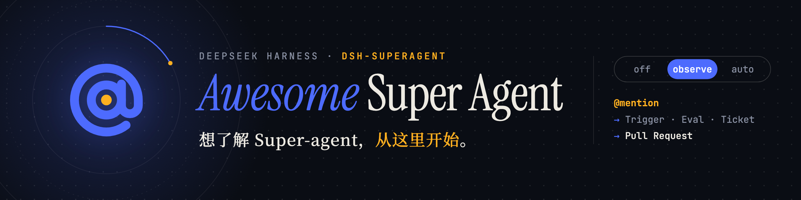

# Awesome Super Agent 

> DeepSeek Harness Super-agent (`dsh-superagent`) 精选资源导航。官方原型仍处于研究阶段，并非 DeepSeek 正式产品。
>
> *English:* Curated resources for the `dsh-superagent` research prototype. Not an official DeepSeek product. Notes are in Chinese.

`dsh-superagent` 是一个基于 DeepSeek Harness 的常驻工程代理原型：监听 GitHub 仓库或飞书消息，按权限名单与接受模式（`off` / `observe` / `auto`）评估并派发独立 Worker 执行任务，最终通过 PR 或回复交付结果。需要注意，设计长文中的部分概念（如独立 Watchdog 会话、云端守护进程、自带模型等）在官方原型仓库中尚未实现；修改已发出的 Issue 正文补加 `@` 不会触发，需另发一条评论。

📘 官方 · 🟢 原型里有 · ⚪ 只在设计文章里 · 📝 社区解读 · 🛠️ 自己动手装 · 🔌 周边插件（核对日期：2026-11-05）

## Contents

- [官方](#官方)
- [设计](#设计)
- [文档](#文档)
- [部署](#部署)
- [解读](#解读)
- [衍生](#衍生)
  - [多项目与控制台](#多项目与控制台)
  - [Windows 适配](#windows-适配)
  - [容器与部署](#容器与部署)
  - [IM 与外部来源插件](#im-与外部来源插件)
  - [功能增强分支](#功能增强分支)
  - [独立重实现](#独立重实现)
- [生态](#生态)
- [讨论](#讨论)

## 官方

### 原型

- [deepseek-ai/dsh-superagent-prototype](https://github.com/deepseek-ai/dsh-superagent-prototype) - 🟢 官方研究原型仓库，MIT 协议（下文提到的 `6337fc8` 与 `8c32a9d` 均为各社区分支切出时的上游基线）.
- [它是什么](https://github.com/deepseek-ai/dsh-superagent-prototype/blob/main/README.md) - 📘 官方 README：界定原型定位与边界.
- [LICENSE](https://github.com/deepseek-ai/dsh-superagent-prototype/blob/main/LICENSE) - 📘 MIT，Copyright (c) 2026 DeepSeek Harness Team.

### Harness

原型运行在 DeepSeek Harness 之上，产品页本身不介绍 Super-agent。

- [DeepSeek Harness](https://www.deepseek.com/en/harness/) - 📘 产品页，基于 Cordis 的「万物皆插件」架构.
- [deepseek-ai/deepseek-harness](https://github.com/deepseek-ai/deepseek-harness) - 📘 Harness 本体（MIT），外部贡献走 Discussions 和带 `dsh-plugin` topic 的插件，不接受外部 PR（见 [CONTRIBUTING.md](https://github.com/deepseek-ai/deepseek-harness/blob/master/CONTRIBUTING.md) / [中文](https://github.com/deepseek-ai/deepseek-harness/blob/master/CONTRIBUTING.zh.md)）.
- [Harness 文档](https://deepseek-harness.github.io/deepseek-harness/) - 📘 官方文档站，含 [Quickstart](https://deepseek-harness.github.io/deepseek-harness/en/guide/quickstart) 与 [插件市场](https://deepseek-harness.github.io/deepseek-harness/en/guide/plugin-market).
- [`@deepseek-ai/dsh`](https://www.npmjs.com/package/@deepseek-ai/dsh) - 📘 官方 CLI，安装版本以部署文档和仓库 `package.json` 为准.

## 设计

设计文章与仓库于 2026-10-31 同步公开。仓库 README 使用了英文标题 *Exploring Super-agent Design: Towards a More Autonomous Agent System*，暂无官方英文链接。

- [Super-agent 设计探索：迈向更自主的 Agent 系统](https://mp.weixin.qq.com/s/zoS7GlReWPhfCjENGxXCdg) - ⚪ 中文原文（署名 Yujia Qiao，DeepSeek Harness team），阐述 Router 分派与 Worker 编码分离的架构设计，文末声明原型仅实现了其中一条路径.
- [知乎转载副本](https://blog.eimoon.com/p/deepseek-super-agent-design/) - 📝 微信无法访问时的全文副本，保留了原声明.
- [英文机器翻译](https://threadnavigator.com/thread/2116857257245987236/) - 📝 第三方对 [@DeepSeekHarness 帖文](https://x.com/DeepSeekHarness/status/2116857257245987236) 的机器翻译，非官方英译.

> **设计 vs 实现差异**：文章中提到的「独立 Watchdog 巡检、云端+本机守护进程、BYOM、执行中途暂停」在官方原型代码中尚未落地；原型实现的是分派与编码双角色及单工单闭环（命令满 5 秒转后台），文中的耗时数据基于计时器模拟，不代表真实仓库效率。

## 文档

建议按编号从上往下阅读，后续文档依赖前置概念。

- [何时行动、何时开口](https://github.com/deepseek-ai/dsh-superagent-prototype/blob/main/docs/000-philosophy.md) - 📘 设计理念与交互克制原则.
- [名词表](https://github.com/deepseek-ai/dsh-superagent-prototype/blob/main/docs/001-domain.md) - 📘 核心领域概念中英对照.
- [谁能派活](https://github.com/deepseek-ai/dsh-superagent-prototype/blob/main/docs/002-authorization.md) - 📘 准入矩阵与 `off` / `observe` / `auto` 授权模型（点名请求默认仍会执行）.
- [一件事怎么做完](https://github.com/deepseek-ai/dsh-superagent-prototype/blob/main/docs/003-execution.md) - 📘 Ticket 与 Assignment 的单工单隔离执行闭环.
- [侧栏](https://github.com/deepseek-ai/dsh-superagent-prototype/blob/main/docs/005-panel.md) - 📘 管理面板、干预时机与事件追踪.
- [代码在哪](https://github.com/deepseek-ai/dsh-superagent-prototype/blob/main/docs/007-architecture.md) - 📘 领域概念与源文件映射.
- [怎么加一种来源](https://github.com/deepseek-ai/dsh-superagent-prototype/blob/main/docs/008-cookbook.md) - 📘 扩展自定义消息来源的开发指南.

### 提示词

位于 [`prompts/`](https://github.com/deepseek-ai/dsh-superagent-prototype/tree/main/prompts)，团队通常按需定制以下三份：

- [提示词怎么拼](https://github.com/deepseek-ai/dsh-superagent-prototype/blob/main/docs/004-prompts.md) - 📘 提示词组装机制说明.
- [`team/communication.md`](https://github.com/deepseek-ai/dsh-superagent-prototype/blob/main/prompts/team/communication.md) - 🟢 沟通与开口规范.
- [`team/scope.md`](https://github.com/deepseek-ai/dsh-superagent-prototype/blob/main/prompts/team/scope.md) - 🟢 PR 可评审标准与草稿边界.
- [`team/delivery.md`](https://github.com/deepseek-ai/dsh-superagent-prototype/blob/main/prompts/team/delivery.md) - 🟢 提交署名与自动合并策略.

### 技能

- [`dsh-superagent-github`](https://github.com/deepseek-ai/dsh-superagent-prototype/blob/main/skills/dsh-superagent-github/SKILL.md) - 🟢 使用 `gh` 读取 Issue、PR、评审与 CI.
- [`dsh-superagent-feishu`](https://github.com/deepseek-ai/dsh-superagent-prototype/blob/main/skills/dsh-superagent-feishu/SKILL.md) - 🟢 以机器人身份读写飞书消息与文档.

## 部署

官方原型仅支持 macOS 与 Linux（Windows 请见「[Windows 适配](#windows-适配)」）。需准备专用 GitHub 账号（不能用 GitHub App，因收件箱依赖个人通知），首次启动退出码为 `3` 表示等待配置。

- [怎么安装](https://github.com/deepseek-ai/dsh-superagent-prototype/blob/main/docs/006-deployment.md) - 📘 账号准备、安装、启停与四档退出码排错指南.
- [交给编程助手的安装步骤](https://github.com/deepseek-ai/dsh-superagent-prototype/blob/main/SETUP.md) - 🛠️ 引导 AI 助手自动检查环境并生成配置.
- [`examples/profile.cordis.patch.yml`](https://github.com/deepseek-ai/dsh-superagent-prototype/blob/main/examples/profile.cordis.patch.yml) - 🛠️ 独立的 `superagent` profile 示例（面板默认 `127.0.0.1:3082`，勿装入日常 `web` profile）.
- [larksuite/cli](https://github.com/larksuite/cli) - 🛠️ 飞书可选 CLI 工具，详见 [飞书 CLI 文档](https://open.feishu.cn/document/mcp_open_tools/feishu-cli-let-ai-actually-do-your-work-in-feishu).

## 解读

### 文章与源码分析

- [dsh-superagent 深挖报告](https://www.bytenote.net/article/dsh-superagent-deep-dive-report) - 📝 梳理实验条件、默认 `observe` 语义，指出其隔离为「Session + 目录」而非系统沙箱.
- [本机管理接口与批次授权](https://www.ctfiot.com/314686.html) - 📝 针对 `6337fc8` 管理接口鉴权与批次授权机制的社区安全审计.
- [合成实验反算：云端那半还只在文章里](https://halfatoken.com/insights/deepseek-super-agent/) - 📝 对设计长文实验数据的独立反算，并确认源码树中不含 Watchdog、边缘守护进程与 BYOM.
- [Ticket、Mandate、Executor](https://www.harelasaf.com/articles/deepseek-dsh-superagent-prototype-ticket-mandate-executor-design) - 📝 基于设计文档的架构解析，重点说明订阅跟进权限边界与 Worker 消息持有机制.
- [MarkTechPost 报道](https://www.marktechpost.com/2026/11/01/deepseek-dsh-superagent-router-worker-coding-agent/) - 📝 英文技术报道，正确标注了模拟工具延时，阅读时需区分已实现与设计构想.
- [Super-agent 设计课](https://github.com/aicoder2048/learn-deepseek-super-agent) - 📝 9 课中文互动教程（MIT），逐篇拆解官方原型文档与核心机制，并附文章与代码实现对照表.
- [Way2SA](https://github.com/NavigatorXia/way2sa) - 📝 8 课静态网页教程（Apache-2.0），含模块图、状态机与事件日志，本地打开 `index.html` 即可阅读.
- [Superagent Explained](https://github.com/Algovate/superagent-explained) - 📝 面向设计长文 §2–§6 的 Node 24 离线可运行导读，含 11 个样例与端到端 trace（注意其规则过滤逻辑与官方原型不同）.

### 短文与笔记

- [Piotr Sobolewski（中文）](https://sobolewski.pro/zh/blog/deepseek-superagent) / [English](https://sobolewski.pro/en/blog/deepseek-superagent) - 📝 简明解析 `off` / `observe` / `auto` 及为何 `danger-full-access` 需要专用系统账号.
- [DeepSeek Super Agent: Complete Guide](https://super-agent.io/deepseek-super-agent/) - 📝 独立英文指南，解释为何 GitHub App 不能替代智能体账号及 `observe` 模式边界.
- [From a GitHub Request to a Reviewable PR](https://pragmaticai.substack.com/p/deepseek-superagent-from-a-github) - 📝 两分钟入门流程演示，配套 [YouTube 视频](https://www.youtube.com/watch?v=7vYILOY6_nE).
- [掘金：源码拆解 + 本地部署](https://juejin.cn/post/7702737817416105999) - 📝 部署流程参考，接入了第三方网关（`@` 写法与细节以官方文档为准）.
- [DSH Superagent 中文源码剖析](https://github.com/yang0228/dsh-superagent-analysis) - 📝 将 Engine、Intake、Policy 与 Executor 精确定位到 `6337fc8` 的源码行号.
- [OpenFree 条目](https://openfree.tools/zh/dsh-superagent) - 📝 官方 README 精简概览.
- [部署笔记（中文）](https://blog.laozhang.ai/zh/posts/deepseek-super-agent-github) / [English](https://blog.laozhang.ai/en/posts/deepseek-super-agent-github) - 📝 第三方部署记录（退出码以官方部署文档为准）.
- [在 GitHub 评论里派活（葡萄牙语）](https://bralvim.github.io/superagente-github/) - 📝 面向 `@deepseek-ai/dsh@0.2.1-rc.3` 的简明安装与点名评论派活笔记.
- [一台 Windows 电脑上的长期在线笔记](https://github.com/hq000204/dsh-living-home) - 📝 作者在 Windows 桌面端连续运行 11 天的个人实操与记忆管理记录（同步发于 Harness [#12056](https://github.com/deepseek-ai/deepseek-harness/discussions/12056) / [#12061](https://github.com/deepseek-ai/deepseek-harness/discussions/12061)）.
- [当 Agent 指挥 Agent](https://starrysea1412.github.io/agent-orchestrator/) - 📝 中文可视化图解（[源码仓库](https://github.com/StarrySea1412/agent-orchestrator)），涵盖准入表、阶段流转与提示词层级.
- [dsh-superagent 源码解剖](https://github.com/HY-love-sleep/dsh-superagent-anatomy) - 📝 锁定 `6337fc8` 的非官方源码解析（CC-BY-4.0 / MIT），附 [交互流程图](https://hy-love-sleep.github.io/dsh-superagent-anatomy/superagent-flow/watch.html).

### 目录

DSH 插件索引站，非 Super-agent 本身的安装方式。

- [dsh.plus](https://dsh.plus/en/) - 📝 策展型 DSH 插件目录，收录了本原型简介.
- [awesome-dsh-plugin](https://github.com/awesome-dsh-plugin/awesome-dsh-plugin) - 📝 社区精选 DSH 插件清单（CC0），见 [官网](https://awesome-dsh-plugin.com/) 与 [Harness #215](https://github.com/deepseek-ai/deepseek-harness/discussions/215).
- [billLiao/awesome-dsh-plugin](https://github.com/billLiao/awesome-dsh-plugin) - 📝 按 `dsh-plugin` topic 自动抓取的大清单（[浏览站](https://billliao.github.io/awesome-dsh-plugin/)），找核心推荐优先看上面那份.

## 衍生

以下均为社区或第三方项目，非 `deepseek-ai` 官方代码。

### 多项目与控制台

- [pprp/multi-superagent](https://github.com/pprp/multi-superagent) - 🔌 单 DSH 进程多项目 bundle（MIT），按项目隔离 Runtime、状态库、GitHub/飞书与路径分发垫片，默认运行在 `127.0.0.1:3084`.
- [Aily-DSH/dsh-superagent-manager](https://github.com/Aily-DSH/dsh-superagent-manager) - 🔌 Windows 多实例管理插件（MIT），为每个项目独立拉起 `dsh web`、端口与 `stateDir`，并通过 `<id>.localhost` 聚合面板.
- [Shuai-S/dsh-superagent-console](https://github.com/Shuai-S/dsh-superagent-console) - 🔌 桌面端控制台插件（MIT），挂载在 `desktop` profile，通过同源代理与内置安装向导管理独立的 `superagent` 引擎.
- [Me106y/dsh-superagent-launcher](https://github.com/Me106y/dsh-superagent-launcher) - 🔌 Rust + egui 桌面启动器，支持 Linux/macOS，可扫描并启停带 `dsh-superagent` 的 profile 及绑定仓库（暂未提供开源授权）.
- [MingoYung/dsh-superagent-power](https://github.com/MingoYung/dsh-superagent-power) - 🔌 DSH 输入栏全局开关插件（MIT），用于在桌面端直接启停已配置好的独立 `superagent` profile（已在 Windows 验收）.
- [superchao5717/dsh-local-superagent](https://github.com/superchao5717/dsh-local-superagent) - 🔌 本机多主管任务看板插件（MIT），支持工作区附件上传、超时自主续办与多 Worker 并发（已从 `ling5717/dsh-local-superagent` 改名）.
- [NattoCB/dsh-plugin-superagent](https://github.com/NattoCB/dsh-plugin-superagent) - 🔌 DSH 本地项目控制台（MIT），运行在 `3081` 端口，需手动点名项目并人工验收（工单模型与官方原型不同，勿混装）.
- [kulebbb/dsh-superagent](https://github.com/kulebbb/dsh-superagent) - 🔌 个人桌面插件雏形，已完成领域核心与个人 Policy 测试，侧边栏接入尚在开发中.
- [aicodeking/dsh-superagent-gui](https://github.com/aicodeking/dsh-superagent-gui) - 🔌 面向本地任意文件夹的轻量网页前端（MIT，macOS/Linux），保留 `observe` 语义，支持在独立 worktree 执行后手动 Merge/Apply.
- [shishuai2016/multiple-superagents](https://github.com/shishuai2016/multiple-superagents) - 🔌 适用于 Claude Code/Cursor 的多实例运维技能包与零依赖本机聚合看板（`127.0.0.1:3099`，MIT）.
- [szmdshagent/dsh-superagent-plugins](https://github.com/szmdshagent/dsh-superagent-plugins) - 🔌 非官方双 bundle 插件索引（MIT），提供 [index.json](https://szmdshagent.github.io/dsh-superagent-plugins/index.json) 与侧边栏派活面板（含自定义工具守卫）.
- [Lencen/dsh-agent-lines](https://github.com/Lencen/dsh-agent-lines) - 🔌 基于持久 DSH Session 与 SQLite 的多成员线路插件（Apache-2.0），作为 superagent 的轻量平替思路.
- [drscrewdriver/dsh-superagent-governance](https://github.com/drscrewdriver/dsh-superagent-governance) - 🔌 基于内存账本与定时巡检的 DSH 预设插件（MIT），含「鱼总管/鱼阁老」调度实验.
- [lzskyline/dsh-superagent-mode](https://github.com/lzskyline/dsh-superagent-mode) - 🔌 轻量 DSH bundle（MIT），向现有 profile 注入 `superagent` 与 `superagent-worker` 两个预设，无后台进程与外部来源.
- [Laixiaomin001/dshm-local-superagent](https://github.com/Laixiaomin001/dshm-local-superagent) - 🔌 本机 DSH 三件套插件（MIT），通过文件队列 `inbox/`、SQLite FTS5 记忆与进程组管理实现本地子会话委托.

### Windows 适配

- [buyou-claw/dsh-superagent-win](https://github.com/buyou-claw/dsh-superagent-win) - 🔌 Windows 移植分支，将 `PATH` 与 Git 配置收敛到单条命令并通过 PowerShell 执行 prepare.
- [xyzOvO/dsh-superagent-prototype](https://github.com/xyzOvO/dsh-superagent-prototype) - 🔌 `fix/windows-support` 分支，修复盘符路径、`pwsh` 白名单与 `gh.cmd` 垫片，已在 Windows 11 + Node 24 跑通 Issue 到 PR.
- [alnyx-dev/dsh-superagent-windows](https://github.com/alnyx-dev/dsh-superagent-windows) - 🔌 无 WSL/tmux 依赖的 Windows 移植版（MIT），使用原生 PowerShell 5.1 与进程内 SIGINT 钩子管理服务.
- [JACKWang19559/dsh-superagent-windows](https://github.com/JACKWang19559/dsh-superagent-windows) - 🔌 Windows 社区分支（MIT），支持在对话中按需启动单仓单分支编排，并在工作区提供只读项目总览页.
- [YansongG-HKU/dsh-superagent-windows](https://github.com/YansongG-HKU/dsh-superagent-windows) - 🔌 Windows 适配与多仓 cluster 管理分支（MIT），通过 `GH_CONFIG_DIR` 与 `windowsHide` 避免弹窗与垫片冲突.
- [ColinStayInLife/dsh-superagent-windows](https://github.com/ColinStayInLife/dsh-superagent-windows) - 🔌 Windows 工人环境适配分支（MIT），修复跨盘符相对路径问题与 `.cmd` 垫片参数传递.
- [vHao11/dsh-superagent](https://github.com/vHao11/dsh-superagent) - 🔌 `windows-adapt` 分支（MIT），改用 Node 版服务管理并新增定时 `schedule` 来源与任务分类拒绝门控.
- [lxhcxyjpl-dotcom/dsh-superagent-windows](https://github.com/lxhcxyjpl-dotcom/dsh-superagent-windows) - 🔌 独立 Windows 适配包（MIT），使用 Python 管理启停（含 exFAT 锁精度适配）并提供本地 `--approve` 人工批准脚本.

### 容器与部署

- [leokyler/dsh-superagent-docker](https://github.com/leokyler/dsh-superagent-docker) - 🔌 非官方 Docker 镜像与 Compose 包装（MIT），基于 `node:24-bookworm`，内置 `MainThread` 补丁、socat 代理与自愈巡检.
- [ForkbombEu/superagent](https://github.com/ForkbombEu/superagent) - 🔌 Coolify Compose 部署包，用 Caddy `forward_auth` 与 HttpOnly Cookie 保护面板，并支持接入 Claude Code 只读复核 PR.
- [two-workspaces/dsh-superagent](https://github.com/two-workspaces/dsh-superagent) - 🔌 Railway 一键部署模板，使用 Caddy HTTP Basic Auth 代理 `127.0.0.1:3082` 管理接口.
- [zhangzihaoDT/dsh-superagent-mashang-service](https://github.com/zhangzihaoDT/dsh-superagent-mashang-service) - 🔌 macOS LaunchAgent 与菜单栏控制器分支（MIT），支持 APFS clone 只读数据挂载与受控业务作业.

### IM 与外部来源插件

- [Shuai-S/dsh-superagent-sources](https://github.com/Shuai-S/dsh-superagent-sources) - 🔌 聚合清单包（MIT），一条配置为 `superagent` profile 批量挂载钉钉、邮件、QQ、微信与企业微信五个 Source 插件.
- [Shuai-S/dsh-superagent-wechat](https://github.com/Shuai-S/dsh-superagent-wechat) - 🔌 微信个人号 Source 插件（MIT），基于 iLink 长轮询与 AES 附件解密，支持 20 小时回复窗口与分段发送.
- [Shuai-S/dsh-superagent-wecom](https://github.com/Shuai-S/dsh-superagent-wecom) - 🔌 企业微信 Source 插件（MIT），同时支持自建应用 XML 回调与智能机器人 JSON 群 `@` 触发.
- [Shuai-S/dsh-superagent-dingtalk](https://github.com/Shuai-S/dsh-superagent-dingtalk) - 🔌 钉钉 Stream 长连接 Source 插件（MIT），自动识别群 `@` 与单聊，无需公网回调地址.
- [Shuai-S/dsh-superagent-qq](https://github.com/Shuai-S/dsh-superagent-qq) - 🔌 QQ 官方机器人 WebSocket Source 插件（MIT），支持群 `@` 与单聊 Trigger 及附件哈希校验.
- [Shuai-S/dsh-superagent-mail](https://github.com/Shuai-S/dsh-superagent-mail) - 🔌 邮箱 IMAP/SMTP Source 插件（MIT），按主题哈希聚合线程并保留 `In-Reply-To` 回复链路.
- [Shuai-S/dsh-superagent-relay](https://github.com/Shuai-S/dsh-superagent-relay) - 🔌 基于本地 `queue.jsonl` 的队列 Source 插件与 `relay-cli` 工具（MIT）.
- [miyako-sa/dsh-superagent-telegram](https://github.com/miyako-sa/dsh-superagent-telegram) - 🔌 Telegram Bot 长轮询 Source 插件（MIT），支持媒体下载与出站附件发送.
- [HulnotHutu/dsh-superagent-qq](https://github.com/HulnotHutu/dsh-superagent-qq) - 🔌 基于 OneBot v11 的 QQ 群来源扩展（含 `napq` 本地工具，需注意第三方客户端协议风险）.
- [Linjiangxian0203/dsh-IM-superbridge](https://github.com/Linjiangxian0203/dsh-IM-superbridge) - 🔌 对接 NapCat 反向 WebSocket 的通用 QQ IM 桥接 bundle（MIT）.
- [Anslen/dsh-personal-agent](https://github.com/Anslen/dsh-personal-agent) - 🔌 多 QQ Bot 人设与表情包检索扩展插件（GPL-3.0-or-later），支持群历史回溯与共享表情库.
- [JHOpenDev/dsh-superagent-inbox](https://github.com/JHOpenDev/dsh-superagent-inbox) - 🔌 基于本地目录的文件收件箱 Source，无需外部平台账号即可触发任务.
- [wiva-hq/superagent-imessage](https://github.com/wiva-hq/superagent-imessage) - 🔌 实验性 iMessage Source（macOS 走 Messages，Linux 走 Photon Spectrum）.
- [billbill2012/dsh-superagent-redmine](https://github.com/billbill2012/dsh-superagent-redmine) - 🔌 Redmine Issue 轮询与评论回写 Source 插件（MIT），兼容 Redmine 2.3–6.1.

### 功能增强分支

- [saltapp/dsh-superagent-prototype-cn](https://github.com/saltapp/dsh-superagent-prototype-cn) - 📝 官方原型的社区中文文档翻译.
- [MYCF711/dsh-session-superagent](https://github.com/MYCF711/dsh-session-superagent) - 🔌 会话级 GitHub/Gitee 仓库守望插件，支持基于水位增量拉取、自动打 ack 标签与密钥脱敏.
- [mycguo/tebra-superagent](https://github.com/mycguo/tebra-superagent) - 🔌 面向多仓库评估的分支，支持面板 Google 登录、PostgreSQL 存储与只读 Jira MCP/REST 接入.
- [waixv-superagent/dsh-superagent-prototype](https://github.com/waixv-superagent/dsh-superagent-prototype) - 🔌 深度魔改分支，新增 Perforce/Swarm 交付与流水线监听、TAPD 接入、虚幻编辑器租约调度及飞书多选项交互卡片.
- [huangyj-dev/dsh-superagent-prototype](https://github.com/huangyj-dev/dsh-superagent-prototype) - 🔌 支持 GitLab（含通配符多项目展开）与 GitHub 双开及自定义 `botUsername` 的社区分支（MIT）.
- [ChrisCindy/dsh-superagent-prototype](https://github.com/ChrisCindy/dsh-superagent-prototype) - 🔌 增强型分支（MIT），支持多仓多实例、可写目录白名单、工单暂扣（hold）、步数/时间预算及 Mandate 路径/动作约束.
- [AIR-DUSTER1/dsh-superagent-review](https://github.com/AIR-DUSTER1/dsh-superagent-review) - 🔌 新增 `review` 审批模式（MIT），通过配套的 [Gatehouse](https://github.com/AIR-DUSTER1/dsh-gatehouse) 控制台签发排期与 HMAC 授权后才派发执行.
- [PHLens/dsh-superagent-prototype](https://github.com/PHLens/dsh-superagent-prototype) - 🔌 项目工作台与强一致恢复分支（MIT），支持 WAL 检查点、内部任务拆解、材料/技能再授权与子会话审计.
- [samanhappy/dsh-superagent](https://github.com/samanhappy/dsh-superagent) - 🔌 多平台接入分支（MIT），在原型基础上新增 GitLab、PingCode、企业微信与个人微信（iLink）来源及图片评估.
- [yuxfeng275/dsh-superagent-prototype](https://github.com/yuxfeng275/dsh-superagent-prototype) - 🔌 高可用与分布式执行分支（MIT），引入单调时钟租约围栏、Outbox 效果账本、企业微信/钉钉及只读移动状态页 `/status`.
- [rusherman/dsh-superagent-prototype](https://github.com/rusherman/dsh-superagent-prototype) - 🔌 多本地 Git 仓库支持分支（MIT），允许不绑定 GitHub，直接跨多个本地仓库创建工单分支并提交.
- [SilasSolivagus/dsh-superagent](https://github.com/SilasSolivagus/dsh-superagent) - 🔌 多角色分工（`assignees:v1`）与工作区定时清理分支（MIT），支持按任务类型分配不同 Worker 预设与并发上限.
- [siyu1231/dsh-superagent-prototype](https://github.com/siyu1231/dsh-superagent-prototype) - 🔌 将工单目录与 DSH 原生 Workspace 深度集成的分支（MIT），支持在对话侧栏直接追踪工单与查看 Worker 日志.
- [wangqiongkaka/dsh-superagent](https://github.com/wangqiongkaka/dsh-superagent) - 🔌 支持将外部执行器切换为 Codex/Claude Code 的分支（MIT），内置多仓 `git-watch` 并放宽只读分析类主动接单条件.
- [wuzhiping/superagent](https://github.com/wuzhiping/superagent) - 🔌 接入 Kaneo 看板、自建 Gitea 与 ntfy 主题的社区分支（MIT）.
- [crazykeybd/nuclear-dev-kit](https://github.com/crazykeybd/nuclear-dev-kit) - 🔌 面向核能数值软件的七阶段门禁定制包 `nuclear-dev-agent`（MIT），对接本机 `nuclearctl.py` 校验流程.
- [yinhaox/dsh-game-studio](https://github.com/yinhaox/dsh-game-studio) - 🔌 Godot 4 游戏开发工作室包（MIT），内置主动检查来源与写入守卫，作者已用其产出一款 3D 推箱子游戏 [sokoban-3d](https://github.com/yinhaox/sokoban-3d)（[v0.1.0](https://github.com/yinhaox/sokoban-3d/releases/tag/v0.1.0)，另有文章提及的私有项目 [coil-3d](https://github.com/yinhaox/coil-3d/releases/tag/v0.1.0) 与 [bastion-3d](https://github.com/yinhaox/bastion-3d/releases/tag/v0.1.0)）.
- [jiaoqsh/dsh-superagent-prototype](https://github.com/jiaoqsh/dsh-superagent-prototype) - 🔌 附带 `bench/replay` 回放台与故障注入评估框架的分支（MIT），用于量化分析超时、中断与错误叫停问题.
- [OCCAgent/dsh-superagent-prototype](https://github.com/OCCAgent/dsh-superagent-prototype) - 🔌 社区学习与实验分支（MIT），附带 GitHub Pages 学习站及双飞书群语义 attach 实验记录.
- [feel-think/dsh-superagent-prototype](https://github.com/feel-think/dsh-superagent-prototype) - 🔌 新增 `spool` 本地 JSON 收件目录、`mcpToolAllowlist` 与定时 `dsh-superagent-goal` 插件的分支（MIT）.
- [wydddddcool/dsh-personal-agent](https://github.com/wydddddcool/dsh-personal-agent) - 🔌 面向个人本地使用的分支（MIT），支持主会话直接派单、24 小时未答问题自动搁置与低阈值自动压缩.
- [hhaa12321/dsh-superagent-prototype](https://github.com/hhaa12321/dsh-superagent-prototype) - 🔌 引入软/硬步数预算（Epoch 快照）控制 Worker 工具调用上限的分支（MIT）.
- [cheng200606/dsh-superagent](https://github.com/cheng200606/dsh-superagent) - 🔌 含本地目录来源、Webhook、手动建单及迁移前 `VACUUM INTO` 自动备份的分支（MIT）.
- [mengzhongjie/dsh-superagent-local](https://github.com/mengzhongjie/dsh-superagent-local) - 🔌 面向本地操作者的重构分支（MIT），精简面板为概览/评估/执行/设置四栏，支持主会话附件直接派单.
- [DylanMing/dsh-superagent-prototype](https://github.com/DylanMing/dsh-superagent-prototype) - 🔌 重构 Source 注册机制并加入本地面板、Gitea/GitLab Webhook 及全套中文文档的分支（MIT）.
- [DylanXQH/dsh-superagent-prototype](https://github.com/DylanXQH/dsh-superagent-prototype) - 🔌 支持 `code-change` / `file-change` / `analysis` 三种任务模式、163 邮箱来源与定时日报的分支（MIT，部分依赖包未公开）.
- [66ai-biz/66AI-Bot](https://github.com/66ai-biz/66AI-Bot) - 🔌 将原型作为 bundle 集成进桌面应用的项目（Apache-2.0 / MIT），通过 `inbox.jsonl` 中继多平台 IM 消息.
- [aniveny163/dsh-superagent-prototype](https://github.com/aniveny163/dsh-superagent-prototype) - 🔌 在控制脚本中新增只读 `tickets` 状态检查与 `MainThread` 进程识别的分支（MIT）.
- [jwangkun/dsh-superagent](https://github.com/jwangkun/dsh-superagent) - 🔌 优化同账号自 `@` 触发逻辑与 `setup` 环境变量隔离的社区分支（MIT）.
- [shibaeff/dsh-superagent-prototype](https://github.com/shibaeff/dsh-superagent-prototype) - 🔌 集成脚本化 Codex 登录（`@jcy2387/dsh-codex-provider`）的 MIT 分支.
- [hi-unc1e/dsh-superagent-prototype](https://github.com/hi-unc1e/dsh-superagent-prototype) - 🔌 新增默认关闭的 `parallel-chat` 本机并行聊天来源分支.
- [chasey-myagi/dsh-superagent](https://github.com/chasey-myagi/dsh-superagent) - 🔌 带 `gh-local` 本地仿真桩、主仓只读锁与派工前记忆召回门控（`recall_facts`）的分支（MIT）.
- [nichar3232/dsh-superagent](https://github.com/nichar3232/dsh-superagent) - 🔌 通过外部 CLI `tgq` 接入 Telegram 与本地私聊的分支（MIT），强制私聊通过 `answer` 路由.
- [lunarmoon26/dsh-superagent-prototype](https://github.com/lunarmoon26/dsh-superagent-prototype) - 🔌 区分「报告完成」与「独立验证」，并支持导出脱敏内容寻址观察快照的分支（MIT）.
- [z-zijie/dsh-superagent-prototype](https://github.com/z-zijie/dsh-superagent-prototype) - 🔌 新增 GitCode 来源（`gc` CLI）与服务脚本免代理检测的分支（MIT）.
- [reboot87/dsh-superagent-ones](https://github.com/reboot87/dsh-superagent-ones) - 🔌 新增 ONES 项目管理来源骨架的社区分支（MIT）.
- [comeonzhj/SuperAgent-General](https://github.com/comeonzhj/SuperAgent-General) - 🔌 基于官方 SDK 长连接飞书并增加正负关键词预过滤的通用 DSH 插件（MIT）.
- [miyako-sa/dsh-superagent](https://github.com/miyako-sa/dsh-superagent) - 🔌 支持 Worker 通过 `orchestrator_send_file` 随结果回传多附件的非官方维护分支.
- [chunonesoft/open-superagent](https://github.com/chunonesoft/open-superagent) - 🔌 集成自建 GitLab（`glab`）与钉钉 Stream 机器人（含部门同步允许名单）的分支（MIT）.

### 独立重实现

不依赖 DeepSeek Harness 运行时，基于其他 Agent 框架或编程语言重写的实现。

- [vicfei/dsh-super-agent](https://github.com/vicfei/dsh-super-agent) - 🔌 面向 Claude Code / Codex / opencode 的独立重实现（`@vicfei/dsh-super-agent`），支持沙箱隔离、投机执行、IM 审批与飞书/Slack/微信/Telegram 接入.
- [LofiSu/deepseek-super-agent](https://github.com/LofiSu/deepseek-super-agent) - 🔌 自带轻量 Harness 与 `ds-agent` 的独立实现，包含 Router / Worker、Trigger 与 Watchdog.
- [cjy851096/nano-dsh-superagent](https://github.com/cjy851096/nano-dsh-superagent) - 🔌 约 3400 行的独立教学骨架，演示设计长文中提到的 Watchdog、异步启停与 Inline & Spill.
- [Yao-MY06/more-agent](https://github.com/Yao-MY06/more-agent) - 🔌 基于 `claude -p` 的影子运行（Shadow Run）框架（MIT），直接复用原型 `src/core` 领域模型.
- [yingpengma/cc-super-agent](https://github.com/yingpengma/cc-super-agent) - 🔌 按设计长文实现的 Claude Code 版 Router / Worker 与定时 Watchdog.
- [0xdrmnhttn13/dsh-superagent-prototype](https://github.com/0xdrmnhttn13/dsh-superagent-prototype) - 🔌 Superagent Investigator（MIT），复用原型 SQLite 模型并将执行器替换为受限的 Pi 会话.
- [mitkox/copilot-superagent](https://github.com/mitkox/copilot-superagent) - 🔌 基于 GitHub Copilot SDK 的 VS Code 扩展（MIT），支持 Copilot Chat、GitHub 与 Microsoft Teams 收件.
- [lesterppo/dsh-superagent-rs](https://github.com/lesterppo/dsh-superagent-rs) - 🔌 原型核心的 Rust 移植版（MIT），含 `init`/`status`/`work`/`poll` 与 Git worktree 隔离执行.
- [RichardoMrMu/mini-super-agent](https://github.com/RichardoMrMu/mini-super-agent) - 🔌 教学向事件引擎（MIT），通过确定性 mock 演示会话阻塞、直通与 SQLite 崩溃恢复.
- [kohakushigure/dsh-superagent-lab](https://github.com/kohakushigure/dsh-superagent-lab) - 🔌 零依赖 Node 24 实验仓库（MIT），含本地 Router/Worker、两级过滤与自动开草稿 PR 链路.
- [lyra-planet/claude-superagent](https://github.com/lyra-planet/claude-superagent) - 🔌 基于 Claude Agent SDK 的重实现（MIT），使用 `PreToolUse` 与沙箱限制 Worker 写入及自合并.
- [zhangcun1995521/superagent-mini](https://github.com/zhangcun1995521/superagent-mini) - 🔌 对照设计长文的净室 TypeScript 实现，基于 `dsh headless` 与飞书常驻入口.
- [lishuoipad/codex-superagent](https://github.com/lishuoipad/codex-superagent) - 🔌 面向 Codex 的纯 Python 标准库社区技能（MIT），使用 SQLite 维护任务绑定与投递意图.
- [cjcj5438/omp-superagent-prototype](https://github.com/cjcj5438/omp-superagent-prototype) - 🔌 将执行器替换为 `omp --mode rpc` 子进程的重写版本（MIT）.
- [ucsdzehualiu/mini_super_agent](https://github.com/ucsdzehualiu/mini_super_agent) - 🔌 基于 AgentScope 的 Python 复刻版（MIT），自带本机控制台与 Watchdog 提示注入.
- [huajixiaobai/admit](https://github.com/huajixiaobai/admit) - 🔌 纯 Python 标准库实现的独立准入闸模块（MIT），严格限定仅 `auto` 模式下的明确点名通过.
- [uppifyagency/deepseek-super-agent-harness](https://github.com/uppifyagency/deepseek-super-agent-harness) - 🔌 面向 macOS 的 TypeScript 独立实现（MIT），结合 Claude Code Router 与 Atomic Worker.
- [ketchupz1999/super-super-harness](https://github.com/ketchupz1999/super-super-harness) - 🔌 基于 Python 与 Claude Code 的本地多 Worker 编排助手（MIT），支持 GitHub 通知观察模式.
- [Charley188/codex-superagent-harness](https://github.com/Charley188/codex-superagent-harness) - 🔌 对接 Codex CLI 的本机网页工作台（MIT），支持并发控制、单轮切模型与只读项目文件浏览.
- [yuzhiyang1/dsh-superagent-java](https://github.com/yuzhiyang1/dsh-superagent-java) - 🔌 基于 Java 21（无 Spring）的跨平台学习向实现（MIT），兼容 OpenAI Chat Completions 接口.
- [d4vid-le/SignalRoom](https://github.com/d4vid-le/SignalRoom) - 🔌 基于 OpenCode 的 Router / Worker 与 macOS 菜单栏工具（MIT），内置推送前敏感文件与密钥 diff 扫描.
- [AIJIUCHENG/opcsuperagent](https://github.com/AIJIUCHENG/opcsuperagent) - 🔌 零第三方依赖的 Python 实现（MIT），基于 `claude -p` 实现投机执行与进程级 Watchdog 线程.
- [Yiminnn/agent-ops](https://github.com/Yiminnn/agent-ops) - 🔌 面向 Claude Code 的本机插件与 shell 编排套件，集成 Linear 承诺追踪与防漂移检查.
- [hextor-ndc/superagent](https://github.com/hextor-ndc/superagent) - 🔌 基于 [t3code](https://github.com/pingdotgg/t3code) `/mcp` 线程的独立控制面（MIT），支持项目目录表单与失败自动续跑.
- [xepher/dsh_superagent](https://github.com/xepher/dsh_superagent) - 🔌 基于 .NET 10 与企业微信机器人的教学向重实现，含定时代码扫描与 worktree 补丁验证.
- [Arcobalneo/pi-super](https://github.com/Arcobalneo/pi-super) - 🔌 基于 Pi 扩展的多阶段编排包（MIT），内置 scout / planner / worker / reviewer 流水线与检查重跑校验.
- [cs11b137/super-agent-harness](https://github.com/cs11b137/super-agent-harness) - 🔌 面向 Claude Code 的极简练习模板，通过 `cc-ticket` 限制并发并拦截危险 Git 操作.
- [zeokeel/ZeoKeel-Super-Agent](https://github.com/zeokeel/ZeoKeel-Super-Agent) - 🔌 Go 语言单二进制独立实现（MIT），完整复刻 `off` / `observe` / `auto` 准入评估路径.
- [Mei0001/hootl-superagent](https://github.com/Mei0001/hootl-superagent) - 🔌 人在环外（Out-of-the-loop）开发循环（Apache-2.0），支持 Claude/Codex/pi/Devin 适配器与独立只读评估.
- [Arohtea/claude-superagent](https://github.com/Arohtea/claude-superagent) - 🔌 基于 Claude Agent SDK 的 Python 实现（MIT），严格限制 Worker 路径权限与对外回复字数.
- [veragao0101-cmd/butler-skill](https://github.com/veragao0101-cmd/butler-skill) - 🔌 面向 Claude Code 的 `/butler` 管家技能（MIT），通过 PreToolUse hook 约束主会话越界操作.
- [RechargedIdeas/organism](https://github.com/RechargedIdeas/organism) - 🔌 独立 Python 运行时（Apache-2.0），支持基于人工裁决的规则毕业机制、签名 Policy 与 Linux 资源隔离.
- [thanatoscosmic-ai/pi-superagent](https://github.com/thanatoscosmic-ai/pi-superagent) - 🔌 基于 `pi-agent-core` 与 `pi-tui` 的交互式工单 CLI（MIT），内置无工具对话代理处理闲聊与追问.
- [alasong/ssa1101](https://github.com/alasong/ssa1101) - 🔌 轻量编排原型 `dsh-superagent-lite`，通过 `dsh --json` 调度任务会话.
- [leolegends/carbon-superagent](https://github.com/leolegends/carbon-superagent) - 🔌 独立本机面板（MIT），调用 Claude Code 或 Codex 在 worktree 执行，交由面板统一提交与合并.
- [lanshi17/dsh-booth](https://github.com/lanshi17/dsh-booth) - 🔌 终端交互控制台（GPL-3.0-only），内置 `dsh-booth-local` 来源与自动补齐 `gh` 版本能力.
- [Hewlbern/superOpenAgent](https://github.com/Hewlbern/superOpenAgent) - 🔌 独立 TypeScript harness（MIT），实现分片 Router、关键词记忆与运行时密钥打码注入.

## 生态

可与 Super-agent 配合使用的外围插件与工具（部分插件工单模型不同，切勿混装替代）。

### 飞书

- [omdsh-dev/dsh-lark](https://github.com/omdsh-dev/dsh-lark) - 🔌 DSH 的飞书 / Lark IM 通道.
- [PGZXB/dsh-feishu](https://github.com/PGZXB/dsh-feishu) - 🔌 飞书内的 DSH 控制台，支持卡片审批与扫码配置.
- [PlutoKeating/dsh-lark-bot](https://github.com/PlutoKeating/dsh-lark-bot) - 🔌 飞书桥接插件，支持流式卡片与多角色（AGPL-3.0）.

### GitHub 与工作流

- [PerryLink/dsh-github](https://github.com/PerryLink/dsh-github) - 🔌 GitHub CI 与带人工批准的 PR 评审机器人（Apache-2.0）.
- [omdsh-dev/dsh_workflow](https://github.com/omdsh-dev/dsh_workflow) - 🔌 可保存、可恢复的多 Agent 调度工作流.
- [toolclub/dsh-agent-team-gui](https://github.com/toolclub/dsh-agent-team-gui) - 🔌 持久化的多模型工作流协作面板.
- [GZX2211/dsh-Visual-Workflow](https://github.com/GZX2211/dsh-Visual-Workflow) - 🔌 含人工确认节点的可视化编排工具.
- [john-walks-slow/dsh-proactive](https://github.com/john-walks-slow/dsh-proactive) - 🔌 由模型预约的主动跟进插件，用于唤醒冷会话（与 superagent 的 Policy/Ticket 体系独立）.

### 命令行

- [GitHub CLI](https://cli.github.com/) - 🛠️ 官方原型要求 `gh` 2.48+.
- [huanlin-labs/dsh-policy-validator](https://github.com/huanlin-labs/dsh-policy-validator) - 🛠️ 零依赖离线校验器（MIT），可校验 `settings.json` 准入矩阵与 `mandate-v3` 哈希.

## 讨论

- [Node 24 下 status 看不到进程，晚到的 GitHub 提及可能被游标跳过](https://github.com/deepseek-ai/deepseek-harness/discussions/11700) - 📝 讨论 Node 24/26 下 `ps` 线程名变为 `MainThread` / `node-MainThread` 导致误判，以及 [#11805](https://github.com/deepseek-ai/deepseek-harness/discussions/11805) 补充的 `stop` 残留与 [#12145](https://github.com/deepseek-ai/deepseek-harness/discussions/12145) 中文 locale 匹配问题.
- [通知看起来正常，提及却可能进不来](https://github.com/deepseek-ai/deepseek-harness/discussions/11706) - 📝 排查 `LANG=zh_CN.UTF-8` 文案不匹配及本机旧版 `gh` 钥匙串令牌覆盖问题.
- [重试和 prepare 可以活过它们的 Assignment](https://github.com/deepseek-ai/deepseek-harness/discussions/11801) - 📝 针对 `6337fc8` 中提供方重试与 `prepare` 取消时序竞态的源码讨论.
- [Windows 上 Worker 会话没有 shell 和文件工具](https://github.com/deepseek-ai/deepseek-harness/discussions/11905) - 📝 Windows 11 下运行原生原型时的工具缺失与 `stateDir` / `fcntl` / tmux 兼容性报告.
- [通知晚到时，GitHub 来源会把 Issue 正文当成旧的](https://github.com/deepseek-ai/deepseek-harness/discussions/11970) - 📝 轮询游标推进过快导致延迟通知对应的 Issue 被跳过（约 1/3 概率漏单的竞态分析）.

## Contributing

欢迎补充新链接，格式规范与标记用法请见 [CONTRIBUTING.md](CONTRIBUTING.md)。
